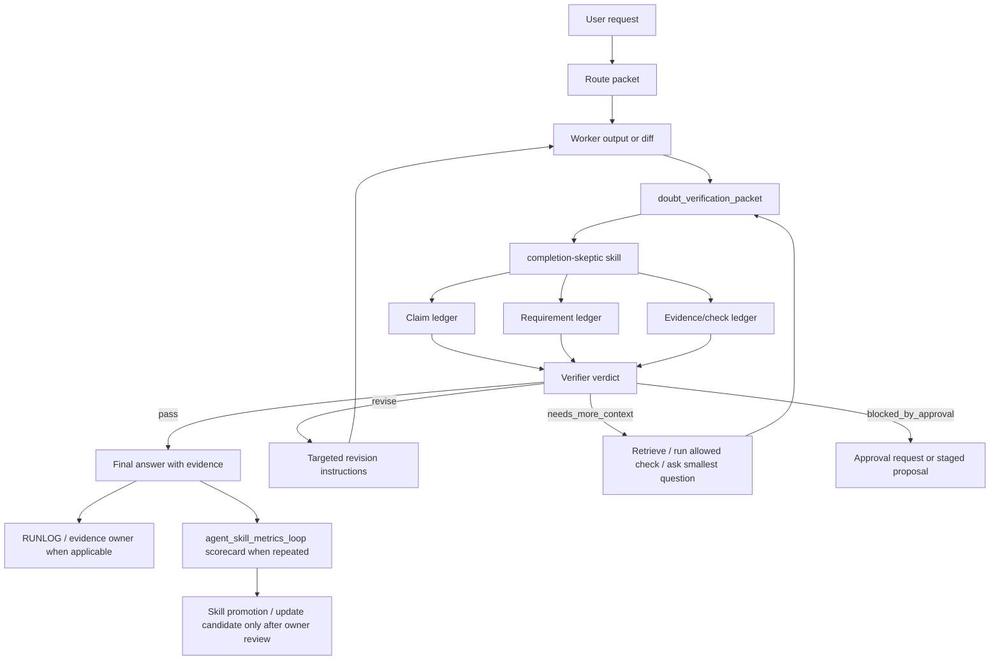

# Doubt / verifier loop batch task matrix

Checked at: 2026-06-09

Source status: `planning artifact, not canonical docs`

This artifact analyzes `output/doubt-technique-comparative-report.md` and converts its recommendations into a staged Product-Agent OS batch plan. It is a proposal only: implementation evidence must later live in code, tests, docs, `RUNLOG.md`, source backlogs and registry entries.

## 1. Executive analysis

The Doubt / verifier loop should become a **verification-first completion gate**, not a generic "rewrite your answer" prompt.

The recommended architecture is:

- CoVe-style claim extraction and verification questions.
- CRITIC-style tool-backed verification for code, docs, current facts and runtime claims.
- Evaluator-optimizer orchestration: worker output -> skeptical evaluator -> targeted revision -> final evidence.
- Reflexion-style learning only after actual failures, recorded as evidence and metrics, not as durable rules.
- Self-Refine only after the verifier finds evidence-backed gaps.

The current Product-Agent OS already has adjacent pieces:

- `evidence_before_completion` behavioral cases.
- `risk-reviewer`, `test-eval-designer`, `project-lifecycle-orchestrator` and `docs-maintainer` lifecycle skills.
- `task_matrix_plan_v1` and validator/completion-report guards.
- `agent_skill_metrics_loop` for staged scorecards and modernization candidates.
- docs/site rules for `Source status:`, source registry, Mermaid diagrams, RU/EN parity and strict MkDocs.

The missing product feature is a named cross-cutting route:

```text
worker_output -> doubt_verification_packet -> completion-skeptic -> revise_or_pass
```

## 2. Product thesis

User problem:

- Users notice agents find 20-30 percent more detail when asked "check again".
- The current UX depends on the user remembering to trigger doubt manually.
- A generic second pass can also degrade good answers, add unsupported claims or polish instead of verify.

Product opportunity:

- Turn the user's manual doubt prompt into a repeatable Product-Agent OS quality gate.
- Make completion claims evidence-bound by default for high-risk work.
- Give users a visible "what was checked, what remains risky" artifact instead of vague confidence.

Product promise:

- "Before claiming done, Product-Agent OS can run a structured skeptical pass that extracts requirements and claims, checks evidence, and only revises evidence-backed gaps."

Non-promise:

- It does not guarantee truth.
- It does not replace tests, source lookup, runtime QA, human review or approvals.
- It does not auto-apply skill/plugin/automation changes.

## 3. Target architecture



## 4. Batch definition

Batch ID: `DVL-BATCH-01`

Batch goal:

- Implement the Doubt / verifier loop as a staged Product-Agent OS capability with packet schema, skill contract, validators, route integration, evals and docs/site updates.

Batch success criteria:

- `doubt_verification_packet` schema exists as a template and validator target.
- `completion-skeptic` skill exists and returns structured pass/revise/needs_more_context/blocked verdicts.
- Runtime routing can recommend the skeptic gate for high-risk/source-sensitive/completion-claim tasks.
- Behavioral/fixture/unit tests cover false-pass, false-rewrite, missing evidence, stale evidence, community claim and approval-bound cases.
- Product docs and generated `site/` describe the feature, architecture diagrams and examples in RU/EN.
- No automation, hook activation, provider/live external model/API call, canonical mutation or git action is performed without separate exact approval.

## 5. Ownership model

| Role | Ownership | Files/surfaces | Stop conditions |
| --- | --- | --- | --- |
| Product Manager | User promise, non-goals, UX copy, acceptance examples | docs/playbooks, docs/product-agent-os overview pages | Product promise implies guaranteed truth or auto-fix |
| Architect | Packet schema, route shape, lifecycle boundaries | design sections, architecture docs, `codex_runtime_runner` contract | Route bypasses evidence or approvals |
| Builder | Validator, skill files, runtime route hooks, templates | `plugins/product-agent-os/` scripts, skills, templates | Overlaps docs/source registry without handoff |
| Tester | Unit, fixture, transcript and regression gates | `tests/`, `assets/eval-fixtures`, `run_fixture_eval.py` | Pass claim without negative tests |
| Reviewer | Risk review, source fidelity, security/approval boundary | `risk-reviewer`, source policy, TEST route | Tool or source evidence is stale/missing |
| Docs Maintainer | RU/EN docs, diagrams, MkDocs nav/site | `docs/`, `mkdocs.yml`, generated `site/` | Docs claims lack registry/source status |
| Release Operator | Go/no-go and no-unapproved-actions proof | `RUNLOG.md`, source backlog, registry, release packet | Git/external action fields missing |

## 6. Summary matrix

| Task ID | Slice | Priority | Status | Task | Technical value | Product value | Primary outputs | Verification route |
| --- | --- | --- | --- | --- | --- | --- | --- | --- |
| `DVL-M01` | S1 architecture | P0 | planned | Convert research report into accepted requirements and non-goals | Prevents implementation from becoming generic self-reflection | Aligns user promise with safe behavior | requirements packet, acceptance list | docs/control-plane review |
| `DVL-M02` | S1 architecture | P0 | planned | Define `doubt_verification_packet` schema | Creates deterministic contract for verifier/reviser/tools | Makes "what was checked" visible | schema/template fields | schema/unit tests |
| `DVL-M03` | S1 architecture | P0 | planned | Define route triggers and exclusion rules | Avoids running expensive loops on trivial tasks | Keeps UX fast unless risk justifies the pass | route policy | route fixture tests |
| `DVL-M04` | S1 architecture | P0 | planned | Define worker, skeptic and reviser prompt contracts | Separates generation, verification and revision | Reduces harmful over-rewrites | prompt/policy pack | transcript eval |
| `DVL-M05` | S2 implementation | P0 | planned | Add packet artifact template | Gives users and agents a reusable evidence artifact | Users get a readable gap ledger | `.codex/artifact-templates/doubt-verification-packet.md` | template tests |
| `DVL-M06` | S2 implementation | P0 | planned | Implement `completion-skeptic` skill | Adds repeatable manual workflow in Codex App/CLI/IDE extension | User can ask "проверь еще раз" with consistent output | skill folder, `SKILL.md`, optional metadata | skill/docs tests |
| `DVL-M07` | S2 implementation | P0 | planned | Add validator and CLI for packet shape | Blocks fake pass and incomplete ledgers | Trustworthy pass/fail language | `validate_doubt_verification_packet.py` | unit tests |
| `DVL-M08` | S2 implementation | P0 | planned | Integrate route recommendation into runtime runner | Makes skeptic gate discoverable by lifecycle routing | Users get proactive quality gate suggestions | runner route fields | runtime contract tests |
| `DVL-M09` | S2 implementation | P1 | planned | Integrate with `risk-reviewer`, `test-eval-designer`, `docs-maintainer` | Converts gaps into tests/docs/source tasks | Fewer missed tests and source gaps | skill wording updates | lifecycle skill tests |
| `DVL-M10` | S2 implementation | P1 | planned | Add status/dashboard projection for skeptic verdicts | Shows generated status without making it source truth | User sees "pass/revise/blocked" at a glance | status snapshot/dashboard fields | dashboard tests |
| `DVL-M11` | S3 evals | P0 | planned | Unit-test schema, validator and route policy | Prevents contract drift | Reduces silent quality regressions | tests | focused unittest |
| `DVL-M12` | S3 evals | P0 | planned | Add transcript eval for manual "check again" prompt | Ensures UX trigger routes correctly | User's natural prompt works | transcript fixtures | transcript eval |
| `DVL-M13` | S3 evals | P0 | planned | Add negative evals for false rewrite and false pass | Protects correct answers from degradation | User does not get churn disguised as quality | negative fixtures | fixture/transcript eval |
| `DVL-M14` | S3 evals | P1 | planned | Add source-sensitive docs/research cases | Enforces trust levels and source registry behavior | Users can distinguish facts from intake | docs/research eval cases | docs tests |
| `DVL-M15` | S3 evals | P1 | planned | Add code/tool evidence cases | Ensures code claims require current checks | Users know whether code was actually verified | code/task examples | unit/fixture tests |
| `DVL-M16` | S4 docs/site | P0 | planned | Add `docs/playbooks/doubt-verification-loop.md` and EN pair | Documents the workflow with examples | Users learn how to use it | playbook pages | docs tests, MkDocs |
| `DVL-M17` | S4 docs/site | P0 | planned | Add architecture diagrams to diagram atlas or Product-Agent OS architecture | Shows integration visually | Users understand where the gate lives | Mermaid diagrams | check_docs, strict MkDocs |
| `DVL-M18` | S4 docs/site | P1 | planned | Update prompting/context/anti-hallucination docs | Aligns existing verifier concepts with packet schema | Users get one consistent mental model | docs pages | docs tests |
| `DVL-M19` | S4 docs/site | P1 | planned | Update agent-systems and workflow-to-skill docs | Shows promotion path: manual -> skill -> plugin -> automation candidate | Users can operationalize the method | docs pages | docs tests |
| `DVL-M20` | S4 docs/site | P0 | planned | Update source registry and insights boundaries | Keeps research claims auditable | Users know which claims are supported vs community intake | registry RU/EN, optional insights page | registry/docs tests |
| `DVL-M21` | S4 docs/site | P0 | planned | Rebuild generated `site/` with examples and diagrams | Keeps published docs aligned with source docs | Users can read feature docs in site | `site/` refresh | strict MkDocs, static checks |
| `DVL-M22` | S5 pilot | P0 | planned | Run manual pilot on docs/research/code examples | Measures whether loop improves real outcomes | User value proven before promotion | pilot ledger | attempt/failure/fix/retest |
| `DVL-M23` | S5 metrics | P1 | planned | Add scorecard fields to `agent_skill_metrics_loop` | Tracks false pass, false rewrite, evidence sufficiency | Product can improve based on data | scorecard fields | metrics tests |
| `DVL-M24` | S5 closure | P0 | planned | Produce go/no-go and rollout boundary | Prevents premature automation/release claims | User sees clear next action | closure packet | full verification route |

## 7. Detailed task blocks

### Task `DVL-M01`

- Task: Convert the research report into accepted requirements and non-goals.
- Status: planned
- Schema version: task_matrix_plan_v1
- Timezone: Europe/Moscow
- Plan trigger: user requested batch task matrix for Doubt / verifier loop implementation and docs.
- Validator target: detailed task blocks
- Date and time of task implementation: pending_execution_timestamp
- Depends on: `output/doubt-technique-comparative-report.md`
- Blocks: `DVL-M02`, `DVL-M03`, `DVL-M04`
- Source: research report, `AGENTS.md`, `PLAN.md`, `TEST.md`
- Short description: Stage product/technical requirements for a verification-first doubt gate.
- Technical value: Establishes scope, acceptance, non-goals and approval boundaries before code or docs changes.
- Product value: Converts the user's observed "ask again" benefit into a clear user-facing promise.
- Scope: requirements, non-goals, acceptance criteria, success/failure examples.
- Non-goals: code changes, docs publication, automation, external calls.
- Expected result: a requirements packet suitable for `PLAN.md` or Track backlog migration.
- Acceptance criteria: includes pass/revise/needs_more_context/blocked verdicts, max revision budget, evidence-first rule and no-auto-automation rule.
- Verification gates: review against research report and project source policy.
- Risks / approval gates: source-backed docs require registry update later.
- Complexity: medium
- Estimated execution time: 1-2 hours
- Agents: Product Manager, Architect
- Skills: implementation-planner
- Output artifacts: requirements packet, acceptance examples
- Next step: define packet schema in `DVL-M02`.

#### Completion Report

- status: planned
- what was done: pending
- files touched / work locations: pending
- technical value delivered: pending
- product value delivered: pending
- actual implementation date and time: pending_execution_timestamp
- verification evidence: pending
- residual risks: pending
- follow-up: pending

### Task `DVL-M02`

- Task: Define `doubt_verification_packet` schema.
- Status: planned
- Schema version: task_matrix_plan_v1
- Timezone: Europe/Moscow
- Plan trigger: verifier loop needs structured state across worker, skeptic and reviser.
- Validator target: detailed task blocks
- Date and time of task implementation: pending_execution_timestamp
- Depends on: `DVL-M01`
- Blocks: `DVL-M05`, `DVL-M07`, `DVL-M11`
- Source: report section "Context-engineering schema"
- Short description: Define packet fields for original request, artifact, claim ledger, requirement ledger, evidence ledger, verdict and revision budget.
- Technical value: Gives validators, skills and route runner a stable contract.
- Product value: Makes the result explainable: users see what was covered, missing or unsupported.
- Scope: schema fields, required/optional fields, status enums, compatibility policy.
- Non-goals: storage backend, live tracing, external model judge.
- Expected result: schema spec and example packet.
- Acceptance criteria: supports `supported`, `unsupported`, `contradicted`, `needs_fresh_check`, `assumption`, `accepted_gap`; supports verdicts `pass`, `revise`, `needs_more_context`, `blocked_by_approval`, `accepted_risk`.
- Verification gates: schema review, future unit tests in `DVL-M11`.
- Risks / approval gates: too large a schema can make manual usage heavy.
- Complexity: medium
- Estimated execution time: 2-3 hours
- Agents: Architect, Tester
- Skills: implementation-planner
- Output artifacts: schema spec, sample packet
- Next step: define triggers in `DVL-M03`.

#### Completion Report

- status: planned
- what was done: pending
- files touched / work locations: pending
- technical value delivered: pending
- product value delivered: pending
- actual implementation date and time: pending_execution_timestamp
- verification evidence: pending
- residual risks: pending
- follow-up: pending

### Task `DVL-M03`

- Task: Define route triggers and exclusion rules.
- Status: planned
- Schema version: task_matrix_plan_v1
- Timezone: Europe/Moscow
- Plan trigger: doubt pass should be proactive only for high-value/high-risk cases.
- Validator target: detailed task blocks
- Date and time of task implementation: pending_execution_timestamp
- Depends on: `DVL-M01`
- Blocks: `DVL-M08`, `DVL-M12`, `DVL-M13`
- Source: report section "Recommended default policy"
- Short description: Specify when Product-Agent OS recommends the skeptic gate and when it stays manual.
- Technical value: Prevents unnecessary latency and avoids route churn for trivial tasks.
- Product value: Users get stronger assurance on risky work without making every small task slow.
- Scope: triggers, exclusions, risk classes, confidence thresholds.
- Non-goals: automatic tool execution, hidden subagent dispatch.
- Expected result: route policy table.
- Acceptance criteria: triggers include "проверь еще раз", completion claims, source-sensitive docs, code changes, architecture, security, release, eval and long-running goal work; exclusions include trivial deterministic read-only commands.
- Verification gates: route fixture tests, transcript eval.
- Risks / approval gates: route over-triggering can degrade UX.
- Complexity: medium
- Estimated execution time: 2 hours
- Agents: Architect, Product Manager, Tester
- Skills: implementation-planner
- Output artifacts: route trigger matrix
- Next step: define prompt contracts in `DVL-M04`.

#### Completion Report

- status: planned
- what was done: pending
- files touched / work locations: pending
- technical value delivered: pending
- product value delivered: pending
- actual implementation date and time: pending_execution_timestamp
- verification evidence: pending
- residual risks: pending
- follow-up: pending

### Task `DVL-M04`

- Task: Define worker, skeptic and reviser prompt contracts.
- Status: planned
- Schema version: task_matrix_plan_v1
- Timezone: Europe/Moscow
- Plan trigger: research warns unconditional self-correction can degrade answers.
- Validator target: detailed task blocks
- Date and time of task implementation: pending_execution_timestamp
- Depends on: `DVL-M01`, `DVL-M02`
- Blocks: `DVL-M06`, `DVL-M12`, `DVL-M13`
- Source: report section "Prompt architecture"
- Short description: Split roles so the skeptic finds evidence-backed defects before any revision.
- Technical value: Reduces prompt ambiguity and false rewrite loops.
- Product value: Users get corrections tied to evidence, not nervous polishing.
- Scope: prompt role contracts, output format, revision budget, stop rules.
- Non-goals: chain-of-thought exposure, hidden raw logs.
- Expected result: prompt/policy pack ready for skill implementation.
- Acceptance criteria: skeptic must not rewrite first; reviser changes only confirmed gaps; unsupported speculative gaps stay risks.
- Verification gates: transcript eval for false rewrite and no-evidence cases.
- Risks / approval gates: prompt may become too verbose for normal interaction.
- Complexity: medium
- Estimated execution time: 2-3 hours
- Agents: Architect, Reviewer
- Skills: implementation-planner, agent-team-designer
- Output artifacts: prompt contracts
- Next step: implement packet template and skill.

#### Completion Report

- status: planned
- what was done: pending
- files touched / work locations: pending
- technical value delivered: pending
- product value delivered: pending
- actual implementation date and time: pending_execution_timestamp
- verification evidence: pending
- residual risks: pending
- follow-up: pending

## 8. Implementation slice tasks

Detailed implementation tasks `DVL-M05..DVL-M10` should be executed after `DVL-M01..DVL-M04` are accepted.

| Task ID | Files / surfaces | Acceptance criteria | Technical value | Product value |
| --- | --- | --- | --- | --- |
| `DVL-M05` | `plugins/product-agent-os/assets/templates/artifact-templates/doubt-verification-packet.md`, renderer registration if needed | Template includes schema, examples, accepted gap fields, no-secrets warning and completion-report compatibility | Creates reusable artifact target | Gives users a clear proof packet |
| `DVL-M06` | `plugins/product-agent-os/skills/completion-skeptic/SKILL.md`, optional `agents/openai.yaml` | Skill has trigger, inputs, outputs, process, verification and failure modes; no auto tools beyond allowed context | Encapsulates repeatable method | Makes "проверь еще раз" consistent |
| `DVL-M07` | `plugins/product-agent-os/scripts/product_agent_os/doubt_verification.py`, `validate_doubt_verification_packet.py`, tests | Validator blocks missing verdict, missing claim status, pass without evidence and implemented rows with pending evidence | Prevents fake verification | Builds user trust in pass/revise labels |
| `DVL-M08` | `scripts/codex_runtime_runner/routes.py`, `contracts.py`, `run_codex_runtime_runner.py` tests | Route emits `completion_skeptic_recommended` with reasons and approval boundary | Makes loop discoverable in lifecycle route | User gets proactive suggestion on risky tasks |
| `DVL-M09` | `risk-reviewer`, `test-eval-designer`, `docs-maintainer`, maybe `project-lifecycle-orchestrator` skills | Existing skills know how to hand off gap ledger to tests/docs/source registry | Connects verifier to existing workflow | Missing tests/docs become actionable tasks |
| `DVL-M10` | `status_snapshot.py`, `status_dashboard.py`, generated-view tests | Dashboard can display skeptic status but says it is not source of truth | Improves observability without false readiness | User can scan current verification posture |

## 9. Evaluation and verification slice tasks

| Task ID | Verification target | Required cases | Technical value | Product value |
| --- | --- | --- | --- | --- |
| `DVL-M11` | Unit tests | valid packet, missing ledgers, pass without evidence, accepted gap shape, approval boundary | Locks schema behavior | Prevents silent contract drift |
| `DVL-M12` | Transcript eval | "проверь еще раз", "ничего не забыли", "before final", "completion claim" | Verifies natural user triggers | Matches the user's actual workflow |
| `DVL-M13` | Negative eval | correct answer should not be rewritten, unsupported critique stays risk, stale evidence blocks pass | Controls self-correction degradation | Users avoid churn and hallucinated fixes |
| `DVL-M14` | Docs/research eval | official source claim, community intake, current fact, missing source registry | Enforces source hierarchy | Users know fact vs assumption |
| `DVL-M15` | Code/tool eval | code claim without tests, lint failure, tool trace missing, static check pass | Connects code confidence to current checks | Users see whether code really ran |

Full verification after S3 implementation should include:

```powershell
python -m unittest discover -s tests -p "test_*.py" -v
python plugins\product-agent-os\scripts\run_fixture_eval.py
python plugins\product-agent-os\scripts\run_transcript_eval.py plugins\product-agent-os\assets\eval-fixtures\transcripts\product-agent-os-synthetic-sessions.json
python plugins\product-agent-os\scripts\validate_codex_compatibility.py
python tools\check_docs.py
git diff --check
```

## 10. Documentation and generated site slice tasks

| Task ID | Docs/site work | Required content | Technical value | Product value | Verification |
| --- | --- | --- | --- | --- | --- |
| `DVL-M16` | Add `docs/playbooks/doubt-verification-loop.md` and `.en.md` | Purpose, trigger, workflow, packet example, "do not rewrite first", failure modes | Documents repeatable workflow | Users can apply it manually | docs tests, `check_docs.py` |
| `DVL-M17` | Add or update diagram page | Mermaid diagrams for route, packet lifecycle, skill promotion | Keeps architecture visual and reviewable | Users understand where the feature lives | `check_docs.py`, strict MkDocs |
| `DVL-M18` | Update `docs/prompting/context-engineering.md` and `anti-hallucination.md` | Connect existing verifier agent to packet schema and evidence gates | Aligns prompt/context docs | Users get consistent mental model | docs tests |
| `DVL-M19` | Update `docs/agent-systems/subagents-skills.md` and `workflow-to-skill.md` | Manual -> playbook -> skill -> plugin -> automation candidate path | Makes promotion criteria explicit | Teams can adopt safely | docs tests |
| `DVL-M20` | Update `docs/sources/registry.md`, `.en.md`, optional `docs/insights/` | Source-backed papers/tools and community-intake trust markers | Keeps claims auditable | Users see source trust | registry docs tests |
| `DVL-M21` | Update `mkdocs.yml` nav if new pages are public; rebuild `site/` | RU/EN nav, generated pages, diagrams, examples, search/sitemap parity | Keeps rendered site aligned | Users can read the docs in site | strict MkDocs, static site checks, diff hygiene |

Docs closure route:

```powershell
python -m unittest tests.product_agent_os.test_product_agent_os_docs -v
python tools\check_docs.py
$env:PYTHONPATH='C:\tmp\codex_docs_mkdocs'; $env:NO_MKDOCS_2_WARNING='1'; python -m mkdocs build --strict
git diff --check
```

## 11. Pilot, metrics and closure tasks

| Task ID | Task | Acceptance criteria | Technical value | Product value |
| --- | --- | --- | --- | --- |
| `DVL-M22` | Run manual pilots | At least one docs/research example, one code/check example and one expected-block example with attempt/failure/fix/retest ledger | Tests real usability before promotion | Proves the loop catches real gaps |
| `DVL-M23` | Add scorecard fields | Track false pass, false rewrite, evidence sufficiency, missing-check catch rate, user-accepted gaps | Makes quality measurable | Product can improve based on observed outcomes |
| `DVL-M24` | Go/no-go closure | Source-owned closure packet, no-unapproved-actions proof, rollback/disable path, next recommendation | Prevents premature release/automation | User gets clear rollout decision |

## 12. Proposed implementation plan packet

```yaml
implementation_plan_packet:
  lifecycle_state: "requirements_ready_for_batch_planning"
  batch_id: "DVL-BATCH-01"
  slices:
    - id: "DVL-S1"
      name: "Architecture and contract"
      tasks: ["DVL-M01", "DVL-M02", "DVL-M03", "DVL-M04"]
    - id: "DVL-S2"
      name: "Plugin implementation"
      tasks: ["DVL-M05", "DVL-M06", "DVL-M07", "DVL-M08", "DVL-M09", "DVL-M10"]
    - id: "DVL-S3"
      name: "Evals and verification"
      tasks: ["DVL-M11", "DVL-M12", "DVL-M13", "DVL-M14", "DVL-M15"]
    - id: "DVL-S4"
      name: "Docs and generated site"
      tasks: ["DVL-M16", "DVL-M17", "DVL-M18", "DVL-M19", "DVL-M20", "DVL-M21"]
    - id: "DVL-S5"
      name: "Pilot, metrics and closure"
      tasks: ["DVL-M22", "DVL-M23", "DVL-M24"]
  dependencies:
    - "DVL-S2 depends on accepted DVL-S1 contract"
    - "DVL-S3 depends on S2 implementation targets"
    - "DVL-S4 can start after S1 but must sync after S2/S3 names stabilize"
    - "DVL-S5 depends on S2/S3/S4 evidence"
  verification_gates:
    - "focused unit tests for validators and route policy"
    - "fixture eval"
    - "transcript eval"
    - "Codex compatibility"
    - "docs tests"
    - "check_docs.py"
    - "strict MkDocs for nav/site/diagram changes"
    - "git diff --check"
  rollback_notes:
    - "Revert only DVL-touched skill, scripts, templates, tests and docs"
    - "Remove generated site changes only if the corresponding source docs/nav changes are reverted"
    - "Do not remove research artifact unless owner asks"
  risks:
    - "Over-triggering skeptic pass can slow UX"
    - "Intrinsic self-review can degrade correct answers without evidence"
    - "Packet schema can become too heavy for manual usage"
    - "Docs/source registry can drift from implementation names"
    - "Dashboard status can be mistaken for source truth"
  assumptions:
    - "Implementation remains local, staged-first and approval-bound"
    - "No provider/live external model/API calls are needed for this batch"
    - "Automation is out of scope until manual success and metrics exist"
  next_lifecycle_state: "plan_ready_after_owner_acceptance"
```

## 13. Proposed agent team design packet

```yaml
agent_team_design_packet:
  roles:
    - role: "Product Manager"
      ownership: ["user promise", "non-goals", "examples", "acceptance criteria"]
    - role: "Architect"
      ownership: ["packet schema", "route policy", "approval boundaries"]
    - role: "Builder"
      ownership: ["plugin scripts", "skill implementation", "artifact templates"]
    - role: "Tester"
      ownership: ["unit tests", "fixture eval", "transcript eval", "negative cases"]
    - role: "Reviewer"
      ownership: ["source fidelity", "risk review", "false-pass/false-rewrite audit"]
    - role: "Docs Maintainer"
      ownership: ["RU/EN docs", "Mermaid diagrams", "mkdocs.yml", "site rebuild"]
  handoff_packets:
    - required_fields: ["sources/context used", "assumptions", "files proposed", "verification evidence", "open risks", "stop reason", "recommended next role"]
  model_reasoning_policy:
    - "Use stronger reasoning for S1 architecture, S2 route/validator design, S3 eval judging and S5 closure"
    - "Use lower reasoning for mechanical docs parity and deterministic fixture updates"
  escalation_rules:
    - "Approval required before live/browser/provider/canonical/git/external actions"
    - "Route back to Architect if schema or route policy creates unsupported completion claims"
    - "Route to Docs Maintainer when source-backed docs claims change"
  stop_conditions:
    - "Missing current verification evidence for pass claim"
    - "Unresolved source registry obligation"
    - "Overlapping write ownership without handoff"
    - "Any secret/private data in examples"
    - "Failed tests without fix/retest ledger"
  unresolved_overlaps:
    - "risk-reviewer and completion-skeptic responsibilities must be separated: reviewer audits broader risk, skeptic owns completion claim gate"
```

## 14. Recommended execution order

1. Execute `DVL-S1` first and get owner acceptance of schema, triggers and non-goals.
2. Implement `DVL-M05..M07` before route integration, so the route has a real packet/validator target.
3. Add route integration `DVL-M08` only after validator tests exist.
4. Add evals before or alongside skill integration; do not wait until the end.
5. Update docs/site after naming and behavior stabilize.
6. Run pilot and metrics before promoting this to automation or durable global rule.

## 15. Open risks

- False positives: skeptic may generate speculative gaps. Mitigation: require evidence status and mark speculative items as optional risks.
- False negatives: verifier may miss a real issue. Mitigation: add negative/adversarial evals and role-specific reviewers for high-risk work.
- UX overload: packet may be too verbose. Mitigation: short final summary plus expandable detailed packet.
- Documentation drift: docs may describe a feature before implementation. Mitigation: docs status must say `planned`, `experiment` or `implemented` based on current evidence.
- Automation temptation: repeated gate can look automatable too early. Mitigation: keep automation candidate blocked until manual success, owner, cadence, rollback and disable path exist.

## 16. Next action

If the owner accepts this batch proposal, the next safe artifact is a concrete source-owned plan slice:

- Add `DVL-BATCH-01` to the active Track 10 backlog or a new source packet.
- Add or update `PLAN.md` compact pointer only.
- Begin `DVL-S1` as requirements/architecture contract work.

No code, docs/site, plugin cache, live runtime, browser, provider, canonical graph, external automation or git action is authorized by this planning artifact alone.
