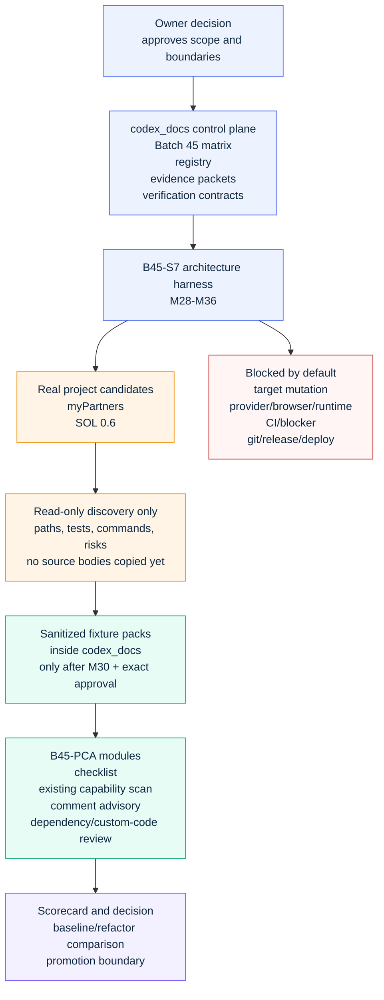
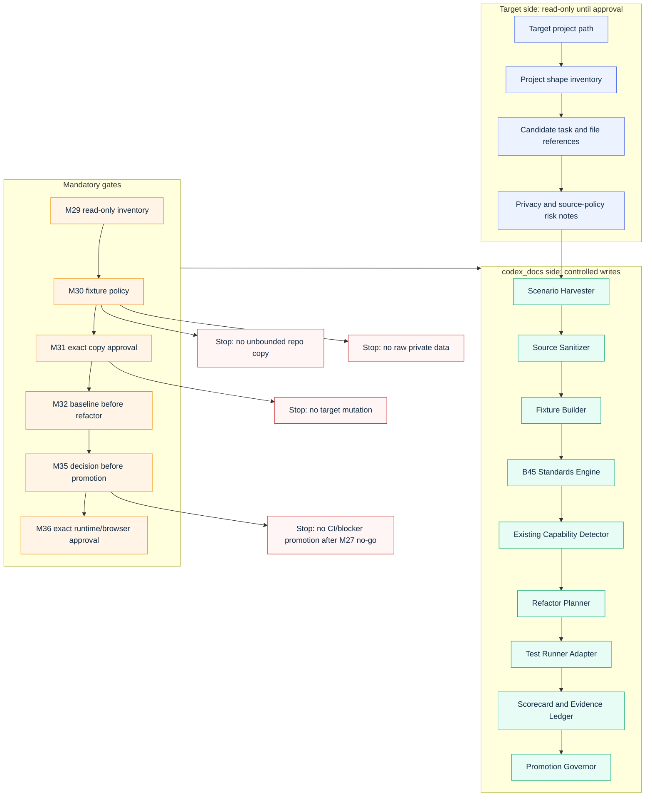
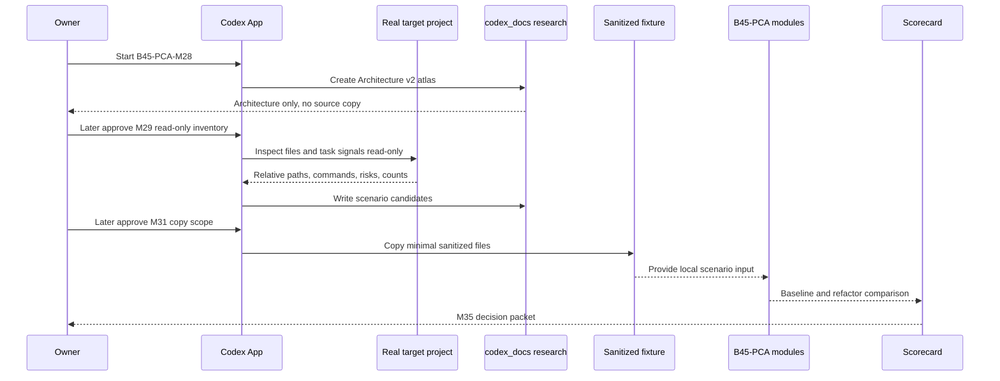
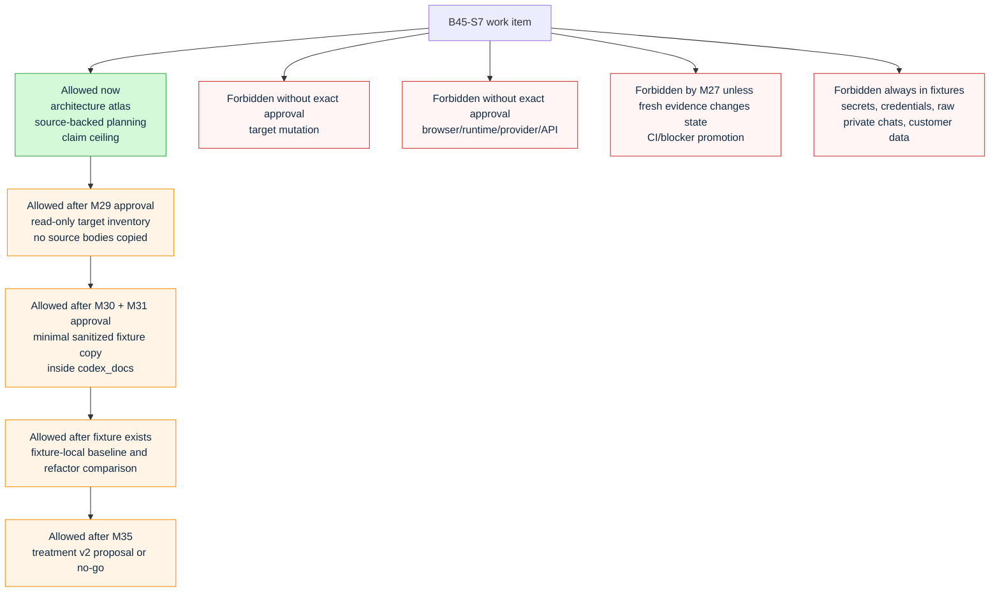
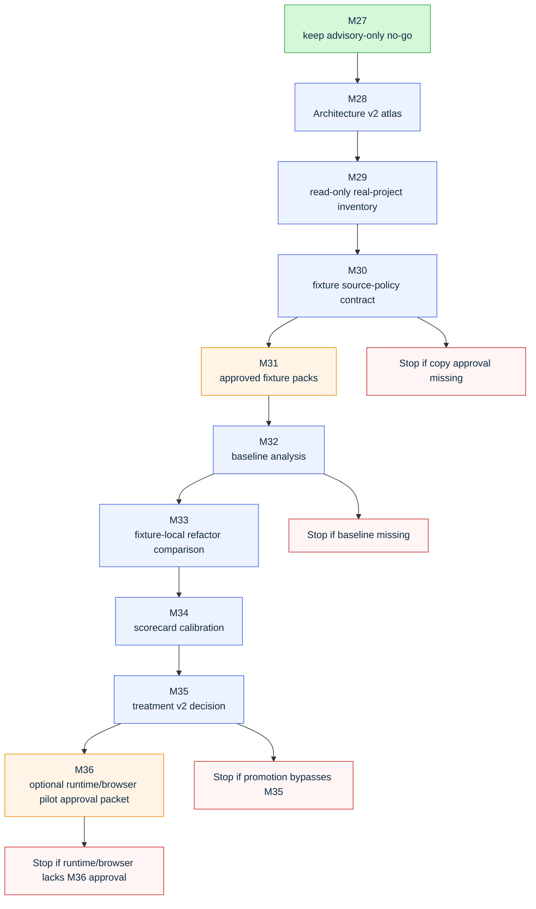

# Batch 45 Professional Code Authoring architecture v2

Source status: `project-authored + derived_from_current_batch45_artifacts`

This internal architecture atlas implements `B45-PCA-M28`. It deepens the
orientation map in `research/batch45-professional-code-authoring-solution-map.md`
into a set of narrower architecture views for the future real-project scenario
harness.

It is not a source-copy approval, not a target-project execution record, not a
runtime proof, not a browser proof, not a provider/model run, not a CI or
blocker promotion, and not evidence that the Professional Code Authoring
treatment improves real AI-agent behavior. The source of truth remains the
Track 11 Batch 45 task matrix, current evidence packets, and current verification
commands.

## Reading Contract

Use this atlas to answer four practical questions before `B45-PCA-M29..M36`:

- What architecture boundary keeps real projects read-only until approval?
- Which components transform real project signals into sanitized fixtures?
- Which data contracts must exist before baseline, refactor and scorecard work?
- Which approval gates prevent `B45-S7` from bypassing the `M27` no-go decision?

The artifact family is a software/system architecture diagram set. The diagrams
are intentionally vertical and decomposed so they remain readable in Codex App
and in Markdown previews.

## Source Ledger

| Source | Role in this atlas |
| --- | --- |
| `docs/superpowers/plans/2026-06-20-track-11-documentation-architecture-refresh.md` | Source of truth for `B45-PCA-M28..M36`, claim ceilings and stop conditions. |
| `research/batch45-professional-code-authoring-solution-map.md` | Prior whole-system orientation map and `M27` no-go context. |
| `PLAN.md`, `TEST.md`, `EVALS.md`, `RUNLOG.md` | Current control-plane boundaries for Batch 45 and real-project evidence. |
| `docs/superpowers/specs/batch45-comment-policy-promotion-decision.json` | `M27` keep-advisory-only/no-go decision. |
| `docs/superpowers/specs/batch45-agent-behavior-eval-results.json` | `M26` baseline/treatment evidence that blocks stronger promotion. |
| `docs/superpowers/specs/batch45-comment-sufficiency-advisory-wiring-summary.json` | `M25` local non-blocking advisory evidence. |

## Architecture Decision

`B45-S7` should be implemented as a staged real-project scenario harness inside
`codex_docs`, not as direct mutation of `myPartners`, `SOL 0.6`, CI, hooks,
provider/model calls, browser automation or installed plugin cache state.

The first executable boundary is:

```text
read-only target inventory -> sanitized fixture policy -> approved fixture copy -> fixture-local baseline -> fixture-local refactor comparison -> scorecard -> decision
```

The current allowed state is architecture and planning evidence only. Source
copying starts only after `B45-PCA-M29` inventory and `B45-PCA-M30` fixture
policy are reviewed and an exact approval names the copy scope.

## Map 1: Context Boundary



## Map 2: Container Architecture



## Component Responsibility Matrix

| Component | Owns | Inputs | Outputs | Stop condition |
| --- | --- | --- | --- | --- |
| Scenario Harvester | Real-project candidate discovery | Target paths, current plans, tests, package/config files | `scenario-candidates.json` | Requires mutation, runtime or private data to understand the scenario |
| Source Sanitizer | Privacy and source-policy filtering | Candidate files and risk notes | redaction policy, allowed/forbidden file classes | Secrets, credentials, raw chats, customer data or production databases are required |
| Fixture Builder | Minimal copied scenario context | Approved scenario list, fixture policy | fixture directories and manifests | Copy scope is unapproved or dependency closure is too large |
| B45 Standards Engine | Professional Code Authoring checks | Fixture source and task packet | checklist findings and accepted gaps | No baseline or checklist fields exist |
| Existing Capability Detector | Reuse and deletion-first review | Source graph, imports, project APIs | reuse options, rejected options, custom-code risk | Project capability cannot be inspected safely |
| Refactor Planner | Fixture-local refactor variants | Baseline findings, accepted scenarios | original/checklist/advisory arms | Refactor would require target mutation or external services |
| Test Runner Adapter | Safe local checks | Fixture commands, test metadata | pass/fail/skip evidence | Test command leaves fixture boundary or calls live services |
| Scorecard and Evidence Ledger | Comparable outcome evidence | Baseline/refactor results | scorecard, gaps, reviewer notes | Score hides critical regression or unsupported claim |
| Promotion Governor | Next-state decision | Scorecard, M27 boundary, owner review | keep advisory, treatment v2, more pilots, no-go | Promotion bypasses approval or M27 no-go evidence |

## Map 3: Data Contract Topology

```mermaid
erDiagram
    REAL_PROJECT_TARGET ||--o{ SCENARIO_CANDIDATE : provides
    SCENARIO_CANDIDATE ||--|| SOURCE_POLICY_REVIEW : requires
    SOURCE_POLICY_REVIEW ||--o{ FIXTURE_MANIFEST : allows
    FIXTURE_MANIFEST ||--o{ BASELINE_RUN : tested_by
    BASELINE_RUN ||--o{ REFACTOR_ARM : compared_with
    REFACTOR_ARM ||--o{ COMPARISON_RESULT : produces
    COMPARISON_RESULT ||--|| SCORECARD : summarized_by
    SCORECARD ||--|| DECISION_PACKET : informs

    REAL_PROJECT_TARGET {
        string target_label
        string absolute_path_not_persisted
        string read_only_status
        string approval_boundary
    }
    SCENARIO_CANDIDATE {
        string scenario_id
        string project_label
        string task_class
        string relative_paths
        string expected_checks
    }
    SOURCE_POLICY_REVIEW {
        string allowed_file_classes
        string forbidden_data
        string redaction_notes
        string copy_approval_status
    }
    FIXTURE_MANIFEST {
        string fixture_id
        string source_digest
        string copied_paths
        string omissions
        string runnable_status
    }
    BASELINE_RUN {
        string run_id
        string command_scope
        string standards_findings
        string test_status
    }
    REFACTOR_ARM {
        string arm_id
        string arm_type
        string diff_summary
        string dependency_delta
    }
    COMPARISON_RESULT {
        string scenario_id
        string baseline_status
        string refactor_status
        string regression_signal
    }
    SCORECARD {
        string existing_capability_reuse
        string custom_code_reduction
        string privacy_safety
        string reviewer_usefulness
    }
    DECISION_PACKET {
        string decision_state
        string next_approval_boundary
        string unsupported_claims
        string rollback_or_delete_path
    }
```



## Map 4: Execution Sequence



## Map 5: Approval Boundary



## Map 6: `B45-S7` Dependency Path



## Scorecard Dimensions

| Dimension | Why it exists | Primary evidence |
| --- | --- | --- |
| Existing-capability reuse | Proves the agent found simpler project/framework paths before custom code. | Checklist findings, imports, local APIs inspected, rejected options. |
| Custom-code reduction | Measures whether refactor reduces surface area instead of adding ceremony. | Diff size, deleted code, wrapper count, dependency delta. |
| Dependency avoidance | Prevents new packages or services where standard APIs already work. | Dependency manifest delta, rejected package notes. |
| Comment sufficiency | Preserves useful comments while avoiding noisy obvious comments. | Comment advisory warnings, accepted gaps, reviewer notes. |
| Test and scenario coverage | Keeps code-quality claims tied to executable or accepted-gap evidence. | Fixture-local test runs, skipped commands, baseline/refactor comparison. |
| Unsupported-claim discipline | Prevents generated reports from becoming runtime or promotion proof. | Claim ledger, source status, decision packet. |
| Privacy and source safety | Keeps real-project evidence usable without exposing private data. | Source-policy review, redaction manifest, forbidden-data scan. |
| Reviewer usefulness | Measures whether the output helps a human make a better code decision. | Reviewer score, actionability notes, false-positive notes. |
| Runtime gap | Separates fixture proof from live/browser/provider behavior. | M36 approval status and explicit unsupported claims. |

## Fitness Functions

`B45-S7` architecture is healthy only if these checks remain true:

1. Every real-project scenario has a target label, task class, relative path
   list and approval boundary before any fixture exists.
2. No fixture copies `.env`, credentials, private keys, raw private chats,
   customer data, production databases, private logs or unbounded repository
   contents.
3. Every fixture has a manifest that names copied paths, omitted paths, source
   digest policy, redactions and delete/rollback path.
4. Every refactor comparison has a baseline result first.
5. Every scorecard separates supported evidence from unsupported runtime,
   browser, provider, CI, blocker, git, release and production-readiness claims.
6. `M27` remains the controlling promotion boundary until `M35` records a new
   owner-reviewed decision with fresh evidence.

## `B45-PCA-M28` Completion Scope

This `M28` implementation provides:

- Architecture v2 context, container, data-contract, sequence, approval-boundary
  and scorecard views.
- Component responsibilities and stop conditions for the future harness.
- A dependency path for `B45-PCA-M29..M36`.
- Claim ceilings that preserve `M27` no-go and approval-required boundaries.

This `M28` implementation does not provide:

- read-only inventory of `myPartners` or `SOL 0.6`;
- copied source fixtures;
- sanitized fixture manifests;
- baseline analysis;
- fixture-local refactor results;
- real target runtime, browser, provider/API or git proof;
- CI, blocker, stronger advisory or production-readiness promotion.

The next safe action is `B45-PCA-M29`: read-only scenario inventory for the
approved real-project candidates.
