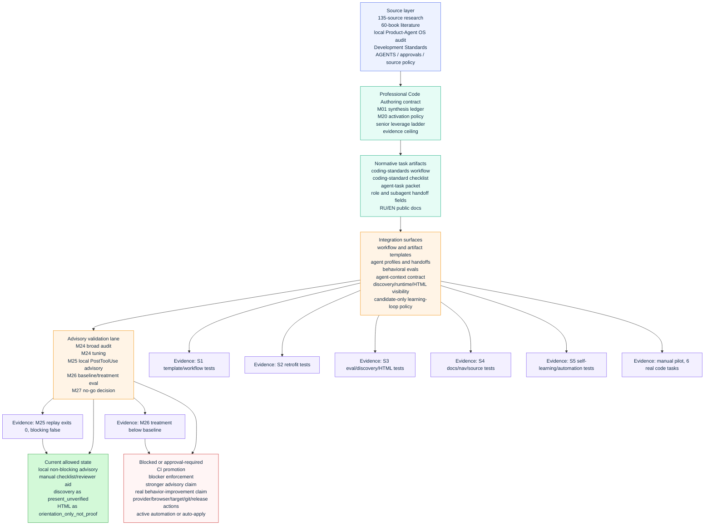
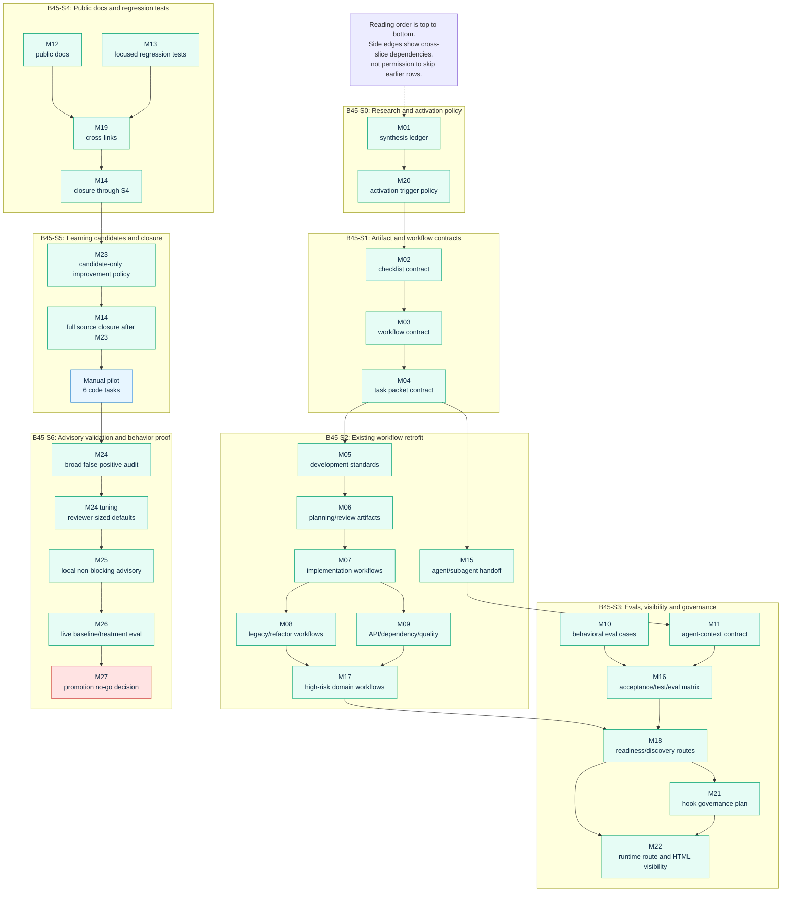
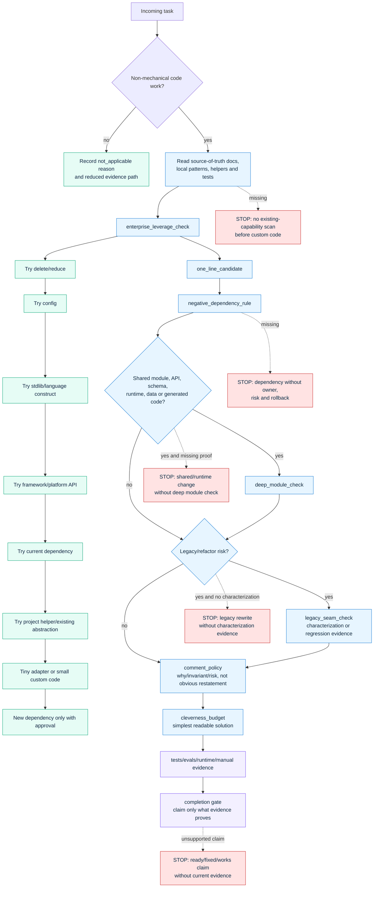
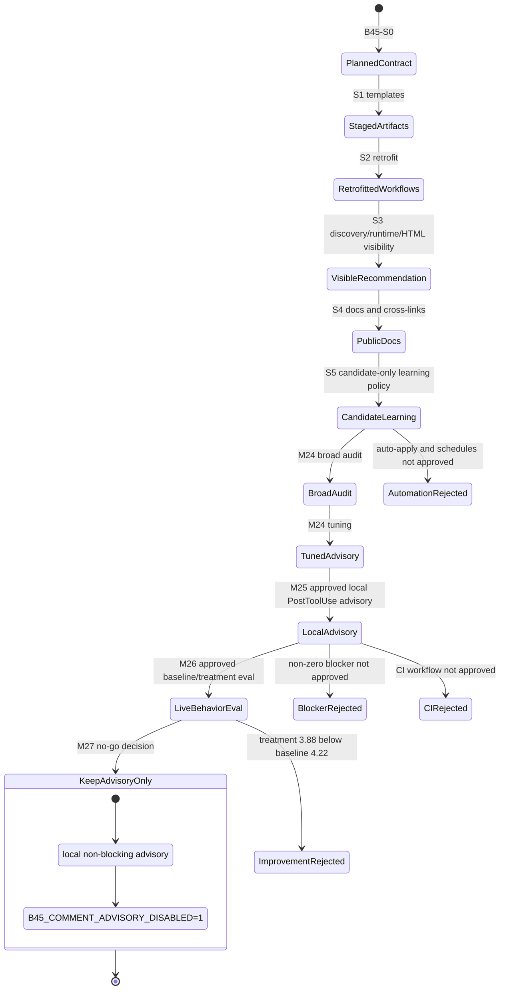
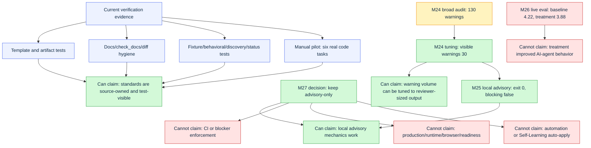

# Batch 45 Professional Code Authoring solution map

Source status: `project-authored + derived_from_current_batch45_artifacts`

This internal artifact is a visual orientation map for Batch 45 Professional Code Authoring.
It is not a readiness claim, not a runtime proof and not a promotion decision by
itself. The source of truth remains the Track 11 task matrix, the Batch 45
evidence packets, the coding standards templates, public docs and current
verification evidence listed below.

## Reading Contract

Use this map when you need to see the full Product-Agent OS coding-standard
system at once:

- what the standard asks an agent to do before writing code;
- which `B45-PCA-*` task rows produced each surface;
- which artifacts are normative task inputs;
- which artifacts are evidence packets;
- which runtime or hook surfaces are only advisory;
- which promotion routes are explicitly blocked by current evidence.

The diagrams use four claim levels:

| Marker | Meaning |
| --- | --- |
| `docs_contract_ready` | Source/docs/template/eval contract exists and has local checks. |
| `synthetic_green` | Local synthetic tests or manual pilot evidence exists. |
| `runtime_enabled_local` | Approved local runtime surface ran in current evidence. |
| `no_go` | Stronger promotion or behavior-improvement claim is rejected by evidence. |

## Source Artifacts

| Layer | Artifacts |
| --- | --- |
| Research inputs | `plugins/product-agent-os/assets/research/ai-agent-coding-standards-research.md`; `plugins/product-agent-os/assets/research/ai-agent-coding-literature-research.md` |
| Standards workflow | `plugins/product-agent-os/assets/templates/workflows/development-standards.md`; `plugins/product-agent-os/assets/templates/workflows/coding-standards.md` |
| Task checklist | `plugins/product-agent-os/assets/templates/artifact-templates/coding-standard-checklist.md` |
| Handoff contract | `plugins/product-agent-os/assets/templates/artifact-templates/agent-task-packet.md`; subagent context/result packet templates |
| Public docs | `docs/product-agent-os/coding-standards.md`; `docs/product-agent-os/coding-standards.en.md`; related cross-links in Product-Agent OS docs and code-review playbook |
| Task matrix | `docs/superpowers/plans/2026-06-20-track-11-documentation-architecture-refresh.md`; `PLAN.md`; `TEST.md`; `EVALS.md`; `RUNLOG.md` |
| Evidence packets | `docs/superpowers/specs/batch45-*.json` evidence packets |
| Tests | `tests/product_agent_os/test_batch45_coding_standards.py`; `tests/product_agent_os/test_batch45_s2_existing_workflow_retrofit.py`; `tests/product_agent_os/test_batch45_s3_professional_code_authoring.py`; `tests/product_agent_os/test_coding_standards_artifacts.py`; `tests/product_agent_os/test_comment_sufficiency.py`; `tests/product_agent_os/test_lifecycle_hooks.py` |

## Map 1: Whole-System Topology



## Map 2: `B45-PCA` Task Dependency DAG



## Map 3: Task-Level Standard Execution Pipeline



## Map 4: Activation And Promotion State Machine



## Map 5: Entity Dependency Inventory

| Entity | Depends on | Produces | Current claim ceiling |
| --- | --- | --- | --- |
| Research packet | External style, refactoring, testing, security and maintainability sources; local audit | Professional coding synthesis | Research support, not implementation proof |
| `development-standards.md` | Product hypothesis, architecture boundary, tests, review, evidence-before-completion | Parent workflow loop | Workflow guidance only |
| `coding-standards.md` workflow template | B45 synthesis, development standards, source policy | Task-level coding sub-gate | Staged workflow contract |
| `coding-standard-checklist.md` | Coding workflow and task context | Task evidence packet | Review artifact, not correctness proof |
| `agent-task-packet.md` | Task lifecycle, ownership, approval boundaries, coding checklist | Fresh-context handoff | Handoff contract, not raw conversation history |
| Agent profiles and subagent packets | Coding contract plus role ownership | Builder/reviewer/architect/tester prompts carry fields | Prompt/template contract, not auto-dispatch |
| Behavioral eval cases | Shortcut anti-patterns and expected failures | Deterministic checks for bloat/dependency/comment/rewrite issues | Local eval coverage |
| Discovery/readiness route | Methodology catalog, synthesis, discovery, first-run analysis | `present_unverified` recommendation | Detection, not enforcement |
| Runtime route and HTML | Analysis renderer, status dashboard, runtime contracts | Visible coding-standard state | `orientation_only_not_proof` |
| Self-Learning Loop policy | Metrics, owner feedback, eval failures, manual pilot evidence | Candidate update packet | Candidate-only; no auto-apply |
| Comment sufficiency validator | Python/JS source parser and tuned defaults | Advisory warnings | Reviewer signal only |
| Local PostToolUse advisory | M24 tuning, approved hook wiring, rollback | Exit 0 warning surface | `runtime_enabled_local`, non-blocking |
| M26 eval plan/results | Held-out tasks, baseline/treatment runs, reviewer rubric | Behavior-improvement measurement | `no_go`, no promotion |
| M27 decision | M24, M25, M26 evidence | Keep advisory-only state | Blocks CI/blocker/stronger promotion |

## Map 6: Evidence Plane And Claim Boundaries



## Current Solution Reading

The full solution is a governance and evidence system, not a single linter.
It has three nested loops:

1. `development-standards.md` is the parent product/architecture/test/review
   loop.
2. `coding-standards.md` is the non-mechanical code authoring sub-gate.
3. `comment_sufficiency` is one local advisory signal inside that sub-gate,
   not the whole standard.

The important dependency is directional:

```text
research -> synthesis -> task artifacts -> workflow/agent/eval visibility
-> advisory validation -> behavior eval -> promotion decision
```

The reverse direction is forbidden. A green local advisory replay cannot
retroactively prove real agent behavior, and a generated HTML section cannot
become source truth.

## Operational Conditions

| Condition | Required evidence | If missing |
| --- | --- | --- |
| Non-mechanical code task | Checklist or explicit `not_applicable` reason | Stop or reduce claim |
| New custom code | Existing capability scan, leverage path, rejected options | Stop |
| New dependency | Negative dependency rule, owner, risk, rollback, approval | Stop |
| Shared/public/runtime module | Deep module check, consumers, error paths, tests | Stop or accepted gap |
| Legacy/refactor work | Characterization/regression evidence, seam strategy, rollback | Stop or accepted gap |
| Comment sufficiency warning | Reviewer handling or explicit reason | Advisory only |
| Completion claim | Current tests/evals/runtime/owner evidence or accepted gap | Do not claim complete |
| Promotion to CI/blocker | Positive behavior eval, false-positive/flake/cost proof, rollback, approval | Forbidden by current M27 |
| Provider/model rerun | Fresh exact approval and privacy-safe eval packet | Approval required |
| Target/browser/runtime proof | Exact surface, owner, rollback and evidence path | Approval required |

## Current State Summary

| Slice | Status | What it proves | What it does not prove |
| --- | --- | --- | --- |
| S0 | `docs_contract_ready` | Research synthesis and activation policy exist. | Runtime or behavior improvement. |
| S1 | `docs_contract_ready` | Core workflow/checklist/task-packet contracts exist and are registered. | Automatic agent compliance. |
| S2 | `docs_contract_ready` | Existing workflows, agent roles and high-risk templates carry the contract. | Hook activation or live behavior. |
| S3 | `docs_contract_ready` | Eval cases, discovery/readiness and HTML visibility exist. | Generated views as proof. |
| S4 | `docs_contract_ready` | Public docs and cross-links exist. | Root site freshness beyond approved evidence or live enforcement. |
| S5 | `synthetic_green` | Learning-loop improvements are candidate-only and gated. | Active automation or auto-apply. |
| M24 | `local_audit_evidence_no_enforcement` | Broad false-positive profile is known. | Blocking readiness. |
| M24 tuning | `synthetic_green` | Default advisory warning volume is reduced. | Behavior improvement. |
| M25 | `runtime_enabled_local` | Approved local non-blocking advisory runs and exits 0. | CI/blocker enforcement. |
| M26 | `live_dependency_aligned` with `no_go` | Live eval falsified current treatment promotion. | Positive AI-agent behavior improvement. |
| M27 | `docs_contract_ready` no-go decision | Keep advisory-only decision is recorded. | Stronger advisory, CI or blocker approval. |

## Practical Next View

If the team wants the next map to become executable rather than descriptive,
the next artifact should be a `B45 treatment v2 design packet` with:

- a smaller treatment surface than the full coding-standard context;
- changed-file advisory response protocol;
- timeout and flake budget;
- deterministic validation-selection rubric;
- explicit handling for read-only `.codex` or target workspaces;
- same held-out task set or a new approved held-out set;
- promotion threshold that requires treatment above baseline, no critical
  regressions and zero blocker-worthy timeouts.

Until that packet exists and passes, the correct operating state remains:

```text
local advisory only -> reviewer signal -> no CI -> no blocker -> no real behavior-improvement claim
```
