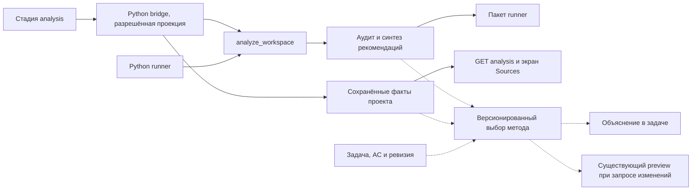

# Методологии Product-Agent OS. Проверка планов и текущей реализации

Source status: repository_source / primary_external_sources / research_review.

Дата анализа — 18 ноября 2026 года. Объект проверки — рабочее дерево, включая незакоммиченные изменения. Это исследовательский отчёт. Решения о составе и статусах задач принадлежат существующим планам.

## Первая сверка планов

Внутренний план A содержит 17 исполняемых задач. METH-16 сохранена как ссылка на направление B. Пользовательский план B содержит 26 задач. Два направления допускают независимую поставку. Внутри B зависимость PMETH-16 от PMETH-12 переносит подготовку миграции FSD на критический путь общего staging. Через PMETH-17–20 это влияет даже на показ результата в Web для backend bug. Это зависимость поставки продукта, хотя на уровне пользовательского сценария план правильно исключает FSD для такого запроса. [План A](../docs/planning/methodology-improvement-2026-11-15.md) · [План B](../docs/planning/user-project-methodologies-2026-11-15.md)

В рабочем дереве уже есть Web-контракт Project Analysis, Node-сервис и Python bridge. Их входы и объём проекции проверяются ниже. Основной вопрос для PMETH-19 — какие поля и действия добавить к действующему пути. [Контракт](../packages/contracts/project-analysis.ts) · [Сервис](../apps/local-service/src/project-analysis/service.mts) · [Мост](../apps/local-service/src/project-analysis/bridge.py)

## Что изменилось после планирования

Проверенная ссылка `main` указывает на `54dc03da5b54472fc457086f086ed1ac79153217`. В рабочем дереве есть изменения Web, тестов и документов. Числа в историческом снимке B (10 реализовано, 24 запланировано) верно описывают его дату. В актуальном владельце FUNC уже 33 `implemented` и одна `awaiting_user_decision` — F23, пользовательская приёмка. Например, F02, F13, F14, F21, F27–29 уже дали конкретные точки интеграции. Статус `implemented` здесь взят из матрицы FUNC, свежий технический прогон в него не включён. [Матрица FUNC](../docs/planning/functional-remediation-2026-11-15.json) · [Контекст и пределы приёмки](../docs/planning/functional-remediation-2026-11-15.md)

Подсчёт по `tasks[].depends_on` в двух русскоязычных JSON-владельцах, без external refs, с устранением повторов при обходе предков каждого узла:

| Показатель | A, сопровождение PAOS | B, функция для пользователя |
| --- | ---: | ---: |
| Запланированные исполняемые задачи | 17 | 26 |
| Критерии приёмки | 51 | 104 |
| Прямые зависимости внутри направления | 25 | 54 |
| Предшественники первого выбранного результата | 9 перед METH-12 (dashboard) | 20 перед PMETH-20 (экран рекомендаций) |

PMETH-17 (доказательства для CLI) ждёт 17 других задач. PMETH-15 зависит от применимости FSD и Design-DD даже для плана исправления backend. PMETH-16 ждёт FSD-предложение PMETH-12, PMETH-17 — визуальную проверку PMETH-09. Для поставки реализации всех пяти методов такая последовательность объяснима. Для первого пользовательского результата она слишком длинна. Предложение — различать готовность базовой возможности и готовность каждого дополнительного метода, оставив совместную проверку перед расширением поддержки. [Граф A](../docs/planning/methodology-improvement-2026-11-15.json) · [Граф B](../docs/planning/user-project-methodologies-2026-11-15.json)

## Где продукт может ошибиться при интеграции

Ниже перечислены сценарии, для которых направление B уже задаёт общую цель, но выбор конкретного владельца или тестового примера меняет результат. Все указатели относятся к рабочему дереву на дату проверки.

1. **Проект и задача имеют разный срок жизни.** `ProjectAnalysis` читает сохранённые данные для `projectId`. Контракт фиксирует ревизию инвентаризации, корень и покрытие. Если поместить туда окончательный выбор метода, две задачи одного проекта смогут получить одинаковую рекомендацию при разном intent. Проектный снимок должен содержать наблюдения. Рекомендация задачи должна ссылаться на этот снимок и учитывать идентификатор и ревизию задачи, её критерии и версию правил. Смена задачи, изменение AC и возврат к старому результату — три разных проверки. [UI](../apps/web/src/features/projects/ProjectAnalysis.tsx) · [Проектный контракт](../packages/contracts/project-analysis.ts) · [Профиль задачи](../packages/contracts/issues/task-profile.ts)
2. **Предел видимости Python отличается в CLI и Web.** Мост запускает `analyze_workspace` на ограниченной копии. Для многих исходников сервис создаёт пустой файл по наблюдаемому пути, содержимое читает только для разрешённого набора. Поэтому совпадение CLI/Web нужно требовать при одинаковых доступных входах. При разном покрытии Web обязан показать `partial`/причину. Иначе имя файла будет принято за проверенные импорты, тест или реализацию. Для FSD использовать граф кода, а в общую проекцию вывести группы рекомендаций с основаниями. [Сервис и allowlist](../apps/local-service/src/project-analysis/service.mts) · [Мост](../apps/local-service/src/project-analysis/bridge.py) · [Граф и покрытие](../packages/contracts/graph/code-graph.ts)
3. **Ручная приёмка уже имеет семантику, важную для PMETH-17.** В `acceptTask` проверяется успешная ручная проверка нужной ревизии. Затем каждому текстовому AC задачи M2 присваивается `passed` с одной общей заметкой. Workflow guard проверяет наличие `passed` по тексту критерия. Для старых задач это допустимая запись решения владельца. При выводе «выполнен TDD», «проверен дизайн» или «соблюдена граница FSD» нужен отдельный вид подтверждения, стабильный идентификатор критерия и соответствующая ревизия. Тестовый случай — одна ручная приёмка, два AC, техническая проверка только одного. Сохранить человеческое решение и показать второе техническое основание как отсутствующее. [Команда приёмки](../apps/local-service/src/tasks/user-commands.mts) · [Условия перехода](../apps/local-service/src/workflows/guards.mts) · [Типы и декодер](../packages/contracts/issues/task-profile.ts)
4. **Последний scan может сменить тип.** GET `/projects/:id/analysis` читает `analysis` только из `saved.latest.stages`. Запуск из раздела базы данных со стадией `schema` или `code_database` заменяет `latest`. По коду при следующем GET возможно `ANALYSIS_NOT_OBSERVED`, даже когда исходники не изменились. Это предсказание по веткам кода, требующее воспроизведения. AC для PMETH-18/19 — сначала анализ проекта, затем сканирование схемы, затем открытие рекомендации. Сохранять последнюю релевантную стадию с проверкой ревизии либо явно объяснять, почему её нужно повторить. Глобальный `lastSuccessful` тоже может относиться к другой стадии. [Чтение и запуск стадий](../apps/local-service/src/http/application.mts) · [Жизненный цикл scan](../apps/local-service/src/project-scans/service.mts)
5. **Один запрос может интерпретироваться по-разному внутри Python.** В `codex_runtime_runner/cli.py`, строки 41–47, аудит выбирает `intent_hint` или `task_context.intent`, тогда как маршрутизация может объединить оба. Критерии передаются в task routing. CLI аудита вызывает `build_methodology_audit` с пустым hint, а подготовка инфраструктуры может начать project scan до учёта задачи. PMETH-02 должен определить приоритет полей и сохранить прежний обзор проекта при отсутствии задачи. Проверка — на одном репозитории сравнить `docs-only` и изменение тестируемого поведения через штатные входы. Проверять выбранный метод и основание, включая случай конфликтующих входов. [Вход runner](../plugins/product-agent-os/scripts/codex_runtime_runner/cli.py) · [Вход аудита](../plugins/product-agent-os/scripts/run_methodology_audit.py) · [Нормализация задачи](../plugins/product-agent-os/scripts/product_agent_os/task_routing.py) · [Подготовка инфраструктуры](../plugins/product-agent-os/scripts/product_agent_os/infrastructure.py)
6. **Одному артефакту могут соответствовать два имени.** `group_recommendations` группирует по исходному значению `artifact`, а `classify_source_artifact` отдельно умеет распознавать соответствия. В `formation_plan` уже выбирается существующий файл-владелец. Для PMETH-15 проверить пару «каноническое имя + проектный alias», приходящую из двух методов. Ожидаемый результат — один артефакт с двумя объяснениями и одним владельцем записи. Это проверка входного контракта, частота такого конфликта у пользователей неизвестна. [Группировка и классификация](../plugins/product-agent-os/scripts/product_agent_os/methodology_synthesis.py) · [Выбор владельца](../plugins/product-agent-os/scripts/product_agent_os/project_formation.py)

## Карта повторного использования

В Python уже два обхода: `analyze_workspace` получает список файлов через `_relative_files`, а вложенный `build_methodology_audit` строит `_relative_inventory`. У них разные фильтры. PMETH-01 стоит описать границы обоих наборов и добавить пример файла, который должен быть виден только одному потребителю. Если вводить общий снимок, каждому потребителю требуется его явно фильтрованное представление. Это также защищает B02 от появления третьего обхода. [Discovery](../plugins/product-agent-os/scripts/product_agent_os/discovery.py) · [Методологический аудит](../plugins/product-agent-os/scripts/product_agent_os/methodology_audit.py)

На схеме сплошные стрелки показывают вызовы или передачу данных, видимые в коде. Пунктир показывает предлагаемую интеграцию. Пользовательское чтение сохранённого анализа и запуск сканирования — разные операции.

| Задачи | Действующая точка подключения | Решение о реализации и пределах |
| --- | --- | --- |
| B01–04, 22. Выбор метода | `analyze_workspace` → `build_methodology_audit` → catalog/synthesis → `plan_route`. Есть 12 доменов, группы, вопросы, уровень готовности, следующий шаг и compact packet. [Discovery](../plugins/product-agent-os/scripts/product_agent_os/discovery.py) · [Аудит](../plugins/product-agent-os/scripts/product_agent_os/methodology_audit.py) · [Runner](../plugins/product-agent-os/scripts/codex_runtime_runner/routes.py) | Зафиксировать соответствие пяти методик существующим доменам и версию результата решения. Для каждого выбранного метода вернуть основание, глубину, применимость, источник и следующий шаг. На малой задаче показывать только то, что нужно пользователю. |
| B05–09, 17. Спецификация, дизайн, TDD и проверка | Существующие AC, связанные артефакты, проверки и приёмка задачи, а также skills `requirements-author` и `test-eval-designer`. [Структурированные ссылки](../apps/local-service/src/artifacts/references.mts) · [Каталог артефактов](../packages/contracts/artifacts/catalog.ts) · [Тестирование и eval](../plugins/product-agent-os/skills/test-eval-designer/SKILL.md) | Ввести связь ревизии AC и вида доказательства. Для TDD хранить причину RED и результат GREEN одного сценария. Для визуального изменения — состояние, дизайн и build. Для изменения AC отмечать устаревшими только зависимые доказательства. |
| A09, B10–12. Анализ импортов | Внутренний тест разбирает AST. Индекс F14 читает исходники через разрешённую инвентаризацию и разбирает JS/TS с Rolldown. Для `tsconfig` поддерживается ограниченный набор. F30 — отдельный import-only PoC. [Тест границ](../tests/web/contracts-boundaries.test.mts) · [Индекс](../apps/local-service/src/code-index/service.mts) · [Разбор импортов](../apps/local-service/src/code-index/lexical.mts) · [Тесты resolution](../tests/web/graph-imports.test.mts) | Переиспользовать типы фактов и набор примеров. Поверх наблюдаемых рёбер добавить правила FSD, исключения и проверку циклов. Для CLI без Node-индекса заранее определить «ограниченное покрытие» или требование доступного адаптера. Отдельно проверить `TSImportType`, реэкспорт, alias, `extends`, TSX и динамические пути. |
| B13–15. Ответственность, skills, план | `WorkflowRecipe` описывает роли, версии skills, входы/выходы, проверки, владение, бюджеты, `next` и `join`. В Python runner уже есть компактный пакет и guards. [Workflow](../packages/contracts/workflows/workflow.ts) · [Контракт runner](../plugins/product-agent-os/scripts/codex_runtime_runner/contracts.py) | Сопоставить выбранные шаги с существующей recipe там, где они исполнимы. Рекомендация также может завершиться чтением или ручным действием. Отображать разницу между предложенным, доступным и выполненным skill. Авторизация остаётся у исполнителя операции. |
| B06, 12, 15–16. Предпросмотр и применение | `formation_plan` выбирает владельцев и шаблоны, `form_project` привязывает stage к просмотренному digest, `merge_infrastructure` проверяет target и поддерживает восстановление. F13 уже владеет отдельным применением document proposal к одному источнику. [Формирование](../plugins/product-agent-os/scripts/product_agent_os/project_formation.py) · [Merge](../plugins/product-agent-os/scripts/product_agent_os/merge_infrastructure.py) · [Контракт документа](../packages/contracts/artifacts/document-apply.ts) | Показать метод и AC в существующем preview. Маршрутизировать пакет инфраструктуры в Python, поддержанный документ — к его текущему writer. Для read-only совета достаточно показа. Сохранить контроль digest, разрешений и идемпотентности по типу операции. |
| B18–21. Хранение, интерфейс и восстановление | Инвентаризация и scan имеют project-scoped версии и CAS. Решение имеет `taskId`, `revision`, `scope`, `history`. Workflow recovery и запуск агента уже проверяют checkpoint и состояние. [SQLite](../apps/local-service/src/storage/sqlite-worker.mts) · [DecisionView](../packages/contracts/decisions/decision.ts) · [Recovery](../apps/local-service/src/recovery/recipe-checkpoint.mts) · [Экран Sources](../apps/web/src/features/projects/ProjectAnalysis.tsx) | Проекту принадлежат наблюдения, задаче — выбор и override, владельцу операции — подтверждение и результат. Вычислимую рекомендацию можно пересчитать. Сохранять решение, его исходные ревизии и историю использованных результатов. Перед новой таблицей доказать, чего не хватает транзакции/CAS и существующим владельцам. |
| A06–07, B22–25. Оценка пользы и решение о расширении | `EVALS.md`, детерминированные fixtures, F11 с ограниченным покрытием run и F23 с протоколом человеческой проверки. [Правила eval](../EVALS.md) · [Доступные метрики](../packages/contracts/telemetry/run-metrics.ts) · [Функциональный план](../docs/planning/functional-remediation-2026-11-15.md) | Сравнивать одинаковые задачи, модель и effort при контролируемом доступе. Для решения о UX отдельно наблюдать пользователя. В F11 `tokenCount` и `cost` здесь имеют тип `null`. При отсутствии данных экономию в деньгах оценить нельзя. |

## Направление A. Что оправдано в этом репозитории

| Карточки | Наблюдение и предлагаемая правка |
| --- | --- |
| METH-01/02 | Сохранить baseline, карту владельцев и два сценария. Одного приложения к существующему пилоту достаточно для привязки «AC → файл → проверка». F02 уже реализовала структурированные ссылки, F28 — общую инвентаризацию. Обновить точки входа в карточках перед исполнением. |
| METH-03/04/05 | Переиспользовать V3, unit-тесты dashboard и browser-проверки partial/error/drafts. Полезное дополнение — намеренно испортить одно состояние или композицию и показать, какая проверка обнаруживает отклонение. Для изменения только пути импорта достаточно проверок сохранения поведения. Новый RED нужен при новом тестируемом поведении или воспроизводимом дефекте. [V3 и границы доказательств](../design/2026-11-13-v3/implementation-evidence.md) · [Dashboard unit](../tests/web/ui-v3-dashboard.test.mts) · [Dashboard browser](../tests/web/single-window/func-g01-dashboard-acceptance.mts) |
| METH-08/09 | ADR уже предлагает «оставить как есть», «усилить границы», «постепенный FSD». Закрепить, какие следующие карточки становятся неприменимыми при каждом выборе. Нынешний тест на строках 23–55 обходит `.ts/.mts` только из contracts и local service и разрешает относительные импорты. Добавить TSX, frontend-область, aliases и отрицательный пример заимствования внутреннего модуля. Полную карту TDD-пробелов METH-05 можно вести независимо от этой проверки. [Проверка границ](../tests/web/contracts-boundaries.test.mts) |
| METH-10/11/12/13 | Связанность реальна. В `dashboard/model.ts:3` используются `semanticStatus` и `isBlocked` из Tasks. `TaskManager.tsx:1` берёт UI из Dashboard, Team использует внутренние task/skill/dashboard-модули. Начать с границы между Dashboard и Tasks и проверки обратного импорта. Выделять только повторно используемые селекторы или UI. Перенос `shared`, `entities/task`, обоих экранов Tasks/Workflows должен зависеть от выбранного ADR и результата dashboard-пилота. Сейчас 10 → 11 → 12 обязательны даже после выбора «только усилить границы». [Dashboard](../apps/web/src/features/dashboard/model.ts) · [Tasks](../apps/web/src/features/tasks/TaskManager.tsx) · [Team](../apps/web/src/features/team/TeamManager.tsx) · [Workflows](../apps/web/src/features/workflows/WorkflowManager.tsx) |
| METH-06/07, 17/18 | Измерять удобство сопровождения и эффект изменения работы агентов отдельно. Миграция Dashboard одновременно с изменением agent prompt мешает объяснить выигрыш. Для FSD сравнить рёбра и усилие в сходном изменении до/после. Для ADD сохранить задачу, исходники, модель, effort и полномочия одинаковыми. Текущий METH-07 уже допускает `insufficient_evidence`. Разрешить METH-17 принимать выполненный архитектурный пилот при остановке после Dashboard; сейчас METH-13 обязателен. В METH-18 указать отдельные решения о каждом расширении. [Критерии и зависимости](../docs/planning/methodology-improvement-2026-11-15.json) · [Модель оценки](../EVALS.md) |
| METH-14/15/16 | Сохранить 14/15 как опцию после измеренной пользы. METH-16 оставить ссылкой. Дельту после переноса screen оценивать по снижению стоимости конкретного изменения, сохранности черновика и взаимных зависимостях. |

## Что говорит документация методов

Проверены Context7 и страницы авторов 18.11.2026. В Context7 опрошены именно `/feature-sliced/documentation` и `/github/spec-kit` после разрешения имён библиотек. Выводы о поведении PAOS получены из кода проекта. Таблица показывает, как внешние источники влияют на решение о плане.

| Метод | Что следует из источника | Следствие для PAOS |
| --- | --- | --- |
| FSD | В FSD 2.1 исходной единицей допускается страница. Общее выделяют ниже, когда появляется повторное использование. Публичный API изолирует потребителей от внутреннего устройства модуля. [FSD 2.1](https://feature-sliced.design/docs/guides/migration/from-v2-0) · [Public API](https://feature-sliced.design/docs/reference/public-api) | Сделать `entities` и миграцию следующих экранов условными в A. В B10/12 разрешить завершение после укрепления границ существующего приложения. |
| Spec-DD | У GitHub Spec Kit разнесены разработка функции и исправление ошибки. Проверка согласованности спецификации, плана и задач выполняется в режиме чтения. [Spec Kit Quickstart](https://github.github.io/spec-kit/quickstart.html) · [Команда анализа](https://github.com/github/spec-kit/blob/main/templates/commands/analyze.md) | PMETH-05/06 — короткая спецификация с AC и проверкой конфликтов. Привязать замечания к существующему файлу-владельцу. Интеграцию Spec Kit устанавливать для этого не требуется. |
| TDD | Тест для следующего изменения поведения предшествует реализации, затем проходит цикл исправления и рефакторинга. [Martin Fowler, Test Driven Development](https://martinfowler.com/bliki/TestDrivenDevelopment.html) | Сохранить PMETH-07. У различимых событий RED и GREEN должны совпадать сценарий и ожидаемая причина. Отсутствие тестов в исходной проекции, сбой запуска среды и изменение документа требуют разных решений. |
| Design-DD | Design Council включает изучение потребностей людей, определение задачи, разработку альтернатив и проверку решения. [Framework for Innovation](https://www.designcouncil.org.uk/resources/framework-for-innovation/) | PMETH-08/09 хорошо описывают состояния UI. Добавить в PMETH-20 наблюдаемую проверку того, что человек понимает рекомендацию и отличает просмотр от применения. Для существенного или неясного нового journey сначала сохранить гипотезу о проблеме и результат проверки с пользователем. |
| ADD | В AWS AI-DLC глубина процесса адаптируется к задаче. Практика Anthropic различает предписанные workflows и автономный выбор действий, отмечает стоимость усложнения. Это примеры подходов, а конкретный контракт ADD определяется PAOS. [AWS AI-DLC](https://aws.amazon.com/blogs/devops/open-sourcing-adaptive-workflows-for-ai-driven-development-life-cycle-ai-dlc/) · [Building effective agents](https://www.anthropic.com/research/building-effective-agents) | Начать с детерминированного выбора и одного исполнителя. Привязать усложнение orchestration к сравнимому эффекту и учесть частоту ручных исправлений. Сохранить гейты полномочий и остановки. |

## Порядок поставки и критерий остановки

Это предложение к следующей редакции планов. ID и исходные AC можно сохранить. В графе поставки стоит выделить частичные результаты карточек, оставив полную приёмку карточки до выполнения всех её AC.

| Очередь | Части текущих задач | Что сможет проверить пользователь или сопровождающий |
| --- | --- | --- |
| 1. Две задачи в одном репозитории | B01/02/22, минимальный контракт B03/04, компактный Spec/TDD B05/07 и адресное основание B17 | Для backend bug видны воспроизведение, один AC и следующий тест. Для правки документа в том же проекте предлагается проверка источника. Оба сценария обходятся без генерации файлов, FSD, visual gate и вызова модели. Зафиксировать baseline до изменения правил и проверить отрицательные случаи. |
| 2. Показать этот результат в Web | Части B18–20 и B26 для чтения. Факты — в Sources, рекомендация и следующий шаг — в существующей задаче | На том же входе CLI и Web согласны с оговоркой о покрытии. Пользователь видит причину, источник и неизвестное. Открытие рекомендации сохраняет положение дел в целевом проекте. Для чтения не требуются B12/16. |
| 3. Сохранить решение и связать доказательства | B06, B13–15 по выбранному пути, оставшаяся часть B17–21; B16 только для действий с записью | Отказ от метода сохраняется с причиной и областью применения. Новая ревизия AC помечает зависимое решение устаревшим. Предпросмотр, разрешение, результат и восстановление привязаны к одной операции. Нельзя переносить разрешение на другой проект или повторно выполнять эффект с неизвестным исходом. |
| 4. Расширять по потребности | B08/09 для изменённого интерфейса, B10–12 для подходящего frontend, B23 для заявленного набора, B24–26 для сравнительной пользы, документации и решения о поставке | Greenfield UI получает дизайн-состояния. Проблемный legacy frontend получает один пилот с возможностью остановки. Уже модульный frontend сохраняет структуру. Backend и docs проходят прежние короткие маршруты после подключения новых методов. |
| Параллельно, без зависимости от B | A01/02, A08/09, один ограниченный Dashboard-сценарий из A03–05/10–12 | Если публичного API достаточно и стоимость следующего изменения снизилась, решение допускает остановку. A13–15 запускаются по отдельному результату пилота. |

Для продуктовой проверки B20/24 заранее выбрать одного владельца решения и сравнимые задания. Зафиксировать долю верных самостоятельных выборов, время до первого проверяемого шага, лишние навязанные шаги, случаи отмены рекомендации и причины. В качестве базового сценария использовать тот же запрос с текущим PAOS. Размер выборки и порог эффекта согласовать до пилота. Протокол F23 можно переиспользовать с согласия владельца; F23 ожидает решения пользователя по собственному scope. Неверно показанное «пройдено», межпроектная подмена решения или действие без полномочий — основания остановить соответствующий путь независимо от средней скорости.

## Заключение и проверка

Состав пяти методов покрывает заявленные сценарии. Расширять перечень методологий оснований нет. Наиболее ценные правки плана — пересчитать baseline владельцев, сократить путь до первого read-only совета и уточнить адресные AC для контекста задачи, проекции, свежести и доказательства. Группировать работу можно без удаления критериев безопасности или совместимости. Пользу для людей и экономию усилий предстоит измерить.

Для всех 43 исполняемых карточек сверены название, статус, приоритет, список `depends_on` и текст критериев в исходном русском Markdown с JSON. Все 155 AC найдены. Графы обеих матриц обойдены с проверкой циклов, существования ID и обратных `blocks`. Расхождений по этим проверкам нет. Это статический анализ исходников, тестов и документов; runtime, browser, actual-agent и пользовательские проверки в нём не выполнялись. Результаты FUNC/V3 имеют исходную дату и собственный объём доказательств. Изменение очередей, статусов, требований и схем по итогам исследования остаётся решением владельца. Для control plane — `no_change_needed` по этому отчёту.
