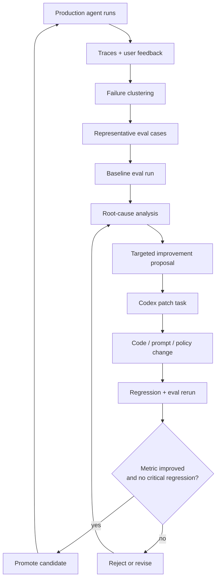
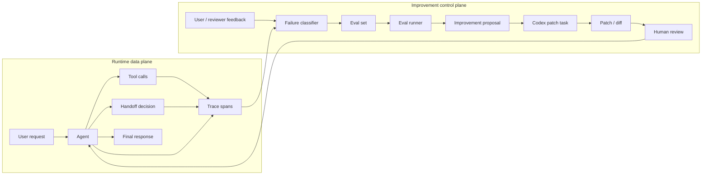
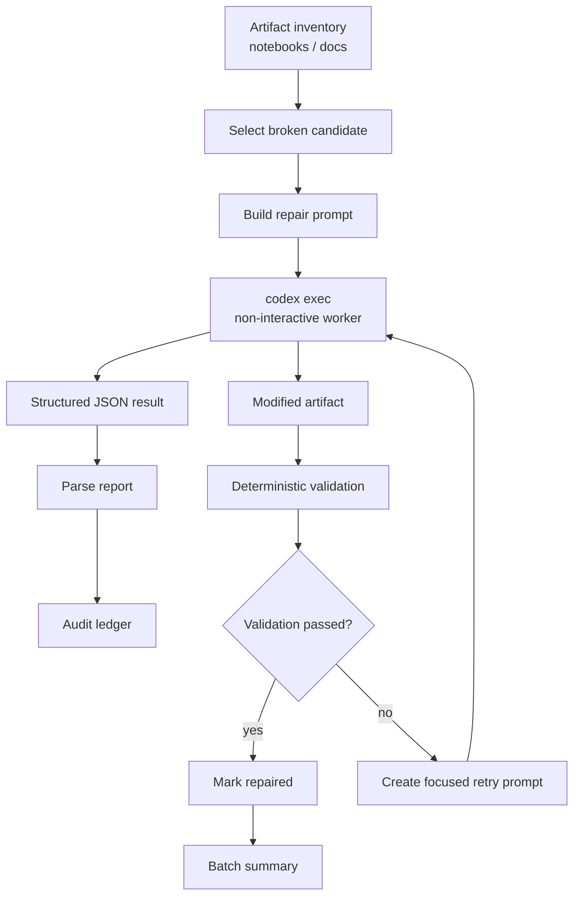
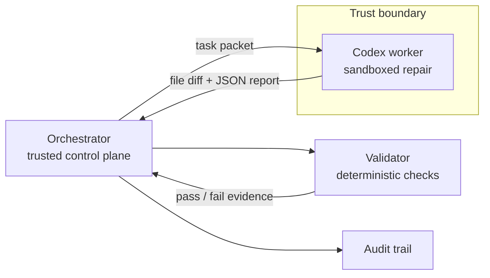
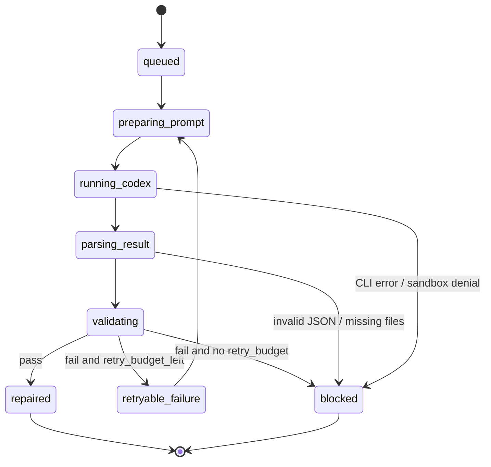
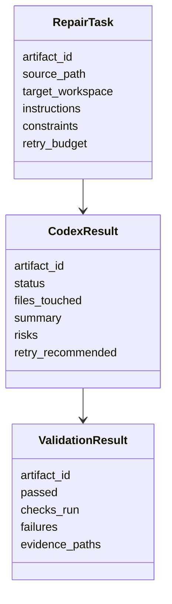
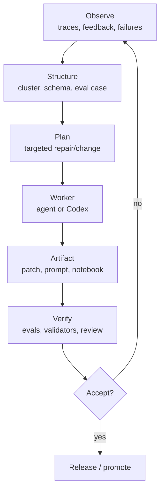
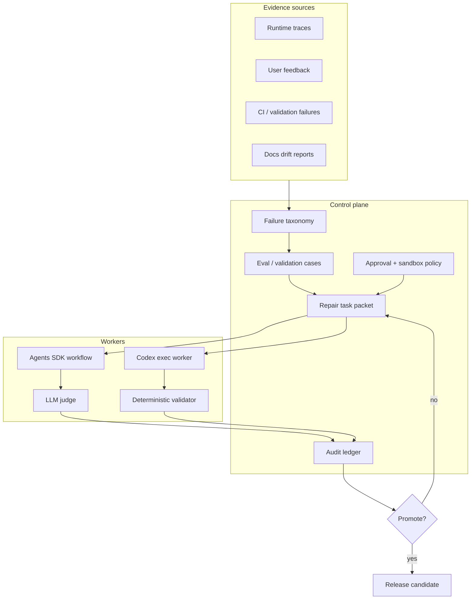
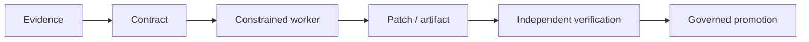

# Технический разбор OpenAI agent improvement и Codex iterative repair loops

Source status: `official + third-party + community + analysis`

Проверено: `2026-06-29`

Статус документа: research note / insight layer. Это не canonical guide и не
runtime proof. Official claims ниже опираются на OpenAI Cookbook и OpenAI docs.
Community claims отделены и имеют `verification_status`.

## Короткий вывод

Обе статьи предлагают одну архитектурную идею: не просить модель "стать лучше"
в общем виде, а строить замкнутый инженерный цикл вокруг наблюдений,
артефактов, проверок и малых изменений.

- В статье про Agents SDK цикл строится вокруг production traces,
  пользовательской обратной связи, кластеризации проблем, evals и Codex как
  исполнителя точечных prompt / policy / routing изменений.
- В статье про Codex iterative repair loop Codex сам становится ремонтным
  worker: запускается в headless / non-interactive режиме, читает structured
  repair prompt, меняет notebook / docs artifact и возвращает JSON-отчёт,
  который затем проверяется deterministic validators.
- Общее инженерное решение: модель не является единственным судьёй качества.
  Она работает внутри системы с trace evidence, schemas, acceptance gates,
  sandbox boundaries, deterministic validation, retry policy и human approval.
- Главный architectural tradeoff: такие loops резко повышают repeatability и
  скорость ремонта, но требуют строгой дисциплины вокруг source-of-truth,
  version pinning, budget limits, privacy, prompt/schema contracts и
  негативного proof, что fallback / old path не обслужил acceptance scenario.

## Источники

### Official OpenAI

- OpenAI Cookbook: [Agent improvement loop with the Agents SDK](https://developers.openai.com/cookbook/examples/agents_sdk/agent_improvement_loop)
- Raw notebook: [openai-cookbook/examples/agents_sdk/agent_improvement_loop.ipynb](https://github.com/openai/openai-cookbook/blob/main/examples/agents_sdk/agent_improvement_loop.ipynb)
- OpenAI Cookbook: [Build iterative repair loops with Codex](https://developers.openai.com/cookbook/examples/codex/build_iterative_repair_loops_with_codex)
- Raw notebook: [openai-cookbook/examples/codex/Build_iterative_repair_loops_with_Codex.ipynb](https://github.com/openai/openai-cookbook/blob/main/examples/codex/Build_iterative_repair_loops_with_Codex.ipynb)
- OpenAI docs: [Agents](https://developers.openai.com/api/docs/guides/agents)
- OpenAI docs: [Evaluate agent workflows](https://developers.openai.com/api/docs/guides/agent-evals)
- OpenAI docs: [Codex CLI](https://developers.openai.com/codex/cli)
- OpenAI docs: [Codex non-interactive mode](https://developers.openai.com/codex/noninteractive)
- OpenAI docs: [Codex sandbox](https://developers.openai.com/codex/config#sandbox)
- OpenAI docs: [Structured Outputs](https://developers.openai.com/api/docs/guides/structured-outputs)

### Third-party implementation experience

- Langfuse: [OpenAI Agents SDK integration guide](https://langfuse.com/guides/cookbook/integration_openai_agents)
- Mem0: [Building AI agents with OpenAI's Agents SDK](https://mem0.ai/blog/ai-agents)

### Community / user feedback signals

- GitHub issue: [openai-agents-python #1418, multi-agent metrics and evals](https://github.com/openai/openai-agents-python/issues/1418)
- GitHub issue: [openai/codex #4181, output schema not working in non-interactive mode](https://github.com/openai/codex/issues/4181)
- GitHub issue: [openai/codex #21176, Codex update broke coding workflow](https://github.com/openai/codex/issues/21176)
- Hacker News discussion: [Ask HN: Agent design is hard](https://news.ycombinator.com/item?id=46013935)
- Reddit: [My failed attempt to completely replace manual coding with Codex](https://www.reddit.com/r/OpenAI/comments/1r0k96m/my_failed_attempt_to_completely_replace_manual/)
- Reddit: [Just spent 3 days vibe-coding with ChatGPT Codex](https://www.reddit.com/r/CodingWithAI/comments/1lt1b21/just_spent_3_days_vibecoding_with_chatgpt_codex/)
- OpenAI Community: [OpenAI Codex CLI Agent Review](https://community.openai.com/t/openai-codex-cli-agent-review/1242527)

## Что именно предлагают статьи

### 1. Agent improvement loop with the Agents SDK

Статья показывает production-oriented цикл улучшения agentic workflow на примере
OpenAI Agents SDK-backed financial analyst для acquisition diligence. Это
важное уточнение: пример не про insurance support и не про coverage claims, а
про вымышленную SaaS-компанию, dataroom, финансовые exports, customer data,
contracts, security notes, board materials и management narratives.

Исходная проблема не в том, что агент "плохо отвечает" абстрактно, а в том, что
production-like traces и feedback показывают конкретные failure clusters:

- finance-controlled ARR должен иметь приоритет над board headline ARR;
- runway / burn надо переводить в near-term financing risk, а не в общий red
  flag;
- customer concentration нужно считать после parent-account rollup, а не только
  по legal entity;
- SOC 2 Type I нельзя превращать в "SOC 2 complete" или Type II claim;
- unsupported metrics вроде CAC payback и unvalidated NRR должны быть refused,
  а не inferred;
- contradictions между structured exports и narratives должны сохраняться как
  uncertainty / review item;
- citations и reviewable artifacts должны оставаться машинно проверяемыми.

Ключевое решение: перевести эти симптомы в repeatable improvement loop.

1. Собрать traces и feedback из реальных runs.
2. Сгруппировать failures в категории, пригодные для engineering action.
3. Создать eval set из репрезентативных cases.
4. Прогнать baseline, чтобы получить численную и качественную точку отсчёта.
5. Сгенерировать targeted improvements: prompt edits, tool policy,
   retrieval constraints, handoff routing, refusal / uncertainty behavior.
6. Передать patch work в Codex, чтобы изменить код / prompt artifacts.
7. Повторно прогнать evals.
8. Принять только те изменения, которые улучшают target metric и не ломают
   regression cases.

Идея здесь ближе к SRE / QA для agentic systems, чем к "prompt tweaking".
Trace становится аналогом production log, eval set - regression suite, а
improvement proposal - change request с measurable acceptance criteria.

Official notebook вводит важный термин: **harness** - это не только prompt.
Harness означает полный контракт вокруг модели: instructions, tools, routing,
output requirements и validation checks. Поэтому улучшение не сводится к
редактированию system prompt; оно может менять tool policy, artifact contract,
source-of-truth rules, eval gate и handoff guidance.

#### Точный runnable контур примера

- Дата Cookbook page: `2026-05-12`.
- Dependencies: `openai`, `openai-agents`, `halo-engine`.
- Promptfoo запускается через `npx`, поэтому нужен Node.js / `npx`.
- Требуется `OPENAI_API_KEY`.
- Пример intentionally live-only: trace generation, model critique, eval
  generation, validation и HALO optimization делают fresh model calls.
- Default path строит пять traced runs; полный run занимает около 20 минут.
- Model knobs вынесены в environment variables:
  `OPENAI_AGENT_MODEL`, `OPENAI_ANALYSIS_MODEL`,
  `OPENAI_EVAL_GENERATION_MODEL`, `OPENAI_JUDGE_MODEL`,
  `OPENAI_HALO_MODEL`.
- Default models в notebook на дату проверки: `gpt-5.5`; Promptfoo version
  default: `0.121.9`.
- Основной carry-forward artifact: `codex_handoff.md` в `ARTIFACT_DIR`; рядом
  также пишется `halo_optimization_context.jsonl`.

#### Synthetic diligence workspace

Notebook создаёт synthetic dataroom из 24 файлов. Важна не сама фиктивная
компания, а conflict design:

| Источник | Что проверяет |
| --- | --- |
| `board_deck.md` | Management narrative, headline ARR `$43.0M`, runway `11 months` |
| `financials/arr_bridge.csv` | Finance-controlled FY2025 ending ARR `$36.9M` |
| `financials/revenue_recognition_notes.md` | Почему board ARR нельзя silently reconcile с finance ARR |
| `customers/account_hierarchy.csv` | Parent-account concentration, который важнее legal-entity framing |
| `security/security_overview.md` | SOC 2 Type I complete, Type II not issued |
| `sales/security_faq.md` | Sales wording that can overstate SOC 2 status |
| `notes/qa_log.md` | Missing metrics and unresolved diligence questions |

Это делает example полезным архитектурно: агент вынужден выбирать source
authority, сохранять contradictions, отказываться от unsupported inference и
оставлять audit artifacts.

#### Agent output artifacts

Статья явно показывает, что agent пишет не только final answer:

| Artifact | Назначение |
| --- | --- |
| `summary_answer.md` | Concise answer returned to the user |
| `investment_memo.md` | Fuller diligence artifact for reviewers |
| `risk_register.json` | Structured risks with evidence |
| `open_questions.md` | Missing evidence / unresolved questions |
| `citations.json` | Machine-readable claim-to-source links |
| `evidence_table.csv` | Tabular audit trail of claims and sources |

Архитектурный смысл: output contract должен быть multi-artifact, иначе
downstream validation видит только prose и теряет проверяемость.

#### Диаграмма: improvement flywheel



#### Архитектурные компоненты

| Компонент | Роль | Почему важен |
| --- | --- | --- |
| Agents SDK | Runtime abstraction для agent, tools, handoffs, tracing | Даёт единый контур исполнения и наблюдаемости |
| Agent instructions | Policy и behavioral contract | Основная поверхность точечных изменений |
| Tools | Инструменты для retrieval, lookup, claim handling, escalation | Отделяют reasoning от external action |
| Tracing | Evidence stream по run / span / tool call | Позволяет находить конкретные failure modes |
| Feedback | Human / user signal | Покрывает UX и semantic quality, которые unit tests не ловят |
| Eval set | Повторяемая проверка | Предотвращает "улучшение на одном примере" |
| Promptfoo / HALO-style eval ideas | Примеры eval / judging harness | Помогают измерять hallucination, helpfulness, compliance |
| Codex | Implementation worker | Переводит improvement plan в patch |
| Human gate | Approval / reviewer | Снижает риск self-modifying loop без контроля |

#### Почему важны traces

Без traces команда видит только финальный ответ агента. С traces видно:

- какой prompt / instructions реально использовались;
- какие tools были вызваны;
- были ли retrieval misses;
- где агент сделал неверный inference;
- был ли handoff предложен, отклонён или вообще не выбран;
- сколько шагов, токенов и latency ушло на failure;
- можно ли воспроизвести ошибку через synthetic eval.

Это меняет архитектурную модель. Agent перестаёт быть "одним API call" и
становится distributed workflow с внутренней телеметрией.

#### Диаграмма: data plane и control plane



#### Предлагаемые design decisions

1. **Failure-first improvement.** Улучшение начинается не с новой идеи, а с
   факта: trace, feedback, failed eval, bad handoff, bad financial diligence
   claim.

2. **Small targeted patches.** Статья не предлагает переписывать агента целиком.
   Она направляет Codex на ограниченный patch: изменить instructions, добавить
   guardrail, уточнить tool usage, поправить handoff rule.

3. **Eval-before-change.** До изменения нужен baseline. Иначе нельзя понять,
   изменение улучшило систему или просто изменило форму ответа.

4. **Human-in-the-loop.** Codex помогает подготовить change, но promotion должен
   иметь review gate. Это особенно важно для financial diligence domain, где
   неверный ARR, SOC 2, customer concentration или unsupported metric claim
   может изменить investment decision.

5. **Trace-to-patch handoff.** Root-cause analysis должен быть достаточно
   структурированным, чтобы Codex получил не "make it better", а task packet:
   source files, symptoms, examples, expected behavior, tests.

6. **Regression protection.** Улучшение одного failure class не должно ломать
   другие классы. Это требует fixed eval suite плюс new cases.

7. **Handoff as source artifact.** `codex_handoff.md` - это не просто summary.
   Это ranked implementation packet: HALO diagnosis, recommendations,
   supporting evidence и validation guidance для следующего harness update.
   В official run top-3 changes были: добавить deterministic diligence fact
   ledger + domain checklist; усилить validators так, чтобы они проверяли
   actual output artifacts, а не только claimed evidence coverage; сохранить
   пять generated evals в checked-in regression suite.

8. **Live-only proof boundary.** Notebook намеренно не является scripted demo.
   Его claims о loop behavior зависят от fresh model calls, Promptfoo gate и
   HALO run. Поэтому переносить выводы в production без собственного baseline
   и budget controls нельзя.

#### Технологический смысл Agents SDK в этом паттерне

Agents SDK полезен не только тем, что запускает agent. Его главная ценность в
таком loop - стандартизация observability и composition:

- agent object хранит instructions и tools;
- handoff позволяет разделить specialists;
- tracing создаёт общий журнал execution;
- eval workflow может переиспользовать те же tasks / cases;
- runner abstraction позволяет менять prompts и сравнивать outcomes;
- structured artifacts можно передавать между "analysis", "patch" и
  "validation" steps.

Это особенно важно, если agent не одиночный chatbot, а workflow из нескольких
ролей: intake, retrieval, policy reasoning, compliance review, escalation.

#### Основные риски

- **Overfitting to evals.** Prompt может научиться проходить маленький eval set,
  но деградировать на реальных edge cases.
- **Trace privacy.** Production traces могут содержать PII, confidential claims,
  raw customer text. Нужны redaction и retention rules.
- **Self-reinforcing judge.** Если модель сама классифицирует failures и сама
  судит evals, можно получить замкнутую ошибку. Нужны deterministic checks,
  human spot checks и разнообразные judges.
- **Prompt drift.** Небольшие prompt edits без versioning быстро превращают
  behavior в неуправляемый слой.
- **Tool policy ambiguity.** Если tool call selection не проверяется, агент может
  "улучшить" ответ, но перестать использовать authoritative retrieval.
- **Eval-generation quality.** В статье evals генерируются LLM из traces,
  human feedback и LLM insights. Это ускоряет coverage, но требует human review,
  потому что плохой eval может закрепить неправильное поведение.
- **Carry-forward artifact drift.** Если `codex_handoff.md` не версионировать
  вместе с harness и eval suite, future Codex patch может реализовать устаревшую
  рекомендацию.

### 2. Build iterative repair loops with Codex

Вторая статья показывает другой паттерн: Codex CLI запускается как
non-interactive repair worker для notebook / documentation artifacts. Пример
работает с outdated OpenAI API examples и строит цикл:

1. Сгенерировать или взять broken / outdated notebooks.
2. Создать repair prompt с требованиями.
3. Запустить `codex exec` в headless режиме.
4. Попросить Codex вернуть structured JSON summary.
5. Проверить результат deterministic validator'ами.
6. Если validation failed, создать следующую repair iteration с конкретной
   ошибкой.
7. Сохранить audit trail и status по каждому artifact.

Это не "Codex пишет код по чату", а batch repair architecture. Codex становится
внутренним worker в pipeline, а не интерактивным собеседником.

#### Точный runnable контур примера

- Notebook предназначен для локального запуска в Jupyter.
- Требуется `OPENAI_API_KEY`.
- Codex CLI ставится как npm package; article pin: `@openai/codex@0.130.0`.
- Default `REPAIR_MODEL`: `gpt-5.4-mini`.
- Default chat model для synthetic notebook setup: `gpt-5.5`.
- Рабочая staging area создаётся во временной директории; путь можно задать
  через `CODEX_REPAIR_RUNS_DIR`.
- Default repair iterations: одна итерация на каждый notebook candidate.
- Команда запускается из temporary workspace, а не из canonical repo root.

Ключевой command shape:

```powershell
codex exec `
  --model <repair_model> `
  --sandbox workspace-write `
  --ask-for-approval never `
  --config model_reasoning_effort="low" `
  --output-schema <schema_file> `
  --output-last-message <answer_file> `
  -
```

Архитектурный смысл flags:

| Flag | Роль в loop |
| --- | --- |
| `--model` | Делает worker model явным и пригодным для regression tracking |
| `--sandbox workspace-write` | Разрешает staged file edits без произвольного filesystem blast radius |
| `--ask-for-approval never` | Делает batch run non-interactive; unsafe actions должны блокироваться policy/validator |
| `--config model_reasoning_effort="low"` | Снижает latency/cost для bounded mechanical repair |
| `--output-schema` | Принуждает final report к machine-readable contract |
| `--output-last-message` | Сохраняет worker report как artifact |
| `-` | Передаёт repair prompt через stdin |

#### Три staged notebook targets

| Notebook | Source notebook | Target iteration / repair depth |
| --- | --- | --- |
| `qdrant_embeddings_search_pre_repair.ipynb` | `examples/vector_databases/qdrant/Using_Qdrant_for_embeddings_search.ipynb` | `1`; one-pass cleanup for local Qdrant query path and sampled fixture framing |
| `getting_started_evals_pre_repair.ipynb` | `examples/evaluation/Getting_Started_with_OpenAI_Evals.ipynb` | `2`; two-pass cleanup for stale Evals flow and result-log brittleness |
| `knowledge_retrieval_pre_repair.ipynb` | `examples/How_to_call_functions_for_knowledge_retrieval.ipynb` | `3`; three-pass cleanup for model/API shape, runnable local setup and full retrieval teaching flow |

Дополнительное business rule в notebook: remove / replace obsolete `oaieval`
CLI guidance with current Evals API-oriented guidance where relevant.

Полный business-rule layer в статье состоит из двух частей:

- `modernize`: migrate `client.chat.completions.create` to
  `client.responses.create`, legacy function-calling schemas to current tools
  schema, `qdrant.search` to `qdrant.query_points`, `oaieval` CLI examples to
  current Evals API workflow.
- `reader_experience`: fresh-environment setup, runnable local samples,
  self-contained repairs unless external setup is the lesson, no manual
  result-file placeholders, runtime prerequisites / side effects before cells,
  preserve original teaching goal while modernizing implementation.

#### Audit record

Каждый repair attempt должен возвращать structured record, который затем
проверяется parser'ом и validator'ом. В production варианте этот record должен
хранить:

- notebook id / path;
- iteration number;
- status;
- summary;
- files changed;
- API migrations performed;
- remaining risks;
- validation result;
- stdout/stderr или их redacted excerpts;
- path to `answer_file`;
- timestamp и model/version metadata.

#### Диаграмма: iterative repair pipeline



#### Главный architectural move

Статья отделяет три роли:

- **Planner / orchestrator**: выбирает artifact, задаёт task prompt, хранит
  status.
- **Codex worker**: меняет файлы в ограниченном workspace и возвращает
  structured status.
- **Validator**: независимо проверяет, что notebook стал рабочим и не нарушил
  constraints.

Это делает Codex заменяемым компонентом. Если worker ошибся, validator не
принимает change. Если validator нашёл ошибку, следующий prompt получает
конкретный failure report.

#### Диаграмма: роли и границы доверия



#### Предлагаемые design decisions

1. **Use `codex exec` for repeatable automation.** Интерактивный Codex удобен
   для steering, но batch repair требует non-interactive command, predictable
   cwd, args и output.

2. **Pin CLI version.** Статья явно ориентируется на конкретную версию CLI.
   Это критично: automation, output schema и sandbox flags могут меняться.

3. **Use a temporary workspace.** Repair loop должен работать на копии или
   staged area. Это снижает риск повреждения canonical sources.

4. **Use structured output.** JSON report нужен не для красоты, а для parser,
   status dashboard, retry prompt и batch rollup.

5. **Separate model confidence from validator truth.** Если Codex пишет
   "fixed", это не доказательство. Доказательство - notebook executes,
   markdown constraints соблюдены, expected cells обновлены.

6. **Make retry prompts evidence-driven.** Следующая итерация должна включать
   конкретную validation error, а не повторять общий prompt.

7. **Record batch artifacts.** Для production repair loop нужны status,
   failures, retry count, modified files, validation logs, final disposition.

8. **Treat review and repair as separate phases.** Article first inspects
   notebooks and labels findings before asking Codex to edit. Good production
   loops should preserve this split: discovery can be read-only; repair is a
   write action with tighter sandbox and audit.

9. **Encode migration rules explicitly.** Codex получает не "modernize this",
   а concrete business rules: replace stale OpenAI API usage, update tool
   calling style, repair Qdrant search API, remove obsolete eval CLI guidance,
   and keep explanatory notebook text aligned with code.

10. **Stop at budget.** One pass per notebook in the article is a deliberate
    containment choice. Production loops should make retry budget explicit,
    because unbounded auto-repair can burn cost and churn files.

#### State machine repair loop



#### Технологический смысл Codex в этом паттерне

Codex здесь используется как локальный coding agent с доступом к workspace.
Это позволяет делать задачи, которые обычный single API call выполняет хуже:

- читать несколько файлов;
- редактировать notebook JSON / Markdown / code cells;
- учитывать repo conventions;
- запускаться в контролируемом cwd;
- возвращать machine-readable report;
- работать в retry loop с конкретной ошибкой.

Но из-за этого Codex требует более строгих boundaries:

- read/write scope;
- sandbox mode;
- approval policy;
- network policy;
- timeout;
- max retries;
- output schema;
- log retention;
- rollback strategy.

#### Review findings taxonomy

Вторая статья полезна ещё и тем, что показывает taxonomy для pre-repair review.
Findings можно нормализовать так:

| Finding label | Что означает |
| --- | --- |
| `stale_model` | Пример ссылается на устаревший model или default |
| `deprecated_api` | Используется устаревший SDK/API pattern |
| `setup_gap` | Notebook не объясняет актуальный setup / env |
| `runtime_risk` | Код может не выполниться из-за dependency/API drift |
| `clarity` | Документ объясняет старую механику или вводит пользователя в заблуждение |

Это важнее, чем кажется: good repair prompt должен ссылаться на concrete
finding classes, иначе Codex начнёт переписывать стиль вместо устранения
maintenance defects.

#### Почему structured output важен

В iterative repair loop structured output является contract между Codex worker и
orchestrator. Без него batch runner вынужден парсить natural language, что
ломается при малейшей вариативности ответа.

Минимальный contract должен содержать:

- artifact id;
- status: `repaired`, `partial`, `blocked`, `no_change`;
- files touched;
- summary;
- validation instructions или expected checks;
- known risks;
- whether retry is recommended;
- machine-readable error class.

Для Codex automation важно различать два schema слоя:

| Schema layer | Что проверяет | Почему отдельно |
| --- | --- | --- |
| Worker output schema | Codex вернул parseable JSON report | Это contract транспорта между worker и orchestrator |
| Artifact validation schema | Notebook / docs artifact реально соответствует rules | Это proof качества результата, а не формы отчёта |

Если первый слой зелёный, но второй красный, loop должен идти в retry или
blocked state. Если второй зелёный, но первый красный, batch dashboard всё равно
не сможет безопасно агрегировать результат.

Official notebook явно разделяет schemas по фазам:

| Phase schema | Required fields |
| --- | --- |
| Review finding | `artifact`, `issue_type`, `severity`, `description`, `suggested_fix_direction` |
| Repair / fix result | `artifact`, `iteration`, `changes_made`, `unresolved_items`, `updated_artifact_path` |
| Validation result | `artifact`, `passed`, `findings`, `remaining_delta` |

Такой schema split - стандартная механика для agent loops: review генерирует
диагноз, repair делает change, validation возвращает delta для следующей
итерации. Один общий "result" object был бы менее управляемым.

#### Диаграмма: artifact contract



## Сравнение двух статей

| Вопрос | Agents SDK improvement loop | Codex iterative repair loop |
| --- | --- | --- |
| Что улучшается | Runtime behavior agent workflow | Source artifacts: notebooks, docs, examples |
| Главный сигнал | Traces, user feedback, eval failures | Deterministic validation failures |
| Исполнитель изменения | Codex как patch assistant | Codex как headless repair worker |
| Основной runtime | Agents SDK | Codex CLI / `codex exec` |
| Контракт результата | Eval score, behavior comparison, patch | JSON repair report + validation result |
| Основной риск | Overfitting, privacy, weak evals | Sandbox/write risk, invalid output, fragile CLI assumptions |
| Human role | Reviewer / approver of behavior changes | Owner of batch policy, approvals, promotion |
| Что считается proof | Eval rerun + trace review + human gate | Validator pass + audit trail + controlled diff |

## Общая архитектурная модель

Обе статьи можно свести к одному meta-pattern:



Ключевой смысл: agentic automation становится надёжнее не потому, что модель
сразу делает всё правильно, а потому что вокруг неё построен feedback-control
system.

## Технологии и как они применяются

### OpenAI Agents SDK

Применение:

- описывает agents, tools и handoffs;
- запускает agent workflows;
- создаёт traces исполнения;
- упрощает многоагентную композицию;
- делает runtime поведение inspectable.

Архитектурная роль:

- runtime fabric для agent workflow;
- observability source для improvement loop;
- boundary между business logic, tools и model reasoning.

Практический вывод:

- Agents SDK особенно полезен, когда workflow состоит из нескольких шагов и
  tools. Для простого single-call Q&A он может быть избыточен.

### Tracing

Применение:

- сбор execution spans;
- анализ tool calls;
- поиск места, где agent ушёл в hallucination или плохой handoff;
- построение evidence для eval case.

Архитектурная роль:

- production telemetry;
- debugging substrate;
- source for failure clustering.

Практический вывод:

- trace без redaction policy опасен;
- trace без taxonomy превращается в большой лог, а не в improvement system.

### Evals / model-graded checks

Применение:

- baseline перед изменением;
- regression после изменения;
- scoring helpfulness, correctness, refusal, hallucination, completeness;
- сравнение prompt versions.

Архитектурная роль:

- acceptance gate;
- regression suite;
- safety net against prompt drift.

Практический вывод:

- subjective evals надо подкреплять deterministic checks там, где это возможно;
- eval cases должны версионироваться вместе с prompts.

### Codex CLI / `codex exec`

Применение:

- headless execution of coding tasks;
- repair of files;
- structured output для orchestrator;
- batch automation.

Архитектурная роль:

- code-modifying worker внутри pipeline;
- bridge между analysis artifact и actual diff.

Практический вывод:

- `codex exec` подходит для repeatable automation, но требует pinned version,
  stable cwd, sandbox policy, timeout и output contract.

### Structured Outputs / JSON schema

Применение:

- machine-readable repair report;
- status rollup;
- retry routing;
- downstream dashboard / ledger.

Архитектурная роль:

- contract boundary между natural-language agent и deterministic orchestrator.

Практический вывод:

- schema решает форму ответа, но не истинность ответа;
- downstream validator всё равно обязателен.

### Promptfoo / HALO-style evaluation ideas

Применение в статье:

- как примеры подходов к eval harness и hallucination-oriented testing;
- как способ переводить qualitative failures в repeatable cases.

Архитектурная роль:

- внешний или вспомогательный evaluation layer;
- comparator prompt versions / agent versions.

Практический вывод:

- eval harness должен быть tool-agnostic: можно менять Promptfoo, custom runner
  или OpenAI eval workflow, но cases и acceptance criteria должны сохраняться.

### Jupyter / notebook validation

Применение во второй статье:

- notebook artifact является repair target;
- validator должен проверять структуру, cells, imports, execution viability и
  absence of stale API patterns.

Архитектурная роль:

- deterministic acceptance surface для docs/examples maintenance.

Практический вывод:

- notebook repair надо проверять как документ и как executable artifact.

## Production blueprint

Для реального внедрения обеих идей я бы строил систему так:



### Минимальные артефакты

- `failure_taxonomy.md`: категории failures и routing rules.
- `eval_cases.jsonl`: вход, expected behavior, rubric, source evidence.
- `repair_task_schema.json`: контракт для Codex worker.
- `validation_matrix.md`: deterministic и model-graded checks.
- `runlog.md`: what changed, why, evidence, gaps.
- `promotion_policy.md`: когда изменение можно выпускать.
- `privacy_policy.md`: redaction, retention, allowed trace fields.

### Минимальные gates

1. Source artifact identified.
2. Failure reproduced or trace-backed.
3. Baseline captured.
4. Patch generated in isolated workspace.
5. Structured result parsed.
6. Deterministic validators passed.
7. Model-graded eval improved or accepted gap recorded.
8. Human review passed for high-risk domains.
9. Rollback path exists.
10. Audit ledger updated.

## Аналогичный пользовательский опыт и отзывы

Ниже не official truth, а external signals. Я не проверял эти workflows локально
в текущем run; они полезны как risk radar.

### Signal 1: разработчикам нужны метрики multi-agent workflow

```yaml
claim: "Пользователи Agents SDK быстро приходят к потребности в метриках уровня multi-agent системы: latency, tool usage, coordination success, error rate, handoff quality."
source: "https://github.com/openai/openai-agents-python/issues/1418"
evidence: "GitHub issue asks about metrics and evals for multi-agent systems, not only single response correctness."
works_for: "Production hardening, observability backlog, agent improvement loops."
risks: "Issue discussion is not official API guarantee and may reflect one user's needs."
verification_status: "unverified"
checked_at: "2026-06-29"
trust_level: "medium"
```

Вывод: статья про Agents SDK правильно делает traces first-class artifact.
Реальные пользователи быстро упираются не в "как вызвать model", а в "как
понять, почему multi-step system стала хуже".

### Signal 2: structured output в Codex automation надо регрессионно проверять

```yaml
claim: "Non-interactive Codex output schema может быть чувствительной поверхностью automation и требует pinning + regression tests."
source: "https://github.com/openai/codex/issues/4181"
evidence: "GitHub issue reports a problem with output schema in non-interactive mode; even if closed, it shows fragility automation contracts."
works_for: "Batch repair loop, CI integration, JSON status parsing."
risks: "Issue may be version-specific and stale after fixes."
verification_status: "unverified"
checked_at: "2026-06-29"
trust_level: "medium"
```

Вывод: в Codex repair loop нельзя считать JSON schema eternal contract без
тестов. Нужно фиксировать CLI version, иметь sample command и проверять parser.

### Signal 3: пользователи Codex CLI ценят agency, но жалуются на breakage

```yaml
claim: "Codex CLI может стать ежедневным coding workflow, но пользователи болезненно воспринимают update breakage и regressions."
source: "https://github.com/openai/codex/issues/21176"
evidence: "Issue describes workflow disruption after a Codex update."
works_for: "Version pinning, release notes review, automation safety."
risks: "Single issue is anecdotal and may not represent broad reliability."
verification_status: "unverified"
checked_at: "2026-06-29"
trust_level: "medium"
```

Вывод: second article's pinning и controlled runner - не формальность. Если
Codex CLI встроен в repair pipeline, обновления должны идти через compatibility
test, а не через implicit latest.

### Signal 4: community видит ценность dashboard traces, но боится framework lock-in

```yaml
claim: "Разработчики ценят встроенные traces и dashboards, но часть community предпочитает hand-rolled loops из-за контроля, прозрачности и provider portability."
source: "https://news.ycombinator.com/item?id=46013935"
evidence: "Hacker News discussion around agent design compares SDK/framework convenience with custom orchestration and observability concerns."
works_for: "Framework selection, build-vs-buy decision, portability planning."
risks: "HN comments are subjective and not controlled evidence."
verification_status: "unverified"
checked_at: "2026-06-29"
trust_level: "low"
```

Вывод: Agents SDK хорош как integrated path, но production architecture должна
оставлять portable contracts: eval cases, failure taxonomy, trace schema,
repair task schema. Тогда команда не запирает весь process knowledge внутри
одного framework.

### Signal 5: Codex помогает при точных задачах, но не заменяет engineering judgment

```yaml
claim: "Пользовательский опыт Codex лучше, когда задача ограничена файлами, expected behavior и checks; попытка полностью заменить manual coding даёт разочарование."
source: "https://www.reddit.com/r/OpenAI/comments/1r0k96m/my_failed_attempt_to_completely_replace_manual/"
evidence: "Reddit post frames a failed attempt to replace manual coding with Codex; pattern aligns with need for review, tests and scoped tasks."
works_for: "Task packet design, human-in-loop policy, prompt discipline."
risks: "Anecdotal Reddit report, no controlled reproduction."
verification_status: "unverified"
checked_at: "2026-06-29"
trust_level: "low"
```

Вывод: обе OpenAI статьи фактически отвечают на этот риск: Codex не должен быть
"магическим заменителем инженера"; он должен быть worker внутри проверяемого
цикла.

### Signal 6: положительный UX возникает при multi-day iterative workflow

```yaml
claim: "Позитивные Codex reports часто описывают не one-shot generation, а multi-day iterative workflow с постепенными fixes."
source: "https://www.reddit.com/r/CodingWithAI/comments/1lt1b21/just_spent_3_days_vibecoding_with_chatgpt_codex/"
evidence: "Reddit post presents a multi-day coding session rather than a single prompt success."
works_for: "Iterative repair mindset, chunked implementation, runlog discipline."
risks: "Anecdotal, may hide manual effort and failed attempts."
verification_status: "unverified"
checked_at: "2026-06-29"
trust_level: "low"
```

Вывод: successful UX похож на loop из второй статьи: small repairs, validation,
retry, state tracking. "Vibe coding" становится полезнее, когда превращается в
evidence-driven iteration.

### Signal 7: third-party observability уже повторяет этот паттерн

```yaml
claim: "Third-party observability platforms интегрируют OpenAI Agents SDK traces, потому что production users хотят видеть spans, tool calls, costs and evaluation signals outside the model call itself."
source: "https://langfuse.com/guides/cookbook/integration_openai_agents"
evidence: "Langfuse documents an OpenAI Agents SDK integration path for tracing and observability."
works_for: "Production monitoring, vendor-neutral trace retention, evaluation dashboards."
risks: "Vendor guide is implementation guidance, not neutral product review."
verification_status: "unverified"
checked_at: "2026-06-29"
trust_level: "medium"
```

Вывод: OpenAI article's trace-driven architecture is not isolated. The market
around agent observability exists because raw prompt/response logs are not
enough for production debugging.

### Signal 8: long-term memory и context persistence остаются отдельной проблемой

```yaml
claim: "Agents SDK examples often need an additional memory layer for persistent user/application context; this is adjacent to, but not solved by, repair loops."
source: "https://mem0.ai/blog/ai-agents"
evidence: "Mem0 discusses adding memory to OpenAI Agents SDK-style agents."
works_for: "Long-running assistants, personalization, context retention."
risks: "Vendor framing promotes its own memory product and should be separated from official SDK claims."
verification_status: "unverified"
checked_at: "2026-06-29"
trust_level: "medium"
```

Вывод: improvement loop и memory loop нельзя смешивать. Improvement loop чинит
system behavior; memory layer хранит user/application context. Оба требуют
source policy и privacy boundaries.

## Практические архитектурные рекомендации

### Для Agents SDK improvement loop

1. Начать с failure taxonomy, а не с prompt rewrite.
2. Сохранять raw traces только с redaction или в protected storage.
3. Каждый improvement ticket должен иметь:
   - trace ids или synthetic reproduction;
   - expected behavior;
   - proposed surface: prompt, tool, retrieval, handoff, guardrail;
   - eval cases;
   - rollback instruction.
4. Использовать модель-судью только как один из signals.
5. Для high-risk domains добавить human review и deterministic policy checks.
6. Версионировать prompts, eval sets и judge rubrics вместе.
7. Считать "eval green" недостаточным без regression review.

### Для Codex iterative repair loop

1. Запускать Codex только в controlled workspace или staged copy.
2. Фиксировать Codex CLI version и smoke-test команды.
3. Хранить task packet и result JSON для каждого artifact.
4. Не принимать self-reported "fixed" без validator output.
5. Использовать retry budget и stop conditions.
6. Нормализовать failure classes:
   - invalid JSON;
   - no files changed;
   - validation failed;
   - sandbox denied;
   - timeout;
   - unsafe diff;
   - human approval required.
7. Отделить repair candidate от canonical source до review/promote gate.

### Для общего production внедрения

1. Сделать source-of-truth registry для prompts, evals, validators и repair
   schemas.
2. Ввести "evidence ledger" как обязательный output каждого loop run.
3. Разделить local synthetic proof, runtime proof, browser proof, live provider
   proof и product acceptance.
4. Запретить silent fallback: если old path / fallback обслужил scenario,
   improvement не доказан.
5. Добавить cost controls: max runs, max retries, max tokens, budget alarm.
6. Добавить privacy controls: PII redaction, allowed trace fields, retention.
7. Добавить release controls: version pinning, changelog scan, compatibility
   smoke before CLI/SDK upgrades.

## Повторный аудит полноты артефакта

После повторной сверки с official pages и текущим Markdown я нашёл и исправил
следующие gaps:

| Gap | Статус после правки |
| --- | --- |
| Неверный домен первого примера: было insurance support вместо financial diligence | Исправлено |
| Не был раскрыт термин `harness` как instructions + tools + routing + output + validation | Добавлено |
| Не были перечислены live-only prerequisites и model/env knobs первого notebook | Добавлено |
| Не был описан synthetic dataroom и source-conflict design | Добавлено |
| Не были перечислены multi-artifact outputs agent run | Добавлено |
| `codex_handoff.md` и `halo_optimization_context.jsonl` были недообъяснены | Добавлено |
| Не была показана точная форма `codex exec` command и роль flags | Добавлено |
| Не были перечислены три staged notebook repair targets | Добавлено |
| Не были описаны explicit migration / business rules второго notebook | Добавлено |
| Не была выделена review findings taxonomy | Добавлено |
| Не был разделён worker output schema и artifact validation schema | Добавлено |

Что остаётся осознанно не включённым:

- Полный source dump notebooks: это был бы пересказ raw notebook, а не
  технический анализ.
- Локальный live run статей: он потребовал бы `OPENAI_API_KEY`, model calls,
  npm/Promptfoo/Codex CLI execution и отдельного approval/budget gate.
- Полная neutral sentiment study по всему интернету: текущий блок feedback -
  это risk radar из найденных public signals, не статистически репрезентативный
  обзор.
- Публичная MkDocs integration: файл лежит в `research/`, потому что добавление
  в `docs/` требует `.en.md`, navigation/i18n parity и registry work.

## Что не доказано этими статьями

- Они не доказывают, что любой agent станет лучше после automatic loop.
- Они не доказывают production safety без privacy/security controls.
- Они не заменяют domain expert review в regulated domains.
- Они не доказывают, что model judge всегда корректен.
- Они не решают полностью data governance для traces.
- Они не дают универсальный answer для multi-provider portability.
- Они не дают live proof для конкретного проекта без локального внедрения.

## Итоговая архитектурная формула

Надёжный agent repair / improvement loop выглядит так:



Где:

- `Evidence` - traces, feedback, CI failures, validation logs.
- `Contract` - eval case, task packet, JSON schema, acceptance criteria.
- `Constrained worker` - Agents SDK workflow, Codex exec, or other agent.
- `Patch / artifact` - prompt edit, code diff, repaired notebook, policy change.
- `Independent verification` - deterministic tests, evals, human review.
- `Governed promotion` - versioned release, rollback, runlog, source registry.

Мой главный вывод: статьи ценны не отдельными snippets, а инженерной сменой
мышления. Agentic systems надо улучшать как production systems: через
observable failures, typed contracts, isolated workers, repeatable validation и
явные promotion gates. Тогда Codex и Agents SDK становятся не "автопилотом без
руля", а ускорителем внутри контролируемой системы качества.
