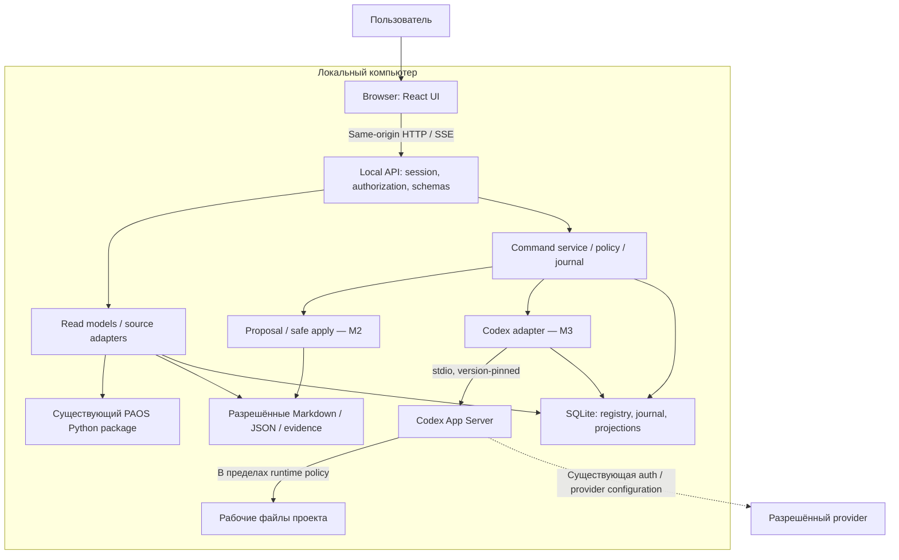
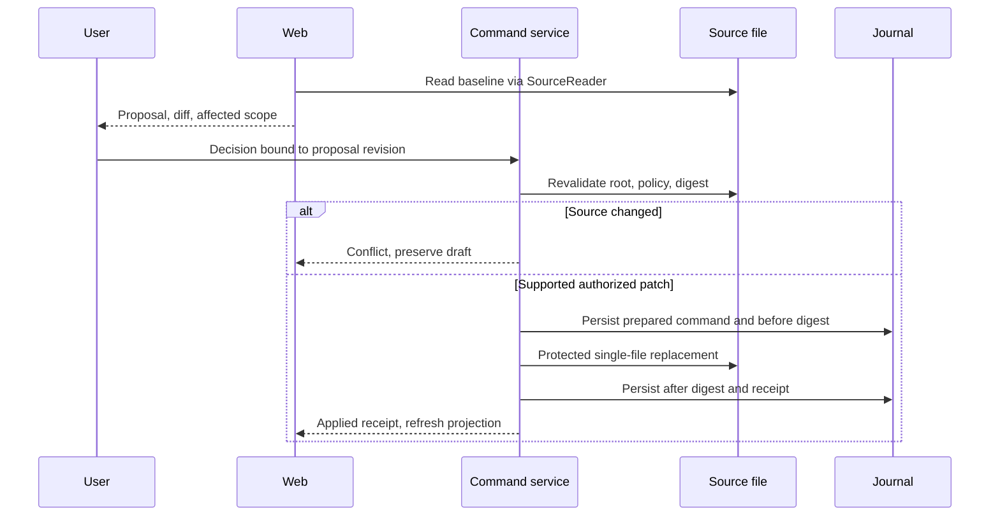

# Product-Agent OS Web — архитектура и план реализации

Source status: `project-authored / proposed / local-source-backed`. Дата: 2026-11-05. Версия: 0.1.

Статус: **draft_for_review**. Документ описывает будущую реализацию. Код Web, API, runtime adapter и схемы БД в этой задаче не создавались. Решения ниже предложены для обсуждения; они не меняют утверждённую очередь разработки PAOS.

Связи: [PRD](product-agent-os-web-prd-2026-11-05.md), [анализ SOL 0.6](sol-0.6-product-agent-os-web-analysis-2026-11-05.md).

## 1. Архитектурный вывод

Рекомендуется локальное browser application: React UI и один локальный Node.js service, использующий существующий Python package PAOS через узкий adapter. Markdown/JSON проекта сохраняют свою authority. SQLite хранит новые сущности Web — команды, решения, события и служебные связи; read models можно перестроить из источников.

Выполнение AI-задач подключается отдельным Codex adapter на M3. M1 работает без него и без provider calls. SOL полезен как источник UI-паттернов: проекты, task workspace, documents, activity feed. Его агентную цепочку, Socket.IO broadcast, JSON persistence и произвольную запись файлов переносить не следует: ограничения подтверждены в исходном аудите.

Это модульный монолит. Отдельные network services, очередь сообщений, vector database и multi-provider abstraction пока не обоснованы.

## 2. Что существует и что предстоит создать

| Текущий source | Подтверждённая роль | Повторное использование / ограничение |
| --- | --- | --- |
| [status_snapshot.py](../plugins/product-agent-os/scripts/product_agent_os/status_snapshot.py) | Read-only status, freshness, evidence и next action | Источник полей Overview; `TASK_MATRIX_PROJECTION_DECISION.state_projection=not_projected`, готовой общей task board нет |
| [project_cockpit_model.py](../plugins/product-agent-os/scripts/product_agent_os/project_cockpit_model.py) | Восемь cockpit sections: Overview, Project Map, Docs & Sources, Code Intelligence, Contracts, Quality & Metrics, Operations & Risk, Proposal Ledger | Переиспользовать модель и provenance; generated view не источник истины |
| [task_routing.py](../plugins/product-agent-os/scripts/product_agent_os/task_routing.py) | Task context, ordinary/full routing, bounded path handling | Adapter должен сохранять актуальный contract, а не вводить обязательный полный lifecycle |
| [question_ledger.py](../plugins/product-agent-os/scripts/product_agent_os/question_ledger.py) | Staged answer ledger | Ответ на вопрос не permission; запись decision требует отдельного contract |
| [merge_infrastructure.py](../plugins/product-agent-os/scripts/product_agent_os/merge_infrastructure.py) | Ограниченные create/append/replace managed-section actions, approval и rollback contracts | Не универсальный Markdown editor; нельзя обещать safe editing любых файлов |
| [runner cli.py](../plugins/product-agent-os/scripts/codex_runtime_runner/cli.py) и [state.py](../plugins/product-agent-os/scripts/codex_runtime_runner/state.py) | Contract route и task-bound state/provenance | Contract runner не полноценный engineering executor; присутствие route не доказывает host execution |
| SOL frontend и backend — [аудит](sol-0.6-product-agent-os-web-analysis-2026-11-05.md) | Интерактивный UI, генерируемые планы/документы, mock workflow | Переносить UX-идеи после проверки лицензий/зависимостей; не считать готовой платформой исполнения |

**Новое:** local API, WorkspaceRegistry, TaskProjectionAdapter, source revision tracking, UI, durable command/event journal, supported document proposal adapter, Codex execution adapter, recovery coordinator. Конкретные signatures существующих Python entrypoints нужно зафиксировать contract fixtures в A0; таблица не обещает drop-in import без адаптации.

## 3. Общая схема и границы доверия

Все Web-компоненты на схеме — proposed. PAOS package и source files существуют; Codex App Server — документированный внешний интерфейс, его совместимость с выбранной локальной версией ещё не проверена.



Чтение проекта не запускает Codex и не отправляет данные provider. Browser не получает filesystem capability, provider credential или универсальный shell endpoint. Project text и вывод tools считаются недоверенными данными, включая инструкции внутри Markdown. Они не могут изменять policy локального сервиса.

## 4. Предлагаемый стек

| Слой | Предложение | Основание и граница |
| --- | --- | --- |
| UI | React + TypeScript, Vite SPA; Tailwind CSS и доступные component primitives | Нет задачи SEO/SSR; короткий local UI delivery path. Точные версии выбрать и закрепить после packaging spike |
| HTTP | Node.js + TypeScript; выбор лёгкого HTTP framework в A0 | Один process для API, static assets, SSE и adapters; нужны schema validation, graceful shutdown и bounded streaming |
| PAOS bridge | Subprocess Python с JSON input/output и allowlist entrypoints | Сохраняет существующую Python реализацию; аргументы массивом, без shell interpolation |
| Durable storage | SQLite, локальный data directory вне target repo | Journal и связи Web; schema migrations, backup и single-process write ownership |
| Streaming | SSE для событий, HTTP commands для действий | Односторонний live feed достаточен; проще reconnect/cursor. Socket.IO не обязателен |
| Runtime | Version-pinned Codex App Server через stdio | Один управляемый adapter; capabilities подтверждаются handshake и contract checks |
| Verification | Существующий Python suite + новые TS unit/contract tests, затем browser journeys | Инструменты и версии выбрать при реализации; сейчас ничего не устанавливается |

SOL использует Next.js, но это не делает Next.js обязательным для PAOS. Если reuse существующего SOL shell даст измеримый выигрыш и не принесёт лишний runtime, Next.js — допустимая альтернатива. Решение D02 принимается по installation size, startup, offline packaging, dependency maintenance и времени первого проверяемого slice. Функциональные требования не зависят от bundler.

В packaged режиме static UI и API имеют один origin. Будущий dev proxy должен сохранять те же origin/auth restrictions. Installer, Python distribution, supported Node version и обновление runtime остаются решениями A0/A5; зависимости не должны загружаться незаметно при первом открытии.

## 5. Модули и ownership

| Модуль | Ответственность | Не принадлежит модулю |
| --- | --- | --- |
| WorkspaceRegistry | Явно выбранные roots, opaque IDs, capabilities | Автоматическое чтение соседних каталогов |
| SourceReader | Allowlist files, hashes, bounded scan, freshness | Выполнение инструкций из source |
| ProjectionService | Overview/task/evidence views с source refs | Изменение authoritative task state |
| PAOSAdapter | Версионированные Python contracts и нормализация ошибок | Переписывание governance в TypeScript |
| CommandService | Schema/auth checks, idempotency, queue, command receipts | Произвольное исполнение shell |
| ProposalService | Supported fields, baseline, diff, decision, apply/recovery | Универсальное редактирование repo |
| RuntimeCoordinator | Task/run mapping, capabilities, approvals, interrupt/reconciliation | Ослабление managed sandbox/approvals |
| EventJournal | Workspace-scoped sequence, replay, retention | Источник verification без check receipt |
| UI | Навигация, понятные состояния, формы и source links | Самостоятельное вычисление разрешений |
| LocalStore | Миграции, transactions, backup metadata | Копирование всех документов и credentials |

Предлагаемые владельцы будущей реализации: frontend owner — UI; backend owner — API/store/source adapters; runtime owner — PAOS/Codex adapters; tester/security reviewer — независимые проверки. Это роли плана, не запущенная команда. Каждый slice должен иметь одного owner для каждого изменяемого модуля.

## 6. Данные и authority

| Сущность | Минимальные поля | Authority |
| --- | --- | --- |
| Workspace | id, registeredRoot, capabilities, createdAt | Локальный registry; root не передаётся клиентом в каждом запросе |
| SourceBinding | sourceId, relativePath, parserVersion, digest, observedAt | Файл и явное правило parser |
| TaskProjection | workspaceId, sourceTaskId, title, state, acceptance, sourceRefs | Связанный source; UI value derived |
| Artifact | id, sourceBinding, kind, revision, sensitivity | Файл или явно обозначенный draft |
| Proposal | id, taskId, baseRevision, patch, supportedAction, decisionId | Web draft до apply; файл после apply |
| Decision | id, kind, actor, scope, revision, outcome, timestamp | Журнал решений; не тождествен runtime approval |
| ApprovalRequest | runtimeRequestId, runId, requestedAction, status | Текущий runtime request и применимая policy |
| Run | id, taskId, runtimeThreadId, runtimeTurnId, state | Runtime observations + durable correlation |
| Check / Evidence | id, sourceRevision, commandRef, result, observedAt, provenance | Реальный receipt; stale после relevant source change |
| Command / Event | id, workspaceId, requestHash, sequence, schemaVersion | Durable journal, отдельный от файлов проекта |

ID — opaque UUID. Человекочитаемые task IDs сохраняются отдельно; key включает workspace и исходный task ID. Заголовок задачи не уникальный идентификатор. Cross-project references запрещены без явно поддержанного relation contract.

Source authority определяется схемой, а не временем изменения файла. Для текущих PAOS task groups — явная связь task_id с owning JSON; legacy Markdown matrices поддерживаются только через конкретный parser и mapping. `PLAN.md`, `RUNLOG.md` и общий lifecycle marker нельзя механически превращать в одну универсальную task database. Если sources противоречат, UI показывает conflict и ссылки, а не выбирает последний timestamp.

SQLite не перезаписывает source state при rebuild. Source-bound status меняется только через approved supported action. Новые Web-only drafts/decisions/runs принадлежат DB, имеют export и versioned schema. После apply сохраняются before/after digests и receipt; самостоятельная truth-копия документа в DB не создаётся.

## 7. Независимые состояния

| Измерение | Proposed states | Правило |
| --- | --- | --- |
| Source | current, stale, partial, conflict, unknown | Observed source revision необходим для current |
| Run | queued, starting, running, awaiting_approval, interrupt_requested, succeeded, failed, interrupted, recovery_required | succeeded означает завершение runtime операции |
| Verification | not_run, running, passed, failed, stale, partial | Проверки и scope остаются отдельными от Run |
| Acceptance | pending, accepted, accepted_with_gaps, changes_requested | Только решение owner; gap не превращает failed check в passed |
| Release | not_requested, proposed, authorized, observed | Публикация и production evidence не выводятся из acceptance |

Task lifecycle показывается согласно owning source schema, с явным mapping. Нельзя автоматически записать task=done из run=succeeded.


Diagram показывает основной путь. Reject/timeout approval обрабатывается согласно runtime response: request отклоняется, результат run не выдумывается. Неподдерживаемое состояние сохраняется как unknown/recovery_required.

## 8. Local API и event protocol

Все endpoints ниже — proposed contracts, не реализованные маршруты.

| Method / endpoint | Семантика |
| --- | --- |
| GET /api/v1/workspaces | Только зарегистрированные roots текущей local session |
| POST /api/v1/workspaces | Явное подключение выбранного root; bounded discovery |
| GET /api/v1/workspaces/{id}/snapshot | revision, observedAt, capabilities, sources, partial flags |
| GET /api/v1/workspaces/{id}/tasks/{taskId} | Source-bound projection и evidence |
| GET /api/v1/workspaces/{id}/artifacts/{artifactId} | Разрешённое содержание; не arbitrary path endpoint |
| POST /api/v1/workspaces/{id}/commands | Validated action, commandId, expectedRevision, payload |
| GET /api/v1/workspaces/{id}/commands/{commandId} | Durable receipt, result/conflict/error |
| GET /api/v1/workspaces/{id}/events | SSE snapshot cursor/replay; session auth |
| GET /api/v1/health | Local service capability, без provider probe |

Пример envelope, значения синтетические:

```json
{
  "schemaVersion": 1,
  "commandId": "command-example",
  "action": "proposal.apply",
  "expectedRevision": "sha256:example",
  "payload": {"proposalId": "proposal-example", "decisionId": "decision-example"}
}
```

Server связывает actor с authenticated session, workspace — с endpoint registry, action — с allowlist. `decisionId` не bearer permission: проверяются scope, revision, expiry и действующая authority. Повторный commandId с тем же workspace/actor/action/requestHash возвращает прежний receipt; с другим payload — conflict. HTTP 202 означает принятие в очередь, не успешное выполнение. Ошибки имеют stable code, user message и retryability; raw stacks/paths не уходят в UI.

Event содержит eventId, workspaceId, nullable taskId/runId, sequence, schemaVersion, observedAt, sourceRevision и redacted payload. Sequence монотонна в workspace journal; durable commit предшествует broadcast. SSE reconnect использует cursor; UI дедуплицирует eventId. Если cursor истёк, сервер требует snapshot resync. Buffer/replay bounded, slow consumer отключается с инструкцией resync.

Exactly-once для внешних side effects не обещается. Idempotency команд предотвращает известные дубли, а неоднозначный dispatch после crash требует reconciliation.

## 9. Local security и filesystem boundary

Localhost не заменяет authentication. Service bind — только loopback, один canonical host. Нужны строгие Host/Origin checks, отсутствие wildcard CORS, session-bound CSRF protection для mutations и проверка Web client session на SSE. DNS rebinding и запросы с произвольного сайта входят в negative suite.

Launcher создаёт одноразовый bootstrap capability и передаёт его через выбранный в A0 локальный канал; token нельзя размещать в query/history/logs/localStorage. После exchange — HttpOnly SameSite cookie, короткая session, server-owned secret. Конкретный bootstrap/HTTPS или loopback transport и cookie flags надо проверить на Windows/Chrome/Edge до M1; пока это открытый design contract, а не реализованная защита.

Registry root выбирается явно. Сервер разрешает только зарегистрированные root и artifacts по ID, повторно проверяет canonical paths, Windows case behavior, UNC/drive forms, junctions/symlinks и traversal. За пределами root и protected paths — deny. Сканирование исключает credentials, .env, private keys, .git internals, dependencies и binaries; user source policy может только сузить доступ. Даже разрешённый Markdown может содержать секрет, поэтому UI/log/export требуют redaction и размеров response.

Предлагаемые стартовые limits для A0 fixtures: 1 MiB на structured task source, configurable file count, bounded 30 s scan с partial/cancel. Это проектные budgets, не утверждение о всех текущих PAOS limits. UI явно различает excluded, unsupported, truncated и failed.

Python bridge получает validated args/JSON, fixed cwd, allowlisted entrypoint, timeout и output cap. Ни document text, ни command payload не подставляются в shell. Неподдерживаемая версия package закрывает mutation capabilities, сохраняя безопасное чтение.

## 10. Proposal, apply и recovery

M2 сначала поддерживает один файл/managed section на команду. Unmanaged content read-only, пока для него не определён preservation contract. Existing infrastructure merge используется только в рамках его собственных actions; generic document edit требует нового adapter и fixtures.



Hash check сам по себе не решает TOCTOU. Реализация должна использовать безопасную работу с file handles, reject reparse redirection и повторную проверку actual target на commit boundary. File-level atomic replacement выполняется через temporary file на том же filesystem с сохранением encoding/EOL и поддерживаемых metadata. Возможности Windows APIs и crash guarantees проверяются отдельными fixtures.

SQLite transaction и filesystem write не образуют общей атомарной транзакции. Prepared journal записывается до replacement. После crash сравниваются before/after digests: исходный файл — not_applied; ожидаемый новый — applied с восстановленным receipt; иное — conflict/recovery_required без overwrite. Multi-file transaction отложена.

Rollback — отдельная scoped command. Он разрешён только если текущий digest совпадает с записанным after digest; иначе ручное разрешение конфликта. Нельзя отменять последующие правки IDE или другого run.

## 11. Codex execution adapter — M3

Официальный [Codex App Server](https://learn.chatgpt.com/docs/app-server) описывает интеграцию rich clients с history, streamed events и approvals. Источник прочитан 2026-11-05. Предлагается stdio; WebSocket transport в документации имеет experimental статус. Локальная совместимость и supported methods ещё не проверены.

До реализации: выбрать поддерживаемую версию Codex CLI, получить matching protocol schema доступным для этой версии способом, проверить initialization/capabilities, session/auth flow, thread/turn correlation, approval и interrupt contracts. Не фиксировать guessed method names из другой версии. UI capability matrix строится по проверенному adapter contract, а не по наличию бинарника.

Не проксировать App Server целиком: некоторые поверхности могут выходить за ожидаемый sandbox. Allowlist adapter methods, server-owned workspace/config, managed approvals и sandbox остаются authoritative. UI decision не может снизить host policy. Credentials принадлежат Codex runtime, не React/SQLite.

```mermaid
sequenceDiagram
  participant U as User
  participant C as Coordinator
  participant J as Journal
  participant R as Codex adapter
  U->>C: Start scoped task
  C->>C: Validate source revision, authority, capabilities
  C->>J: Store command and run correlation
  C->>R: Dispatch once
  R-->>C: Ack and runtime identifiers
  C->>J: Persist observed state
  R-->>C: Approval request
  C-->>U: Exact action and scope
  U->>C: Decision for current request
  C->>R: Validated response
  R-->>C: Completion / failure
  C->>J: Evidence references and result
  C-->>U: Result, checks, diff, gaps; acceptance separate
```

Один активный mutating run на workspace в M3; остальные queued. Read-only views допускаются параллельно. Lease не блокирует IDE, поэтому source revisions повторно проверяются на границах действий. Несколько tabs используют общий run state и одного action owner.

Crash между dispatch и ack переводит run в recovery_required. Нельзя автоматически повторять turn: сначала проверить существующий runtime thread/turn, иначе явно завершить неопределённый run и согласовать новый. Interrupt — request до подтверждения runtime, не rollback. Сохраняются частичные изменения и их diff.

Browser disconnect не повторяет и не отменяет run автоматически; уже разрешённое действие контролирует local service. Новые approvals остаются pending до reconnect, timeout отклоняет request без auto-approve. Это не разрешение на новые unattended workflows. Shutdown service должен предупредить о run и согласованно завершить/зафиксировать recovery.

## 12. Ошибки, наблюдаемость и хранение

| Ситуация | Поведение | Проверка |
| --- | --- | --- |
| Source изменён в IDE | Stale snapshot / conflict proposal, refresh | SC-06/09 |
| Unsupported task format | Source viewer и явный gap вместо пустой successful board | SC-03 |
| Codex отсутствует/несовместим | Read-only UI доступен, Start disabled с причиной | SC-12 |
| Дубли command/event | Один receipt; dedup event | SC-07/10 |
| Потерян runtime ack | Recovery_required без retry side effects | SC-14 |
| Disk full / journal unavailable | Mutation fail closed; source не меняется до prepared receipt | Crash/storage suite |
| Partial apply receipt | Digest reconciliation, никакого blind rollback | SC-09/10 + crash suite |
| Другой workspace / malicious path | Reject до доступа, sanitized error | SC-05/16 |
| Failed check после успешного run | Failed остаётся видимым, owner acceptance отдельно | SC-15 |

Structured diagnostics: commandId/runId, module, duration, result code, revision; без prompts, code, credential и raw private chat по умолчанию. Метрики latency имеют scope и sample count. Unknown usage/cost остаётся unknown, цена не вычисляется по guessed тарифам.

Предлагаемый retention: transient event replay и opt-in pilot metrics — 30 дней; drafts, decisions и evidence metadata — до явного archive/delete owner. Expiry replay не удаляет source evidence; UI предупреждает об ограничении timeline. Raw chat принадлежит runtime и не дублируется автоматически в local store; opt-in transcript persistence — отдельное решение с privacy contract.

Backup включает Web-owned DB и schema version, исключает credentials; target repo backup — отдельная ответственность. Schema migration имеет backup/recovery path и запрет downgrade write при несовместимой версии. Удаление workspace из registry не удаляет файлы проекта. Retention/delete обрабатывают derived cache и ссылки без фальсификации verification history.

Health различает alive, source-reader-ready и runtime-capable. Для health не вызываются provider endpoints. Error telemetry local-only; внешний export требует явного действия с preview.

## 13. Предлагаемые ADR

| Решение | Выбор | Альтернативы и trade-off | Условие пересмотра |
| --- | --- | --- | --- |
| ADR-W01 deployment | Local single-user | Hosted SaaS облегчает collaboration, но требует tenancy/auth/secrets/remote execution; static cockpit проще, но ограничивает actions | Pilot доказывает shared-workspace demand |
| ADR-W02 UI | React SPA | Next.js shell даёт reuse SOL, но SSR пока не нужен; существующий HTML cockpit дешевле для обзорного прототипа | Packaging/reuse spike показывает выигрыш |
| ADR-W03 authority | Files + DB для Web-owned data | All-in-DB ломает существующий file workflow; all-in-files усложняет transactional journal | Появилась согласованная migration strategy |
| ADR-W04 events | SSE + HTTP | Socket.IO/WebSocket нужны при обоснованном bidirectional transport | Измеренный scenario не решается SSE |
| ADR-W05 execution | Codex adapter | SOL chain и собственный agent runtime дублируют governance, auth и recovery | Подтверждённая потребность второго runtime |
| ADR-W06 writes | Supported single-file patch | Generic editor/multi-file apply увеличивает preservation/recovery surface | Пройдены fixtures и есть owner-approved use case |

Все ADR имеют статус proposed. Сохранение документа не означает принятие ADR.

## 14. Этапы реализации и критерии выхода

Каждый этап начинается только после отдельного разрешения на разработку соответствующего scope. Оценки длительности отсутствуют: команда, packaging и compatibility baseline пока не определены. A0–A5 последовательны по зависимостям, но A2 уже даёт самостоятельный M1 pilot.

| Этап | Deliverable / порядок | Требования и критерий выхода | Owner / rollback |
| --- | --- | --- | --- |
| A0 — контракты и UX | Зафиксировать D01–D03, supported source schemas, reference workload; low-fidelity screens E01–E07; packaging/auth/runtime feasibility | Source inventory + fixtures; user walkthrough «открыть → понять → найти evidence»; Codex spike отдельно только при разрешении runtime | Architect + product; выбросить prototype, исходники не мигрируются |
| A1 — local foundation | Registry, bootstrap/session, source reader, Python bridge, store migrations, API errors | FR-01/05/14/15; SC-01/02/16; read-only target hashes, cross-root deny, offline startup | Backend; удалить Web registry/cache, сохранить repo |
| A2 — M1 | Overview, task projection, artifacts/evidence, freshness, deep links, refresh | FR-02–06/13/16; SC-03–07/17; smoke packaging/a11y до пилота; 4/5 pilot users orient target как гипотеза | Frontend + backend; disable Web, использовать source/cockpit |
| A3 — M2 | Intake, ordinary/full routing, questions, supported proposal/diff/decision/apply/rollback | FR-07–10/18; SC-08–11; no-loss fixtures, conflict and crash recovery, owner-defined editable sections | Backend; отключить mutations; scoped rollback только по digest |
| A4 — M3 | Versioned Codex adapter, capabilities, durable run/approval/interrupt, evidence/acceptance | FR-11–13/17; SC-12–15/18; observed supported runtime path, no masked fallback, authorized eval/runtime cases | Runtime owner; disable new runs, reconcile active run, read-only UI остаётся |
| A5 — bounded beta | Installer/update/restore, broader Windows/a11y/regression, privacy review, pilot learning | Все SC; recovery suite; no-loss/security gates, named accepted gaps, measured pilot baseline | Tester + product; previous compatible build/DB backup, не blind downgrade |
| A6 — отдельное discovery | Shared access/remote deployment, additional runtimes, marketplace только по demand | Новый PRD/ADR, tenancy/security/cost evidence; не часть local MVP | Product + architect; не расширять scope до решения |

Task slicing внутри этапа: один наблюдаемый user outcome, source contract, owner, test/check, rollback. Новое testable behavior — TDD на минимальном слое; integration/E2E добавляются для межмодульных рисков. Ни фазы, ни owner-таблица не авторизуют автоматический запуск subagents.

## 15. План проверки будущего продукта

- Unit/contract: schema validation, authority mapping, state dimensions, parser unknown/conflict, idempotency, redaction.
- Integration: Python bridge, SQLite migrations, CAS apply, junction/path controls, events workspace isolation, restart/replay.
- Failure injection: crash до/после dispatch, file replacement и receipt, disk full, source edit во время apply, stale decision.
- Browser: E01–E07 на Windows, keyboard/focus/errors, disconnected state, deep links, conflict and acceptance.
- Runtime: pinned Codex compatibility, actual approval/interrupt path, provider/cost boundaries и no-fallback evidence только в отдельно разрешённом scope.
- Pilot: baseline orientation, first useful action, returns, misunderstandings of completion; без заявления PMF по пяти пользователям.

SC-01–18 из PRD — acceptance contract, пока все pending. Не требуется запуск полного runtime suite ради этих документов. Исторические SOL проверки и текущие PAOS suites не доказывают Web UX или новые API.

## 16. Решения, gaps и control-plane sync этой задачи

Утверждено только авторство Markdown и переход lifecycle marker. Предложенные стек, ICP, stages, budgets и requirements требуют product review. Открыты: D01–D07 PRD, точные editable fields, runtime protocol/version, bootstrap transport, packaging, pilot owner и budget.

Shared lifecycle marker предыдущей metadata-задачи был terminal перед переходом; его closure сохранён. Незавершённые parent GAP-03/GAP-05 gates этим документом не закрываются. Web service в будущем не должен трактовать этот marker как разрешение на любой проект или runtime action.

Control-plane sync: RUNLOG — update_required, короткий handoff с ссылками; RU/EN source registries — update_required. REQUIREMENTS/PLAN — not_applicable к изменению активной implementation queue: новые требования и этапы пока proposed и принадлежат этим двум документам. TEST/EVALS — not_applicable к изменению действующих commands/rubrics; future Web checks ещё не реализованы. prod_test — not_applicable, Batch 39 evidence не изменялось. После принятия scope потребуется отдельный handoff в активные REQUIREMENTS/PLAN.

Не изменялись product implementation, hooks, source SOL, dependency manifests, MkDocs navigation или public site. Существующие dirty changes других задач сохранены; они не являются результатом этой работы.

## 17. Проверка документов в текущем запуске

Статус документационного пакета: `docs_static_verified / draft_for_review`. Проверки выполнены 2026-11-05 в текущем workspace; они не являются приёмкой будущего Web.

| Проверка | Наблюдаемый результат |
| --- | --- |
| `python -m unittest tests.product_agent_os.test_product_agent_os_docs -v` | Сначала exit 1, 4 failures из-за кириллического anchor в EN registry. Anchor убран; повтор — exit 0, 100 tests OK, 2.376 s |
| `python tools/check_docs.py` | Exit 0: `OK: documentation structure checks passed` |
| `.venv-docs\Scripts\python.exe -m mkdocs build --strict --site-dir .docs-tools/reports/web-docs-preview` | Сначала exit 1: ссылки registry на research вне docs root. Заменены на repository-path references по существующему формату. Повтор — exit 0, `Documentation built in 19.61 seconds` |
| `git diff --check` | Exit 0; Git предупреждает о будущей нормализации CRLF/LF в dirty workspace, whitespace errors не обнаружены |
| Inline read-only Python check, `python -` через PowerShell here-string | Exit 0: 2 UTF-8 files, 22 существующие local links, 5 Mermaid blocks, 18 FR / 8 NFR / 18 SC, WEB-S01–04 parity, balanced fences, без trailing whitespace/replacement characters/проверенных private-key markers |

Self-review: источники и proposed capabilities разделены; каждому M1–M3 соответствует пользовательский результат и gate; crash/approval/conflict semantics не подменяют owner acceptance. Scope diff проверен: два новых research-документа, отдельные записи registry/RUNLOG и разрешённый lifecycle marker; чужие dirty changes не исправлялись и не включаются в этот результат.

Strict build относится к локальному preview документации и проверке registry. Research-файлы находятся вне site navigation; build не доказывает rendering их Mermaid. Browser/rendered, product/runtime, usability, accessibility и performance acceptance не выполнялись. Публикации не было; root `site/` не обновлялся.

## 18. Источники и пределы доказательств

- [SOL 0.6 audit](sol-0.6-product-agent-os-web-analysis-2026-11-05.md) — локальный аудит исходников, текущая основа reuse/risk decisions; прежние test receipts не перезапускались.
- Текущие PAOS owning sources перечислены в §2; существующий source contract имеет приоритет над предложенными Web-моделями.
- [Codex App Server](https://learn.chatgpt.com/docs/app-server) — official documentation, прочитана 2026-11-05; подтверждает документированные возможности интеграции, не установленную local runtime compatibility.
- [PRD](product-agent-os-web-prd-2026-11-05.md) — product proposal и traceability, не evidence реализованной функциональности.

Следующий предмет решения: принять или скорректировать M1, ICP и D01–D03. Начало разработки требует отдельной команды пользователя.

