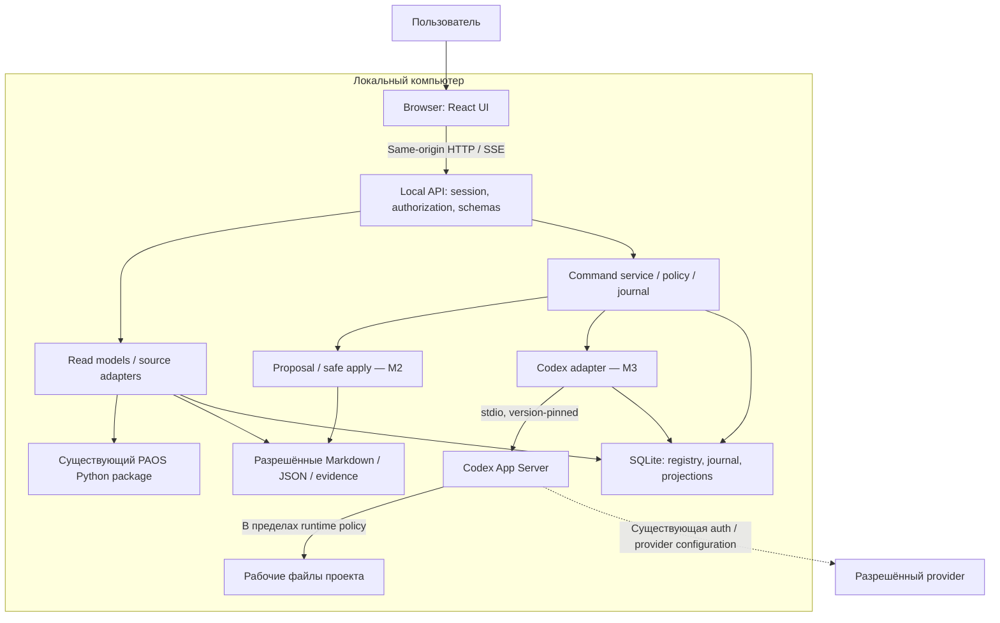
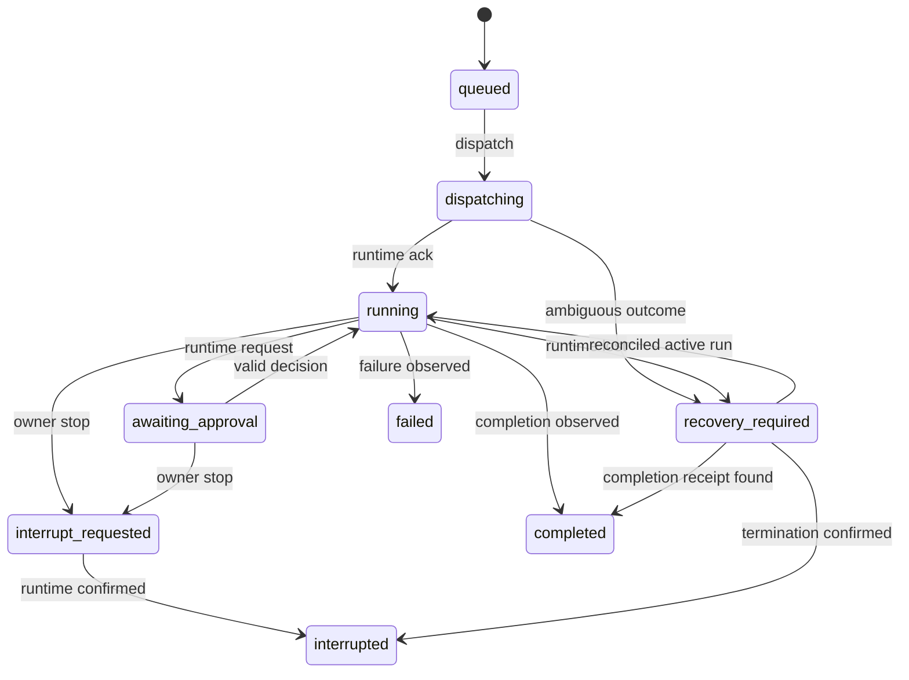
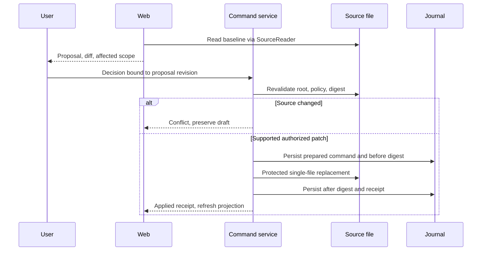
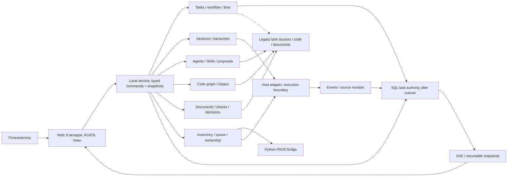
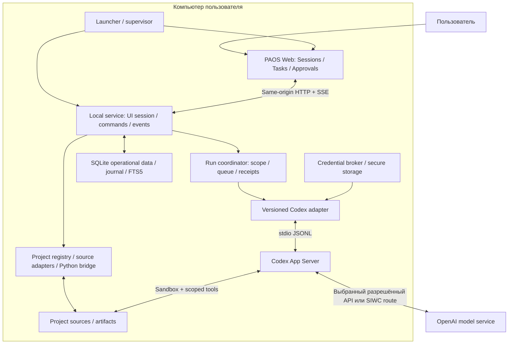
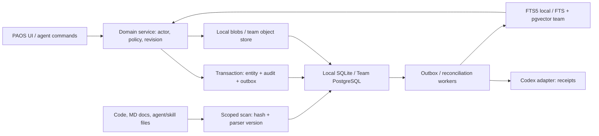
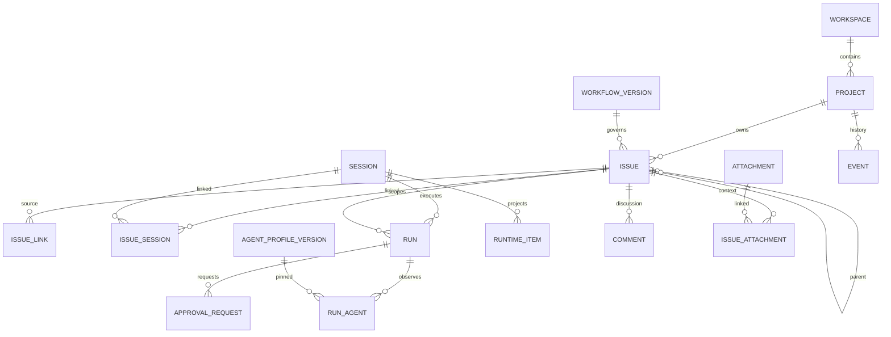
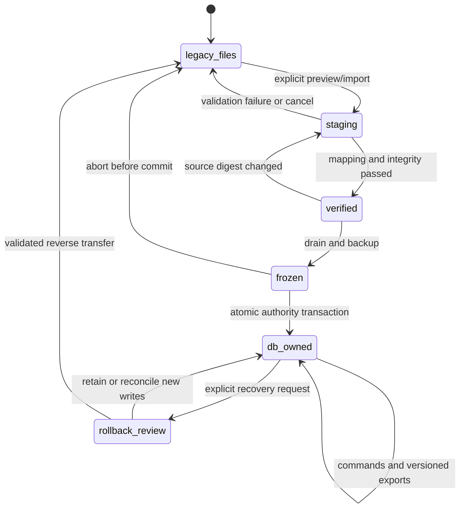

# Product-Agent OS Web — архитектура и план реализации

Уточнение Settings UX,13.11.2026: native Explorer folder selection/New folder → explicit Add → bounded source/JS/TS scan; cancel не регистрирует проект. App-agent handoff открывает server-built Codex draft, требует явного Send и сохраняет waiting до actual worker attach; URI open не доказывает host/model entitlement. Existing BYOK/approval/commercial boundaries сохранены. [Source contracts, official links и evidence](product-agent-os-web-m1-execution-2026-11-11.md).


Startup update13-11-2026: launcher → guarded `/launch` → одноразовый HttpOnly challenge/same-origin POST → session/CSRF, без MessageBox/code. Допуск — direct browser user intent, не launcher identity; native clients вне ceiling. Старый service без browserLaunchVersion1 требует Quit/restart. [Решение и проверки](product-agent-os-web-m1-execution-2026-11-11.md#запуск-без-ручного-сопряжения--2026-11-13). Остальные runtime/model/worker boundaries сохранены; прежние startup-code описания исторические.

Актуализация планирования 13-11-2026: **M5 — «Подключение ChatGPT и командная работа»** объединяет PAOS-0047 (optional/admission), PAOS-0052 и PAOS-0053 (team design/storage/transfer). Прежние OPTIONAL/T1 — исторические обозначения этих веток. Текущая группировка, функции, ценность и gates: [план v0.9](product-agent-os-web-task-manager-plan-2026-11-09.md#paos-m5). Все три задачи planned; M4 не зависит от M5, team-ветка не зависит от SIWC. Это изменение плана, без допуска, реализации или активации.

Актуализация 11-11-2026: Codex App agents — выбранный owner-default маршрут без API key; его текущий контракт и предел доказательств приведены в новом App-agent addendum в конце документа. Прежний API-only/closed-App baseline ниже сохранён как история и explicit compatibility; он не определяет новый default.

Исследование 2026-11-09: [варианты БД и vector retrieval](product-agent-os-web-storage-research-2026-11-09.md). Выбор принят: SQLite + FTS5 local и PostgreSQL + pgvector team. Актуальные schema/authority/cutover — §20; исследование сохраняет историю альтернатив.

Актуализация 2026-11-10: **v0.7 — текущие M1 решения в §21**; PRD §17 и очередь v0.7 заменяют прежние design placeholders. Текущий runtime/auth/startup contract — §19; прежняя очередь с runtime на M3 историческая. [Экраны](product-agent-os-web-task-manager-screens-2026-11-09.md) и [план](product-agent-os-web-task-manager-plan-2026-11-09.md).

Source status: `project-authored / selected-direction / proposed-implementation / official-docs-backed`. Создан: 2026-11-05. Обновлён: 2026-11-10. Версия: 0.7.

Статус: **draft_for_review**. Документ описывает будущую реализацию. Код Web, API, runtime adapter и схемы БД в этой задаче не создавались. Решения v0.7 согласуют документационную очередь Web; это не разрешение начать реализацию и не изменение очереди прочих PAOS workstreams.

Связи: [PRD](product-agent-os-web-prd-2026-11-05.md), [анализ SOL 0.6](sol-0.6-product-agent-os-web-analysis-2026-11-05.md).

UX-детализация M1 от 2026-11-09: [wireframes и interaction contracts](product-agent-os-web-m1-wireframes-2026-11-09.md), `draft_for_review`; это документационное уточнение, разработка не начата.

## 1. Архитектурный вывод

Рекомендуется локальное browser application: React UI и один локальный Node.js service, использующий существующий Python package PAOS через узкий adapter. SQLite + FTS5 владеет operational Web entities после проверенного project cutover; до него legacy MD/JSON остаются authority. Код, документы и инструкции остаются файлами. PostgreSQL + pgvector выбран для будущей командной версии; детали — §20.

Выполнение через Codex App Server входит в M1: сессии, approvals, interrupt/recovery и результат в одном окне. Без provider connection доступны локальные CRUD/search/backup при здоровой SQL (PRD §17). Актуальная схема — §19; исходный stage mapping §3/§14 исторический. SOL полезен как источник UI-паттернов: проекты, task workspace, documents, activity feed. Его агентную цепочку, Socket.IO broadcast, JSON persistence и произвольную запись файлов переносить не следует: ограничения подтверждены в исходном аудите.

Это модульный монолит. Отдельные network services, очередь сообщений, vector database и multi-provider abstraction пока не обоснованы.

## 2. Что существует и что предстоит создать

| Текущий source | Подтверждённая роль | Повторное использование / ограничение |
| --- | --- | --- |
| [status_snapshot.py](../plugins/product-agent-os/scripts/product_agent_os/status_snapshot.py) | Read-only status, freshness, evidence и next action | Источник полей Overview; `TASK_MATRIX_PROJECTION_DECISION.state_projection=not_projected`, готовой общей task board нет |
| [project_cockpit_model.py](../plugins/product-agent-os/scripts/product_agent_os/project_cockpit_model.py) | Восемь cockpit sections: Overview, Project Map, Docs & Sources, Code Intelligence, Contracts, Quality & Metrics, Operations & Risk, Proposal Ledger | Переиспользовать модель и provenance; generated view не источник истины |
| [task_routing.py](../plugins/product-agent-os/scripts/product_agent_os/task_routing.py) | Task context, ordinary/full routing, bounded path handling | Adapter должен сохранять актуальный contract, а не вводить обязательный полный lifecycle |
| [question_ledger.py](../plugins/product-agent-os/scripts/product_agent_os/question_ledger.py) | Staged answer ledger | Ответ на вопрос не permission; запись decision требует отдельного contract |
| [merge_infrastructure.py](../plugins/product-agent-os/scripts/product_agent_os/merge_infrastructure.py) | Ограниченные create/append/replace managed-section actions, approval и rollback contracts | Не универсальный Markdown editor; нельзя обещать safe editing любых файлов |
| [runner cli.py](../plugins/product-agent-os/scripts/codex_runtime_runner/cli.py) и [state.py](../plugins/product-agent-os/scripts/codex_runtime_runner/state.py) | Contract route и task-bound state/provenance | Contract runner не полноценный engineering executor; присутствие route не доказывает host execution |
| SOL frontend и backend — [аудит](sol-0.6-product-agent-os-web-analysis-2026-11-05.md) | Интерактивный UI, генерируемые планы/документы, mock workflow | Переносить UX-идеи после проверки лицензий/зависимостей; не считать готовой платформой исполнения |

**Новое:** local API, WorkspaceRegistry, TaskProjectionAdapter, source revision tracking, UI, durable command/event journal, supported document proposal adapter, Codex execution adapter, recovery coordinator. Конкретные signatures существующих Python entrypoints нужно зафиксировать contract fixtures в A0; таблица не обещает drop-in import без адаптации.

## 3. Исходная схема v0.1 и границы доверия — исторический stage mapping

Все Web-компоненты на схеме — proposed. PAOS package и source files существуют; Codex App Server — документированный внешний интерфейс, его совместимость с выбранной локальной версией ещё не проверена.



Чтение проекта не запускает Codex и не отправляет данные provider. Browser не получает filesystem capability, provider credential или универсальный shell endpoint. Project text и вывод tools считаются недоверенными данными, включая инструкции внутри Markdown. Они не могут изменять policy локального сервиса.

## 4. Предлагаемый стек

| Слой | Предложение | Основание и граница |
| --- | --- | --- |
| UI | React + TypeScript, Vite SPA; Tailwind CSS и доступные component primitives | Нет задачи SEO/SSR; короткий local UI delivery path. Точные версии выбрать и закрепить после packaging spike |
| HTTP | Node.js + TypeScript; выбор лёгкого HTTP framework в A0 | Один process для API, static assets, SSE и adapters; нужны schema validation, graceful shutdown и bounded streaming |
| PAOS bridge | Subprocess Python с JSON input/output и allowlist entrypoints | Сохраняет существующую Python реализацию; аргументы массивом, без shell interpolation |
| Durable storage | SQLite + FTS5 local; PostgreSQL + pgvector team | Operational entities, audit/outbox, versioned migration; data directory вне target repo; §20 |
| Streaming | SSE для событий, HTTP commands для действий | Односторонний live feed достаточен; проще reconnect/cursor. Socket.IO не обязателен |
| Runtime | Version-pinned Codex App Server через stdio | Один управляемый adapter; capabilities подтверждаются handshake и contract checks |
| Verification | Существующий Python suite + новые TS unit/contract tests, затем browser journeys | Инструменты и версии выбрать при реализации; сейчас ничего не устанавливается |

SOL использует Next.js, но это не делает Next.js обязательным для PAOS. Если reuse существующего SOL shell даст измеримый выигрыш и не принесёт лишний runtime, Next.js — допустимая альтернатива. Решение D02 принимается по installation size, startup, offline packaging, dependency maintenance и времени первого проверяемого slice. Функциональные требования не зависят от bundler.

В packaged режиме static UI и API имеют один origin. Будущий dev proxy должен сохранять те же origin/auth restrictions. Installer, Python distribution, supported Node version и обновление runtime остаются решениями A0/A5; зависимости не должны загружаться незаметно при первом открытии.

## 5. Модули и ownership

| Модуль | Ответственность | Не принадлежит модулю |
| --- | --- | --- |
| WorkspaceRegistry | Явно выбранные roots, opaque IDs, capabilities | Автоматическое чтение соседних каталогов |
| SourceReader | Allowlist files, hashes, bounded scan, freshness | Выполнение инструкций из source |
| ProjectionService | Overview/task/evidence views с source refs | Изменение authoritative task state |
| PAOSAdapter | Версионированные Python contracts и нормализация ошибок | Переписывание governance в TypeScript |
| CommandService | Schema/auth checks, idempotency, queue, command receipts | Произвольное исполнение shell |
| ProposalService | Supported fields, baseline, diff, decision, apply/recovery | Универсальное редактирование repo |
| RuntimeCoordinator | Task/run mapping, capabilities, approvals, interrupt/reconciliation | Ослабление managed sandbox/approvals |
| EventJournal | Project-scoped sequence, replay, retention (§21.2) | Источник verification без check receipt |
| UI | Навигация, понятные состояния, формы и source links | Самостоятельное вычисление разрешений |
| LocalStore | Миграции, transactions, backup metadata | Копирование всех документов и credentials |

Предлагаемые владельцы будущей реализации: frontend owner — UI; backend owner — API/store/source adapters; runtime owner — PAOS/Codex adapters; tester/security reviewer — независимые проверки. Это роли плана, не запущенная команда. Каждый slice должен иметь одного owner для каждого изменяемого модуля.

## 6. Данные и authority

Ниже legacy/file-mode contract до cutover. Для новых и migrated проектов актуален SQL-owned contract §20; TaskProjection не является основной моделью DB-owned issue.

| Сущность | Минимальные поля | Authority |
| --- | --- | --- |
| Project | id, registeredRoot, capabilities, createdAt | Локальный registry; root не передаётся клиентом в каждом запросе |
| SourceBinding | sourceId, relativePath, parserVersion, digest, observedAt | Файл и явное правило parser |
| TaskProjection | projectId, sourceTaskId, title, state, acceptance, sourceRefs | Связанный source; UI value derived |
| Artifact | id, sourceBinding, kind, revision, sensitivity | Файл или явно обозначенный draft |
| Proposal | id, taskId, baseRevision, patch, supportedAction, decisionId | Web draft до apply; файл после apply |
| Decision | id, kind, actor, scope, revision, outcome, timestamp | Журнал решений; не тождествен runtime approval |
| ApprovalRequest | runtimeRequestId, runId, requestedAction, status | Текущий runtime request и применимая policy |
| Run | id, taskId, runtimeThreadId, runtimeTurnId, state | Runtime observations + durable correlation |
| Check / Evidence | id, sourceRevision, commandRef, result, observedAt, provenance | Реальный receipt; stale после relevant source change |
| Command / Event | id, projectId, requestHash, sequence, schemaVersion | Durable journal, отдельный от файлов проекта |

ID — opaque UUID. Человекочитаемые task IDs сохраняются отдельно; key включает project и исходный task ID. Заголовок задачи не уникальный идентификатор. Cross-project references запрещены без явно поддержанного relation contract.

Source authority определяется схемой, а не временем изменения файла. Для текущих PAOS task groups — явная связь task_id с owning JSON; legacy Markdown matrices поддерживаются только через конкретный parser и mapping. `PLAN.md`, `RUNLOG.md` и общий lifecycle marker нельзя механически превращать в одну универсальную task database. Если sources противоречат, UI показывает conflict и ссылки, а не выбирает последний timestamp.

SQLite не перезаписывает source state при rebuild. Source-bound status меняется только через approved supported action. Новые Web-only drafts/decisions/runs принадлежат DB, имеют export и versioned schema. После apply сохраняются before/after digests и receipt; самостоятельная truth-копия документа в DB не создаётся.

## 7. Независимые состояния

| Измерение | Proposed states | Правило |
| --- | --- | --- |
| Source | current, stale, partial, conflict, unknown | Observed source revision необходим для current |
| Run | queued, dispatching, running, awaiting_approval, interrupt_requested, completed, failed, interrupted, recovery_required | completed означает завершение runtime операции |
| Verification | not_run, running, passed, failed, stale, partial | Проверки и scope остаются отдельными от Run |
| Acceptance | pending, accepted, accepted_with_gaps, changes_requested | Только решение owner; gap не превращает failed check в passed |
| Release | not_requested, proposed, authorized, observed | Публикация и production evidence не выводятся из acceptance |

Task lifecycle показывается согласно owning source schema, с явным mapping. Нельзя автоматически записать task=done из run=completed.



Diagram показывает основной путь. Reject/timeout approval обрабатывается согласно runtime response: request отклоняется, результат run не выдумывается. Неподдерживаемое состояние сохраняется как unknown/recovery_required.

## 8. Local API и event protocol

Все endpoints ниже — proposed contracts, не реализованные маршруты.

| Method / endpoint | Семантика |
| --- | --- |
| GET /api/v1/projects | Только зарегистрированные roots текущей local session |
| POST /api/v1/projects | Явное подключение выбранного root; bounded discovery |
| GET /api/v1/projects/{id}/snapshot | revision, observedAt, capabilities, sources, partial flags |
| GET /api/v1/projects/{id}/tasks/{taskId} | Source-bound projection и evidence |
| GET /api/v1/projects/{id}/artifacts/{artifactId} | Разрешённое содержание; не arbitrary path endpoint |
| POST /api/v1/projects/{id}/commands | Validated action, commandId, expectedRevision, payload |
| GET /api/v1/projects/{id}/commands/{commandId} | Durable receipt, result/conflict/error |
| GET /api/v1/projects/{id}/events | SSE snapshot cursor/replay; session auth |
| GET /api/v1/health | Local service capability, без provider probe |

Пример envelope, значения синтетические:

```json
{
  "schemaVersion": 1,
  "commandId": "command-example",
  "action": "proposal.apply",
  "expectedRevision": "sha256:example",
  "payload": {"proposalId": "proposal-example", "decisionId": "decision-example"}
}
```

Server связывает actor с authenticated session, workspace — с endpoint registry, action — с allowlist. `decisionId` не bearer permission: проверяются scope, revision, expiry и действующая authority. Повторный commandId с тем же workspace/actor/action/requestHash возвращает прежний receipt; с другим payload — conflict. HTTP 202 означает принятие в очередь, не успешное выполнение. Ошибки имеют stable code, user message и retryability; raw stacks/paths не уходят в UI.

Event содержит eventId, projectId, nullable taskId/runId, sequence, schemaVersion, observedAt, sourceRevision и redacted payload. Sequence монотонна в project journal; durable commit предшествует broadcast. SSE reconnect использует cursor; UI дедуплицирует eventId. Если cursor истёк, сервер требует snapshot resync. Buffer/replay bounded, slow consumer отключается с инструкцией resync.

Exactly-once для внешних side effects не обещается. Idempotency команд предотвращает известные дубли, а неоднозначный dispatch после crash требует reconciliation.

## 9. Local security и filesystem boundary

Localhost не заменяет authentication. Service bind — только loopback, один canonical host. Нужны строгие Host/Origin checks, отсутствие wildcard CORS, session-bound CSRF protection для mutations и проверка Web client session на SSE. DNS rebinding и запросы с произвольного сайта входят в negative suite.

Bootstrap выбран в auth §7: pairing code из launcher, exchange POST и host-bound HttpOnly/SameSite session cookie; никакого token в URL. Windows/browser proof — 0054/0041, pending.

Registry root выбирается явно. Сервер разрешает только зарегистрированные root и artifacts по ID, повторно проверяет canonical paths, Windows case behavior, UNC/drive forms, junctions/symlinks и traversal. За пределами root и protected paths — deny. Сканирование исключает credentials, .env, private keys, .git internals, dependencies и binaries; user source policy может только сузить доступ. Даже разрешённый Markdown может содержать секрет, поэтому UI/log/export требуют redaction и размеров response.

Предлагаемые стартовые limits для A0 fixtures: 1 MiB на structured task source, configurable file count, bounded 30 s scan с partial/cancel. Это проектные budgets, не утверждение о всех текущих PAOS limits. UI явно различает excluded, unsupported, truncated и failed.

Python bridge получает validated args/JSON, fixed cwd, allowlisted entrypoint, timeout и output cap. Ни document text, ни command payload не подставляются в shell. Неподдерживаемая версия package закрывает mutation capabilities, сохраняя безопасное чтение.

## 10. Proposal, apply и recovery

M2 сначала поддерживает один файл/managed section на команду. Unmanaged content read-only, пока для него не определён preservation contract. Existing infrastructure merge используется только в рамках его собственных actions; generic document edit требует нового adapter и fixtures.



Hash check сам по себе не решает TOCTOU. Реализация должна использовать безопасную работу с file handles, reject reparse redirection и повторную проверку actual target на commit boundary. File-level atomic replacement выполняется через temporary file на том же filesystem с сохранением encoding/EOL и поддерживаемых metadata. Возможности Windows APIs и crash guarantees проверяются отдельными fixtures.

SQLite transaction и filesystem write не образуют общей атомарной транзакции. Prepared journal записывается до replacement. После crash сравниваются before/after digests: исходный файл — not_applied; ожидаемый новый — applied с восстановленным receipt; иное — conflict/recovery_required без overwrite. Multi-file transaction отложена.

Rollback — отдельная scoped command. Он разрешён только если текущий digest совпадает с записанным after digest; иначе ручное разрешение конфликта. Нельзя отменять последующие правки IDE или другого run.

## 11. Codex execution adapter — перенесён из M3 в M1 разделом 19

Официальный [Codex App Server](https://learn.chatgpt.com/docs/app-server) описывает интеграцию rich clients с history, streamed events и approvals. Источник прочитан 2026-11-05. Предлагается stdio; WebSocket transport в документации имеет experimental статус. Локальная совместимость и supported methods ещё не проверены.

До реализации: выбрать поддерживаемую версию Codex CLI, получить matching protocol schema доступным для этой версии способом, проверить initialization/capabilities, session/auth flow, thread/turn correlation, approval и interrupt contracts. Не фиксировать guessed method names из другой версии. UI capability matrix строится по проверенному adapter contract, а не по наличию бинарника.

Не проксировать App Server целиком: некоторые поверхности могут выходить за ожидаемый sandbox. Allowlist adapter methods, server-owned workspace/config, managed approvals и sandbox остаются authoritative. UI decision не может снизить host policy. Credentials принадлежат credential broker/runtime contract §19, не React/SQLite.

```mermaid
sequenceDiagram
  participant U as User
  participant C as Coordinator
  participant J as Journal
  participant R as Codex adapter
  U->>C: Start scoped task
  C->>C: Validate source revision, authority, capabilities
  C->>J: Store command and run correlation
  C->>R: Dispatch once
  R-->>C: Ack and runtime identifiers
  C->>J: Persist observed state
  R-->>C: Approval request
  C-->>U: Exact action and scope
  U->>C: Decision for current request
  C->>R: Validated response
  R-->>C: Completion / failure
  C->>J: Evidence references and result
  C-->>U: Result, checks, diff, gaps; acceptance separate
```

Один активный mutating run на workspace в M3; остальные queued. Read-only views допускаются параллельно. Lease не блокирует IDE, поэтому source revisions повторно проверяются на границах действий. Несколько tabs используют общий run state и одного action owner.

Crash между dispatch и ack переводит run в recovery_required. Нельзя автоматически повторять turn: сначала проверить существующий runtime thread/turn, иначе явно завершить неопределённый run и согласовать новый. Interrupt — request до подтверждения runtime, не rollback. Сохраняются частичные изменения и их diff.

Browser disconnect не повторяет и не отменяет run автоматически; уже разрешённое действие контролирует local service. Новые approvals остаются pending до reconnect, timeout отклоняет request без auto-approve. Это не разрешение на новые unattended workflows. Shutdown service должен предупредить о run и согласованно завершить/зафиксировать recovery.

## 12. Ошибки, наблюдаемость и хранение

| Ситуация | Поведение | Проверка |
| --- | --- | --- |
| Source изменён в IDE | Stale snapshot / conflict proposal, refresh | SC-06/09 |
| Unsupported task format | Source viewer и явный gap вместо пустой successful board | SC-03 |
| Codex отсутствует/несовместим | Read-only UI доступен, Start disabled с причиной | SC-12 |
| Дубли command/event | Один receipt; dedup event | SC-07/10 |
| Потерян runtime ack | Recovery_required без retry side effects | SC-14 |
| Disk full / journal unavailable | Mutation fail closed; source не меняется до prepared receipt | Crash/storage suite |
| Partial apply receipt | Digest reconciliation, никакого blind rollback | SC-09/10 + crash suite |
| Другой workspace / malicious path | Reject до доступа, sanitized error | SC-05/16 |
| Failed check после успешного run | Failed остаётся видимым, owner acceptance отдельно | SC-15 |

Structured diagnostics: commandId/runId, module, duration, result code, revision; без prompts, code, credential и raw private chat по умолчанию. Метрики latency имеют scope и sample count. Unknown usage/cost остаётся unknown, цена не вычисляется по guessed тарифам.

Текущий retention — §21.6: SSE replay 7 дней, durable visible messages/drafts/evidence до явного удаления; исходное предложение 30 дней и opt-in-only transcript superseded. История сохраняется с coverage, raw private reasoning не собирается.

Backup включает Web-owned DB и schema version, исключает credentials; target repo backup — отдельная ответственность. Schema migration имеет backup/recovery path и запрет downgrade write при несовместимой версии. Удаление workspace из registry не удаляет файлы проекта. Retention/delete обрабатывают derived cache и ссылки без фальсификации verification history.

Health различает alive, source-reader-ready и runtime-capable. Для health не вызываются provider endpoints. Error telemetry local-only; внешний export требует явного действия с preview.

## 13. ADR и статус решений

| Решение | Выбор | Альтернативы и trade-off | Условие пересмотра |
| --- | --- | --- | --- |
| ADR-W01 deployment | Local single-user | Hosted SaaS облегчает collaboration, но требует tenancy/auth/secrets/remote execution; static cockpit проще, но ограничивает actions | Pilot доказывает shared-workspace demand |
| ADR-W02 UI | React SPA | Next.js shell даёт reuse SOL, но SSR пока не нужен; существующий HTML cockpit дешевле для обзорного прототипа | Packaging/reuse spike показывает выигрыш |
| ADR-W03 authority — revised §20 | SQLite + FTS5 local, PostgreSQL + pgvector team; SQL tasks после cutover, files для кода/инструкций | Engines selected; схема и migration proposed. Без двух writable masters | Проверки миграции, restore или workload требуют изменения |
| ADR-W04 events | SSE + HTTP | Socket.IO/WebSocket нужны при обоснованном bidirectional transport | Измеренный scenario не решается SSE |
| ADR-W05 execution | Codex adapter | SOL chain и собственный agent runtime дублируют governance, auth и recovery | Подтверждённая потребность второго runtime |
| ADR-W06 writes | Supported single-file patch | Generic editor/multi-file apply увеличивает preservation/recovery surface | Пройдены fixtures и есть owner-approved use case |

Исходные ADR proposed, кроме явно принятых последующими решениями: ADR-W05 в §19 и ADR-W03 revised в §20. Детали реализации и runtime acceptance остаются pending.

## 14. Исходные этапы v0.1 — заменены очередью §19 и G11

Каждый этап начинается только после отдельного разрешения на разработку соответствующего scope. Оценки длительности отсутствуют: команда, packaging и compatibility baseline пока не определены. A0–A5 последовательны по зависимостям, но A2 уже даёт самостоятельный M1 pilot.

| Этап | Deliverable / порядок | Требования и критерий выхода | Owner / rollback |
| --- | --- | --- | --- |
| A0 — контракты и UX | Зафиксировать D01–D03, supported source schemas, reference workload; low-fidelity screens E01–E07; packaging/auth/runtime feasibility | Source inventory + fixtures; user walkthrough «открыть → понять → найти evidence»; Codex spike отдельно только при разрешении runtime | Architect + product; выбросить prototype, исходники не мигрируются |
| A1 — local foundation | Registry, bootstrap/session, source reader, Python bridge, store migrations, API errors | FR-01/05/14/15; SC-01/02/16; read-only target hashes, cross-root deny, offline startup | Backend; удалить Web registry/cache, сохранить repo |
| A2 — M1 | Overview, task projection, artifacts/evidence, freshness, deep links, refresh | FR-02–06/13/16; SC-03–07/17; smoke packaging/a11y до пилота; 4/5 pilot users orient target как гипотеза | Frontend + backend; disable Web, использовать source/cockpit |
| A3 — M2 | Intake, ordinary/full routing, questions, supported proposal/diff/decision/apply/rollback | FR-07–10/18; SC-08–11; no-loss fixtures, conflict and crash recovery, owner-defined editable sections | Backend; отключить mutations; scoped rollback только по digest |
| A4 — M3 | Versioned Codex adapter, capabilities, durable run/approval/interrupt, evidence/acceptance | FR-11–13/17; SC-12–15/18; observed supported runtime path, no masked fallback, authorized eval/runtime cases | Runtime owner; disable new runs, reconcile active run, read-only UI остаётся |
| A5 — bounded beta | Installer/update/restore, broader Windows/a11y/regression, privacy review, pilot learning | Все SC; recovery suite; no-loss/security gates, named accepted gaps, measured pilot baseline | Tester + product; previous compatible build/DB backup, не blind downgrade |
| A6 — отдельное discovery | Shared access/remote deployment, additional runtimes, marketplace только по demand | Новый PRD/ADR, tenancy/security/cost evidence; не часть local MVP | Product + architect; не расширять scope до решения |

Task slicing внутри этапа: один наблюдаемый user outcome, source contract, owner, test/check, rollback. Новое testable behavior — TDD на минимальном слое; integration/E2E добавляются для межмодульных рисков. Ни фазы, ни owner-таблица не авторизуют автоматический запуск subagents.

## 15. План проверки будущего продукта

- Unit/contract: schema validation, authority mapping, state dimensions, parser unknown/conflict, idempotency, redaction.
- Integration: Python bridge, SQLite migrations, CAS apply, junction/path controls, events workspace isolation, restart/replay.
- Failure injection: crash до/после dispatch, file replacement и receipt, disk full, source edit во время apply, stale decision.
- Browser: E01–E07 на Windows, keyboard/focus/errors, disconnected state, deep links, conflict and acceptance.
- Runtime: pinned Codex compatibility, actual approval/interrupt path, provider/cost boundaries и no-fallback evidence только в отдельно разрешённом scope.
- Pilot: baseline orientation, first useful action, returns, misunderstandings of completion; без заявления PMF по пяти пользователям.

SC-01–18 из PRD — acceptance contract, пока все pending. Не требуется запуск полного runtime suite ради этих документов. Исторические SOL проверки и текущие PAOS suites не доказывают Web UX или новые API.

## 16. Исторические решения и control-plane sync v0.1

Утверждено только авторство Markdown и переход lifecycle marker. Предложенные стек, ICP, stages, budgets и requirements требуют product review. Открыты: D01–D07 PRD, точные editable fields, runtime protocol/version, bootstrap transport, packaging, pilot owner и budget.

Shared lifecycle marker предыдущей metadata-задачи был terminal перед переходом; его closure сохранён. Незавершённые parent GAP-03/GAP-05 gates этим документом не закрываются. Web service в будущем не должен трактовать этот marker как разрешение на любой проект или runtime action.

Control-plane sync: RUNLOG — update_required, короткий handoff с ссылками; RU/EN source registries — update_required. REQUIREMENTS/PLAN — not_applicable к изменению активной implementation queue: новые требования и этапы пока proposed и принадлежат этим двум документам. TEST/EVALS — not_applicable к изменению действующих commands/rubrics; future Web checks ещё не реализованы. prod_test — not_applicable, Batch 39 evidence не изменялось. После принятия scope потребуется отдельный handoff в активные REQUIREMENTS/PLAN.

Не изменялись product implementation, hooks, source SOL, dependency manifests, MkDocs navigation или public site. Существующие dirty changes других задач сохранены; они не являются результатом этой работы.

## Историческая проверка документов v0.1

Статус документационного пакета: `docs_static_verified / draft_for_review`. Проверки выполнены 2026-11-05 в текущем workspace; они не являются приёмкой будущего Web.

| Проверка | Наблюдаемый результат |
| --- | --- |
| `python -m unittest tests.product_agent_os.test_product_agent_os_docs -v` | Сначала exit 1, 4 failures из-за кириллического anchor в EN registry. Anchor убран; повтор — exit 0, 100 tests OK, 2.376 s |
| `python tools/check_docs.py` | Exit 0: `OK: documentation structure checks passed` |
| `.venv-docs\Scripts\python.exe -m mkdocs build --strict --site-dir .docs-tools/reports/web-docs-preview` | Сначала exit 1: ссылки registry на research вне docs root. Заменены на repository-path references по существующему формату. Повтор — exit 0, `Documentation built in 19.61 seconds` |
| `git diff --check` | Exit 0; Git предупреждает о будущей нормализации CRLF/LF в dirty workspace, whitespace errors не обнаружены |
| Inline read-only Python check, `python -` через PowerShell here-string | Exit 0: 2 UTF-8 files, 22 существующие local links, 5 Mermaid blocks, 18 FR / 8 NFR / 18 SC, WEB-S01–04 parity, balanced fences, без trailing whitespace/replacement characters/проверенных private-key markers |

Self-review: источники и proposed capabilities разделены; каждому M1–M3 соответствует пользовательский результат и gate; crash/approval/conflict semantics не подменяют owner acceptance. Scope diff проверен: два новых research-документа, отдельные записи registry/RUNLOG и разрешённый lifecycle marker; чужие dirty changes не исправлялись и не включаются в этот результат.

Strict build относится к локальному preview документации и проверке registry. Research-файлы находятся вне site navigation; build не доказывает rendering их Mermaid. Browser/rendered, product/runtime, usability, accessibility и performance acceptance не выполнялись. Публикации не было; root `site/` не обновлялся.

## Исторические источники и пределы v0.1

- [SOL 0.6 audit](sol-0.6-product-agent-os-web-analysis-2026-11-05.md) — локальный аудит исходников, текущая основа reuse/risk decisions; прежние test receipts не перезапускались.
- Текущие PAOS owning sources перечислены в §2; существующий source contract имеет приоритет над предложенными Web-моделями.
- [Codex App Server](https://learn.chatgpt.com/docs/app-server) — official documentation, прочитана 2026-11-05; подтверждает документированные возможности интеграции, не установленную local runtime compatibility.
- [PRD](product-agent-os-web-prd-2026-11-05.md) — product proposal и traceability, не evidence реализованной функциональности.

Следующий предмет решения: принять или скорректировать M1, ICP и D01–D03. Начало разработки требует отдельной команды пользователя.

## 17. Дополнение Task Manager — 2026-11-09

Source status: proposed architecture / user requirements. Версия дополнения: 0.2. Приоритет над прежней декомпозицией M1–M3 для полного scope; реализации нет.

Сохраняется модульный монолит: React/TypeScript Web, local Node.js/TypeScript service, Python PAOS bridge, SQLite и SSE. Не добавляем отдельные микросервисы ради новых вкладок. Конкретные версии dependencies и supported host API фиксируются при PAOS-0001, а не предполагаются по названию продукта.

### Владение данными и модули

| Модуль | Ответственность | Authority / запись |
| --- | --- | --- |
| Project registry / capabilities | Project identity, источники, coverage и доступность adapter | Локальный registry; read-only discovery до явного merge |
| Tasks / workflow | Все поля, зависимости, status transitions, assignment links | До cutover source-owned task-group/plan; после — SQL authority §20, без двух masters |
| Event journal / time | Run events, интервалы, idempotency, metrics | Append-only события с source event IDs; Durable SQL journal; только derived indexes/projections rebuildable |
| Sessions | Project-bound history, pagination, transcripts, subagent relations | Host/source adapter authoritative; локальный индекс с retention/redaction |
| Agent catalog / proposals | Effective/project/proposed/pinned profiles, CRUD, generation | Project-owned файлы; preview/versioned apply; host-loaded version отдельно подтверждается |
| Skill catalog / discovery | Sources, find-skills, import, requirements-based generation | Source/version/hash и staged proposals; generation не исполняет содержимое |
| Code index / graph | Files, symbols, typed edges, revision and confidence | Производный индекс, source files authoritative |
| Autonomy coordinator | Policy, queue, ownership, budgets, stop/retry/recovery | Durable commands и events; host остаётся исполнителем и permission boundary |
| Documents / evidence / decisions | Readers, diff proposals, checks, owner decisions | Source revision и scoped approval receipt; stale proposal rejected |
| UI shell / localization | Navigation, project context, theme, RU/EN, accessible states | Preferences отдельно от project configuration |

### Контракты и поток

Web отправляет typed commands с project_id, entity_id, expected_revision и idempotency_key. Service проверяет capability, scope, ownership и revision, затем пишет command receipt и выполняет предусмотренный adapter. Events несут event_id, project_id, task_id, run_id, actor_id, source и timestamps. SSE sequence позволяет resume и dedup; после потери окна client перечитывает snapshot. UI optimistic state допускается для drafts/preferences; запуск, approval и завершение показываются подтверждёнными после receipt.

Сессии не читаются через произвольный скрейпинг приватных host databases. PAOS-0001 проверяет доступный поддерживаемый adapter на установленной версии, completeness и project association. Пока это не доказано, transcript surface показывает unavailable/partial. Добавление agent/skill version не является доказательством загрузки runtime: profile snapshot и effective loaded receipt привязаны к run.

Для файловых сущностей нужны write-ahead proposal, expected source hash, atomic replace там, где поддержано, manifest предыдущих версий и recoverable apply receipt. Rollback не перезаписывает последующие пользовательские изменения: при изменившемся hash создаётся конфликт. SQLite и file authority синхронизируются journal/reconcile; не обещать общую ACID-транзакцию файловой системы и SQLite.

Graph хранит FileNode и SymbolNode с identity `file + language + lexical scope + definition location`, edges import/call/define/read/write/reference. Качество parser зависит от языка. Dynamic access, aliasing и unresolved references помечаются; static edge не доказывает runtime execution. Инкрементальная индексация привязана к source revision. Фильтры, lazy neighbors и list alternative ограничивают размер графа.

### Проверка перед реализацией

PAOS-0001 должен подтвердить session source API, agent run telemetry, write routes project-owned profiles, поддерживаемые языки graph и модель authority task data. До этого estimates приблизительны. Generation adapters требуют отдельно разрешённого provider/host route; данные private sessions не отправляются внешнему генератору дизайна. Security tests: path traversal/symlink, stale writes, prompt injection в импортированном skill, cross-project leakage, duplicate commands, cancel/reconnect/recovery.

[План и зависимости](product-agent-os-web-task-manager-plan-2026-11-09.md) задаёт предложенные границы файлов. Новые endpoint names и schema keys уточняются contract-first в PAOS-0001/0002; не объявлены существующим API.

### Обновлённая схема модулей



Это proposed boundaries. Host capabilities и completeness проверяются до реализации; стрелка не означает уже подключённый adapter. Runtime stop/pause принадлежит coordinator и host, а не одному UI state. Модульные contracts из таблицы выше определяют authority; SQL становится единственным источником task truth после cutover; legacy files остаются projection.

## 18. Issue model и workflow contracts v0.3 — 2026-11-09

Source status: proposed / derived from [PRD §14](product-agent-os-web-prd-2026-11-05.md). Jira reference sources и отличие PAOS находятся в PRD. Реализация отсутствует.

- Issue entity расширяет Task: type/parent, creator/initiator, status/resolution/blocker, priority/rank, components, plan dates, affects/fix versions. Product status не является status существующего task_matrix_plan_v1. Migration adapter сохраняет исходное значение и unknown provenance, а неоднозначность показывает владельцу.
- Hierarchy service проверяет типы parent/child, проект, циклы и reparent. IssueLink service хранит canonical typed edge и inverse labels отдельно от hierarchy и code graph. Blocks graph — DAG; информационные links не участвуют в scheduler без явной семантики.
- WorkflowDefinition/Version/Transition и ExecutionRecipe/Version — отдельные сущности. Project type mapping выбирает workflow; issue и run закрепляют версии. BoardDefinition содержит column/status mapping и WIP, а не второй status задачи.
- Transition service авторизует actor, expected revision, required fields, criteria/children/dependencies, WIP и policy; только затем пишет событие/command receipt. Manual completion не требует agent run, но соблюдает completion guards. При активном writer cancellation receipt предшествует terminal task status.
- Recipe runner получает idempotent transition command; outbox/journal и acknowledgement не позволяют replay повторно породить run. Transition applied и run failed — разные события: UI не выдаёт rollback источников за автоматический эффект ошибки. Failures и compensation оформляются отдельными явными steps с журналом.
- Workflow publish не меняет pinned активные runs. Migration выполняется по плану mapping с revision guards; rollback не уничтожает старые definitions/events. Archived workflow остаётся доступным истории. Валидация циклов различает запрещённые бесконечные automatic loops и разрешённые bounded rework/manual loops.
- Attachment store содержит managed local binaries и hash/metadata. Source path не заменяет storage ID; upload не даёт права отправлять provider. Comments versioned, audit append-only и redacted; transcript, comment и task event имеют свои identity и связи.
- Version/component registries project-scoped. Изменение release state не запускает deployment. Actor attribution не меняется вслед за display name или удалением профиля; имя хранится snapshot, identity — устойчивый ID.
- Ни workflow editor, ни текст комментария/attachment не расширяют host permissions. Structured declarative recipes допускают только разрешённые action kinds; произвольный исполняемый текст не становится новым runtime endpoint.

Ownership: PAOS-0031–0034 — hierarchy/fields/versions/context contracts; PAOS-0035–0038 — board/workflow/recipe/links; PAOS-0024/0025 — scheduler/runner integration; PAOS-0028/0029 — integrated acceptance. Общие contracts записываются одним владельцем; UI adapters потребляют согласованную версию. Proposed file locations и dependencies — в [плане](product-agent-os-web-task-manager-plan-2026-11-09.md).

## 19. Единое окно, runtime и авторизация — v0.4

Детализация UX от 2026-11-09: [структура S01–S31](product-agent-os-web-task-manager-screens-2026-11-09.md) и [wireframes UX v0.7](product-agent-os-web-m1-wireframes-2026-11-09.md). WF-01–21, UX-AC-01–18 и DATA-AC-01–05 определяют proposed поведение сессии, task/agent/file context, разрешений и recovery; не подтверждают реализацию или capabilities runtime.

Source status: user-selected direction / proposed architecture / official App Server documentation checked 2026-11-09. Это актуальная схема: runtime входит в M1. §11 и §14 с отложенным M3 — историческая последовательность. [PRD §15](product-agent-os-web-prd-2026-11-05.md#15-единое-окно-и-codex-app-server--v04), [auth/commercial contract](product-agent-os-web-auth-commercial-2026-11-09.md) и G11 плана имеют приоритет.

### 19.1. ADR-W05 revised: собственный клиент

Решение пользователя: PAOS UI → local service → Codex App Server. Companion к Codex App отвергнут как основной режим из-за двух рабочих окон и зависимости от чужой истории. Собственный agent loop поверх Responses API отложен: он дублировал бы harness. Desktop wrapper опционален после browser MVP; отдельный hosted service не добавляется.

Протокол: typed HTTP commands + SSE между UI и PAOS; stdio JSONL между service и version-pinned App Server. PAOS не проксирует произвольный RPC. initialize/initialized, thread/start/read/resume, turn/start/interrupt и поток item/agentMessage/delta — documented examples, точные schemas/actions/errors фиксируются для установленного build до кода. Experimental WebSocket не нужен локальному MVP. [Официальный протокол](https://learn.chatgpt.com/docs/app-server).



Локальное выполнение tools и удалённый inference разделены. Codex App не находится на обязательном пути. Браузер не получает provider secret, shell endpoint или произвольный filesystem доступ. Файлы проекта/сообщения/tools — недоверенные данные для orchestration policy.

### 19.2. Ответственность и authority

| Компонент | Владелец состояния | Контракт |
| --- | --- | --- |
| Launcher / supervisor | PAOS process lifecycle | Single instance, health, graceful quit, process-tree cleanup, no auto-install/update |
| Project registry / source adapter | Project identity и source bindings | Canonical root, source hashes, filesystem containment; чтение не запускает inference |
| Conversation service | PAOS session metadata и ссылки | Project/actor binding, task links, drafts, pagination; raw runtime transcript остаётся за runtime |
| Run coordinator | Command/run/approval receipts | Единственная macro queue; policy, budgets, expected revision, idempotency, один mutating writer на workspace |
| Codex adapter | Protocol correlation и capabilities | Allowlist, pinned version/schema, translation events, invalid/unknown RPC fail closed |
| Codex harness | Thread/turn/tool execution | Исполнение внутри authority; runtime policy не расширяется UI |
| Credential broker | Connection binding и secure-storage refs | Не брать credentials из project text/global чужого cache; auth contract отдельно |
| Tasks/workflow | SQL issue/workflow после cutover §20; legacy sources до него | Completion guards; snapshot workflow/recipe/agent/skill versions |
| Event journal | Durable PAOS events | Append-only receipts/redaction, replay cursor, no fabricated transcript или double execution |

PAOS назначает workflow и поручение. Codex может использовать child agents внутри него, если это разрешено. Child agents регистрируются по наблюдаемым IDs/receipts, а не по упоминанию имени. Два независимых scheduler не управляют одной задачей. Agent profile, assignment, logical actor и runtime thread — разные сущности.

### 19.3. Сущности и хранение

Новые proposed contracts: Connection(id, route, principalRef, secureStoreRef, state, verifiedAt); RuntimeProfile(build, schemaHash, effectivePolicy, capabilityEvidence); Session(projectId, actorId, runtimeProfileId, externalThreadId, source, coverage); Run(issueId, sessionId, connectionId, recipeVersion, scopeDigest, dispatchState, externalTurnId); Approval(runId, externalRequestId, processGeneration, actionDigest, expiry, decisionReceipt).

Issue↔Session many-to-many через явные links. Run принадлежит одному execution scope/issue; thread может продолжаться в последующих runs, но один turn не исполняется под двумя issue authorities. Discussion session может быть без issue; mutating run требует task binding. Fork/child links отдельно от task hierarchy и Linked Issues.

Runtime local history — authority transcript; PAOS хранит индекс, собственные сообщения-drafts до ACK, journal и ссылки, а не второй редактируемый master. При недоступном source показывать partial/unavailable; сохранённый redacted cache с provenance не объявлять полной историей. История Codex App/CLI других profiles импортируется только отдельным supported adapter с явным выбором, dedup и coverage. SIWC не даёт ChatGPT history.

PAOS data directory и runtime profile — вне target repo. Project docs сохраняют file authority; tasks после cutover принадлежат SQL согласно §20, до него — legacy sources §6. Coordinator использует единственное выбранное task хранилище. Canonical root aliasing/junctions не должны обходить writer lease. Account/workspace identity входит в runtime profile binding; разные principals не делят работающий process. Profile isolation от PAOS не считается независимым OS sandbox.

### 19.4. Сквозной поток и recovery

```mermaid
sequenceDiagram
  actor U as Пользователь
  participant W as PAOS UI
  participant S as Local service / coordinator
  participant C as Codex App Server
  participant J as Journal / sources
  U->>W: Выполнить задачу
  W->>S: Command + scope + expected revision
  S->>S: Connection / policy / lease / capability checks
  S->>J: Durable dispatch intent
  S->>C: thread/start or resume, turn/start
  C-->>S: Turn ID / events
  S->>J: Correlation + receipts
  S-->>W: Stream + task/run context
  opt Требуется runtime approval
    C->>S: Request with runtime identity
    S-->>W: Scope / effect / decision
    U->>W: Allow or deny
    W->>S: Bound decision
    S->>C: Reply after freshness / authority checks
    S-->>W: Acknowledged or failed
  end
  C-->>S: turn/completed with actual status
  S->>J: Outcome / diff / check references
  S-->>W: Результат и gaps; task acceptance отдельно
```

Событие turn/completed проверяется по status: failed/interrupted не считаются completed success. Runtime turn success также не доказывает acceptance критериев задачи.

Проектный run state: queued → dispatching → running / awaiting_approval → completed / failed / interrupted; дополнительно auth_required, reconciling, recovery_required. Он не заменяет Kanban status. HTTP 202 означает queue receipt, не выполненную операцию.

Exactly-once execution через внешнюю границу не обещается. Durable intent до dispatch, request/turn correlation, runtime history reconciliation после потери ACK. Если turn мог стартовать, неизвестный результат не ретраится как новый turn. Если API не позволяет надёжно установить исход — recovery_required и явное решение пользователя. SSE replay переотправляет события UI, не команды runtime.

Approval привязан к process generation + request ID + run + action digest. После restart pending approval считается stale до восстановления источником; сохранённое allow не проигрывается слепо. Interrupt показывает stop_requested до ACK; timeout означает unknown/recovery_required, а не stopped. Уже изменённые файлы не откатываются автоматически.

### 19.5. Запуск, остановка, обновление

M1: launcher поднимает loopback service и browser UI; проверяет version/build и health. Отсутствующий/несовместимый Codex показывает инструкцию и локальный read-only режим; скрытой установки или другого runtime нет. Connection activation отдельна от проверки бинарника; модель не вызывается ради открытия окна.

Local-service supervisor живёт отдельно от вкладки. Закрытие вкладки не даёт обещания 24/7; явный Quit предлагает bounded interrupt/drain или оставить service. По умолчанию Quit останавливает runs, сохраняет outcomes и завершает child processes. Crash/sleep/reboot оставляют recovery записи; автоматически продолжать uncertain mutating run нельзя. Минимальный M1 — один активный mutating run на проект и ограничение общей concurrency; увеличение — G07.

Upgrade: drain new dispatch → backup journal/profile metadata → protocol/schema compatibility → restart → reconcile. Старый build используется только после проверки совместимости storage/history; rollback не удаляет последующие пользовательские изменения и не повторяет tools. Unsupported runtime оставляет чтение и диагностику.

### 19.6. Auth boundary и коммерческие условия

Применяется [отдельный контракт](product-agent-os-web-auth-commercial-2026-11-09.md): local UI session, provider auth, workspace authority и product license разделены. Runtime/provider profile выбирается сервисом, не пользовательским project Markdown. API BYOK — базовый кандидат; SIWC — отдельный eligible route. Общий ключ сервиса нельзя включать в distributed desktop package.

Критический gate: проверить отсутствие секретов в окружении shell/child tools, persistence runtime, crash dumps и event payload. Отдельный процесс сам по себе не защищает injected environment. При невозможности доказать isolation — stop route, не просто redaction UI. Для SIWC env_key refresh требует restart/resume; меняются process generation и runtime approval validity.

### 19.7. Этапы и проверка

M1: G01 minimal contracts, G11 PAOS-0039–0045/0054 и local G12 PAOS-0048–0051/0055–0056 (18 задач). PAOS-0043 создаёт минимальную task/session поверхность, поэтому не зависит от полного Kanban, agent/skill editors или workflow builder. После M1: PAOS-0046 — ранний commercial review. M2: full Task Manager G02–G06/G09, PAOS-0035/0036/0038, PAOS-0027. M3: PAOS-0037 и G07, повторно использующие M1 coordinator. M4: PAOS-0028/0029/0030 с повторной проверкой актуальности коммерческих gates. Порядок всех 56 задач — план v0.8. PAOS-0047 SIWC optional, не dependency API-M1.

Fitness checks: no Codex App dependency; one writer per canonical workspace; no implicit credential fallback; no provider call on discovery; no duplicate execution after uncertain dispatch; process-bound approvals; no secret tool inheritance; unknown capability/history shown honestly; files and task source remain authoritative. Required proofs — contract, failure injection, browser and authorized real runtime, не только fixtures.

В этом документировании runtime commands, OAuth registration, API calls, install, browser и migration не выполнялись. Реальная версия, capabilities и коммерческий admission не подтверждены. Snapshot исходной реализации §2 исторический; новые изменения параллельного PAOS-AUD scope не считаются Web integration.

## 20. Хранение, схема и миграция — v0.6

Source status: user-selected engines / proposed logical schema, 2026-11-09. ADR-W03 revised принят в части SQLite + FTS5 local / PostgreSQL + pgvector team и SQL authority после проверенного cutover. Таблицы, migrations, drivers, schemas и API здесь только специфицированы; приложение не реализовано. §20 заменяет file-owned task contracts §6/§17/§19 после cutover; существующий репозиторий и его task-group JSON сейчас остаются authoritative.

### 20.1. Профили и границы

Local: одна SQLite DB на PAOS local data profile вне target repo, project-scoped rows; attachments в sibling blobs directory. Только local service открывает write connection, UI/агенты/Python bridge используют typed commands. Короткие транзакции, bounded write queue/busy retry; один writer не означает, что единовременно может работать только один reader/agent. Workspace run lease дополнительно запрещает конфликтующие изменения файлов, не является SQLite lock. FTS5 — выбранный lexical index. LanceDB, Qdrant, PGlite и vector extension не входят в local baseline.

Team: server service + PostgreSQL/pgvector + object storage; та же domain model, отдельные dialect migrations и authorization. Tenant/workspace membership проверяется на API и repository layer; RLS — дополнительная защита, а не замена API policy. Application role не owner/superuser/BYPASSRLS; transaction-local tenant context очищается при pool reuse. Управление Codex на локальной машине/сервере, удалённый доступ, tenancy и credentials требуют отдельного решения T1; смена DB не создаёт работающий remote runtime.

Browser не подключается к DB, агенты не получают raw SQL/DB credentials. Auth scope, approval, commercial admission из §19 не меняются.

### 20.2. Размещение и поток записи



Data directory: db/paos.sqlite, blobs/<opaque-id>, backups/<backup-id>/manifest и snapshots. Paths иллюстративные; installation owner задаёт final OS app-data root. Backup не хранится исключительно на том же диске без явного объяснения риска. DB/WAL и blobs не помещаются в target Git repository или network/sync folder. Registry хранит canonical filesystem roots отдельно от browser-visible opaque project IDs. Secrets — secure storage refs, не payload БД.

Entity mutation: validate actor/scope/expected_revision → короткая SQL transaction → update revision + audit event + outbox command → commit → async dispatch → durable ACK/outcome. Ошибка до commit не оставляет частично изменённую задачу. Повтор команды с тем же idempotency key и payload возвращает прежний receipt; другой payload с тем же key — conflict. Outbox допускает повтор delivery; внешний runtime не получает обещания exactly-once. Потеря ACK требует reconciliation, а не повторного turn/start.

SQLite: включать foreign_keys на каждом connection; WAL только local filesystem, настроенный busy timeout, короткие транзакции, durability baseline synchronous=FULL до измеренного решения. Проверять наличие FTS5 в поставляемом build. Transaction не держится во время LLM, filesystem scan или UI approval. SQLite online backup API/VACUUM INTO либо корректно закрытая DB используются вместо копирования одного live .sqlite без WAL. [FK](https://sqlite.org/foreignkeys.html), [WAL](https://sqlite.org/wal.html), [backup](https://sqlite.org/backup.html).

### 20.3. Общие правила схемы

Это логическая модель, не готовый DDL. PK — UUID, выдаваемый приложением: SQLite TEXT / PostgreSQL uuid. Внешние runtime IDs — непрозрачные строки, не локальные PK. created_at/updated_at — UTC (SQLite canonical ISO-8601 TEXT / PostgreSQL timestamptz); плановые даты — date-only TEXT/date и project timezone. Duration — integer milliseconds, оценка — integer seconds; UI HH:MM:SS, unknown=NULL, а не 0. JSON используется для versioned payload/provenance, не вместо FK/status/actor/parent колонок.

Project-owned rows имеют project_id; project_id → workspace_id → tenant_id. Для связей использовать composite UNIQUE(project_id,id) и composite FK или эквивалентный строгий constraint, чтобы UUID другого проекта не проходил. Tenant identity не доверяется полю из browser payload. Global catalog/actor/workspace rows имеют явно заданный scope; membership валидируется отдельно. Mutable business rows имеют revision INTEGER; optimistic update требует expected revision. Schema migrations versioned/checksummed, applied_at и app compatibility записываются в schema_migrations.

### 20.4. Логическая схема: operational core

| Таблицы | Ключевые поля / связи | Правила и этап |
| --- | --- | --- |
| tenants, workspaces, projects, workspace_members | id; workspace.tenant_id; project.workspace_id, key_prefix, name, timezone, next_issue_number; member.actor_id/role | Local: один private tenant/workspace, без имитации командного RBAC. Team memberships — T1 |
| project_locations | project_id, host_id, canonical_root, root_identity, observed_at | Root path machine-specific; в team transfer не превращается в серверный путь. Один canonical root не регистрируется как два независимых writer scopes |
| actors | id, tenant_id, kind=user/agent/system/unknown, display_name, archived_at | Immutable identity; event хранит name snapshot. Unknown legacy actor не получает permissions |
| project_storage_state | project_id, authority_mode=legacy_files/db, authority_epoch, active_import_id, revision | Единственный переключатель task authority; whole-project task cutover, не выбор по mtime |
| issues | id, project_id, number, key_prefix_snapshot, type, parent_id, title, summary, technical_value, product_value, creator_actor_id, initiator_actor_id, suggested_by_actor_id, workflow_version_id, status_id, priority, rank, resolution, planned_start_date, due_date, estimate_seconds, revision, archived_at | UNIQUE(project_id,number); публичный ABCD-123, prefix четыре латинские буквы, коллизия разрешается при создании. Sequence атомарен; номер не переиспользуется; переименование проекта не меняет issue key. M1 минимальный task; M2 расширение |
| issue_criteria, issue_risks, issue_blockers | issue_id, criterion text/order; risk text/mitigation; blocker reason/source/since/owner/resolved_at | Criteria verdict с evidence и actor; risk/blocker самостоятельные записи. Критерии completion — service guard |
| components, product_versions, issue_components, issue_versions | project_id; version state/dates; join role=affects/fix | UNIQUE joins; archived справочник остаётся читаемым истории; dates start ≤ due. M2 |
| issue_links | project_id, source_issue_id, target_issue_id, relation_type, created_by | Directed canonical relation; inverse label вычисляется; no self/duplicate. blocks graph DAG; relates не создаёт execution dependency |
| issue_assignments | issue_id, actor_id, agent_profile_version_id nullable, role, assigned_at, ended_at | Текущие и прошлые исполнители; assigned не означает реально работал |
| issue_file_changes | issue_id, run_id nullable, relative_path, planned_operation, actual_operation nullable, before_hash, after_hash, evidence_ref | Plan create/modify/delete отдельно от observed result. Rename включает old/new paths; path containment |
| artifacts, artifact_revisions, issue_artifacts | project_id, kind, source_binding_id or external_uri; digest/revision; join issue_id/artifact_id | Plans/research/decisions/links; внешняя ссылка сама по себе не fetched; ревизия документа не становится SQL editable master |
| comments, comment_revisions | project_id, issue_id, author_actor_id, body, current_revision; immutable previous body/version | User/agent attribution и edit history. Tombstone/redaction policy вместо молчаливого уничтожения истории |
| blobs, attachments, issue_attachments | workspace_id, storage_key, digest, byte_size, mime, state=staged/ready/deleting; attachment/project/actor; issue join | Bytes вне SQL; scoped opaque keys, digest check, size/type limits; нет global cross-tenant dedup |
| workflow_definitions, workflow_versions, workflow_states, workflow_transitions | project_id, definition_id, version, published_at, state category; transition from/to/guard | Immutable published version. Issue status FK принадлежит pinned workflow version. M1 seed workflow, M2 mappings/editor, M3 execution recipes |
| board_definitions, board_columns, board_status_mappings | project_id, column rank, WIP mode/limit, workflow_version_id/state_id | Status один раз на доске; legacy pinned states покрыты либо explicit outside-board |
| recipe_definitions, recipe_versions, recipe_steps | project_id, immutable version, declarative action kind, bounded retry, ownership/budget | M3; не произвольный shell из workflow text; run pinned version |

Hierarchy: Epic без parent; Task/Bug/UserStory parent=Epic или NULL; Sub-Task parent=standard того же проекта и без children. CHECK/type validation + transactional cycle/parent guards обязательны. Удаление parent не удаляет children молча. Concurrent blocks/reparent changes сериализуются на project graph revision; T1 использует project-scoped lock/serializable retry, чтобы два независимых валидных чтения не создали цикл.

### 20.5. Сессии, агенты и служебные сущности

| Таблицы | Ключевые поля / связи | Authority и этап |
| --- | --- | --- |
| connections, runtime_profiles | workspace_id, principal_ref, secure_store_ref, auth_route; build/schema_hash/capabilities, process_generation | SQL metadata, secrets снаружи. Connection принадлежит actor/profile, не автоматически всем участникам team |
| sessions, issue_sessions, session_relations | project_id, created_by, title, active_binding_id, source, coverage; join issue_id; relation fork/child | Runtime IDs/unique(profile,thread) находятся в session_runtime_bindings (§21), task↔session many-to-many |
| message_drafts, runtime_items | session_id, draft_id, author_actor_id, body, revision, client_message_id; external_item_id/turn_id, item_kind, content_ref, source_revision, coverage | Draft editable до dispatch; runtime item read-only projection, redacted/retained только по выбранной policy. Draft→ACK correlation запрещает double send |
| runs, run_agents, time_intervals | project_id, issue_id, session_id, connection_id, recipe_version_id, scope_digest, state, external_turn_id, started_at/ended_at; profile_version/child runtime ref; interval start/end/state | M1 mutating run привязан к issue; active/duration receipts. Wall time=union intervals, effort=sum per-agent intervals, elapsed/effort не смешиваются |
| approval_requests, approval_decisions | run_id, external_request_id, process_generation, action_digest, expires_at, state; actor, decision, receipt | UNIQUE(run,generation,request); restore не оживляет pending/allow; источник runtime обязан подтвердить request |
| checks, evidence, acceptance_decisions | issue_id/run_id, source_revision, command_ref, outcome, evidence_ref; owner/decision/gaps | Run success ≠ check passed ≠ owner acceptance; manual completion без run допустим |
| agent_profiles, agent_profile_versions, skill_catalog, skill_versions, profile_skills | project/workspace scope, source_binding_id, digest, immutable observed version, proposed/effective state | File authority; usage по observed run/skill receipts, unknown usage не заменяется нулём |
| source_bindings, source_snapshots, proposals | project_id, relative_path/parser_version; digest/observed_at; base_revision, patch_ref, decision | Сканер не исполняет instructions; apply только с fresh digest и scoped authority |
| commands, outbox, events, entity_changes | workspace/project, idempotency_key, payload_hash, state; dispatch payload/ref; per-project seq, actor, entity/revision, event_schema, redacted delta | UNIQUE(project,idempotency_key), UNIQUE(project,seq); append-only audit; retention не удаляет незавершённые команды |
| import_batches, import_items, legacy_id_map, export_receipts, backup_manifests | project, source hash/parser/mapping versions, state, counts, errors; source_key→entity_id; authority_epoch/schema/digests | Durable migration provenance; export/import receipts не runtime approval |
| indexed_documents, search_index_state, graph_nodes, graph_edges | scope, entity/source revision, text/language/type, tombstone; index generation/coverage; symbols/file refs/typed edges | Derived; graph AST/parser identity, не embeddings. Индекс не владеет задачами |

Приватный transcript и file contents не входят в diagnostics, tests, examples или source registry. SQL message projection не означает автоматическое копирование всех chats: полнота ограничена runtime adapter и explicit retention. Для новых M1 сессий visible messages durable по §21.6; для импортированных/недоступных runtime источников coverage остаётся partial.

Основные индексы: issues(project_id,status_id,rank), issues(project_id,parent_id), issues(project_id,due_date), issue_links endpoints/type, sessions(project_id,updated_at), runtime_items(session_id,external_turn_id,order_key), events(project_id,seq), runs(project_id,state), outbox(state,next_attempt_at), source_bindings(project_id,relative_path), legacy_id_map(project_id,source_key). Уникальные связи не заменяются JSON arrays.



Диаграмма показывает ключевые отношения, не весь DDL. Target endpoint IssueLink также FK на ISSUE; отношение many-to-many задаётся join table. Реализация не обязана создавать все M2/M3 таблицы в M1, но migration версионируется и сохраняет эти boundaries.

### 20.6. Поиск без обязательной векторной БД

Local FTS5 индексирует разрешённые indexed_documents: task title/summary/value/criteria, comments, supported docs и доступный transcript cache. Exact issue ID/path lookup идёт отдельным SQL route. Baseline tokenizer unicode61 + prefix, BM25; RU morphology, typo tolerance и semantic similarity не обещаются. RU/EN corpus проверяется отдельно; кодовые identifiers и punctuation требуют fixtures. [FTS5](https://sqlite.org/fts5.html).

Предложение реализации: contentful FTS5 virtual table + normal indexed_documents metadata row; rowid связывает записи. UPDATE/DELETE index и metadata выполняются одной index-worker transaction; generation/revision guard не допускает старый job после нового. Business commit публикует outbox job; lag отражён в UI. Project/visibility scope применяется при выборе candidates и повторно по authoritative entity перед snippet/response; произвольный FTS query не превращается в SQL. Deleted/hidden entity исключается сразу authoritative filter, затем очищаются FTS/cache/blob refs по policy.

При rebuild использовать новую generation и атомарное переключение после проверки coverage; failure оставляет прежний индекс с stale badge либо exact/list fallback. Mutation задач не зависит от готовности FTS. Для file docs index содержит source hash/parser version, out-of-scope/secret files не сканируются.

Team: PostgreSQL FTS и pgvector embeddings(source_chunk_id, model_id, model_revision, dimension, content_hash, vector, indexed_at). Модель/размерность версионированы; разные пространства не сравниваются. Начать exact vector baseline; HNSW/IVFFlat выбираются по filtered recall/latency, а не включаются автоматически. Embedding generation асинхронна и требует разрешённого local/remote provider route; vector missing не блокирует lexical search. [pgvector](https://github.com/pgvector/pgvector).

### 20.7. Миграция MD/JSON → SQLite

1. **Inventory / preview.** Определить owning sources по project bindings. Текущий PAOS task-group JSON имеет приоритет перед его MD projection; произвольный Markdown не распознаётся универсально. Сохранить hashes, parser/schema version, source path, counts и diagnostics. Никаких writes в project source.
2. **Staging import.** Создать import batch и isolated staging DB. Детерминированный legacy_id_map предотвращает duplicate records при повторе. Mapping отдельно хранит original task ID/status, original source and field provenance. Не менять историю и actual timestamps; неизвестные поля NULL/unknown. Валидировать task key collisions, references, hierarchy, cycles, statuses/workflow mapping, actor/versions, intervals, attachments containment/digests. Неизвестный статус требует решения, а не coercion в Done.
3. **Verification.** Counts по типам, mapped/unmapped records, field comparisons, FK/integrity checks, dedup и significant text preservation. Parse errors не маскируются успешным total. Preview содержит все unmapped fields/docs; критические потери блокируют cutover. Исторические checks остаются historical/unverified, не current passed.
4. **Freeze / backup.** Приостановить new dispatch и legacy task writers, drain/reconcile active run; unresolved mutating run блокирует transfer. Перечитать source hashes; external change инвалидирует preview. Согласованный DB+blob+source-manifest backup, test restore до production cutover. Source files сохранить.
5. **Promote.** Проверенные staging records копируются в operational DB одной migration transaction с import receipt, mappings и project_storage_state.authority_mode=db/epoch+1. Успех фиксируется commit; до него читается legacy, после — DB. Crash recovery читает DB marker; нет двухфайлового переключателя. Failed commit оставляет legacy authority. Large datasets: chunk staging допускается, финальный publish не показывает частичный project.
6. **Post-check / export.** Проверить IDs/counts/relations/search rebuild, запрет legacy writes для migrated scope; выдать receipt и Markdown export с schema/authority_epoch/revision/hash. Export failure не отменяет успешный DB commit — статус export_pending, безопасный retry без повторного import.

Внешний editor нельзя физически запретить менять старый MD: watcher показывает external change. После cutover это import proposal с base export revision и three-way field diff; конфликт не last-write-wins. Unknown hand-authored prose сохраняется. Неподдерживаемый reverse import явно отклоняется; все файлы доступны для чтения.

Compatibility gate: перед cutover все PAOS consumers, включая CLI/Python route, должны получать DB-owned tasks через adapter/service, а не продолжать изменять старый task-group JSON. Unsupported writer означает read-only project либо blocked cutover. Нынешние hooks/task-matrix/source registries не переключаются этим документом.



Rollback до cutover: discard staging, source untouched. После cutover без новых writes — restore verified baseline и authority согласованно. После новых writes простое переключение на старый MD запрещено: export/reconcile post-cutover deltas, preview loss/unsupported fields и явное решение владельца. Если lossless reverse transfer невозможен — восстановить совместимый DB build, а не молча потерять данные.

### 20.8. Backup, retention и team transfer

Backup содержит consistent DB snapshot, schema/app versions, immutable referenced blobs с hashes, project bindings/authority epochs и manifest. Blob upload: stage bytes → fsync/hash → publish immutable object → DB ready reference; orphan cleanup позже. Удаление: убрать доступную ссылку transactionally → tombstone → GC после retention и исключения active export/backup references. Backup manifest не принимается как полный, если blob отсутствует. Code repository и runtime transcript sources — отдельный backup scope, явно указанный пользователю.

Restore в отдельный каталог → integrity/FK/blob hash/schema checks → запустить compatible service → reconcile runs. Pending approvals становятся stale, workspace leases заново проверяются, commands с unknown external effects не повторяются. Credentials не восстанавливаются обычным backup; reconnect явный. Append-only SQL audit на уровне application contract, не криптографическое доказательство от администратора с доступом к диску. Retention удаляет content контролируемо, сохраняя допустимые redacted audit tombstones; backups имеют собственный срок хранения.

Local → team — versioned logical export/import, а не копия SQLite file в PostgreSQL. Export включает entities, stable UUID/public keys, actor provenance, workflow versions, blobs и hashes; исключает credentials, host absolute paths как operational bindings и executable pending commands/approvals. Source paths могут быть redacted provenance, не server paths. Target identity mapping/tenant membership утверждаются; collision report не переименовывает ID молча.

Team importer staging → validate counts/FK/permissions → freeze local writes → final delta + hash verification → activate one authoritative team copy. Local project становится read-only snapshot/remote binding. Offline bidirectional sync не входит в T1. Search indexes перестраиваются; FTS syntax/ranking и SQL dialect migrations проверяются отдельно, не обещается byte-for-byte portability. PostgreSQL constraints/RLS, pool context и tenant-scoped vector results проходят negative tests. [RLS](https://www.postgresql.org/docs/current/ddl-rowsecurity.html).

### 20.9. Приёмка и нерешённые вопросы

ST-01–12 и ST-AC-01–08 из PRD: crash/duplicate/concurrency, source drift/cutover/reverse transfer, RU/EN search/delete/rebuild, restore с stale approvals, project/tenant isolation. Benchmarks и restore rehearsals будущие. Driver, SQL migration strategy, candidate tuple, local backup privacy и workload/latency targets выбраны в §21; validated compatibility pending. Team hosting/RBAC и embedding model решаются в T1. Основные риски: legacy writers вне adapter, потеря source provenance, index lag, schema downgrade и restore без blob/runtime consistency.

Owning implementation: G12 PAOS-0048–0053 плюс существующие domain tasks. Текущая authoring задача не создаёт DB, SQL migrations, packages или app code.

## 21. Контракты M1 после аудита — v0.7

Source status: project-authored design baseline, 2026-11-10; implementation_not_started. §21 уточняет §19–20 и заменяет открытые M1 design placeholders. Проверки старых версий остаются историей; гарантии ниже — критерии будущей проверки.

### 21.1. ADR: решения и последствия

| ADR | Решение M1 | Альтернатива / цена решения | Проверка |
| --- | --- | --- | --- |
| ADR-W07 scope | Flat Task, fixed workflow, import profile PRD §17 | Полная Jira-like модель требует M2 до первого пути; unsupported проекты остаются legacy | 0050/0056: no loss |
| ADR-W08 agent commands | Client-handled App Server dynamic tools → domain service | MCP stdio возможен, но добавляет transport lifecycle; выбранный API experimental, нужен pin/fail-closed | 0054 до 0055/0042; без скрытого fallback |
| ADR-W09 bootstrap | Pairing code в launcher → POST exchange → local session cookie | URL fragment проще, но может попасть в history; цена решения — один pairing шаг | Auth §7, 0041 |
| ADR-W10 driver | Node 26.5.0 node:sqlite DatabaseSync в dedicated Worker; versioned SQL migrations/checksums, без ORM | better-sqlite3 добавляет native packaging; встроенный модуль имеет release-candidate stability | 0054/0048: FTS5, crash, backup; failure требует нового ADR |
| ADR-W11 history | Durable visible-message read model + coverage; explicit deletion | Краткоживущий cache не обеспечивает возврат к сессии; цена — рост диска/privacy | 0051 restore/purge |
| ADR-W12 concurrency | Project-scoped cursors, canonical-root lease; global local M1 concurrency=1 | Parallel runs отложены до измерений | 0042/0044 fencing |

### 21.2. Terminology, схема и транзакции

Workspace — коллекция проектов одного local data profile; project — зарегистрированный canonical repository root. Tenant зарезервирован для T1. Canonical root определяется через final filesystem path/volume identity, включая junction/symlink aliases; пересекающиеся parent/child roots конфликтуют при execution. Один service writer на DB, один execution lease на root; global M1 run concurrency=1. Чтение нескольких проектов и Task CRUD доступны параллельно, но scope/target активного run закреплены.

| Дополнение схемы §20 | Инвариант |
| --- | --- |
| projects: canonical_root_id, authority_mode, authority_epoch | Новые проекты SQL; legacy→SQL только 0056; epoch проверяется командой |
| issues (тип Task в M1): UUID, project_id, public_key, revision, type=Task | Уникальный project key; поля M1 типизированы, JSON metadata не обходит constraints |
| issue_links: project_id, from_id, to_id, kind | Оба FK в одном проекте; related симметричен, blocks направлен и acyclic |
| import_items + legacy_id_map: source_digest, parser_version, source_key, task_id, raw_metadata | Mapping идемпотентен; raw metadata не делает поле поддержанным |
| session_runtime_bindings: session_id, profile_id, external_thread_id, policy_mode, generation | Несколько последовательных runtime threads в одной PAOS session; уникальна пара profile/thread |
| runtime_items (видимые сообщения): binding_id, source_item_id, revision, text, coverage, committed_at | Dedup binding/item/revision; final text committed до UI badge; gaps не выдумываются |
| commands: project_id, actor_id, idempotency_key, payload_hash, expected_revision, authority_epoch | Same key/hash возвращает receipt, другой hash = conflict; actor из transport context |
| events: project_id, seq, stream_generation, event_id, schema_version | seq монотонен в project; entity+audit+outbox атомарны |
| root_leases: canonical_root_id, process_generation, fencing_token, run_id | TTL не доказывает остановку старого процесса; старый fencing token отклоняется |
| import_batches/export_receipts/backup_manifests | Hashes, counts, schema/adapter version, epochs, coverage; без secrets |

SSE cursor — opaque token для project_id/seq/stream_generation, проверяемый в scope local principal. Одна подписка на project; connection health имеет отдельный system stream/cursor. Workspace sequence §6/§8 заменён этим контрактом. Restore меняет stream_generation; old cursor требует snapshot resync. Audit хранится отдельно от короткого replay window.

### 21.3. Agent commands и legacy writers

Transport: Codex child stdio → dynamic tool request → adapter → domain service → SQL transaction → receipt. У модели нет HTTP bearer token, SQL credentials и возможности назначить себе actor/project/permission через arguments. Context связывается с process generation, principal, thread/turn/item, run/target и pinned recipe.

Операции M1: task_read, task_propose, task_patch, task_comment, task_link, evidence_reference. Discussion/Planning доступны только read/propose; proposal становится Task после Save пользователя. Execution patch ограничен target и allowlist, revision обязателен; изменение scope/criteria/assignments активного run требует нового решения пользователя. Agent не выставляет Done/owner acceptance и не создаёт successful check без проверенного source receipt. Создание от агента — draft proposal. Evidence reference проверяет существование/scope observed receipt; текст агента остаётся assertion.

Payload schema, byte limits и idempotency проверяются до записи. Key связывает process generation/request ID с domain command identity; lost ACK не даёт нового dispatch без reconciliation. Unknown calls отклоняются без shell/raw SQL fallback.

0055 инвентаризует реальные reader/writer flows плагина, CLI и пользовательских scripts: task_routing/status_snapshot/task matrix readers, plan/update skills и runtime state consumers. Наличие файла не доказывает write роль. Каждый consumer получает read adapter, domain adapter либо unsupported status. Пока известный task writer может работать вне service, cutover запрещён. Управляемый runtime не пишет в DB-owned task projections. Внешний ручной MD edit невозможно запретить PAOS: watcher создаёт conflict, SQL не меняется. Blind dual write запрещён; код, документы, AGENTS/SKILL definitions остаются файлами.

### 21.4. Policy по режимам

| Mode | Target / tool network | Tools и эффекты |
| --- | --- | --- |
| Discussion | readOnly, зарегистрированный scope; network запрещён | read/propose; только session journal/draft |
| Planning | Та же readOnly policy | read/propose; Save Task — отдельная user command |
| Execution | workspaceWrite только root; network запрещён по умолчанию | Scoped domain commands; sandbox + on-request approvals; только turn-scoped grants |

M1 отключает external MCP/apps/computer-use, full-access, session grants и эскалацию вне root. Inference network самого runtime не равен сети инструментов. Read-only filesystem не защищает от удалённых side effects — поэтому внешние tools отдельно выключены. Affected files в Task — план и контроль отклонений; OS sandbox охватывает root и не обещает точную per-file allowlist. Неожиданный diff требует review.

Policy задаётся явно на каждом turn. Смена mode: Stop→ACK/reconciliation активного run, новый runtime thread/binding с чистой policy и явно выбранным видимым контекстом; история PAOS session сохраняется с границей сегмента. Старые grants/tools не наследуются. Resume того же режима требует сверки effective policy/profile/version. Нельзя молча продолжить при несовпадении. Защита от произвольного процесса с теми же OS правами не обещается; проверяется отсутствие secrets в tool environment/context и sandbox boundary.

### 21.5. Manifest и semantic event mapping

Наблюдённые локальные версии 2026-11-10: codex-cli 0.167.0, Node v26.5.0, Python 3.13.5. Это candidate tuple, не certified compatibility. 0054 фиксирует exact binary hashes, Windows build/x64, Node/SQLite compile options/FTS5, Python, Chrome/Edge versions, package lock digest, generated protocol schema digest, adapter revision. Поставка M1: Windows 11 x64, local ZIP/launcher без admin install, React/TS SPA + Node service + Python bridge; manual update. Неподдержанный tuple блокирует dependent execution, без auto-latest.

0054 генерирует schema закреплённым CLI и проверяет handshake, experimental capabilities/dynamicTools, policies/auth/error forms. Проверка с реальным provider отдельно в 0045 после authority; fixtures не доказывают inference. Имена полей/enum берутся из schema, следующая таблица задаёт semantic mapping.

| Сигнал | Значение PAOS | Не означает |
| --- | --- | --- |
| turn/start response, turn/started | Accepted turn ID; dispatching→running, dedup | Завершение |
| item/.../requestApproval | Pending request с generation/thread/turn/item/request IDs | Permission |
| Отправка ответа | response_sent, ждём подтверждения | Success действия |
| serverRequest/resolved | answered_or_cleared; без evidence причина unknown | Approved/выполнено: возможен cleanup |
| item/completed | Outcome item по type/status | Task Done или завершение turn |
| turn/completed | completed/failed/interrupted по payload | Checks passed / owner accepted |
| EOF/timeout/unknown event | Gap, recovery_required, reconcile | Автоматический retry dispatch |

Live run states: queued, dispatching, running, awaiting_approval, interrupt_requested, completed, failed, interrupted, recovery_required. Starting/succeeded — только historical aliases, не дополнительные состояния. Task status/check/acceptance независимы.

### 21.6. Retention, privacy и backup

| Данные | Default | Backup |
| --- | --- | --- |
| Tasks/comments/audit/check receipts/visible messages/drafts | До явного удаления, без очистки по возрасту | Включены вместе с coverage |
| Token chunks/incomplete buffers | Compact после final commit; незавершённый tail ≤24 часа, затем gap marker | Полнота tail не гарантируется |
| SSE replay | 7 дней; audit не удаляется вместе с replay | После restore новая generation |
| Raw stdout/stderr, hidden reasoning | По умолчанию не сохраняются; только bounded redacted excerpts evidence | Raw/private logs исключены |
| FTS/graph | Производные; logical delete убирает refs и результаты, rebuild по доступному corpus | Перестраиваемы |
| Secrets/runtime auth store | Credential Manager / ephemeral runtime memory | Исключены |

Session delete: revoke/stop active operations → tombstone transaction → убрать messages/drafts/search refs → redacted audit receipt; UI заранее показывает затрагиваемые evidence references. Project purge после остановки runs и explicit preview/confirm. SQLite WAL/free pages и старые backups исключают обещание secure erase: отдельная maintenance compaction и управление копиями. Backup содержит private content, ACL текущего OS user; шифрование архива не обещается. Auto cloud upload отсутствует.

Ручной backup обязателен до cutover/schema upgrade; дополнительные по кнопке. Retention — последние 5 managed successful backups; pinned не очищаются; rotation после проверки новой копии с показом удаляемых копий. Пользовательские exports не удаляются автоматически. Consistent SQLite backup + blob manifest/hash, без repository files/runtime threads/credentials; исключения видимы. Restore в новый каталог → integrity/FK/hash/coverage → maintenance stop → switch profile/new generation. Старый profile сохраняется до switch; rollback не теряет новые writes. Сохранённые сообщения читаются без Codex, но backup PAOS не обещает resumability утраченного runtime thread.

### 21.7. Порядок миграции

0050 выполняет inventory/preview/staging; 0051 независимо реализует backup/restore; 0055 — writer compatibility. Только после них и 0044 можно 0056: quiesce → source digest recheck → backup/restore gate → atomic authority switch → receipt. До switch legacy, после SQL; partial cutover связанных Tasks запрещён. Crash reconciles фактический commit/epoch, без двух masters. Export/edit/re-import M1 — proposal с base revision, conflict требует нового preview. Reverse export должен включать все post-cutover deltas; старый backup не оправдывает потерю новой работы.

~~~mermaid
flowchart LR
  Preview["0050 Preview"] --> Gate["0056 Freeze и сверка"]
  Backup["0051 Backup/restore"] --> Gate
  Writers["0055 Writers"] --> Gate
  Recovery["0044 Recovery"] --> Gate
  Gate --> Check["Hashes, FK, mapping, restore receipt"]
  Check --> Switch["SQL authority + epoch: одна транзакция"]
  Check -->|"ошибка"| Legacy["Legacy остаётся authority"]
  Switch --> Receipt["Receipt и DB-owned UI"]
~~~

### 21.8. Workload и budgets

Reference workload для 0045: Windows 11 x64, 4 cores, 16 GiB RAM, local SSD; 10 000 Tasks, 100 000 visible messages, 200 MiB текста, 1 000 документов; один run, две UI tabs. Page size 50/max100; документ для индекса ≤1 MiB, остальные partial с причиной. Targets: p95 indexed search ≤500 ms; local commit/ACK ≤500 ms; event-to-visible ≤1 s; warm project view ≤1 s; cold launch ≤10 s. Это цели будущего измерения. Initial rebuild показывает progress/cancel/coverage; ID search доступен отдельно, нет индекса не означает no matches.

WAL, foreign_keys ON; busy timeout 5 s, максимум 2 retries только для доказанно не committed локальных transactions. Write queue ≤100; overflow возвращает busy без side effects. 5 GiB data — soft warning без удаления истории; free disk <1 GiB запрещает new run/large import, active run останавливается с recovery. Изменение thresholds после измерений фиксируется в требованиях/manifest.

Источники проверены 2026-11-10: [App Server](https://learn.chatgpt.com/docs/app-server) — schema/dynamic tools/approvals; [Codex config](https://learn.chatgpt.com/docs/config-file/config-reference) — auth storage; [Node 26.5 SQLite](https://nodejs.org/download/release/v26.5.0/docs/api/sqlite.html) — DatabaseSync/backup, release-candidate status. Choices и thresholds — требования PAOS, не обещания поставщиков.

### 21.9. App-agent route: решение владельца 2026-11-11

Решение владельца 11-11-2026: выбран `codex_app_agent` с `selection: owner_default`, без API key; `local_api_byok` сохранён только как явно выбираемый `explicit_compatibility` с отдельным API account. Это разные маршруты, автоматического fallback нет. Inherited auth cache не читается; SIWC остаётся отдельным admission-gated маршрутом. AUTH-G1–G6 и PAOS-0046/0030 не закрыты этим решением.

Фактическая проверка 11-11-2026, 17:50:23–17:51:35 MSK: production UI → durable job → реальный App collaboration worker → capability-authenticated claim/report → сохранённый финальный ответ → результат в browser, **16/16**, service/fixture cleanup true. Receipt: `.tmp/paos-m1/app-agent-evidence-9TDdwj/app-agent-result.json`; actualAppAgent=true, actualAppServer=false, externalProviderClient=false, apiKey=false, nativeSandbox=false. Synthetic correlation value в ответе не является credential и здесь не копируется. Это реальный App-hosted reasoning/result путь, а не fixture RPC или новый provider client.

Действующий App coordinator должен быть активен: consumer lease 30 s с heartbeat, host identity attested, не cryptographic. Нет доказанного automatic Desktop wakeup и фоновой работы после остановки чата/App. Pinned 0.167.0 предоставляет публичный proxy command, но фактические daemon-version/proxy проверки завершились WSA10050, включая разрешённый native повтор; transport к работающему Desktop не квалифицирован. Этот результат не подменяется чтением auth cache или private IPC. Execution заблокирован до подтверждения permission boundary; cooperative Stop требует ACK, при потере lease сохраняется recovery_required без replay. Нет native sandbox/полной tool-permission приёмки и нет обещания неограниченного usage.

PAOS-0039 остаётся implemented только в контракте выбора маршрута. PAOS-0042/0043/0044 остаются in_progress, PAOS-0045 — blocked; M1: 14 implemented / 3 in_progress / 1 blocked — компонентный счёт, не readiness. Исходный full-turn gate «Codex App закрыт» SW-AC-01/UX-AC-01 сохранён как историческое требование самостоятельного App Server маршрута, остаётся непроверенным и не объявляется пройденным. Для нового owner-selected App-agent маршрута App и активный consumer обязательны: новый 16/16 receipt подтверждает только этот путь. Standalone/offline launcher PAOS-0040 проверен отдельно. Полная execution/recovery и M1/human acceptance этим addendum не закрываются; прежний manual owner rejection сохраняется.

Контур: browser/CSRF → route-selector (одна очередь connect/disconnect/dispatch) → AppAgentGateway → SQL job/user message → capability-authenticated App consumer claim → настоящий host subagent → report → SQL final message → browser. Это отдельный протокол, не RuntimeRpc facade. `waiting_for_worker` не означает модель подключена; heartbeat/claim/report проверяют worker generation и lease token. Route selector сверяет global foreign unresolved runs при connect и новом bindings/send; scope/revision/CAS/idempotency остаются server-owned. Claim ACK отличается от queued ACK; cancel_requested не равен interrupted. Область permission текущего App не копируется и не объявляется native read-only/workspace-write profile. Секреты channel/lease не входят в public messages/reports; profile-scoped канал и cleanup проверяются отдельно.

### 21.10. App-mediated native command broker — 2026-11-11

Source status: implemented local contract; current qualification, failures and limitations: [execution report](product-agent-os-web-m1-execution-2026-11-11.md), section «App-mediated native broker». Requirements: [PRD §17.7](product-agent-os-web-prd-2026-11-05.md#177-уточнение-app-active-execution--2026-11-11).

App worker → typed command intent → durable PAOS domain approval → pinned offline `command/exec` → native receipt/file snapshot → App report → canonical SQL message/UI. Broker owns fixed cwd, mode, isolated environment, operation identity and interrupt; model turns and account operations are absent. Its isolated CODEX_HOME is outside the target workspace. Native qualification thread establishes policy provenance; standalone `command/exec` is not falsely described as belonging to that thread. No inherited auth cache or separate API credential is used.

Admission/heartbeat/Stop are not held behind a long native command. Durable operation IDs prevent repeat dispatch; scopes and profile generations reject stale approvals. Final progress and final report use one canonical sourceItemId. Known channel/lease secrets are scrubbed before durable outputs/diffs; credential files and private-key contents are excluded from snapshots. These controls do not promise universal secret detection or read isolation of every App tool.

After service restart, same worker may explicitly migrate its private state only with matching stable profile identity and a fresh lease. Terminal results are read back; unknown operations are not replayed. `cancel_undispatched` is available only for a live matching worker with no completed/dispatching/unknown operation; it records interrupted/dispatch_not_observed and never fabricates command success. Task file actualOperation and time projection use observed events; approval waiting is excluded, unknown durations stay null.

WSA10050 has a bounded cause on this host: missing parent of the documented default AF_UNIX endpoint. Native sockets work; an existing empty parent only changes the error to connection refused. Correct `app-server proxy` framing is WebSocket over stdio, not JSONL. An isolated offline listener qualifies that framing, not the identity or availability of the current Desktop daemon. PAOS presents hostTransport unavailable/unverified separately from the attached worker and native broker; it does not create global daemon directories or modify policies to hide the condition.

Primary sources checked for this implementation: [App Server protocol](https://learn.chatgpt.com/docs/app-server#protocol), [pinned proxy command](https://github.com/openai/codex/blob/rust-v0.167.0/codex-rs/cli/src/main.rs#L1387), [pinned transport](https://github.com/openai/codex/blob/rust-v0.167.0/codex-rs/stdio-to-uds/src/lib.rs#L10), [command execution handler](https://github.com/openai/codex/blob/rust-v0.167.0/codex-rs/app-server/src/request_processors/command_exec_processor.rs). Local observations are PAOS evidence, not supplier guarantees.
