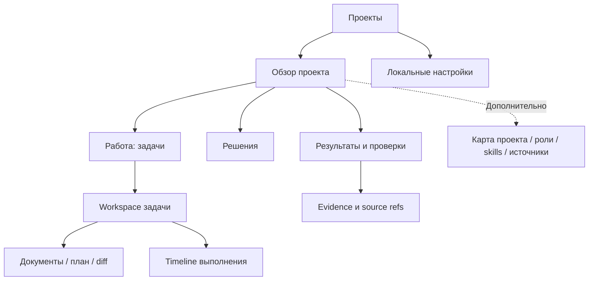
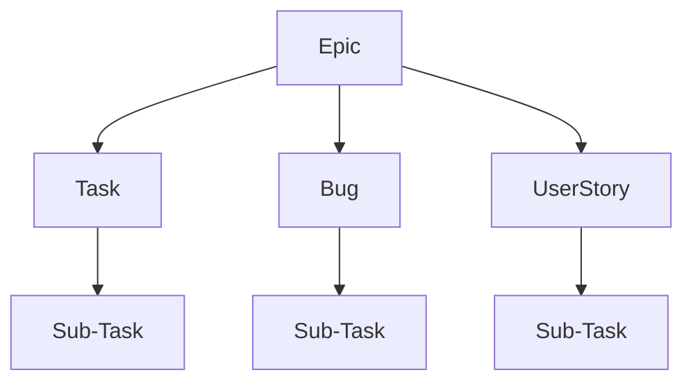
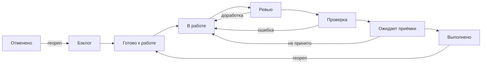

# Product-Agent OS Web — PRD

Актуализация 2026-11-09: **v0.6 — SQLite + FTS5 local, PostgreSQL + pgvector team; единое окно через Codex App Server**. §16 определяет хранение и миграцию, §15 — runtime; требования Task Manager §13–§14 сохранены. [План: 53 задачи / 12 групп](product-agent-os-web-task-manager-plan-2026-11-09.md), [авторизация и коммерческие ограничения](product-agent-os-web-auth-commercial-2026-11-09.md).

Source status: `project-authored / selected-direction / proposed-implementation / official-docs-backed`. Создан: 2026-11-05. Обновлён: 2026-11-09. Версия: 0.6.

Статус: **direction_selected / implementation_not_started**. Пользователь выбрал собственный клиент Codex App Server. Детальные контракты, оценки и коммерческий допуск остаются proposed/pending. Разрешены документы, разработка и deployment не начаты.

Связи: [архитектура и этапы](product-agent-os-web-architecture-2026-11-05.md), [анализ SOL 0.6](sol-0.6-product-agent-os-web-analysis-2026-11-05.md).

Исторический read-only концепт M1: [wireframes](product-agent-os-web-m1-wireframes-2026-11-09.md). Его четыре раздела и отложенный runtime больше не определяют MVP. Актуальны восемь вкладок Task Manager и активные сессии §15; прежние изображения не являются полным изображением v0.4.

## 1. Проблема, цель и ценность

Пользователь Product-Agent OS вынужден искать текущее состояние между Markdown/JSON-файлами, чатами и результатами проверок. Трудно определить, что уже сделано, что подтверждено, где требуется решение и как продолжить после перерыва.

**Цель Web:** одно рабочее пространство для понимания проекта, постановки задач, согласования изменений и приёмки проверяемых результатов. Основные объекты — проект, задача, решение, результат. Source-файлы остаются доступными для контроля и переноса.

Продуктовое обещание: «Управляйте AI-разработкой через понятные задачи, решения и проверяемые результаты».

Гипотеза: представление состояния и evidence в контексте задачи сокращает время ориентации и ошибочные выводы о завершении. Baseline, величина эффекта и готовность платить пока не измерены.

## 2. Пользователи и JTBD

| Сегмент | Задача | Приоритет |
| --- | --- | --- |
| Technical founder / product engineer | Вести свой продукт через AI, понимать scope и результат | Основной |
| AI Engineer / ведущий разработчик | Контролировать проверки, контекст и передачу работы | Основной |
| Небольшая студия | Ориентироваться в нескольких проектах, сохранять repeatability | Вторичный |
| PM с техническим reviewer | Согласовывать требования и принимать продуктовый результат | Позднее, после collaborative workflow |

Начальный ICP: технически самостоятельный пользователь либо команда примерно 2–10 человек с регулярной работой над реальными репозиториями. Размер — критерий отбора пилота, не рыночная статистика. Первый deployment single-user: команда как ICP не означает реализованные shared access/RBAC.

JTBD: «Когда я возвращаюсь к проекту или даю AI следующую задачу, помоги понять, что известно, что изменилось, чему можно доверять и где нужно моё решение».

Не первичный сегмент: полностью нетехнический founder без reviewer, regulated enterprise и одноразовая генерация сайта. Им потребуются дополнительные гарантии приёмки, эксплуатации или масштаба.

## 3. Принципы

1. Основной сценарий понятен без знания имён MD-файлов; источник можно открыть.
2. У статуса есть source, revision и время наблюдения. Unknown не заменяется success или zero.
3. Ordinary task не требует полного пакета документов; routing остаётся за PAOS.
4. Открытие проекта не меняет target files и не вызывает provider.
5. Изменения в IDE сохраняются; stale proposal вызывает conflict, а не overwrite.
6. Execution, verification, owner acceptance и release authorization различаются.
7. Повторное разрешение не запрашивается, если действующая bounded authority полностью покрывает действие; изменение scope требует нового решения.
8. Progress — наблюдаемые операции и результаты, без выдуманного процента или внутренних chain-of-thought.
9. Source-owned данные не дублируются независимой истиной в UI storage.
10. Local-first; внешняя телеметрия выключена по умолчанию.

## 4. Поставки и non-goals

| Поставка | Пользовательский результат | In scope | Исключено |
| --- | --- | --- | --- |
| M1 — Одно рабочее окно | Обсудить и выполнить одну ограниченную задачу через Codex, вернуться к результату | Launcher, connection, SQLite + FTS5, controlled import/restore, session composer/stream, минимальная task card, approvals, interrupt, restart/resume, diff/checks | Full workflow editor, массовая автономность, SaaS и коммерческий launch без gates |
| M2 — Полный Task Manager | Управлять задачами, контекстом, агентами, скиллами и графом | G02–G06/G09, Kanban/links, proposals, manual CRUD и версии | Неограниченное unattended выполнение |
| M3 — Настраиваемая автономность | Выполнять цепочки агентов по разрешённой политике | Workflow editor/recipes, ownership, budgets, queue, bounded repair, статистика | Automatic deployment, shared multi-tenant editing |
| M4 — Проверка и выпуск | Проверить полный путь и выбранную коммерческую модель | Accessibility, install/update/restore, pilot и AUTH-G1–G6 | SIWC без admission; обещание паритета с Codex App |

**MVP = обсуждение → задача → Codex run → проверяемый результат в PAOS.** Выполнение включено уже в M1. Старые M1–M3/A0–A6 и stage labels в исходных §6–§12 ниже — историческая декомпозиция, заменённая §15. Требования безопасности/authority и acceptance сценарии сохраняются; новый stage mapping — в §15.

Общие non-goals: собственная IDE/терминал, перенос SOL backend целиком, обязательная цепочка из десяти ролей, новый multi-provider framework, marketplace, voice, billing, cloud sync, remote access, SSO/RBAC, мобильное выполнение, автоматическая правка prompts/hooks/permissions.

Первичная платформа пилота — Windows и desktop browser; Chrome/Edge предлагаются для проверки. Cross-platform, installer и минимальная ширина экрана уточняются в A0. Local browser app не означает доступность из LAN/интернета.

## 5. Информационная архитектура

Глобально: переключатель проекта и состояние local service. В проекте: «Обзор», «Работа», «Решения», «Результаты». Deep links используют opaque IDs вместо absolute paths.

Человекочитаемые проекции: REQUIREMENTS → «Что делаем»; PLAN → «План работы»; TEST/EVALS → «Как проверяем»; RUNLOG → «История результатов». Для проекта с иными owning artifacts используются его bindings; наличие ровно этих файлов не навязывается.

## 6. Исходные экраны v0.1 — актуальные контракты в §13–§15

### E01. Проекты и подключение

Цель — выбрать существующий workspace. Карточка: имя, доступность пути, last observed, краткое состояние, блокирующие решения. Неизвестные значения обозначены явно.

M1 actions: подключить папку, открыть, обновить сведения, убрать из списка. Последнее не удаляет project files. Onboarding: ввести/выбрать путь поддерживаемым local flow → подтвердить scope чтения → bounded scan → обзор найденного и gaps. Browser directory handle name не принимается за абсолютный путь backend.

Empty state объясняет, что будет прочитано. Ошибки: root не разрешён, путь недоступен, scan partial, формат unsupported. Для проекта без PAOS показывается предложение onboarding; control plane автоматически не создаётся.

### E02. Обзор

Цель — понять состояние и следующий шаг. Верхний блок: цель проекта, snapshot freshness/coverage, текущая задача. Далее: активная работа, блокеры, решения владельца, последние проверенные результаты.

Primary CTA описывает конкретное следующее действие и причину. В M1 — навигация/refresh, в M2+ — доступная команда. Единого процента готовности продукта нет; при известном составе этапа допустимо «подтверждено N из M» с явным denominator. Source health (`current/stale/conflict/partial`) показывается отдельно от business status.

### E03. Работа: список и доска

Список/board, поиск по title/ID, фильтры состояния, owner, blockers и evidence. Карточка: title, short ID, source state, run/verification badges, owner, blocker, last update.

Hierarchy выводится только из явных parent-child связей; dependencies не подменяют parentId. M1 read-only: drag-and-drop не меняет статус. Неподдерживаемая матрица остаётся документом с пояснением; LLM не генерирует «факты» из произвольного текста.

### E04. Workspace задачи

Компактная сводка задачи + «Обсуждение / Активность» + панель «Требования / План / Документы / Изменения / Проверки». На узком desktop панели переключаются вкладками. Сводка содержит expected result, non-goals, acceptance, зависимости, authority и текущий run.

M1 читает существующие артефакты без обещания импорта всех исторических Codex chats. M2 добавляет task draft и вопросы. M3 показывает runtime conversation и timeline наблюдаемых действий. Доступные actions: уточнить, посмотреть план, подготовить изменение, начать, остановить, открыть результат.

Interrupt сначала показывает «Остановка запрошена», затем подтверждённый runtime status. Остановка не означает rollback уже сделанного.

### E05. Решения

Inbox объединяет три явно различных типа: вопрос о scope, product/proposal decision, runtime approval. Карточка: задача, причина, варианты, последствия, baseline revision, срок действия и ожидаемый эффект.

M1 только читает доступные записи. M2 позволяет отвечать и принимать scoped proposals. M3 передаёт решение по конкретному runtime request и ждёт acknowledgement. Ответ на продуктовый вопрос не предоставляет permission; «одобрить всё» отсутствует. Действующая authority отображается и проверяется без лишнего повторного вопроса.

### E06. Документ и предложение изменения

Режимы «Документ», «Источник», «Предлагаемое изменение». Видны source ref, revision, freshness, source/generated status. Source view по умолчанию read-only. В M2 редактирование поддерживаемых полей/секций создаёт draft, затем diff; preview не означает apply.

Apply показывает target/effect/rollback. При внешнем изменении исходника — conflict, перечитывание и пересборка preview. Draft сохраняется. Незнакомый Markdown автоматически не переписывается.

### E07. Результаты и проверки

Результат: описание изменения, diff, acceptance checklist, реально выполненные checks с outcome и revision, environment provenance, gaps и остаточные риски. Raw private logs не сохраняются; diagnostic details доступны только в redacted виде.

M1 читает существующее evidence. M3: принять, вернуть на доработку, принять с явными ограничениями. Owner acceptance не превращает failed/missing checks в passed и не выдаёт release authorization.

### E08. Дополнительные сведения и настройки

Карта проекта, sources, роли/skills и runtime capabilities — advanced navigation. Effective и proposed configuration различимы. Установка plugins, смена глобальных permissions/hooks/models не входят в M1–M3.

Настройки: workspace registry, состояние service/adapter, privacy/retention, cache cleanup и диагностика совместимости. Credentials не записываются в browser storage; auth flow Codex уточняется в A0/A4.

## 7. Состояния и доступность

| Состояние | Поведение | Действия |
| --- | --- | --- |
| Loading | Стадия чтения; прошлый snapshot обозначен историческим | Cancel scan, если поддержан |
| Empty | Объяснение отсутствующих данных | Подключить / открыть source |
| Partial / unsupported | Доступная часть + gaps | Read source / bounded refresh |
| Stale | Время и изменившиеся зависимости | Refresh; stale apply заблокирован |
| Conflict | Версии/источники и причина | Rebuild preview / решить authority |
| Disconnected | Последний snapshot с offline badge | Reconnect; новые commands недоступны |
| Permission denied | Причина и scope без утечки данных | Пересмотреть действие |
| Running / awaiting decision | Реальный шаг и ожидание | Inspect / ответить / interrupt |
| Interrupted / recovery required | Подтверждённые side effects и checkpoint | Inspect / explicit resume после reconciliation |
| Verified / accepted with gaps | Evidence и ограничения рядом | Owner decision без автоматического release |

Обязательны keyboard navigation, видимый focus, возврат focus после dialogs, текстовые альтернативы цветам, понятные сообщения и доступное объявление ошибок. WCAG 2.2 AA — целевой стандарт, соответствие не проверено. Mobile execution не обещается.

## 8. Функциональные требования

| ID | Требование | Первая поставка |
| --- | --- | --- |
| WEB-FR-01 | Подключить разрешённый workspace и выполнить read-only discovery | M1 |
| WEB-FR-02 | Overview с provenance, freshness и next action | M1 |
| WEB-FR-03 | Task projection без подмены source authority | M1 |
| WEB-FR-04 | Чтение artifacts/evidence в контексте задачи | M1 |
| WEB-FR-05 | Изоляция workspace/events и deep links | M1 |
| WEB-FR-06 | Refresh, external source changes, offline/partial states | M1 |
| WEB-FR-07 | Task draft, scope questions и ordinary/full route | M2 |
| WEB-FR-08 | Source-bound proposal с diff и decision | M2 |
| WEB-FR-09 | Revision-safe supported apply, receipt и scoped rollback | M2 |
| WEB-FR-10 | Раздельные questions, product decisions, runtime approvals | M2/M3 |
| WEB-FR-11 | Запуск согласованного task slice через Codex adapter | M3 |
| WEB-FR-12 | Timeline, interrupt и recovery без скрытого повторного execution | M3 |
| WEB-FR-13 | Checks/diff/gaps и отдельная owner acceptance | M1 чтение; M3 решение |
| WEB-FR-14 | Честные capabilities и unsupported states | M1–M3 |
| WEB-FR-15 | Preservation, sensitive-data minimization и local API protection | M1–M3 |
| WEB-FR-16 | Доступный UI и понятные errors | M1–M3 |
| WEB-FR-17 | Elapsed/usage/model/cost только по доступным runtime данным | M3 |
| WEB-FR-18 | Durable drafts/decisions/evidence с retention и удалением | M2/M3 |

## 9. Acceptance scenarios

Все сценарии `pending`. Owners — будущие ответственности, не запущенные subagents. В таблице FR обозначает WEB-FR. Цепочка: requirement → scenario → check → evidence owner.

| Scenario / FR | Given → When → Then | Будущая проверка / owner |
| --- | --- | --- |
| SC-01 / 01,02 | PAOS workspace → подключить → цель/источники/свежесть видны, target hashes не менялись, provider не вызван | Manifest + integration journey / tester |
| SC-02 / 01,14 | Проект без control plane → открыть → найденные данные и gaps, без scaffolding | Fixture + UI / tester |
| SC-03 / 03 | Поддерживаемая task matrix → выбрать task → её acceptance/source; unknown format явно отмечен | Parser contract / backend owner |
| SC-04 / 04,13 | Passed receipt от другой revision → открыть → исторический receipt виден, текущая проверка stale | Projection + UI / tester |
| SC-05 / 05 | Событие A при открытом B → доставить → B не меняется, deep link ведёт к A | Two-workspace integration / tester |
| SC-06 / 06 | Source изменён в IDE → refresh → новая revision, прошлый snapshot не current | Watcher/refresh integration / backend owner |
| SC-07 / 06,12 | Disconnect → reconnect → snapshot + deduplicated cursor replay, без повторения commands | Failure injection / tester |
| SC-08 / 07 | Маленький low-risk фикс → intake → ordinary route с acceptance, без обязательного полного пакета | Routing + product review / product owner |
| SC-09 / 08,09 | Draft baseline A, source уже B → Apply → conflict без write, draft сохранён | CAS negative test / backend owner |
| SC-10 / 09 | Одобренный patch → повторить command ID → один эффект, исходные секции сохранены | Idempotency/preservation / tester |
| SC-11 / 10 | Ответ на scope question → опасное действие → ответ не используется как permission | Authorization contract / security reviewer |
| SC-12 / 11 | Codex несовместим/не авторизован → Start → нет execution, read-only UI доступен | Adapter negative test / runtime owner |
| SC-13 / 12 | Выполнение → Interrupt → pending stop, затем подтверждение и оставшийся diff | Authorized runtime/browser / tester |
| SC-14 / 12 | Crash между dispatch и ack → restart → recovery_required, без автоматического turn retry | Crash/reconciliation / runtime owner |
| SC-15 / 13 | Run завершён, check failed → принять с gap → acceptance сохранён, check остаётся failed | Domain + UI / tester/owner |
| SC-16 / 15 | Out-of-root/junction payload → запрос → deny до I/O, secret не попал в ответ | Path/authz/privacy tests / security reviewer |
| SC-17 / 16 | Keyboard-only → основной flow/dialog → доступные actions и корректный focus/errors | Browser/a11y / frontend owner |
| SC-18 / 17,18 | Нет cost или sensitive log → открыть результат → cost unknown, sensitive value отсутствует | Redaction/unknown contracts / tester |

Multi-file apply, remote execution и rollback всех code changes агента не входят в первый write slice. Unit checks не заменяют M3 runtime/browser evidence.

## 10. Нефункциональные требования

| ID | Предлагаемая цель | Проверка |
| --- | --- | --- |
| WEB-NFR-01 | Нет unapproved writes и межпроектных раскрытий в negative suite | Authz/path/origin/policy |
| WEB-NFR-02 | Нет потери авторского текста в supported edit/conflict cases | Preservation + crash fixtures |
| WEB-NFR-03 | Cached overview p95 ≤ 1 s; command ack p95 ≤ 500 ms; committed event виден p95 ≤ 1 s | Local reference workload/hardware фиксируются в A0; LLM latency исключена |
| WEB-NFR-04 | Bounded/cancellable scan и честный partial | Большие/неподдерживаемые fixtures |
| WEB-NFR-05 | Recovery durable commands/events без hidden replay side effects | Crash/restart integration |
| WEB-NFR-06 | Source portability и rebuildable UI cache | Migration/restore |
| WEB-NFR-07 | Offline startup без provider; actions gated по capability | Degraded-mode tests |
| WEB-NFR-08 | Русский UI, canonical terms, keyboard/a11y target AA | Content + a11y checks |

Числа — design targets для обсуждения, не измеренные свойства. Benchmark недействителен без зафиксированных hardware, объёмов данных и состояния cache.

## 11. Метрики, tracking и pilot

Decision horizon: discovery → M1 pilot → M2/M3 pilot. Business outcome — повторное использование/готовность платить; product outcome — правильное понимание состояния; feature traction — использование экранов. Клики не доказывают ценность.

Primary metric: доля заранее назначенных pilot orientation tasks, где пользователь без подсказки верно определяет current task, blocker/next action и evidence level. Denominator включает неудачи; retries не считаются новыми успехами. Baseline собирается на текущем MD/chat workflow до знакомства с UI.

Предлагаемые targets: 4/5 design partners справляются за 3 минуты; 3/5 возвращаются с другой реальной задачей за 14 дней. Это качественный пилот, не PMF proof. Guardrails: ноль ошибочных трактовок unverified как verified в контрольных кейсах и ноль потерь данных. Input metrics: source coverage и доля journey без ручного поиска MD. Counter-metrics: неправильные решения, скрытые gaps, повторная работа, трудность conflicts. Не оптимизировать число закрытых задач/скорость в ущерб проверкам.

Owner критериев/интервью — будущий product owner; data/privacy owner назначается до измерений. Signoff, baseline, interviews и post-release evidence pending. Review — после 14 дней пилота, перед расширением scope; дата старта не назначена.

Использованы packaged [tracking-plan](../plugins/product-agent-os/assets/templates/artifact-templates/tracking-plan.md) и [metric-spec](../plugins/product-agent-os/assets/templates/artifact-templates/metric-spec.md). Точный `.codex/artifact-templates/tracking-plan.md` отсутствует; разделы здесь — proposal alias, не утверждение о прохождении gate, требующего этот путь. Отдельные template copies не создаются.

| Event | Вопрос | Минимальные свойства | Будущий owner |
| --- | --- | --- | --- |
| workspace.opened | Началась ли ориентация? | pseudonymous workspace ID, snapshot state, timestamp | frontend |
| orientation.assessed | Верно ли понят результат? | pilot session ID, task class, elapsed, correctness enum | product owner, manual assessment |
| source.opened | Нужен ли raw source? | artifact kind, entry screen, без path/content | frontend |
| proposal.conflicted | Безопасно ли обработан edit? | reason enum, schema version | backend |
| result.decided | Принят ли результат с gaps? | verification/acceptance enums | backend |

Operational audit не становится аналитикой автоматически. Pilot metrics только opt-in, локально; external export — отдельное явное действие. Event IDs дедуплицируются, пропуски показываются. Privacy class: internal, потенциально sensitive usage metadata. Не собирать prompts/code/names/absolute paths/credentials. Предлагаемый retention metrics 30 дней с TTL и ручным удалением. Runtime evidence retention описан в архитектуре.

Qualitative loop: первое открытие, возвращение после перерыва, приёмка спорного результата, интервью о последнем реальном затруднении. M3 AI quality сравнивается с baseline на representative/negative cases; live eval calls требуют отдельного разрешения.

## 12. Исторические этапы v0.1 и решения — актуализация в §15

Подробности A0–A6 — в [архитектуре](product-agent-os-web-architecture-2026-11-05.md). Всё `proposed / not_started`; сроки/бюджет/команда не утверждены.

| Этап | Результат |
| --- | --- |
| A0 | Source contracts, UX prototype и capability spike |
| A1 | Local foundation: registry/access/discovery |
| A2 | Read-only overview/tasks/artifacts/evidence — M1 |
| A3 | Intake/questions/proposals/safe apply — M2 |
| A4 | Codex adapter и run lifecycle — M3 |
| A5 | Recovery/packaging/a11y и bounded local beta pilot |
| A6 | Отдельная оценка multi-user/remote/marketplace |

| ID | Решение / рабочее допущение | До какого этапа |
| --- | --- | --- |
| D01 | Local-first, Windows, existing repo, technical ICP | A0/A1 |
| D02 | React SPA + local Node service; bundler после packaging spike | A1 |
| D03 | Поддерживаемые task-source schemas и authority mapping | A2 |
| D04 | Разрешённые поля/секции для M2; unmanaged docs read-only | A3 |
| D05 | Версия Codex, auth/approval integration и capabilities | A4 |
| D06 | Consent/retention, pilot owner и thresholds | До сбора данных |
| D07 | Scope beta, install/update path, runtime cost boundary | A5 |

## 13. Sources, ограничения и handoff

Источники: [SOL audit](sol-0.6-product-agent-os-web-analysis-2026-11-05.md); текущие [status_snapshot.py](../plugins/product-agent-os/scripts/product_agent_os/status_snapshot.py), [cli.py](../plugins/product-agent-os/scripts/codex_runtime_runner/cli.py), [question_ledger.py](../plugins/product-agent-os/scripts/product_agent_os/question_ledger.py), [merge_infrastructure.py](../plugins/product-agent-os/scripts/product_agent_os/merge_infrastructure.py). Исходники PAOS перечитаны в документационной задаче. Предыдущие SOL typecheck/lint результаты не являются тестами нового UI.

Факты: task projection в snapshot отложен; contract runner не выполняет engineering task; answer ledger staged-only; merge поддерживает узкие actions. Новые UI/API/runtime capabilities — проектные предложения. Customer/visual/a11y/performance/security/runtime acceptance не выполнены. Accepted gaps от имени пользователя не оформляются.

Scope текущей задачи: два Markdown proposals, source-registry RU/EN, RUNLOG pointers и явно разрешённый lifecycle transition. Код, hooks, конфигурация выполнения, SOL и внешние системы не меняются. Detailed frontend/backend/architecture/metric artifacts объединены разделами двух документов; runtime receipts и reviews принадлежат будущим этапам. `requirements_ready` не заявляется до owner/domain review.

Control-plane sync: RUNLOG и source registries — ссылки на draft; REQUIREMENTS/PLAN/TEST/EVALS/prod_test — not_applicable для изменения действующих scope/queue/gates, так как Web ещё не принят к разработке. После принятия потребуется отдельная синхронизация. Проверки пакета — в архитектуре. Следующее действие владельца: рассмотреть M1 и D01–D03; разработка требует отдельного запроса.

## 13. Дополнение 2026-11-09: полноценный Task Manager

Source status: user requirements / project-authored proposal. Версия дополнения: 0.2. Это актуальный продуктовый scope. При конфликте с исходными §4–§8 и M1-wireframes приоритет имеет этот раздел. Read-only обзор сохраняется как режим без provider; актуальный M1 определён в §15. Агенты, Скиллы, Сессии и Карта проекта становятся основными вкладками. Редакторы и ограниченная автономность входят в roadmap.

Owning artifacts: [экраны](product-agent-os-web-task-manager-screens-2026-11-09.md), [план и 30 карточек](product-agent-os-web-task-manager-plan-2026-11-09.md), [8 машинных групп](product-agent-os-web-task-manager-task-group-2026-11-09.json).

### Требования и трассировка

| ID | Обязательное поведение | Экраны | Группы |
| --- | --- | --- | --- |
| TM-01 | Восемь проектных вкладок: Обзор, Задачи, Сессии, Агенты, Скиллы, Карта проекта, Документы, Проверки | S03–S21 | G01–G06, G08 |
| TM-02 | Список агентов, инструкции, effective и pinned версии, роли и источники | S10–S12 | G04 |
| TM-03 | Частота использования за период, активные/прошлые задачи и статистика исходов работы | S10–S11 | G03–G04 |
| TM-04 | Добавление/редактирование/удаление агента вручную или через proposal по описанию; неоднозначный target требует уточнения | S12–S13 | G04 |
| TM-05 | Каталог, редактор, версии и удаление скиллов с проверкой зависимостей | S14–S15 | G05 |
| TM-06 | Добавление скилла по пути или через find-skills | S16 | G05 |
| TM-07 | Генерация/рекомендация скиллов по требованиям проекта или описанию | S17 | G05 |
| TM-08 | Все доступные сессии проекта и все доступные user-visible сообщения пользователя и агентов | S08–S09 | G03 |
| TM-09 | Граф зависимостей файлов и переменных с исходными определениями/ссылками | S18 | G06 |
| TM-10 | Все двенадцать полей задачи, перечисленные ниже | S06–S07 | G01–G02 |
| TM-11 | Оценка до старта; измеренное фактическое время HH:MM:SS | S04–S07, S11 | G01–G02, G04 |
| TM-12 | Dark/Light/System и RU/EN на всех экранах | S01–S24 | G01, G08 |
| TM-13 | Максимальная самостоятельность внутри заранее разрешённых scope, бюджета и stop conditions | S06, S22–S23 | G07 |
| TM-14 | Сквозная трассировка задача → agent run → session → files → checks → acceptance | S06, S09, S11, S18, S21 | G02–G08 |

### Контракт задачи

| Поле | Тип и правило | Поведение UI |
| --- | --- | --- |
| ID | `PROJECT_PREFIX-NNNN`; prefix — 4 латинские буквы из названия/аббревиатуры проекта, например PAOS; sequence монотонный и уникальный в проекте | Prefix предлагается при подключении и подтверждается; для коротких/неоднозначных имён редактируется. Rename не меняет ID; старые ID сохраняют alias |
| Название | Непустая строка | Короткое название в списке, полное в карточке |
| Краткое описание | Текст scope и проблемы | Видно до запуска; поддерживает draft |
| Техническое значение | Отдельный текст результата для системы | Не подменяется продуктовой ценностью |
| Продуктовое значение | Отдельный текст результата для конечного пользователя | Связано с целью/приёмкой |
| Затрагиваемые файлы | Массив path, planned operation и actual operation: create/modify/delete; source revision | План отдельно от фактического diff; rename отображает обе стороны |
| Исполнители | Agent ID, profile version, assignment/run links, период участия | Показывает текущих и прошлых агентов, а не только последнего |
| Проектные артефакты | Тип, путь/URL, revision, provenance; планы, исследования, решения пользователя, внешние ресурсы | Безопасные ссылки с доступностью; непроверенный внешний источник помечен |
| Критерии приёмки | Массив условия, способ проверки, evidence и outcome | Чекбокс сам по себе не доказательство; unmet criterion виден |
| Оценочное время | estimate seconds, created_at, author/source, revisions | HH:MM:SS; обязательное до ready/start; фиксируется snapshot при старте |
| Реальное время | start/end events, интервалы, duration seconds nullable | HH:MM:SS; до старта «Не начата»; при потере telemetry «Неизвестно», не 00:00:00 |
| Потенциальные риски | Риск, затронутый flow, вероятность/влияние при наличии оснований, проверка/mitigation | Видны перед запуском и при приёмке |

Дополнительно: project_id, status, dependencies, created/updated revision и event references. Черновик допускает незаполненные поля; перевод в ready требует названия, описания, обеих ценностей, приёмки, оценки, risks (или явного none) и scope. ID назначается атомарно; номер после удаления не переиспользуется.

### Время, статистика и наблюдаемость

Хранить UTC timestamps, отображать выбранную timezone. Часы HH могут быть больше 23, длительность не обнуляется на сутках. Показывать отдельно elapsed wall time, активную длительность задачи (объединение интервалов работы без pauses) и суммарное агентское время. При параллельной работе двух агентов последнее может превышать elapsed; UI это объясняет. Pause/resume/retry/cancel/failed/completed фиксируются идемпотентными событиями. Если crash оставил интервал незавершённым, восстановление запрашивает/реконструирует evidence и помечает неопределённость; не придумывает timestamp завершения.

Частота агента = число уникальных начатых runs за выбранный период и проект; mentions имени в чате не считаются запуском. Исходы successful/failed/cancelled/needs decision и принятые пользователем результаты различаются. Duration, retries, token/cost доступны только при подтверждённой telemetry; показывать source, freshness, denominator и coverage. До подключения данных — «Нет данных», а не искусственные нулевые графики.

### Сессии и границы доступности

Цель — полная проектная история: pagination, archived, forks и связанные subagent sessions. Binding основан на устойчивом project ID и проверяемом source workspace, а не только имени/пути в тексте. Исходные сообщения сохраняют язык, авторство, порядок и ссылки. Source adapter обязан сообщать coverage и причины пропусков. Требование «все» не позволяет обещать доступ к сессиям, которые установленный host/API не раскрывает; такой пробел является blocking gap интеграции, не «нет сессий».

Показываются user-visible сообщения и разрешённые tool events. Не извлекаются hidden chain-of-thought и secrets. Redaction, удалённые сообщения, attachments и усечение показаны явно. История чужого проекта не попадает в поиск текущего.

### Управление агентами, skills и автономность

Ручной editor и генерация по описанию используют один proposal contract. Результат генерации — редактируемый draft; проверка структуры, diff, source revision и разрешённое применение создают новую версию. Работающий run закреплён за прежней версией. Архив/удаление прекращает новые назначения; исторические ссылки и evidence остаются. Active dependency требует разрешения конфликта до hard delete.

Добавление skill по пути проверяет containment, metadata и ресурсы; внешние/vendor sources не перезаписываются без применимого права. find-skills — discovery route, поиск не равен установке. До применения показываются origin, version/hash, dependencies и доступная license/trust информация. Генерация по требованиям ссылается на конкретный requirement и проверяет дубликаты.

Автономный путь: постановка → план → выбор агентов/skills → проверка ownership → исполнение → проверки → ограниченное исправление → приёмка. Внутри уже разрешённых границ повторное подтверждение не нужно. Budget exceeded, конфликт файлов, недоступный источник, исчерпанный retry budget и новый approval boundary останавливают соответствующий run с объяснением. Policy UI не расширяет sandbox/host permissions. Глобальная установка hooks и массовое unattended выполнение не считаются включёнными наличием Web.

## 14. Иерархия, Kanban и настраиваемые workflow — 2026-11-09

Source status: official Atlassian documentation checked 2026-11-09 / proposed Product-Agent OS design. Версия дополнения: **0.3**, draft_for_review. Дополняет §13 Task Manager и имеет приоритет при конфликте полей/статусов. Ниже решения для будущего Web; они не меняют текущие runtime statuses или task_matrix_plan_v1 в репозитории. Jira используется как reference model, интеграция с Jira не входит в scope.

### 14.1. Что подтверждено в Jira Cloud

| Источник | Подтверждённое поведение Jira | Решение Product-Agent OS |
| --- | --- | --- |
| [JIRA-01: Hierarchy](https://support.atlassian.com/jira-cloud-administration/docs/what-are-issue-types/) | Epic → standard (Story/Task/Bug) → Subtask. В новых документах Jira используются work item/work type. | Сохраняем три уровня; UI UserStory соответствует Jira Story. |
| [JIRA-02: Status categories](https://support.atlassian.com/jira-cloud-administration/docs/what-is-a-workflow-status/) | Каждый status относится к To do, In progress или Done. | Стабильные категории и отдельные пользовательские названия статусов. |
| [JIRA-03: Transitions](https://support.atlassian.com/jira-cloud-administration/docs/create-workflow-transitions/) | Переход направленный; обратный переход задаётся отдельно. | Явные transitions с guards и ручным/агентским инициатором. |
| [JIRA-04: Kanban mapping](https://support.atlassian.com/jira-software-cloud/docs/configure-columns/) | Колонки доски сопоставляются статусам; колонка может содержать несколько статусов. | Kanban — представление workflow, а не отдельное поле состояния. |
| [JIRA-05: Workflow schemes](https://support.atlassian.com/jira-cloud-administration/docs/add-edit-and-delete-an-issue-workflow-scheme/) | Workflow schemes сопоставляют типы работ workflow; изменения активной схемы требуют публикации draft и при необходимости mapping статусов. | Versioned workflow и явная миграция существующих задач. |
| [JIRA-06: Versions](https://support.atlassian.com/jira-cloud-administration/docs/manage-versions/) | Affects versions описывает затронутые версии; Fix versions связывает работу с выпуском. | Два независимых массива версий, без смешения с release readiness. |
| [JIRA-07: Components](https://support.atlassian.com/jira-software-cloud/docs/what-are-jira-components/) | Jira components группируют работу и ограничены company-managed spaces. | Собственный project-scoped справочник без зависимости от Jira/Compass. |
| [JIRA-08: Creator](https://support.atlassian.com/jira-software-cloud/docs/jql-fields/) | Creator фиксирует пользователя, создавшего запись, и не меняется. | Неизменяемый actor user/agent/system; инициатор и создатель разделены. |
| [JIRA-09: Linked work items](https://support.atlassian.com/jira-cloud-administration/docs/configure-issue-linking/) | Тип связи имеет имя и прямое/обратное описание; создание связи требует права. | Typed links с авторством и явной семантикой блокировки. |
| [JIRA-10: Comments and history](https://support.atlassian.com/jira-software-cloud/docs/what-are-the-different-types-of-activity-on-an-issue/) | Activity разделяет Comments, History и Work log. | Отдельные вкладки Комментарии и История изменений. |
| [JIRA-11: Attachments](https://support.atlassian.com/jira-software-cloud/docs/add-an-attachment-to-an-issue/) | Файл можно добавить upload/drag-and-drop; действуют ограничения вложений. | Локальное managed storage и явные ограничения; числовые лимиты Jira не копируем. |
| [JIRA-12: Priority and resolution](https://support.atlassian.com/jira-cloud-administration/docs/what-are-issue-statuses-priorities-and-resolutions/) | Priority отличается от Resolution; стандартные priorities Highest–Lowest. | Пять уровней приоритета, отдельный outcome закрытия. |
| [JIRA-13: Scheduling](https://support.atlassian.com/jira-software-cloud/docs/schedule-issues-in-advanced-roadmaps-using-start-end-dates/) | Start date/Due date используются для планирования; рассмотренная страница Plans относится к Premium/Enterprise. | Плановые даты отдельно от фактических timestamps; не заявляем эквивалентность всех Jira тарифов. |

Ограничения источников: company-managed, team-managed и advanced Plans имеют различия. Мы не переносим тарифные ограничения, Jira permissions или скрытые особенности конкретного tenant в Product-Agent OS. Конкретные статусы, роли агентов, лимиты, attachment storage и правила dependency gates ниже — **проектные предложения PAOS**, а не утверждения о Jira.

### 14.2. Типы и иерархия задач

| Тип UI | Canonical key | Назначение | Допустимый parent |
| --- | --- | --- | --- |
| Epic | epic | Крупный результат или инициатива с несколькими работами | Нет |
| Task | task | Техническая, операционная или организационная работа | Epic либо нет |
| Bug | bug | Дефект: воспроизведение, expected/actual, затронутая версия | Epic либо нет |
| UserStory | user_story | Пользовательская потребность, ценность и проверяемый сценарий | Epic либо нет |
| Sub-Task | sub_task | Часть Task, Bug или UserStory | Ровно один standard item того же проекта |

Task, Bug и UserStory — соседи, а не последовательные уровни. Sub-Task не имеет детей; прямой Epic → Sub-Task запрещён в выбранной модели. Standard item может существовать без Epic. Произвольные дополнительные уровни не входят в первый scope. Группы G01–G10 в плане — области реализации, они не превращаются автоматически в продуктовые Epic.

Parent — структурная принадлежность; Linked Issues — другая связь. В проекте действует один parent, отсутствие циклов и запрет self-parent. Reparent/type conversion выполняются с preview: incompatible children, workflow/status, данные типа и версии сохраняются или требуют явного решения. ID не меняется. Удаление parent с детьми не каскадирует молча.

Epic не запускается как один агентский run: исполняются выбранные дочерние задачи. UI показывает child counts по outcomes, обязательные незавершённые элементы, roll-up estimates и effort отдельно от elapsed. Нельзя суммировать вложенные roll-ups дважды. Собственное время parent не смешивается с child effort. Закрытие Epic/standard parent как выполненного требует завершения обязательного объёма; отменённый child требует явного исключения из scope с причиной и не считается выполненным.

### 14.3. Дополнительные поля и справочники

Все прежние поля сохраняются. Новые поля:

| Поле | Контракт | Правило |
| --- | --- | --- |
| Тип / Parent | issue_type, parent_id nullable | Таблица иерархии; для Sub-Task parent обязателен |
| Статус | status_id, status_category, workflow_id, workflow_version | Статус меняется только допустимым transition; category вычисляется из определения |
| Создатель | created_by: actor_type + actor_id + display_name_snapshot; created_at | Неизменяемый автор сохранённой записи: user, agent или system; agent profile/run/source session при наличии |
| Инициатор | initiated_by nullable | Если пользователь поручил агенту создать задачу, создатель agent, инициатор user. Если пользователь сохранил предложенный draft, creator=user, suggested_by=agent |
| Приоритет | priority_id, rank отдельно | Highest, High, Medium (default), Low, Lowest; RU: Высший, Высокий, Средний, Низкий, Низший. Rank упорядочивает внутри очереди; severity Bug — отдельно, если нужна |
| Компоненты | component_ids[] | Multi-select: BackEnd, FrontEnd, DB, RAG, LLM, Design, Marketing, Integrations, DevOps, QA, Analytic |
| Start Date | planned_start_date, YYYY-MM-DD nullable | Плановая дата начала; label «Start Date (план)». Фактический старт берётся из actual_started_at и показывается рядом |
| Due Date | due_date, YYYY-MM-DD nullable | Дедлайн включительно до конца дня в timezone проекта; overdue со следующего локального дня. Не принуждает к false completion |
| Affects version | affects_version_ids[] | Версии, к которым относится проблема/наблюдение; особенно Bug; допускает несколько и «Не определено» |
| Fix version / Target release | fix_version_ids[] | Релизы поставки результата; это поле нужно для release planning, Affects version его не заменяет |
| Attachments | attachment references[] | Фото, документы и другие context files; отдельны от links на проектные артефакты |
| Resolution | null либо completed/cancelled/duplicate/wont_do | Обязательно для terminal state; очищается при reopen, прежнее значение остаётся в history |
| Blocker | is_blocked + reason + linked_issue/decision + since + owner | Ортогональный признак; не стирает текущий status |

Для legacy import неизвестный creator сохраняется unknown с provenance; его нельзя приписывать текущему пользователю. Создатель, исполнители и автор последнего изменения — три разные сущности. Существующие planned записи этого репозитория не получают выдуманные продуктовые даты, creators или версии.

Components — project-scoped справочник с устойчивыми ID; пользователь может добавить, переименовать и архивировать компонент. Canonical labels из требования сохранены, включая Analytic. Несколько компонентов не дают неявных конфликтующих назначений: workflow route выбирается по явному правилу, при неоднозначности показывается выбор. Компонент не тождественен файлу, модулю graph или агенту.

Плановые даты опциональны, но при наличии обеих start ≤ due. Изменение Due Date сохраняет прежнее значение, автора и причину; timezone проекта показывается. Reopen не переписывает первый actual start; повторные попытки учитываются интервалами. Старт/дедлайн Epic не наследуются детям молча; обнаруженное превышение parent due показывается предупреждением.

Version registry: id, name, description, planned_start_date, release_date, state=unreleased/released/archived. Название может быть SemVer или другим принятым проектом форматом. Release policy задаёт обязательность target release по типам/компонентам и условия готовности. Первоначально поле необязательно; release-managed проект требует его перед Ready, с явным исключением для unplanned hotfix. Обнаружение Bug в v1.2 и исправление в v1.3 заполняет Affects=v1.2, Fix=v1.3. Закрытие задачи не выпускает версию, не публикует код и не доказывает deployment.

### 14.4. Статусы и Kanban

Базовый workflow:

| Canonical status | RU / EN | Category | Условие/значение |
| --- | --- | --- | --- |
| backlog | Бэклог / Backlog | todo | Сохранённая задача, возможна неполная постановка |
| ready | Готово к работе / Ready | todo | Scope, ценность, приёмка, оценка и нужные поля заполнены |
| in_progress | В работе / In progress | in_progress | Пользователь или агент начал работу; стартовый event |
| review | Ревью / Review | in_progress | Результат передан на инженерную/предметную проверку |
| verification | Проверка / Verification | in_progress | Выполняются предусмотренные проверки |
| awaiting_acceptance | Ожидает приёмки / Awaiting acceptance | in_progress | Evidence собрано, требуется решение по результату |
| done | Выполнено / Done | done | Criteria и обязательные dependencies/children выполнены; resolution=completed |
| cancelled | Отменено / Cancelled | done | resolution=cancelled/duplicate/wont_do; причина обязательна |

Дополнительные разрешённые transitions: любая nonterminal задача → Cancelled с причиной; Ready → Backlog при возврате на уточнение; Done/Cancelled → указанный выше стартовый статус через Reopen. Owner может закрыть вручную из любого nonterminal статуса, если проверены guards завершения; это отдельный переход Complete manually с evidence и reason. Diagram показывает основной путь, а не полный автомат переходов.

Kanban по умолчанию имеет 7 колонок: Бэклог, Готово к работе, В работе, Ревью, Проверка, Ожидает приёмки, Закрыто. Последняя объединяет Done и Cancelled с разными badges/outcomes; cancelled можно скрыть фильтром, с явным числом скрытых карточек. Backlog можно вынести в отдельный список. У каждой колонки набор status IDs; один статус не дублируется в нескольких колонках одной доски. Publish board mapping требует покрытия всех статусов выбранных workflow, включая старые pinned версии, либо явного раздела «Вне доски» с count/link.

Drag-and-drop вызывает transition, а не прямую запись status. При нескольких допустимых target statuses пользователь выбирает один; недопустимое перемещение объясняет guard. Keyboard/menu переходы эквивалентны drag. Отдельные фильтры: type, Epic, parent, agent, creator, priority, components, dates, affects/fix version, blocked. Default карточка: type icon+label, ID/title, priority, agents, components, due/overdue, blockers, subtasks count. Поля карточки настраиваемы.

WIP limits опциональны на колонку; warning либо hard mode задаётся явно. Agent scheduler соблюдает hard WIP, ownership и dependency gates; ручной override soft limit журналируется. Priority не разрешает игнорировать blockers. Reopened — событие, failed — outcome run, blocked — признак; их не нужно принудительно добавлять как постоянные колонки.

### 14.5. Создание, закрытие и права пользователя

Пользователь создаёт Epic/Task/Bug/UserStory из «Новая задача», Sub-Task из parent. Сохранение создаёт Backlog; подготовка к Ready валидирует поля. Agent может создать задачу по существующей authority, с реальным авторством и источником; это не делает owner агентом автоматически.

Доступны «Завершить», «Отменить», «Переоткрыть» и обычные переходы. Человек не обязан запускать агента, чтобы выполнить и закрыть задачу. Manual completion принимает ручные evidence и результат проверки; отсутствие agent run не является ошибкой. Если критерий не выполнен, UI предлагает доработку или отмену/изменение scope с причиной, а не ложное Done. Duplicate требует ссылку на canonical issue.

Перед terminal transition активные runs должны завершиться либо подтвердить cancel; промежуточное «Отмена запрошена» относится к run, а status задачи ещё не terminal. Закрытие не может оставить writer незаметно работающим. Agent может выполнять переходы в пределах policy; по умолчанию итоговая приёмка владельцем, а автоматическое Done разрешается отдельно для выбранного workflow с проверяемыми criteria. Он не может расширить себе права через редактор workflow.

### 14.6. Настраиваемые workflow и цепочки агентов

Два связанных уровня:

1. **Issue workflow**: states, categories, transitions, guards, доступные типы, ручные actions и правила completion.
2. **Execution recipe**: последовательность/ветвления ролей и skills внутри этапа — input artifacts, output artifacts, checks, ownership, timeout, retry/iteration budget и stop conditions.

Пользователь может создать workflow с нуля или копией шаблона, переименовать, добавить/убрать статусы и переходы, настроить column mapping и recipe, проверить и опубликовать новую версию. Project default workflow и mapping по issue type выбирают initial definition; explicit per-issue selection имеет приоритет, затем type mapping, затем default. Component routing допускается только с детерминированным порядком правил; конфликт не решается скрытым «первым попавшимся» агентом.

Редактор содержит диаграмму и доступное табличное представление. Для transition: from/to, name, allowed actor roles, required fields, guards, associated recipe, success/failure targets и необходимость решения. Вызов permission-sensitive action остаётся в host authority; поле workflow не является shell script или способом отключить guardrails.

Примеры recipes (PAOS proposals):

| Шаблон | Исполнение | Завершение |
| --- | --- | --- |
| Feature/UserStory | product-manager уточняет критерии → architect → builder → tester → reviewer | Проверки и приёмка |
| Bug rescue | tester воспроизводит → builder исправляет → tester regression → reviewer | Bug acceptance и affected/fix versions |
| Design/Marketing | product-manager уточняет brief → назначенный проектный агент готовит результат → reviewer | Пользователь оценивает по предметным criteria; coding checks не навязываются |
| Manual | Пользователь выполняет работу и добавляет evidence | Manual completion |

Draft workflow не меняет active задачи. Publish создаёт immutable version после validation и preview. Задача хранит workflow version; начатый run дополнительно закрепляет recipe и profile/skill versions. Новые задачи берут active version. Для существующих нужна migration preview: old/new statuses, transitions, field requirements, board mapping, число затронутых задач; миграция только по expected revision. Активные runs остаются pinned до завершения/подтверждённой отмены. Архив workflow запрещает новые назначения, сохраняя историю. Rollback выбирает старую версию для новых задач; миграция назад также явная.

Validation: один initial state, категории всех states, достижимый terminal path, отсутствие бесконечных automated loops, guards на terminal transitions, допустимые роли/skills, конечные timeout/retry/budget, разрешимые branches/join и отсутствие пересекающихся writers. Ручные rework loops допустимы; автоматические циклы имеют конечный iteration budget. SSE replay/retry не запускает рецепт повторно: command/run idempotency и compare-and-set transition обязательны.

### 14.7. Linked Issues

| Тип связи | Прямое / обратное отображение | Семантика PAOS |
| --- | --- | --- |
| blocks | блокирует / заблокирована задачей | A blocks B: B нельзя начать/закрыть как выполненную до выполнения A либо явного снятия/waiver зависимости |
| relates_to | связана с / связана с | Симметричная информационная связь, без execution gate |
| duplicates | дублирует / имеет дубликат | Направление к canonical issue; не закрывает автоматически |
| clones | копия / источник копии | Provenance, без execution gate |

Пользователь и разрешённый агент создают/удаляют links через поиск ID/title; actor, timestamp, reason и source сохраняются. Одна canonical запись ребра даёт прямое и обратное отображение; self-link и дубли отклоняются. Parent не хранится второй раз как blocks. Для blocks граф обязан быть DAG: цикл отвергается с путём. В relates_to циклы допустимы. Duplicate chains проверяются на цикл и приводятся к canonical target.

При отмене blocker зависимость не считается выполненной: successor остаётся blocked, пока пользователь не изменит её с причиной. Reopen blocker помечает зависимые результаты как требующие пересмотра; завершённые задачи автоматически не переписываются. Новая blocking link на активную задачу приостанавливает её на безопасной границе после подтверждения runner, сохраняя pending state до receipt. Link creation не выполняет работу и не выдаёт новый approval.

В первом scope links разрешены внутри проекта; cross-project links — будущая capability с проверкой доступа. Статусы, версии, badges и hover preview видны в Linked Issues. Иерархия, ссылки задач и code dependency graph — разные типы графов; UI не смешивает их edges.

### 14.8. Attachments, комментарии и история

Attachment — управляемая локальная копия с id, original filename, media type, bytes, hash, created_by/at, task ID, status и storage reference. Исходный внешний файл не изменяется. Предлагаемые defaults: 50 MiB/file, 500 MiB/task; параметры видимы до upload и настраиваемы owner. Проверять MIME/content/extension, path traversal, quotas и partial uploads; одинаковое имя не перезаписывает прежнее вложение. Изображения и PDF можно preview; исполняемые/активные форматы не исполняются, HTML/SVG требуют безопасного renderer или download-only. Текст вложения — untrusted context, не instruction authority.

Удаление attachment требует права и показывает ссылки из comments/artifacts; остаётся tombstone/history. Backups включают metadata и binaries с проверкой hash. URL внешнего ресурса остаётся artifact link, не становится attachment без явного импорта. Доступ агента к файлу определяется task scope; отправка внешнему provider не следует автоматически из upload.

**Комментарии** — самостоятельная вкладка: user/agent author, timestamp, Markdown, reply/thread, attachment refs и task mentions. Agent comment содержит run/session ссылку при наличии. Edit создаёт revision и отметку «изменено», delete — tombstone; исходный текст не остаётся публично доступным после удаления, audit хранит событие и безопасные metadata. Комментарий не запускает workflow автоматически; action «Создать предложение из комментария» отделён от обычного текста.

**История изменений** — самостоятельная вкладка: кто, что, когда, старое/новое значение, причина, источник, revision/correlation. Покрывает fields, type/parent, status/resolution, workflow migration, links, versions, attachments, comments metadata, assignments и manual overrides. UTC storage, timezone display, фильтры по actor/field/date. Append-only events; correction новым event. Sensitive data не дублируются в audit, redaction отмечается. Session transcript и task comments не копируются друг в друга без явного действия.

### 14.9. Требования, экраны и приёмка

| ID | Требование | План |
| --- | --- | --- |
| TM-15 | Типы, parent rules, reparent/conversion и roll-up | PAOS-0031 |
| TM-16 | Статус, creator/initiator, priority, components, plan dates | PAOS-0002, PAOS-0031, PAOS-0032 |
| TM-17 | Affects/Fix versions и release policy | PAOS-0033 |
| TM-18 | Attachments | PAOS-0034 |
| TM-19 | Ручное создание/закрытие/reopen, guards и active-run stop | PAOS-0006, PAOS-0008, PAOS-0035 |
| TM-20 | Kanban, mappings, WIP и фильтры | PAOS-0005, PAOS-0035 |
| TM-21 | Создание/редактирование/versioning/migration workflow | PAOS-0036 |
| TM-22 | Recipes и ограниченное agent execution | PAOS-0024, PAOS-0025, PAOS-0037 |
| TM-23 | Linked Issues и dependency semantics | PAOS-0038 |
| TM-24 | Отдельные Comments и Change history | PAOS-0034 |

S04/S05 получают hierarchy filters, поля карточек и Kanban settings; S06 — type/parent, новые поля, Linked Issues, Attachments и отдельные tabs Комментарии/История изменений; S07 — полный editor. S23 ссылается на policy, не заменяет workflow editor. Предлагаются S25 «Workflow проекта» и S26 «Редактор workflow» в настройках проекта; version registry — раздел настроек релизов. Старые 24 изображения v0.2 не перерисовывались и не покрывают новое дополнение.

Acceptance scenarios:

1. User создаёт UserStory под Epic и Sub-Task под UserStory; Task под UserStory и self-parent отклоняются с объяснением.
2. Agent создаёт Bug по поручению user: creator=agent, initiated_by=user; последующий editor не меняет creator.
3. User без agent run вручную закрывает Task с выполненными criteria; при открытом обязательном child Done недоступен, Cancelled требует reason.
4. Bug affects v1.2 и targets v1.3; release filter v1.3 находит его по Fix version, не по Affects.
5. Drag в колонку с двумя target statuses предлагает допустимый выбор; отсутствие transition не меняет запись.
6. Publish workflow v2 не меняет running v1; migration preview требует status mapping, stale revision не применяется.
7. A blocks B и B blocks C; C blocks A отклоняется. Двусторонняя relates_to не блокирует исполнение.
8. User/agent comment виден в Comments; изменение priority и status видно в History с actor, before/after и временем; удалённый attachment остаётся tombstone.
9. Replayed transition не запускает второй run; закрытие при работающем writer ждёт подтверждённой остановки.
10. RU/EN и обе темы сохраняют доступность новых полей, keyboard transitions и workflow editor.

Non-goals: Jira sync/import API, собственный язык scripting, дополнительные hierarchy levels, cross-project dependency scheduling, hosted collaboration и автоматическая публикация релизов. Product/UX acceptance и runtime integration остаются будущими gates. Все описанные defaults можно уточнить до реализации без переписывания исторического evidence.

## 15. Единое окно и Codex App Server — v0.4

Детализация UX от 2026-11-09: [структура S01–S28](product-agent-os-web-task-manager-screens-2026-11-09.md) и [wireframes UX v0.5](product-agent-os-web-m1-wireframes-2026-11-09.md). WF-01–16 и UX-AC-01–18 определяют proposed поведение сессии, task/agent/file context, разрешений и recovery; не подтверждают реализацию или capabilities runtime.

Source status: user-selected product direction / official documentation checked 2026-11-09 / proposed implementation. Этот раздел заменяет прежнюю очередность runtime на M3 и приоритетен при конфликте с историческими §4–§12. TM-01–24, issue hierarchy, поля, workflow, связи и комментарии не сокращаются.

### 15.1. Продуктовое решение

Product-Agent OS — основное окно общения и управления проектом. Codex App Server выполняет инженерные поручения; Codex App не является обязательным приложением, UI proxy или источником авторизации по умолчанию. PAOS владеет задачами/workflow/бюджетами/решениями; Codex владеет агентным циклом внутри выданного scope. Модель вызывается у провайдера, filesystem/tools работают в выбранном локальном окружении. Это local-first, не полностью offline AI.

Отсутствие provider connection оставляет просмотр/ручную работу с поддерживаемыми локальными данными. Оно не вызывает переход в Codex App. OAuth consent может открываться в системном браузере; это исключение для подключения, а не второе рабочее приложение.

### 15.2. Запуск и основной путь

1. Запустить PAOS ярлыком. Launcher проверяет совместимость runtime, поднимает local service и открывает UI. Нет обязательной ручной команды в терминале; установка отсутствующего runtime только после явного решения.
2. Настроить connection и увидеть, кто оплачивает inference. Без connection можно открыть проект в локальном режиме.
3. Выбрать папку; bounded read-only discovery показывает состояние, источники, ограничения. Не отправлять содержимое provider при открытии.
4. Создать сессию или открыть задачу. Composer явно различает «Обсуждение», «Планирование» и «Выполнение». Первые два режима не разрешают target mutations; inference в них всё равно может быть платным.
5. При необходимости преобразовать обсуждение в draft Epic/Task/Bug/UserStory/Sub-Task. Обычное сообщение не создаёт задачу молча. До mutating run нужны задача, scope, критерии и оценка.
6. Запустить разрешённый slice. Видны выбранный агент/profile, workflow/recipe version, модель/connection, tools, изменяемые файлы и фактическое время.
7. Ответить на вопрос или runtime approval в том же окне. Продуктовое согласие и permission различаются; действующие permissions не запрашиваются повторно без причины.
8. Посмотреть diff/checks/gaps; принять либо вернуть результат. Завершение turn не равно выполнению задачи.
9. После закрытия/перезапуска открыть ту же сессию; восстановить контекст по сохранённым IDs и receipts без повторного применения уже сделанного.

Задача может быть выполнена человеком без agent run. Сессия может обсуждать несколько задач; задача может иметь несколько запусков/сессий. Ссылки устойчивые, но не жёсткое one-to-one.

### 15.3. Экраны и навигация

Восемь вкладок сохраняются. При первом открытии проекта — Обзор с CTA «Новая сессия»; после возвращения — последняя выбранная вкладка/сессия этого проекта. В Задачах действие «Работать в сессии» создаёт/открывает связанную сессию, не меняя её project binding.

| Экран | Новое обязательное поведение |
| --- | --- |
| S01/S02 Проекты/подключение | Launcher/runtime status, выбор connection, offline discovery, actionable ошибки установки/версии |
| S06 Задача | Связанные сессии и runs, «Обсудить / Составить план / Выполнить», evidence и manual close guards |
| S08 Сессии | Собственные сессии PAOS, поиск/архив/родительские и дочерние связи, New session; внешний импорт отдельной capability с coverage |
| S09 Рабочая сессия | Слева список сессий; в центре transcript + composer, Attach/Send/Stop; справа task/plan/diff/checks/approvals. Keyboard и narrow layout переключают панели |
| S22 Решения | Runtime request ID, actor/scope/effect, expiry и acknowledgement; reconnect не одобряет автоматически |
| S23 Автономность | Policy и лимиты новых runs; состояние процесса отдельно от Kanban |
| S24 Настройки | Connection/account/payer, capabilities, disconnect, runtime version, retention; секреты не отображаются |
| S27 Подключение runtime | Новый текстовый route /settings/connections; onboarding и Settings используют один flow с API/SIWC availability |
| S28 Восстановление | Новый текстовый route /p/:project/recovery; orphan/unknown run, сохранённые side effects и действия Inspect/Resume/Stop |

Всего 28 основных текстовых routes; прежние 24 image concepts не покрывают v0.3/v0.4 и не обновлялись. Новый графический дизайн в эту задачу не входит.

### 15.4. Новые требования и трассировка

| ID | Требование | План / этап |
| --- | --- | --- |
| SW-01 | Весь engineering journey доступен без открытого Codex App | PAOS-0042–0045 / M1 |
| SW-02 | Launcher, service health, совместимость, безопасный shutdown и локальный режим | PAOS-0040 / M1 |
| SW-03 | Изолированные project/session/issue/run/thread/turn связи, user-visible history | PAOS-0042/0043, PAOS-0009–0011 / M1–M2 |
| SW-04 | Composer discussion/planning/execution, streaming, вложения по capabilities | PAOS-0043, PAOS-0034 / M1–M2 |
| SW-05 | Approvals/questions, interruption и ACK внутри PAOS | PAOS-0042–0044 / M1 |
| SW-06 | Reconnect/restart/resume и reconciliation без скрытого повторного execution | PAOS-0044/0045 / M1 |
| SW-07 | Один coordinator, scoped run, pinned profile/recipe, один mutating writer на workspace | PAOS-0042, PAOS-0023–0026 / M1–M3 |
| SW-08 | Local UI auth, provider auth, workspace permissions и product entitlement разделены | PAOS-0039/0041 / M1 |
| SW-09 | Коммерческий route и SIWC eligibility проверяются до соответствующего выпуска | PAOS-0039/0046/0047 / gate |
| SW-10 | Credential isolation, no fallback, account/route/model capability matrix | PAOS-0041/0042/0047 / M1 и опционально |
| SW-11 | Login/model catalog не выдаются за inference access; payer/limits/unknown cost видимы | PAOS-0041/0045/0046 / M1–M4 |
| SW-12 | Source truth, privacy и runtime compatibility имеют проверяемый evidence ceiling | PAOS-0045/0046, PAOS-0028 / все этапы |

Перенос прежних FR: WEB-FR-01–07/10–18 — минимальный сквозной scope в M1, полная широта UI/telemetry позже M2–M3; WEB-FR-08/09 — general proposal/editor в M2, diff результата agent execution уже M1. SC-01–18 сохраняются как общий regression contract; прежние stage labels не откладывают interrupt/approval/recovery до M3. Общая приёмка полного scope TM-01–24 относится к M4.

### 15.5. Приёмка M1 и ограничения

| Сценарий | Наблюдаемый результат |
| --- | --- |
| SW-AC-01: Codex App закрыт | Launch → local connection → проект → сессия → разрешённый turn → результат в PAOS |
| SW-AC-02: Нет credentials/network | Локальные документы доступны; Send объясняет проблему; нет расхода или скрытого другого account |
| SW-AC-03: Обсуждение/планирование | Можно получить ответ/план, но policy не допускает target writes; переход к execution явный |
| SW-AC-04: Permission request | Scope виден, deny не исполняет действие, allow ждёт ACK; stale request после restart не применяется |
| SW-AC-05: Двойной Send / потеря ACK | Команда не порождает повторный run вслепую; unknown dispatch reconciled или требует решения |
| SW-AC-06: Stop / crash / restart | Остановка подтверждается runtime; файлы не откатываются автоматически; история восстанавливается, side effects не дублируются |
| SW-AC-07: Смена проекта/аккаунта | Чужая история и approvals недоступны; новый connection не продолжает run другого principal |
| SW-AC-08: Завершённый turn с failed checks | Task не закрывается автоматически; evidence/gaps доступны, manual decision трассируется |
| SW-AC-09: Token expired / limit exceeded | Новые runs остановлены с причиной; retry bounded; нет скрытой оплаты или подмены auth |
| SW-AC-10: Полный первый путь | Пользователь проходит путь без второго рабочего приложения; измеряются затруднения, а не выдуманный success rate |

Все runtime/browser acceptance пока pending. Для M1 достаточно одной фиксированной recipe и минимальной карточки с ID, описанием, scope, ценностью, критериями, оценкой, risks, actor и evidence; general workflow editor и все catalog CRUD не являются зависимостями первого диалога.

При закрытии вкладки работа продолжается только пока жив local supervisor. Quit предлагает остановить либо явно оставить service; по умолчанию остановка с acknowledgement/recovery record. После выключения машины новые операции не выполняются. Новая работа после restart не стартует без reconciliation и применимой authority. Remote 24/7 execution — отдельный будущий deployment.

### 15.6. Авторизация и решения

Нормативная матрица routes, AUTH-G1–G6 и ограничения SIWC — в [отдельном документе](product-agent-os-web-auth-commercial-2026-11-09.md). Базовый commercial candidate — local API BYOK; SIWC optional с подтверждённым admission. Это не обещание доступности или юридический допуск.

D01: single-window/local-first направление выбрано. D02: React/TS + local Node service + Python bridge сохраняется; packaging и версии pending. D03/D04: task/source authority и editable scope требуют контрактных fixtures. D05 переносится в M1: pinned runtime, connection и approvals обязательны до первого pilot. D06/D07: privacy, installation, коммерческий route и бюджет — открытые gates. M1 не зависит от marketplace, graph visualization или готовности всех agent editors.

## 16. Хранение и перенос данных — v0.6

Source status: user-selected storage direction, 2026-11-09; logical schema and migration design proposed; implementation_not_started. Этот раздел заменяет прежнюю бессрочную file authority для задач после cutover. До фактического переноса действуют существующие MD/JSON и runtime contracts. Выбор БД принят пользователем; схема, UX миграции и результаты проверок ещё не реализованы.

### 16.1. Принятое решение и продуктовые границы

- Local M1: SQLite + FTS5, один local service владеет записью; данные приложения вне target repository. Базовый поиск полнотекстовый, без embeddings, LanceDB и обязательного inference.
- Team edition: PostgreSQL + pgvector, общий server API и отдельное хранение вложений. Это будущая поставка T1 после локальной; наличие команды в ICP не добавляет shared access в M1.
- Semantic search и выбор embedding model не входят в local M1. pgvector выбран для командной версии; включение semantic retrieval требует модели, privacy/cost policy и quality checks. Keyword search остаётся доступен без embeddings.
- Browser хранит preferences и временное UI state; durable draft принадлежит service/DB. Browser storage не является единственной копией пользовательской работы.
- Чтение, поиск, создание задач, просмотр истории и экспорт работают локально без provider connection. Выполнение через Codex сохраняет отдельные runtime/auth ограничения §15.

### 16.2. Что хранится где

| Данные | Источник истины после переноса | Поведение пользователя |
| --- | --- | --- |
| Задачи, hierarchy, links, компоненты, версии, criteria, Comments/History | SQL | CRUD/переходы через UI и проверяемые команды агентов; стабильные ID |
| Workflow/board/recipe definitions и опубликованные версии | SQL | Редактирование draft, publish с проверками; активная работа закреплена за версией |
| Сессии: название, project/task links, drafts и PAOS actions | SQL | Сохранение после restart, поиск и возвращение к контексту |
| Runtime transcript, tool events и execution truth | Codex runtime source; в SQL read-only projection/cache с source IDs и coverage | Все доступные сообщения в одном окне; partial/history unavailable видимы. Cache не редактирует оригинал |
| Agents/skills: инструкции и исполняемые определения | Project-owned files; SQL catalog/proposals/version refs | UI создаёт preview и сохраняет scoped file change; статистика строится по SQL run receipts |
| Исходный код, AGENTS.md, SKILL.md, исследования/архитектурные документы | Файлы | Просмотр/редактирование через разрешённые file flows, история revision/hash |
| Вложения | Managed blobs; SQL metadata и ссылки | Upload/preview/download/remove; upload сам по себе не отправляет файл модели |
| Events, time intervals, decisions, checks, commands/outbox | SQL | Объяснимая история с attribution, evidence и recovery; не выводить Done из одного successful run |
| Search/graph | Перестраиваемые индексы | Freshness/coverage; удалённые и чужие данные не попадают в результаты |
| Credentials | OS secure storage/runtime auth store согласно auth contract | Только opaque refs в SQL; нет секретов в MD, exports и ordinary backup |

### 16.3. Пользовательский путь MD/JSON → DB

Для нового проекта задачи сразу DB-owned. Для подключённого legacy проекта первое открытие read-only: сканирование не переносит данные и не меняет файлы.

1. «Перенести задачи в приложение»: показать выбранные источники, распознанные записи, ошибки, conflicts и неподдерживаемые sections. Если JSON уже владеет задачей, MD summary не становится второй записью.
2. Предварительный импорт в staging: preview ID/parent/status/author/date mapping. Unknown остаётся unknown; исходный status и source ref сохраняются. LLM suggestions не становятся фактами без подтверждения.
3. Пользователь разрешает неоднозначности, видит counts/checksums/unresolved items и состав backup. Критические ошибки блокируют cutover. Непереносимая prose остаётся документом, а не теряется.
4. На время переключения запретить новые mutating runs; согласовать текущие, проверить неизменность source digests. Подтвердить перенос только проверенного scope и переключить его authority одной операцией.
5. После cutover редактировать задачи в UI/API; Markdown export — читаемая проекция с revision, а не второй master. Изменение старого файла вызывает предупреждение/предложение import diff, без тихого перезаписывания DB.
6. Показать receipt: что перенесено, что осталось файлами, что не распознано, где backup, как восстановиться. Не удалять исходники автоматически.

M1 мигрирует project task scope целиком: нельзя оставить один из связанных issue records writable в MD, другой в SQL. Объём схемы растёт по этапам; importer не теряет ещё не поддержанные поля — сохраняет исходный документ и не разрешает cutover при потере значимых данных.

Полная историческая переписка сторонних Codex profiles не обещается: отдельный supported import с выбором источников и coverage. Ручной creator неизвестной legacy записи не подставляется текущим пользователем.

### 16.4. Требования и приёмка

| ID | Требование | Проверяемое поведение будущей реализации |
| --- | --- | --- |
| ST-01 | Local SQLite/FTS5 без отдельного DB server | Новый проект/task/comment/draft сохраняются после restart, чтение/поиск без provider |
| ST-02 | Один источник записи | До cutover MD/JSON; после cutover SQL; external MD edit не меняет DB молча |
| ST-03 | Все поля и связи §13–14 | Round-trip hierarchy, links, creators, dates, versions, attachments, criteria, risks и time без потери/выдумки |
| ST-04 | Атомарное изменение | Entity revision + audit + outbox фиксируются вместе; duplicate command не создаёт вторую задачу/run |
| ST-05 | Честная история сессии | Runtime item IDs, coverage, revision и actor attribution; unavailable history не заменяется придуманными сообщениями |
| ST-06 | Локальный поиск | Exact ID/path и FTS по доступным tasks/comments/docs/message projections; RU/EN, project filters, delete/rebuild; semantic ranking не обещается |
| ST-07 | Безопасный перенос | Dry-run не меняет sources; repeat import идемпотентен; conflicting/invalid hierarchy/status блокируют cutover; source drift требует нового preview |
| ST-08 | Backup/restore | Согласованный DB+blob snapshot и manifest; restore сохраняет связи; pending approvals не становятся действующими, uncertain runs требуют reconciliation |
| ST-09 | Файловые инструкции | Agent/skill UI проходит versioned file preview/apply; DB catalog не выдаётся за effective host-loaded config |
| ST-10 | Team boundary | PostgreSQL/pgvector за server API; workspace membership/authorization; cross-tenant links и search leakage запрещены |
| ST-11 | Local → team | Export/import с checksums, стабильными IDs и explicit identity mapping; нет автоматического sync двух writable копий |
| ST-12 | Retention и export | Удаление производных search/cache/blob refs согласовано; обычный backup без secrets; raw private logs не попадают в diagnostics |

Acceptance scenarios ST-AC-01–08: (01) restart и offline CRUD/search; (02) duplicate/concurrent commands; (03) MD+JSON duplicate/unknown/invalid import; (04) source drift и crash на каждой границе cutover; (05) export/edit/re-import conflict; (06) RU/EN search + deletion + index rebuild; (07) backup/restore без повторного разрешения/tool execution; (08) team transfer и negative tenant isolation. ST-AC-01–07 относятся к local milestones; ST-AC-08 — T1. Сценарии pending execution.

### 16.5. Scope, delivery и решения

M1a добавляет storage schema/transactions; M1b опирается на durable store; M1c требует FTS, migration и restore gates. Полные поля/редакторы M2 и автономные recipes M3 расширяют эту же модель. T1 не блокирует локальный выпуск M4. [Архитектура §20](product-agent-os-web-architecture-2026-11-05.md#20-хранение-схема-и-миграция--v06) владеет логической схемой; G12 PAOS-0048–0053 в [плане](product-agent-os-web-task-manager-plan-2026-11-09.md) — будущей реализацией.

Приняты local/team engines и отказ от обязательного vector store в local M1. Pending: SQLite driver/package versions, retention limits, измеренные performance SLO, team hosting/RBAC/runtime placement и embedding model. Исследование альтернатив остаётся [историческим основанием](product-agent-os-web-storage-research-2026-11-09.md), а не разрешением внедрять LanceDB/Qdrant/PGlite.
