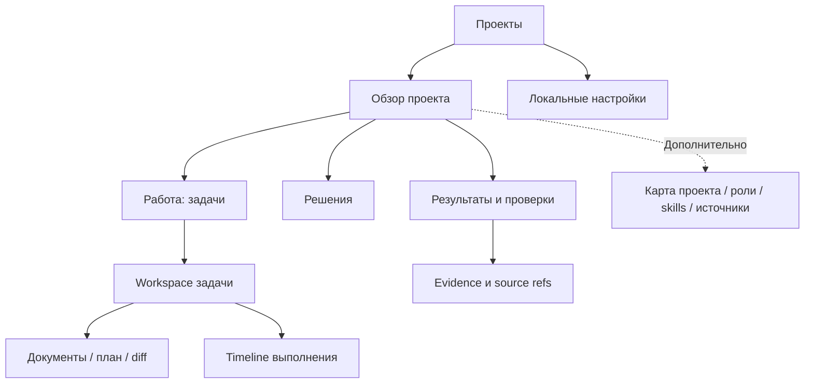

# Product-Agent OS Web — PRD

Актуализация 2026-11-09: добавлен полный scope Task Manager v0.2 в заключительном дополнении; он имеет приоритет над исходной очередью M1–M3. [Экраны](product-agent-os-web-task-manager-screens-2026-11-09.md) и [план](product-agent-os-web-task-manager-plan-2026-11-09.md).

Source status: `project-authored / proposed / local-source-backed`. Дата: 2026-11-05. Версия: 0.1.

Статус: **draft_for_review**. Разрешены подготовка и сохранение документов; разработка Web, runtime integration и deployment не начаты. Все поставки ниже — предложения, а не утверждённая очередь разработки.

Связи: [архитектура и этапы](product-agent-os-web-architecture-2026-11-05.md), [анализ SOL 0.6](sol-0.6-product-agent-os-web-analysis-2026-11-05.md).

Детализация M1 от 2026-11-09: [экраны, навигация, пользовательские пути и wireframes](product-agent-os-web-m1-wireframes-2026-11-09.md). Proposed UX уточняет первый MVP: четыре раздела, список задач, read-only evidence; решения M2/M3 сохранены в этом PRD.

## 1. Проблема, цель и ценность

Пользователь Product-Agent OS вынужден искать текущее состояние между Markdown/JSON-файлами, чатами и результатами проверок. Трудно определить, что уже сделано, что подтверждено, где требуется решение и как продолжить после перерыва.

**Цель Web:** одно рабочее пространство для понимания проекта, постановки задач, согласования изменений и приёмки проверяемых результатов. Основные объекты — проект, задача, решение, результат. Source-файлы остаются доступными для контроля и переноса.

Продуктовое обещание: «Управляйте AI-разработкой через понятные задачи, решения и проверяемые результаты».

Гипотеза: представление состояния и evidence в контексте задачи сокращает время ориентации и ошибочные выводы о завершении. Baseline, величина эффекта и готовность платить пока не измерены.

## 2. Пользователи и JTBD

| Сегмент | Задача | Приоритет |
| --- | --- | --- |
| Technical founder / product engineer | Вести свой продукт через AI, понимать scope и результат | Основной |
| AI Engineer / ведущий разработчик | Контролировать проверки, контекст и передачу работы | Основной |
| Небольшая студия | Ориентироваться в нескольких проектах, сохранять repeatability | Вторичный |
| PM с техническим reviewer | Согласовывать требования и принимать продуктовый результат | Позднее, после collaborative workflow |

Начальный ICP: технически самостоятельный пользователь либо команда примерно 2–10 человек с регулярной работой над реальными репозиториями. Размер — критерий отбора пилота, не рыночная статистика. Первый deployment single-user: команда как ICP не означает реализованные shared access/RBAC.

JTBD: «Когда я возвращаюсь к проекту или даю AI следующую задачу, помоги понять, что известно, что изменилось, чему можно доверять и где нужно моё решение».

Не первичный сегмент: полностью нетехнический founder без reviewer, regulated enterprise и одноразовая генерация сайта. Им потребуются дополнительные гарантии приёмки, эксплуатации или масштаба.

## 3. Принципы

1. Основной сценарий понятен без знания имён MD-файлов; источник можно открыть.
2. У статуса есть source, revision и время наблюдения. Unknown не заменяется success или zero.
3. Ordinary task не требует полного пакета документов; routing остаётся за PAOS.
4. Открытие проекта не меняет target files и не вызывает provider.
5. Изменения в IDE сохраняются; stale proposal вызывает conflict, а не overwrite.
6. Execution, verification, owner acceptance и release authorization различаются.
7. Повторное разрешение не запрашивается, если действующая bounded authority полностью покрывает действие; изменение scope требует нового решения.
8. Progress — наблюдаемые операции и результаты, без выдуманного процента или внутренних chain-of-thought.
9. Source-owned данные не дублируются независимой истиной в UI storage.
10. Local-first; внешняя телеметрия выключена по умолчанию.

## 4. Поставки и non-goals

| Поставка | Пользовательский результат | In scope | Исключено |
| --- | --- | --- | --- |
| M1 — Обзор | Открыть существующий проект и понять состояние | Registry, read-only discovery, overview, tasks projection, documents, evidence, freshness, локальный поиск | Target writes, prompts/provider calls, approval actions |
| M2 — Управляемые изменения | Подготовить задачу/решение и применить поддерживаемый patch | Intake, questions, draft, diff, action-bound decision, safe single-file apply и rollback receipt | Произвольный редактор репозитория и AI execution |
| M3 — Управляемое выполнение | Выполнить согласованную engineering task через Codex | Run lifecycle, events, runtime approvals, interrupt/recovery, checks/diff/acceptance | Hosted/unattended agents, automatic deployment, multi-user editing |

**MVP пользовательской ценности = M1.** M2/M3 задают дальнейшую архитектуру, но не обязательны для первого пилота. Полный engineering delivery flow требует M3; M1 не позиционируется как автономная разработка.

Общие non-goals: собственная IDE/терминал, перенос SOL backend целиком, обязательная цепочка из десяти ролей, новый multi-provider framework, marketplace, voice, billing, cloud sync, remote access, SSO/RBAC, мобильное выполнение, автоматическая правка prompts/hooks/permissions.

Первичная платформа пилота — Windows и desktop browser; Chrome/Edge предлагаются для проверки. Cross-platform, installer и минимальная ширина экрана уточняются в A0. Local browser app не означает доступность из LAN/интернета.

## 5. Информационная архитектура

Глобально: переключатель проекта и состояние local service. В проекте: «Обзор», «Работа», «Решения», «Результаты». Deep links используют opaque IDs вместо absolute paths.

Человекочитаемые проекции: REQUIREMENTS → «Что делаем»; PLAN → «План работы»; TEST/EVALS → «Как проверяем»; RUNLOG → «История результатов». Для проекта с иными owning artifacts используются его bindings; наличие ровно этих файлов не навязывается.

## 6. Основные экраны

### E01. Проекты и подключение

Цель — выбрать существующий workspace. Карточка: имя, доступность пути, last observed, краткое состояние, блокирующие решения. Неизвестные значения обозначены явно.

M1 actions: подключить папку, открыть, обновить сведения, убрать из списка. Последнее не удаляет project files. Onboarding: ввести/выбрать путь поддерживаемым local flow → подтвердить scope чтения → bounded scan → обзор найденного и gaps. Browser directory handle name не принимается за абсолютный путь backend.

Empty state объясняет, что будет прочитано. Ошибки: root не разрешён, путь недоступен, scan partial, формат unsupported. Для проекта без PAOS показывается предложение onboarding; control plane автоматически не создаётся.

### E02. Обзор

Цель — понять состояние и следующий шаг. Верхний блок: цель проекта, snapshot freshness/coverage, текущая задача. Далее: активная работа, блокеры, решения владельца, последние проверенные результаты.

Primary CTA описывает конкретное следующее действие и причину. В M1 — навигация/refresh, в M2+ — доступная команда. Единого процента готовности продукта нет; при известном составе этапа допустимо «подтверждено N из M» с явным denominator. Source health (`current/stale/conflict/partial`) показывается отдельно от business status.

### E03. Работа: список и доска

Список/board, поиск по title/ID, фильтры состояния, owner, blockers и evidence. Карточка: title, short ID, source state, run/verification badges, owner, blocker, last update.

Hierarchy выводится только из явных parent-child связей; dependencies не подменяют parentId. M1 read-only: drag-and-drop не меняет статус. Неподдерживаемая матрица остаётся документом с пояснением; LLM не генерирует «факты» из произвольного текста.

### E04. Workspace задачи

Компактная сводка задачи + «Обсуждение / Активность» + панель «Требования / План / Документы / Изменения / Проверки». На узком desktop панели переключаются вкладками. Сводка содержит expected result, non-goals, acceptance, зависимости, authority и текущий run.

M1 читает существующие артефакты без обещания импорта всех исторических Codex chats. M2 добавляет task draft и вопросы. M3 показывает runtime conversation и timeline наблюдаемых действий. Доступные actions: уточнить, посмотреть план, подготовить изменение, начать, остановить, открыть результат.

Interrupt сначала показывает «Остановка запрошена», затем подтверждённый runtime status. Остановка не означает rollback уже сделанного.

### E05. Решения

Inbox объединяет три явно различных типа: вопрос о scope, product/proposal decision, runtime approval. Карточка: задача, причина, варианты, последствия, baseline revision, срок действия и ожидаемый эффект.

M1 только читает доступные записи. M2 позволяет отвечать и принимать scoped proposals. M3 передаёт решение по конкретному runtime request и ждёт acknowledgement. Ответ на продуктовый вопрос не предоставляет permission; «одобрить всё» отсутствует. Действующая authority отображается и проверяется без лишнего повторного вопроса.

### E06. Документ и предложение изменения

Режимы «Документ», «Источник», «Предлагаемое изменение». Видны source ref, revision, freshness, source/generated status. Source view по умолчанию read-only. В M2 редактирование поддерживаемых полей/секций создаёт draft, затем diff; preview не означает apply.

Apply показывает target/effect/rollback. При внешнем изменении исходника — conflict, перечитывание и пересборка preview. Draft сохраняется. Незнакомый Markdown автоматически не переписывается.

### E07. Результаты и проверки

Результат: описание изменения, diff, acceptance checklist, реально выполненные checks с outcome и revision, environment provenance, gaps и остаточные риски. Raw private logs не сохраняются; diagnostic details доступны только в redacted виде.

M1 читает существующее evidence. M3: принять, вернуть на доработку, принять с явными ограничениями. Owner acceptance не превращает failed/missing checks в passed и не выдаёт release authorization.

### E08. Дополнительные сведения и настройки

Карта проекта, sources, роли/skills и runtime capabilities — advanced navigation. Effective и proposed configuration различимы. Установка plugins, смена глобальных permissions/hooks/models не входят в M1–M3.

Настройки: workspace registry, состояние service/adapter, privacy/retention, cache cleanup и диагностика совместимости. Credentials не записываются в browser storage; auth flow Codex уточняется в A0/A4.

## 7. Состояния и доступность

| Состояние | Поведение | Действия |
| --- | --- | --- |
| Loading | Стадия чтения; прошлый snapshot обозначен историческим | Cancel scan, если поддержан |
| Empty | Объяснение отсутствующих данных | Подключить / открыть source |
| Partial / unsupported | Доступная часть + gaps | Read source / bounded refresh |
| Stale | Время и изменившиеся зависимости | Refresh; stale apply заблокирован |
| Conflict | Версии/источники и причина | Rebuild preview / решить authority |
| Disconnected | Последний snapshot с offline badge | Reconnect; новые commands недоступны |
| Permission denied | Причина и scope без утечки данных | Пересмотреть действие |
| Running / awaiting decision | Реальный шаг и ожидание | Inspect / ответить / interrupt |
| Interrupted / recovery required | Подтверждённые side effects и checkpoint | Inspect / explicit resume после reconciliation |
| Verified / accepted with gaps | Evidence и ограничения рядом | Owner decision без автоматического release |

Обязательны keyboard navigation, видимый focus, возврат focus после dialogs, текстовые альтернативы цветам, понятные сообщения и доступное объявление ошибок. WCAG 2.2 AA — целевой стандарт, соответствие не проверено. Mobile execution не обещается.

## 8. Функциональные требования

| ID | Требование | Первая поставка |
| --- | --- | --- |
| WEB-FR-01 | Подключить разрешённый workspace и выполнить read-only discovery | M1 |
| WEB-FR-02 | Overview с provenance, freshness и next action | M1 |
| WEB-FR-03 | Task projection без подмены source authority | M1 |
| WEB-FR-04 | Чтение artifacts/evidence в контексте задачи | M1 |
| WEB-FR-05 | Изоляция workspace/events и deep links | M1 |
| WEB-FR-06 | Refresh, external source changes, offline/partial states | M1 |
| WEB-FR-07 | Task draft, scope questions и ordinary/full route | M2 |
| WEB-FR-08 | Source-bound proposal с diff и decision | M2 |
| WEB-FR-09 | Revision-safe supported apply, receipt и scoped rollback | M2 |
| WEB-FR-10 | Раздельные questions, product decisions, runtime approvals | M2/M3 |
| WEB-FR-11 | Запуск согласованного task slice через Codex adapter | M3 |
| WEB-FR-12 | Timeline, interrupt и recovery без скрытого повторного execution | M3 |
| WEB-FR-13 | Checks/diff/gaps и отдельная owner acceptance | M1 чтение; M3 решение |
| WEB-FR-14 | Честные capabilities и unsupported states | M1–M3 |
| WEB-FR-15 | Preservation, sensitive-data minimization и local API protection | M1–M3 |
| WEB-FR-16 | Доступный UI и понятные errors | M1–M3 |
| WEB-FR-17 | Elapsed/usage/model/cost только по доступным runtime данным | M3 |
| WEB-FR-18 | Durable drafts/decisions/evidence с retention и удалением | M2/M3 |

## 9. Acceptance scenarios

Все сценарии `pending`. Owners — будущие ответственности, не запущенные subagents. В таблице FR обозначает WEB-FR. Цепочка: requirement → scenario → check → evidence owner.

| Scenario / FR | Given → When → Then | Будущая проверка / owner |
| --- | --- | --- |
| SC-01 / 01,02 | PAOS workspace → подключить → цель/источники/свежесть видны, target hashes не менялись, provider не вызван | Manifest + integration journey / tester |
| SC-02 / 01,14 | Проект без control plane → открыть → найденные данные и gaps, без scaffolding | Fixture + UI / tester |
| SC-03 / 03 | Поддерживаемая task matrix → выбрать task → её acceptance/source; unknown format явно отмечен | Parser contract / backend owner |
| SC-04 / 04,13 | Passed receipt от другой revision → открыть → исторический receipt виден, текущая проверка stale | Projection + UI / tester |
| SC-05 / 05 | Событие A при открытом B → доставить → B не меняется, deep link ведёт к A | Two-workspace integration / tester |
| SC-06 / 06 | Source изменён в IDE → refresh → новая revision, прошлый snapshot не current | Watcher/refresh integration / backend owner |
| SC-07 / 06,12 | Disconnect → reconnect → snapshot + deduplicated cursor replay, без повторения commands | Failure injection / tester |
| SC-08 / 07 | Маленький low-risk фикс → intake → ordinary route с acceptance, без обязательного полного пакета | Routing + product review / product owner |
| SC-09 / 08,09 | Draft baseline A, source уже B → Apply → conflict без write, draft сохранён | CAS negative test / backend owner |
| SC-10 / 09 | Одобренный patch → повторить command ID → один эффект, исходные секции сохранены | Idempotency/preservation / tester |
| SC-11 / 10 | Ответ на scope question → опасное действие → ответ не используется как permission | Authorization contract / security reviewer |
| SC-12 / 11 | Codex несовместим/не авторизован → Start → нет execution, read-only UI доступен | Adapter negative test / runtime owner |
| SC-13 / 12 | Выполнение → Interrupt → pending stop, затем подтверждение и оставшийся diff | Authorized runtime/browser / tester |
| SC-14 / 12 | Crash между dispatch и ack → restart → recovery_required, без автоматического turn retry | Crash/reconciliation / runtime owner |
| SC-15 / 13 | Run завершён, check failed → принять с gap → acceptance сохранён, check остаётся failed | Domain + UI / tester/owner |
| SC-16 / 15 | Out-of-root/junction payload → запрос → deny до I/O, secret не попал в ответ | Path/authz/privacy tests / security reviewer |
| SC-17 / 16 | Keyboard-only → основной flow/dialog → доступные actions и корректный focus/errors | Browser/a11y / frontend owner |
| SC-18 / 17,18 | Нет cost или sensitive log → открыть результат → cost unknown, sensitive value отсутствует | Redaction/unknown contracts / tester |

Multi-file apply, remote execution и rollback всех code changes агента не входят в первый write slice. Unit checks не заменяют M3 runtime/browser evidence.

## 10. Нефункциональные требования

| ID | Предлагаемая цель | Проверка |
| --- | --- | --- |
| WEB-NFR-01 | Нет unapproved writes и межпроектных раскрытий в negative suite | Authz/path/origin/policy |
| WEB-NFR-02 | Нет потери авторского текста в supported edit/conflict cases | Preservation + crash fixtures |
| WEB-NFR-03 | Cached overview p95 ≤ 1 s; command ack p95 ≤ 500 ms; committed event виден p95 ≤ 1 s | Local reference workload/hardware фиксируются в A0; LLM latency исключена |
| WEB-NFR-04 | Bounded/cancellable scan и честный partial | Большие/неподдерживаемые fixtures |
| WEB-NFR-05 | Recovery durable commands/events без hidden replay side effects | Crash/restart integration |
| WEB-NFR-06 | Source portability и rebuildable UI cache | Migration/restore |
| WEB-NFR-07 | Offline startup без provider; actions gated по capability | Degraded-mode tests |
| WEB-NFR-08 | Русский UI, canonical terms, keyboard/a11y target AA | Content + a11y checks |

Числа — design targets для обсуждения, не измеренные свойства. Benchmark недействителен без зафиксированных hardware, объёмов данных и состояния cache.

## 11. Метрики, tracking и pilot

Decision horizon: discovery → M1 pilot → M2/M3 pilot. Business outcome — повторное использование/готовность платить; product outcome — правильное понимание состояния; feature traction — использование экранов. Клики не доказывают ценность.

Primary metric: доля заранее назначенных pilot orientation tasks, где пользователь без подсказки верно определяет current task, blocker/next action и evidence level. Denominator включает неудачи; retries не считаются новыми успехами. Baseline собирается на текущем MD/chat workflow до знакомства с UI.

Предлагаемые targets: 4/5 design partners справляются за 3 минуты; 3/5 возвращаются с другой реальной задачей за 14 дней. Это качественный пилот, не PMF proof. Guardrails: ноль ошибочных трактовок unverified как verified в контрольных кейсах и ноль потерь данных. Input metrics: source coverage и доля journey без ручного поиска MD. Counter-metrics: неправильные решения, скрытые gaps, повторная работа, трудность conflicts. Не оптимизировать число закрытых задач/скорость в ущерб проверкам.

Owner критериев/интервью — будущий product owner; data/privacy owner назначается до измерений. Signoff, baseline, interviews и post-release evidence pending. Review — после 14 дней пилота, перед расширением scope; дата старта не назначена.

Использованы packaged [tracking-plan](../plugins/product-agent-os/assets/templates/artifact-templates/tracking-plan.md) и [metric-spec](../plugins/product-agent-os/assets/templates/artifact-templates/metric-spec.md). Точный `.codex/artifact-templates/tracking-plan.md` отсутствует; разделы здесь — proposal alias, не утверждение о прохождении gate, требующего этот путь. Отдельные template copies не создаются.

| Event | Вопрос | Минимальные свойства | Будущий owner |
| --- | --- | --- | --- |
| workspace.opened | Началась ли ориентация? | pseudonymous workspace ID, snapshot state, timestamp | frontend |
| orientation.assessed | Верно ли понят результат? | pilot session ID, task class, elapsed, correctness enum | product owner, manual assessment |
| source.opened | Нужен ли raw source? | artifact kind, entry screen, без path/content | frontend |
| proposal.conflicted | Безопасно ли обработан edit? | reason enum, schema version | backend |
| result.decided | Принят ли результат с gaps? | verification/acceptance enums | backend |

Operational audit не становится аналитикой автоматически. Pilot metrics только opt-in, локально; external export — отдельное явное действие. Event IDs дедуплицируются, пропуски показываются. Privacy class: internal, потенциально sensitive usage metadata. Не собирать prompts/code/names/absolute paths/credentials. Предлагаемый retention metrics 30 дней с TTL и ручным удалением. Runtime evidence retention описан в архитектуре.

Qualitative loop: первое открытие, возвращение после перерыва, приёмка спорного результата, интервью о последнем реальном затруднении. M3 AI quality сравнивается с baseline на representative/negative cases; live eval calls требуют отдельного разрешения.

## 12. Этапы и открытые решения

Подробности A0–A6 — в [архитектуре](product-agent-os-web-architecture-2026-11-05.md). Всё `proposed / not_started`; сроки/бюджет/команда не утверждены.

| Этап | Результат |
| --- | --- |
| A0 | Source contracts, UX prototype и capability spike |
| A1 | Local foundation: registry/access/discovery |
| A2 | Read-only overview/tasks/artifacts/evidence — M1 |
| A3 | Intake/questions/proposals/safe apply — M2 |
| A4 | Codex adapter и run lifecycle — M3 |
| A5 | Recovery/packaging/a11y и bounded local beta pilot |
| A6 | Отдельная оценка multi-user/remote/marketplace |

| ID | Решение / рабочее допущение | До какого этапа |
| --- | --- | --- |
| D01 | Local-first, Windows, existing repo, technical ICP | A0/A1 |
| D02 | React SPA + local Node service; bundler после packaging spike | A1 |
| D03 | Поддерживаемые task-source schemas и authority mapping | A2 |
| D04 | Разрешённые поля/секции для M2; unmanaged docs read-only | A3 |
| D05 | Версия Codex, auth/approval integration и capabilities | A4 |
| D06 | Consent/retention, pilot owner и thresholds | До сбора данных |
| D07 | Scope beta, install/update path, runtime cost boundary | A5 |

## 13. Sources, ограничения и handoff

Источники: [SOL audit](sol-0.6-product-agent-os-web-analysis-2026-11-05.md); текущие [status_snapshot.py](../plugins/product-agent-os/scripts/product_agent_os/status_snapshot.py), [cli.py](../plugins/product-agent-os/scripts/codex_runtime_runner/cli.py), [question_ledger.py](../plugins/product-agent-os/scripts/product_agent_os/question_ledger.py), [merge_infrastructure.py](../plugins/product-agent-os/scripts/product_agent_os/merge_infrastructure.py). Исходники PAOS перечитаны в документационной задаче. Предыдущие SOL typecheck/lint результаты не являются тестами нового UI.

Факты: task projection в snapshot отложен; contract runner не выполняет engineering task; answer ledger staged-only; merge поддерживает узкие actions. Новые UI/API/runtime capabilities — проектные предложения. Customer/visual/a11y/performance/security/runtime acceptance не выполнены. Accepted gaps от имени пользователя не оформляются.

Scope текущей задачи: два Markdown proposals, source-registry RU/EN, RUNLOG pointers и явно разрешённый lifecycle transition. Код, hooks, конфигурация выполнения, SOL и внешние системы не меняются. Detailed frontend/backend/architecture/metric artifacts объединены разделами двух документов; runtime receipts и reviews принадлежат будущим этапам. `requirements_ready` не заявляется до owner/domain review.

Control-plane sync: RUNLOG и source registries — ссылки на draft; REQUIREMENTS/PLAN/TEST/EVALS/prod_test — not_applicable для изменения действующих scope/queue/gates, так как Web ещё не принят к разработке. После принятия потребуется отдельная синхронизация. Проверки пакета — в архитектуре. Следующее действие владельца: рассмотреть M1 и D01–D03; разработка требует отдельного запроса.

## 13. Дополнение 2026-11-09: полноценный Task Manager

Source status: user requirements / project-authored proposal. Версия дополнения: 0.2. Это актуальный продуктовый scope. При конфликте с исходными §4–§8 и M1-wireframes приоритет имеет этот раздел. Read-only M1 остаётся ранним этапом поставки, а не ограничением полного продукта. Агенты, Скиллы, Сессии и Карта проекта становятся основными вкладками. Редакторы и ограниченная автономность входят в roadmap.

Owning artifacts: [экраны](product-agent-os-web-task-manager-screens-2026-11-09.md), [план и 30 карточек](product-agent-os-web-task-manager-plan-2026-11-09.md), [8 машинных групп](product-agent-os-web-task-manager-task-group-2026-11-09.json).

### Требования и трассировка

| ID | Обязательное поведение | Экраны | Группы |
| --- | --- | --- | --- |
| TM-01 | Восемь проектных вкладок: Обзор, Задачи, Сессии, Агенты, Скиллы, Карта проекта, Документы, Проверки | S03–S21 | G01–G06, G08 |
| TM-02 | Список агентов, инструкции, effective и pinned версии, роли и источники | S10–S12 | G04 |
| TM-03 | Частота использования за период, активные/прошлые задачи и статистика исходов работы | S10–S11 | G03–G04 |
| TM-04 | Добавление/редактирование/удаление агента вручную или через proposal по описанию; неоднозначный target требует уточнения | S12–S13 | G04 |
| TM-05 | Каталог, редактор, версии и удаление скиллов с проверкой зависимостей | S14–S15 | G05 |
| TM-06 | Добавление скилла по пути или через find-skills | S16 | G05 |
| TM-07 | Генерация/рекомендация скиллов по требованиям проекта или описанию | S17 | G05 |
| TM-08 | Все доступные сессии проекта и все доступные user-visible сообщения пользователя и агентов | S08–S09 | G03 |
| TM-09 | Граф зависимостей файлов и переменных с исходными определениями/ссылками | S18 | G06 |
| TM-10 | Все двенадцать полей задачи, перечисленные ниже | S06–S07 | G01–G02 |
| TM-11 | Оценка до старта; измеренное фактическое время HH:MM:SS | S04–S07, S11 | G01–G02, G04 |
| TM-12 | Dark/Light/System и RU/EN на всех экранах | S01–S24 | G01, G08 |
| TM-13 | Максимальная самостоятельность внутри заранее разрешённых scope, бюджета и stop conditions | S06, S22–S23 | G07 |
| TM-14 | Сквозная трассировка задача → agent run → session → files → checks → acceptance | S06, S09, S11, S18, S21 | G02–G08 |

### Контракт задачи

| Поле | Тип и правило | Поведение UI |
| --- | --- | --- |
| ID | `PROJECT_PREFIX-NNNN`; prefix — 4 латинские буквы из названия/аббревиатуры проекта, например PAOS; sequence монотонный и уникальный в проекте | Prefix предлагается при подключении и подтверждается; для коротких/неоднозначных имён редактируется. Rename не меняет ID; старые ID сохраняют alias |
| Название | Непустая строка | Короткое название в списке, полное в карточке |
| Краткое описание | Текст scope и проблемы | Видно до запуска; поддерживает draft |
| Техническое значение | Отдельный текст результата для системы | Не подменяется продуктовой ценностью |
| Продуктовое значение | Отдельный текст результата для конечного пользователя | Связано с целью/приёмкой |
| Затрагиваемые файлы | Массив path, planned operation и actual operation: create/modify/delete; source revision | План отдельно от фактического diff; rename отображает обе стороны |
| Исполнители | Agent ID, profile version, assignment/run links, период участия | Показывает текущих и прошлых агентов, а не только последнего |
| Проектные артефакты | Тип, путь/URL, revision, provenance; планы, исследования, решения пользователя, внешние ресурсы | Безопасные ссылки с доступностью; непроверенный внешний источник помечен |
| Критерии приёмки | Массив условия, способ проверки, evidence и outcome | Чекбокс сам по себе не доказательство; unmet criterion виден |
| Оценочное время | estimate seconds, created_at, author/source, revisions | HH:MM:SS; обязательное до ready/start; фиксируется snapshot при старте |
| Реальное время | start/end events, интервалы, duration seconds nullable | HH:MM:SS; до старта «Не начата»; при потере telemetry «Неизвестно», не 00:00:00 |
| Потенциальные риски | Риск, затронутый flow, вероятность/влияние при наличии оснований, проверка/mitigation | Видны перед запуском и при приёмке |

Дополнительно: project_id, status, dependencies, created/updated revision и event references. Черновик допускает незаполненные поля; перевод в ready требует названия, описания, обеих ценностей, приёмки, оценки, risks (или явного none) и scope. ID назначается атомарно; номер после удаления не переиспользуется.

### Время, статистика и наблюдаемость

Хранить UTC timestamps, отображать выбранную timezone. Часы HH могут быть больше 23, длительность не обнуляется на сутках. Показывать отдельно elapsed wall time, активную длительность задачи (объединение интервалов работы без pauses) и суммарное агентское время. При параллельной работе двух агентов последнее может превышать elapsed; UI это объясняет. Pause/resume/retry/cancel/failed/completed фиксируются идемпотентными событиями. Если crash оставил интервал незавершённым, восстановление запрашивает/реконструирует evidence и помечает неопределённость; не придумывает timestamp завершения.

Частота агента = число уникальных начатых runs за выбранный период и проект; mentions имени в чате не считаются запуском. Исходы successful/failed/cancelled/needs decision и принятые пользователем результаты различаются. Duration, retries, token/cost доступны только при подтверждённой telemetry; показывать source, freshness, denominator и coverage. До подключения данных — «Нет данных», а не искусственные нулевые графики.

### Сессии и границы доступности

Цель — полная проектная история: pagination, archived, forks и связанные subagent sessions. Binding основан на устойчивом project ID и проверяемом source workspace, а не только имени/пути в тексте. Исходные сообщения сохраняют язык, авторство, порядок и ссылки. Source adapter обязан сообщать coverage и причины пропусков. Требование «все» не позволяет обещать доступ к сессиям, которые установленный host/API не раскрывает; такой пробел является blocking gap интеграции, не «нет сессий».

Показываются user-visible сообщения и разрешённые tool events. Не извлекаются hidden chain-of-thought и secrets. Redaction, удалённые сообщения, attachments и усечение показаны явно. История чужого проекта не попадает в поиск текущего.

### Управление агентами, skills и автономность

Ручной editor и генерация по описанию используют один proposal contract. Результат генерации — редактируемый draft; проверка структуры, diff, source revision и разрешённое применение создают новую версию. Работающий run закреплён за прежней версией. Архив/удаление прекращает новые назначения; исторические ссылки и evidence остаются. Active dependency требует разрешения конфликта до hard delete.

Добавление skill по пути проверяет containment, metadata и ресурсы; внешние/vendor sources не перезаписываются без применимого права. find-skills — discovery route, поиск не равен установке. До применения показываются origin, version/hash, dependencies и доступная license/trust информация. Генерация по требованиям ссылается на конкретный requirement и проверяет дубликаты.

Автономный путь: постановка → план → выбор агентов/skills → проверка ownership → исполнение → проверки → ограниченное исправление → приёмка. Внутри уже разрешённых границ повторное подтверждение не нужно. Budget exceeded, конфликт файлов, недоступный источник, исчерпанный retry budget и новый approval boundary останавливают соответствующий run с объяснением. Policy UI не расширяет sandbox/host permissions. Глобальная установка hooks и массовое unattended выполнение не считаются включёнными наличием Web.
