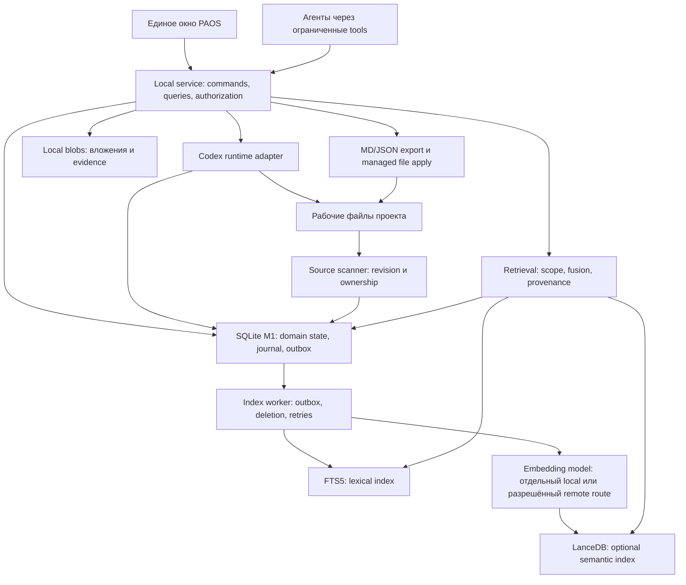
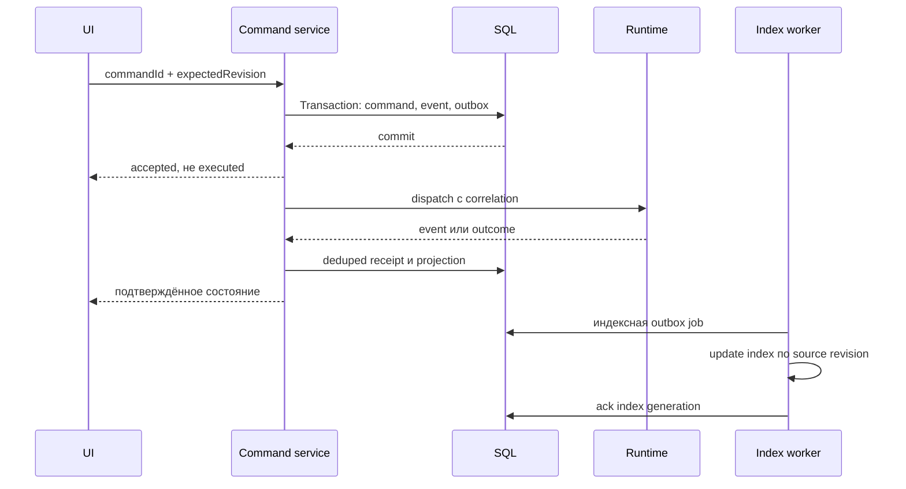

# Product-Agent OS Web: исследование хранения и поиска

Решение владельца после исследования, 2026-11-09: **SQLite + FTS5 local; PostgreSQL + pgvector team**. LanceDB/другие альтернативы ниже сохраняются как исторические кандидаты и не входят в выбранный local baseline. Актуальны [PRD §16](product-agent-os-web-prd-2026-11-05.md) и [архитектура §20](product-agent-os-web-architecture-2026-11-05.md). Выбор engines принят; реализации и benchmark нет.

Source status: research_complete / documentation_partially_verified / official-docs-and-repository-inspection / proposed architecture. Дата: 2026-11-09. Task: PAOS-WEB-STORAGE-RESEARCH-2026-11-09. Документ сохранён в три checkpoint; итоговая рекомендация — §12. Установка, migration и реализация не выполняются.

## 1. Контекст и проверенные исходные условия

- [Архитектура v0.4](product-agent-os-web-architecture-2026-11-05.md) предлагает локальный Node.js service, React UI, Python bridge и Codex App Server; SQLite вне target repo для journal/связей. Это proposal, не существующая Web DB.
- [UX v0.5](product-agent-os-web-m1-wireframes-2026-11-09.md) требует согласованности задач, сессий, сообщений, agent runs, file changes, approvals и recovery. Одного хранилища Markdown для этих взаимосвязей недостаточно — архитектурный вывод, не результат benchmark.
- Текущие source-owned JSON/Markdown нельзя молча заменить DB: нужен явный выбор владельца каждой сущности и миграция. AGENTS.md, SKILL.md и код остаются интерфейсом к файловым агентам, пока отдельное решение не изменит этот contract.
- [Аудит SOL 0.6](sol-0.6-product-agent-os-web-analysis-2026-11-05.md) фиксировал LanceDB с JSON snapshots и отдельные browser/file stores; это вторичный локальный источник, не повторный аудит SOL сегодня. Совместное наличие хранилищ не доказывает согласованность данных.

## 2. Первые наблюдения

SQL store для задач/истории/разрешений, vector index для поиска по смыслу и файловое хранилище решают разные задачи. LanceDB/Qdrant не следует автоматически считать заменой relational workflow database. БД не заменяет проверку permissions в локальном сервисе.

- SQLite WAL допускает параллельное чтение с записью, но writer остаётся один; network filesystem не подходит для WAL. [SQLite WAL](https://sqlite.org/wal.html).
- FTS5 уже даёт lexical search/BM25; semantic retrieval требует отдельной embedding модели и vector capability. [SQLite FTS5](https://sqlite.org/fts5.html).
- Для live backup нужен согласованный механизм, например Backup API, а не произвольное копирование открытого файла. [SQLite Backup API](https://sqlite.org/backup.html).
- PostgreSQL + pgvector рассматривается как единый SQL/vector путь командного/серверного продукта. [pgvector](https://github.com/pgvector/pgvector).

## 3. Порядок проведённого исследования

1. Официальные contracts SQLite, PostgreSQL/pgvector, LanceDB; дополнительный кандидат Qdrant и embedded альтернативы.
2. GitHub: выбор близких проектов по agent orchestration, sessions/tasks, локальному UX и storage implementation; README отдельно от прочитанного кода.
3. Матрица, source ownership, hybrid retrieval, backup/migration, рекомендации M1 и team deployment.
4. Статические проверки документа и фиксирование ограничений доказательств.

## 4. Граница доказательств

Ни одна сравнительная оценка не является измерением PAOS latency, нагрузки или качества retrieval. Stars не используются как доказательство корректности. Источники привязаны к конкретным страницам и файлам; пять продуктов и companion SDK зафиксированы по commit SHA.

## 5. Проверка кандидатов: подтверждённые свойства

### SQLite и расширения

SQLite — встраиваемая relational DB. Для M1 подходит роль operational store: короткие транзакции, связи tasks/sessions/runs, история, ограничения уникальности. WAL даёт concurrent readers, но единственного writer нужно учитывать в локальном service: очередь коротких записей, bounded retry и отсутствие долгих транзакций во время inference. Не размещать рабочую WAL DB на network share или в каталоге, синхронизируемом несколькими машинами. Документация также фиксирует WAL-reset bug и исправления 3.51.3+/backports: при packaging проверить реальную linked SQLite version, не только версию npm/Python wrapper. [WAL](https://sqlite.org/wal.html).

FTS5 — lexical search с BM25; полезен для task ID, имён файлов, ошибок, сообщений. Проверять tokenization для кириллицы и code identifiers; Porter не означает русскую морфологию. Semantic search отдельно. [FTS5](https://sqlite.org/fts5.html).

Два разных vector extension, которые нельзя смешивать:
- **sqlite-vec**: C extension, Node/Python bindings, vec0, metadata/partition columns; автор помечает pre-v1 и возможные breaking changes. Не фиксируем утверждение «ANN отсутствует во всех версиях» по старым статьям. [Репозиторий](https://github.com/asg017/sqlite-vec).
- **SQLite Vec1**: официальный отдельный extension; прочитанная страница указывает v0.8, ANN IVFADC/OPQ, L2/cosine, Windows build и ограничения SIMD. Это не встроенная возможность любой установленной SQLite. Пригодность под Windows installer, фильтры проекта и corpus eval ещё не проверена. [Vec1](https://sqlite.org/vec1.html).

### PostgreSQL + pgvector

MVCC, конкурентные транзакции, FK/constraints, JSONB и full-text search позволяют держать workflow и retrieval metadata в одном SQL engine. Row-Level Security полезна для team/multi-tenant режима, но её нужно включать и проверять на реальной runtime role: owner и privileged roles могут иметь другой доступ. [MVCC](https://www.postgresql.org/docs/current/mvcc-intro.html), [RLS](https://www.postgresql.org/docs/current/ddl-rowsecurity.html), [FTS](https://www.postgresql.org/docs/current/textsearch.html).

pgvector добавляет exact и approximate retrieval, HNSW/IVFFlat. Фильтрация после approximate scan может вернуть меньше результатов; нужны измерения per-project recall, iterative scans/partitioning по ситуации. FTS + dense retrieval объединяет приложение, это не гарантированное улучшение качества. [pgvector](https://github.com/pgvector/pgvector).

Цена удобства — процесс/служба DB, обновления, миграции, backup и наблюдение. Embedded native PostgreSQL уменьшает ручную настройку, но не превращается в SQLite и не отменяет lifecycle сервера. Backup поддерживает dump и PITR при соответствующей настройке. [Backup](https://www.postgresql.org/docs/current/backup.html).

### LanceDB

Embedded library особенно интересна для локального Node/Python продукта: vector + full-text + hybrid, default RRF; embeddings и FTS index должны существовать до hybrid query. [Hybrid search](https://docs.lancedb.com/search/hybrid-search).

Важная граница: atomic commit одной таблицы, consistent table snapshot, optimistic concurrency с возможными конфликтами. Это не общая транзакция «task + approval + audit + dispatch» через несколько таблиц. После timeout write мог уже committed; слепой retry append может дублировать данные. [Guarantees](https://docs.lancedb.com/basics/guarantees).

Открытый Embedded table handle по умолчанию не обязан видеть изменения другого handle; нужны read consistency interval или checkout_latest. Version history не заменяет backup. Для PAOS вывод: сильный кандидат на **перестраиваемый retrieval index**, слабая замена operational SQL store. [Consistency](https://docs.lancedb.com/tables/consistency).

### Дополнительный основной кандидат: Qdrant

Qdrant Server — специализированный vector service с payload filters, dense/sparse/hybrid retrieval и средствами разделения tenant data. Для PAOS рассматривать вместе с PostgreSQL/SQLite, а не вместо relational workflow store. Query filtering — часть retrieval, не замена authorization. [Hybrid queries](https://qdrant.tech/documentation/search/hybrid-queries/), [Multitenancy](https://qdrant.tech/documentation/manage-data/multitenancy/).

Актуальная документация уже описывает **Qdrant Edge**, поэтому утверждение «Qdrant всегда требует отдельного сервера» неверно. Edge — in-process, Python/Rust, отдельные Edge Shards; Server — REST/gRPC. Edge имеет другой operational/API contract: manual optimization, нет cluster HA. Для нашего Node service это дополнительный Python/Rust boundary либо отдельный server; Windows packaging и конкретный SDK требуют spike. [Edge](https://qdrant.tech/documentation/edge/), [Edge vs Server](https://qdrant.tech/documentation/edge/edge-vs-qdrant-cluster/).

### Дополнительный embedded SQL вариант: PGlite

Postgres в WASM с Node и browser deployment; native filesystem или IndexedDB persistence, pgvector доступен расширением. Но single exclusive connection и отличия multiplexer от обычного PostgreSQL не позволяют обещать server-equivalent concurrency. Возможный эксперимент для одного SQL dialect local→server; не текущий default без crash/recovery, size/latency и migration spike. [Getting started](https://pglite.dev/docs/), [extensions](https://pglite.dev/extensions/), [single-connection limitation](https://pglite.dev/docs/pglite-socket).

## 6. GitHub: промежуточные source-backed наблюдения

Выборка целевая, не полный обзор рынка. Пять близких продуктов; OpenHands дополнительно требует чтения отдельного SDK repository. Публичные файлы прочитаны через GitHub connector; проекты не запускались, зависимости не устанавливались. Commit SHA фиксирует inspection snapshot, не означает tested release.

| Проект | Snapshot commit | Что подтверждено | Что полезно PAOS |
| --- | --- | --- | --- |
| Vibe Kanban | `ad41bda05844411f03dbe92d36f21a574e1ad9da` | Local SQLx/SQLite, session model; remote PgPool/Postgres | Разделение локального execution state и командного server state, устойчивые IDs sessions/executions |
| Paperclip | `189fefb99183953be37f0d1084275fbb0f35d6e2` | postgres-js/Drizzle; issues с parent/project/agent/run связями; heartbeat runs; object storage interface | Task/agent/run/actor как отдельные сущности, DB-backed orchestration, отдельные attachment bytes |
| OpenCode | `617a770aecc757ec79cc08f7727a1d5d3801e210` | SQLite WAL/FK настройка, session/message и event sequence schemas | События и сообщения в структурированном store, отдельная последовательность для replay |
| CodeKanban | `c8e99feffdf3c2570733473bffab1925de4a0588` | SQLite config.db; history layer читает SQL tables и JSONL; one-connection pool comment | Миграция legacy config, health/retention visibility; гибридное хранение требует явной authority |
| OpenHands / Agent Canvas | `9b363b49fb1af78a6e630df0f713ebc299e8afeb` | README: единый UI с несколькими backends; SDK владеет events/conversations | Не смешивать UI state, runtime history и orchestration ownership |
| OpenHands SDK — companion, не шестой продукт | `719ed71895439a32d72c264641ee22a2e1567001` | FileStore EventLog, lock и stable durable sequence; предупреждение NFS в коде | Даже event-file approach требует locks, cursor semantics и recovery; DB не единственный возможный формат |

Исходники:
- Vibe Kanban: [local DB](https://github.com/BloopAI/vibe-kanban/blob/ad41bda05844411f03dbe92d36f21a574e1ad9da/crates/db/src/lib.rs), [sessions](https://github.com/BloopAI/vibe-kanban/blob/ad41bda05844411f03dbe92d36f21a574e1ad9da/crates/db/src/models/session.rs), [remote DB](https://github.com/BloopAI/vibe-kanban/blob/ad41bda05844411f03dbe92d36f21a574e1ad9da/crates/remote/src/db/mod.rs). В прочитанном local constructor используется journal_mode Delete, не WAL; не переносить случайно чужой настройочный профиль. Windows checksum auto-repair присутствует в migration code, но для PAOS не рекомендуется без доказанной причины и integrity review.
- Paperclip: [README](https://github.com/paperclipai/paperclip/blob/189fefb99183953be37f0d1084275fbb0f35d6e2/README.md), [DB client](https://github.com/paperclipai/paperclip/blob/189fefb99183953be37f0d1084275fbb0f35d6e2/packages/db/src/client.ts), [issues](https://github.com/paperclipai/paperclip/blob/189fefb99183953be37f0d1084275fbb0f35d6e2/packages/db/src/schema/issues.ts), [runs](https://github.com/paperclipai/paperclip/blob/189fefb99183953be37f0d1084275fbb0f35d6e2/packages/db/src/schema/heartbeat_runs.ts), [storage interface](https://github.com/paperclipai/paperclip/blob/189fefb99183953be37f0d1084275fbb0f35d6e2/server/src/storage/types.ts). README предлагает managed embedded PostgreSQL локально и external PostgreSQL для production; packaging/backup claims не были проверены запуском.
- OpenCode: [database](https://github.com/anomalyco/opencode/blob/617a770aecc757ec79cc08f7727a1d5d3801e210/packages/core/src/database/database.ts), [sessions/messages](https://github.com/anomalyco/opencode/blob/617a770aecc757ec79cc08f7727a1d5d3801e210/packages/core/src/session/sql.ts), [events](https://github.com/anomalyco/opencode/blob/617a770aecc757ec79cc08f7727a1d5d3801e210/packages/core/src/event/sql.ts).
- CodeKanban: [README](https://github.com/fy0/CodeKanban/blob/c8e99feffdf3c2570733473bffab1925de4a0588/README.md), [config DB](https://github.com/fy0/CodeKanban/blob/c8e99feffdf3c2570733473bffab1925de4a0588/utils/config_database.go), [history storage](https://github.com/fy0/CodeKanban/blob/c8e99feffdf3c2570733473bffab1925de4a0588/service/websession/history_storage.go). README описывает один UI для terminals/Codex; auto-detected status нельзя автоматически считать подтверждённым runtime outcome PAOS.
- OpenHands: [Canvas README](https://github.com/OpenHands/OpenHands/blob/9b363b49fb1af78a6e630df0f713ebc299e8afeb/README.md), [SDK EventLog](https://github.com/OpenHands/software-agent-sdk/blob/719ed71895439a32d72c264641ee22a2e1567001/openhands-sdk/openhands/sdk/conversation/event_store.py). Нельзя приписать всему OpenHands единую БД по одному frontend repository; просмотрен конкретный SDK event store.

Ближе всего по продуктовой модели — Paperclip; по coding-task execution UI — Vibe Kanban; по session/event contracts — OpenCode. Это аналитическая оценка сходства, не рейтинг качества. Из наличия SQL/файлов в прочитанных слоях **не следует отсутствие vector поиска во всём продукте**.

## 7. Сравнительная матрица в контексте PAOS

Оценки качественные: инженерное суждение по требованиям, не benchmark. Local означает один доверенный local service, не несколько компьютеров с общим DB файлом.

| Критерий | SQLite + FTS5 (+ vector extension) | PostgreSQL + pgvector | LanceDB Embedded | Qdrant Server / Edge | PGlite + pgvector |
| --- | --- | --- | --- | --- | --- |
| Основная роль | Operational SQL, локальное состояние | Operational SQL + retrieval для team/server | Retrieval/index | Специализированный retrieval | Embedded PostgreSQL-compatible SQL |
| Tasks, hierarchy, relations, audit | Подходит: FK/constraints, транзакции | Подходит: concurrent transactions | Не выбирать основой многотабличного workflow | Нужна отдельная SQL DB | Возможен SQL подход, нужен compatibility spike |
| Task+event+outbox запись | Одна короткая SQL transaction | Одна SQL transaction | Atomicity одной таблицы не покрывает workflow | Не считать multi-entity workflow transaction | Проверять выбранный runtime/driver |
| Конкурентная запись | Один writer; central service сглаживает поток | Несколько sessions; locks/conflicts сохраняются | OCC/conflicts, explicit freshness | Server — service workload; Edge иной operational режим | Single exclusive connection; multiplexer не full server |
| Точный поиск | SQL индексы; FTS5 для текста | SQL/JSONB/FTS | Scalar filters + FTS | Payload filters + text/sparse search | SQL/FTS с проверкой extension support |
| Semantic/hybrid | Extension + модель + fusion | pgvector + FTS + fusion | Vector/FTS/hybrid в библиотеке | Dense/sparse/hybrid; Server/Edge APIs различаются | pgvector extension; модель/fusion отдельно |
| Локальная установка | Простая topology; native bindings проверяются | Сервер/managed child process | In-process library, native packages | Server: сервис; Edge: Python/Rust in-process | WASM в Node без native PG service |
| Несколько пользователей/машин | Через один API, не shared file; не team default | Предпочтительный вариант | Embedded не равен hosted enterprise | Server — search tier рядом с SQL | Не замена многопользовательскому PostgreSQL |
| Windows packaging | SQLite version, DLL/ABI, ACL, recovery | Binaries, lifecycle, port, upgrade/restore | SDK wheel/binary, CPU/ABI, compaction | Exact Server/Edge build pending spike | FS durability, память, startup, extensions |
| Backup | Backup API + blob manifest | Dump или base backup/WAL + manifest | Storage/version retention + backup | Snapshot/restore зависит от edition | Проверить dump/FS/upgrade версии |
| Сопровождение M1 | Низкое относительно полного server stack | Выше: сервер и ops | Умеренное как второй store | Выше для Server; Edge переносит ops в app | Меньше сервисов, больше неизвестных recovery |
| Рекомендация | Default operational store local M1 | Default при team/server scope | Первый кандидат local semantic retrieval | При измеренной потребности search tier | Reserve spike для одного SQL dialect |

Сравнивать нужно **полные конфигурации**. SQLite+LanceDB означает два engine и index synchronization; PostgreSQL+pgvector — один engine, но более тяжёлую локальную эксплуатацию. LanceDB без SQL не эквивалентна PostgreSQL+pgvector по объёму решаемой задачи. Добавлять Qdrant к PostgreSQL только ради слова RAG не обосновано.

## 8. Что где хранить

Предлагаемая политика владельца данных; ещё не принята и не мигрирована. «Всё в DB» не означает Git worktree, вложения и credentials в одной таблице.

| Данные | Предлагаемый authoritative store | Представление / поиск |
| --- | --- | --- |
| Новые Web tasks, hierarchy, statuses, components, versions, links | SQL после принятия DB-owned режима | UI projections; MD/JSON export |
| Legacy tasks из JSON/Markdown | Старый источник до явного cutover | Import/projection с hash; конфликт не перетирается |
| Sessions/messages, comments, revisions, decisions | SQL с project/account/session/run IDs и retention | FTS; разрешённые chunks для semantic search |
| Runs, commands, ACK/outcomes, actor attribution | SQL journal и normalized event payloads | Replay cursor; наблюдение не создаёт authority над runtime |
| Pending runtime permissions | SQL запись + текущая runtime generation/policy | После restart нужен reconciliation; запись не оживляет permission |
| Agents и skills | Существующие файлы source-owned; Web draft может принадлежать SQL | Версионированный текст; export/apply в читаемые runtime файлы |
| PRD, планы, исследования, ADR | Existing repo docs source-owned; новые Web docs могут быть SQL-owned TEXT | Markdown как rich text/export format, не обязательный файловый UI |
| Код и рабочие файлы | Git worktree / filesystem | SQL hash/revision/path metadata, derived code chunks |
| Attachments, большие логи/evidence | Immutable local blob store; server — object storage | SQL digest/MIME/size/ACL/lifecycle |
| Карта файлов/символов/переменных | Анализ source с parser version | SQL nodes/edges и graph view |
| Embeddings/FTS/search summaries | Перестраиваемые индексы | Source revision, model/chunker version, validity/access scope |
| Credentials | OS-protected credential store/поддержанный secret mechanism | В DB только credential reference |

У конкретной сущности одна write authority. Для managed agent/skill сохраняются editable draft и published file revision; run закрепляет опубликованную версию. Внешняя правка файла создаёт import conflict/review, а не last-write-wins.

Агент не получает свободный SQL доступ. Ограниченные application tools/API дают чтение задачи, comment, предложение перехода, evidence и context retrieval. Service применяет authorization, revision check и transaction. Способ подключения tools к Codex App Server ещё нужно проверить; существующие endpoints этим не утверждаются.

AGENTS.md/SKILL.md остаются читаемыми runtime контрактами, пока интеграция не докажет заменяющий путь. Это меньше MD, чем организация всех task/status/session данных в файлах. Пользователь работает с экраном, а текстовый файл может быть export.

## 9. Предлагаемая схема компонентов

Блоки PAOS Web ниже — proposed.



App data directory находится вне target repo. Пример логической структуры; файлы сейчас не создаются:

```text
app-data/
  operational.sqlite
  blobs/<project-id>/<content-digest>
  indexes/<project-id>/<index-generation>/
  backups/<snapshot-id>/manifest.json
  exports/<project-id>/
```

Default — одна operational DB на local PAOS profile, ключевые таблицы scoped по project/account. Это упрощает каталоги и атомарные связи. DB per project возможна ради физического разделения/экспорта, но усложняет registry/reporting; не смешивать оба режима без причины. Перенос проекта — export package, не копирование открытого DB файла.

Browser не владеет authoritative DB: очистка browser storage не уничтожает задачи. IndexedDB допустим для UI cache/draft с явной политикой, не единственного durable journal.

## 10. Доменная модель и инварианты

Это логическая модель, не SQL migration.

| Семейство | Данные и ограничения |
| --- | --- |
| projects / source_bindings | Opaque ID, root binding, authority mode, parser/schema revision |
| tasks / task_links / task_components / task_versions | UUID + human ID; parent/type rules, cycle checks, atomic ID allocation |
| workflow_versions / transitions | Published immutable versions, pinned running version |
| sessions / messages / message_parts / session_tasks | Transcript, роли, source refs; несколько связанных tasks |
| runs / run_assignments / agent_versions / skill_versions | Один execution target, pinned instructions/skills; initiator/creator/executor различимы |
| commands / events / outbox | Unique command key+payload hash, scoped sequence, schema version |
| approval_requests / decisions | Runtime generation, action/scope/revision, expiry, ACK; decision не execution |
| artifacts / artifact_versions / attachments / file_changes | Source/blob refs, hashes, planned vs actual, provenance |
| checks / acceptance / comments / audit_entries | Реальный receipt и owner acceptance отдельно; before/after revision |
| chunks / index_jobs / index_generations | Source hashes, model/dimension, retries/deletions, coverage |

Критические поля нормализованы. JSON подходит для typed event payload, но не всей задачи одним read-modify-write blob. FK/unique/NOT NULL и revision CAS проверяет SQL/service; similarity не решает ссылочную целостность.

Audit append-only на уровне приложения; владелец local DB технически может изменить файл. Tamper-proof/compliance журнал не обещается. Task status, run status, check result и acceptance — разные сущности.

UTC events и Start/Due Date сохраняются явно; duration — число с declared units и учётом перерывов, UI форматирует HH:MM:SS. Нельзя считать actual только по разности mutable task timestamps.

Stream не требует transaction на каждый token: bounded chunks/checkpoints и финальные message parts. Approvals/dispatch/outcome фиксируются durable до подтверждения UI. Допустимая потеря незавершённого текста задаётся отдельно от critical events.



SQL transaction не делает filesystem/provider side effect атомарным. При потерянном ACK нужен runtime reconciliation вместо слепого повторного dispatch. Outbox поддерживает повторяемую доставку внутренних jobs, не exactly-once внешнее выполнение. Index worker использует idempotent upsert/chunk key.

## 11. Поиск и память агентов

Четыре разных маршрута:
1. SQL lookup: task ID, статус, creator, версия, разрешение.
2. Lexical: ошибка, имя символа, path, фраза.
3. Semantic: «где обсуждали отказ от автоматического deploy».
4. Graph traversal: кто вызывает функцию/использует переменную; основа parser/AST/LSP, не embeddings.

Предлагаемый hybrid contract:
- До retrieval выбирается разрешённый corpus; project/account/source ACL обязательны для обеих веток. Повторная проверка прав и актуальности перед показом/передачей агенту.
- Dense и lexical ищут независимо, затем RRF/dedup; rerank добавляется при доказанном выигрыше. BM25 только по dense top-k не полноценный hybrid.
- Chunk хранит source ID/revision/path-or-message anchor, язык, sensitivity, model/chunker/dimensions. Код делится по структуре; сообщения сохраняют role/task/run context.
- Отозванный источник скрывается service сразу; удаление embeddings/старых generations отслеживается отдельно. Stale index не возвращает запрещённый текст.
- Vector engine unavailable → lexical с явным coverage; tasks/permissions остаются рабочими.
- Embedding модель — отдельное решение. Local требует disk/CPU и проверки RU/EN/code; remote — явного data/cost route. Никаких embeddings/provider calls сейчас нет.
- Извлечённая «память» — candidate с provenance/scope, не system instruction и не разрешение.


Для карты M1 достаточно SQL nodes/edges и bounded traversal. Graph DB стоит оценивать при измеренно тяжёлых многопереходных запросах; наличие graph UI её не требует. DuckDB/Parquet возможны для отдельной аналитики, но не добавляются в transactional MVP. Это границы scope, не глубокое исследование дополнительных engines.

## 12. Рекомендация и условия изменения

### Для принятого local-first направления

**SQLite + FTS5 как operational store; LanceDB Embedded — первый кандидат semantic index; local blobs для вложений/evidence.**

Чат/задачи/permissions должны быть корректны без embeddings. M1 не нужно задерживать до semantic retrieval. Если semantic memory становится обязательной частью первой версии, включить SQLite+LanceDB в этот milestone с index jobs/fallback; не заменять SQLite одной LanceDB. Это proposal, не отказ от vector requirement.

Основания: один local service, простая установка, отделение critical workflow от rebuildable поиска, переносимые документы/skills без ручного MD task ledger. TypeScript/Python surface LanceDB ближе стеку, чем отдельный Qdrant server; Windows compatibility pending.

sqlite-vec/Vec1 — реальные конкуренты LanceDB на spike. Если один SQLite engine обеспечивает нужные качество, фильтрацию и latency при более простом обновлении, второй store не нужен.

### Когда PostgreSQL нужен сразу

При обязательной общей workspace команды, нескольких API replicas/remote executors, централизованных правах и server backup — **PostgreSQL + pgvector + object storage** с первой версии. Продажа локального приложения сама по себе PostgreSQL не требует. Несколько агентов на одной машине тоже не доказательство предела SQLite: важны writes/transaction duration и measured contention.

Paperclip демонстрирует proposal «один запуск» поверх managed native PG; его packaging не проверен нами. Единый dialect local/server стоит сравнить с ценой native PG lifecycle или PGlite compatibility. Нужен Windows install/upgrade/restore spike.

### Когда Qdrant оправдан

Если selective filters, large/multivector corpus или независимое scaling retrieval дают измеримый выигрыш над pgvector/LanceDB. Server располагается рядом с SQL. Edge сравнивается как embedded альтернатива при оправданном Python/Rust boundary. Не поддерживать все engines сразу в M1.

### Открытые решения

- DB-owned tasks/documents и migration policy требуют принятия до смены authority JSON/MD.
- Semantic retrieval: M1 либо следующий slice; сейчас это не реализованное обещание.
- Exact SQLite driver, SDK, model, update channel и supported Windows architectures.
- Team/server — отдельный deployment profile; offline bidirectional sync не появляется автоматически.
- 47 planned implementation tasks этим исследованием не меняются.

## 13. Миграция и восстановление

### MD/JSON → SQL

1. Inventory и dry-run parsers; сохранить IDs, user text, digests, creator provenance.
2. Import в isolated staging DB; preview mapping, conflicting states, orphan links, пропущенных полей. Не выдавать defaults за исторические facts.
3. Сравнить counts, IDs, hierarchy, links, text/attachments hashes, UI projections.
4. Явный cutover project/entity types. Старый источник archived/export-only либо остаётся authoritative; две editable копии не допускаются.
5. API/tools для агентов. MD export несёт schema/source revision, обратный import — отдельная команда.
6. Rollback: stop writes, сохранить новую delta, restore snapshot или проверенный reverse export. Старый MD без новых SQL изменений — потеря данных.

### SQLite → PostgreSQL

Сохраняются domain IDs и command contract; отдельно проверяются dialect, JSON/time/boolean types, collation, FTS, migrations и conflicts. Repository boundary уменьшает coupling, но не делает перенос автоматическим. Maintenance export/import с проверкой invariants проще постоянного dual-write. После cutover index rebuild по source/model versions.

### Backup

Согласовать operational snapshot с immutable blob manifest. Индекс перестраиваемый, но authoritative sources/chunk metadata восстановимы. Restore проверить на чистом profile: hashes, refs, ACL, receipts. Active runs после restore требуют reconciliation; pending approvals не оживляют автоматически. Privacy deletion охватывает старые indexes/exports/backups по объявленной retention policy.

## 14. Проверка перед реализацией

Это **план эксперимента, не результаты benchmark**.

| Проверка | Что измерить / проверить |
| --- | --- |
| Windows packaging | Install/update/rollback, native ABI/CPU; отсутствие скрытых загрузок |
| Operational нагрузка | Concurrent messages/tasks/events/reads; p50/p95, writer wait, BUSY/errors, event lag |
| Crash/unknown outcome | Обрыв до/после commit, dispatch, ACK, index update; no false Done/duplicate side effect |
| Retrieval quality | Одинаковые RU/EN/code corpus/queries, lexical baseline vs SQLite vector/LanceDB; team — pgvector/Qdrant |
| Filtered recall | Project/branch/version/access filters; Recall@k/nDCG/latency и deleted sources |
| Maintenance | Upsert/delete/model change/reindex; crash между SQL/index; tombstones |
| Backup/restore | DB+blob restore, evidence hashes, runtime rebind, no resurrected approvals |
| Boundaries | Агент не обходит service; cross-project retrieval и untrusted content |
| UX | Работа без знания filenames; indexing/coverage/offline/conflict states |

Synthetic stress ladder: 10k/100k/1M chunks — не измеренный размер PAOS и не обещание throughput. Raw float32 vectors при 100k × 768 × 4 bytes ≈293 MiB, при 1M ≈2.86 GiB; metadata/index/text сверху. Размерность модели и retention существенно влияют на ресурсный бюджет.

Выбирать сначала по correctness/recovery, затем quality, затем latency/RAM/disk/installer/maintenance. Числовые SLO и нагрузка задаются до benchmark по целевому устройству/ICP.

## 15. Лицензии и коммерческая граница

Проверены upstream источники: SQLite public domain ([copyright](https://sqlite.org/copyright.html)); PostgreSQL License ([license](https://www.postgresql.org/about/licence/)); LanceDB Apache-2.0 ([LICENSE](https://github.com/lancedb/lancedb/blob/main/LICENSE)); Qdrant Apache-2.0 ([LICENSE](https://github.com/qdrant/qdrant/blob/master/LICENSE)). sqlite-vec README показывает MIT/Apache-2.0; exact artifact/NOTICE проверяется при packaging.

Это license inventory, не заключение по всей поставке. Enterprise/managed services, transitive dependencies, model weights и datasets имеют отдельные условия. Лицензия DB не решает commercial Codex auth/runtime: [предыдущий auth contract](product-agent-os-web-auth-commercial-2026-11-09.md) остаётся отдельной границей.

## 16. Источники, метод и проверка

Snapshot: 2026-11-09. Primary: официальные страницы DB и pinned GitHub файлы выше. Search snippets — для обнаружения; технические выводы проверены по открытым страницам/коду. Reddit/сторонние обзоры не служат доказательством.

Coverage: пять продуктов, шесть repositories включая companion OpenHands SDK; targeted inspection, не security audit/runtime test. Recursive tree Paperclip дважды не получен (transport error), затем scoped directories/files успешно прочитаны. Часть LanceDB URLs сначала не открылась; Guarantees прочитана через официальный nav link, Consistency/Hybrid доступны. Не прочитанная embedded-vs-enterprise страница не служит доказательством parity.

Checkpoint 1: локальный контекст и SQL/index/files. Checkpoint 2: кандидаты и GitHub. Checkpoint 3: матрица, ownership, diagrams, migration, verification plan.

### Текущий запуск: результаты проверки

| Проверка | Наблюдаемый результат |
| --- | --- |
| `python -m unittest tests.product_agent_os.test_product_agent_os_docs -v` | Exit 0, 105 tests OK, 12.526 s; process-local TEMP/TMP: .docs-tools/reports/web-task-manager/test-temp |
| `python tools/check_docs.py` | Exit 0; documentation structure checks passed |
| `git diff --check` | Exit 0; только CRLF normalization warnings |
| Inline Node artifact check | errors=[]; UTF-8 без replacement characters, 8 сбалансированных fences, 3 Mermaid sources, 4 существующие local links, 40 уникальных external source URLs |
| Root compactness | Все пять control-plane files <51200 bytes на проверенном snapshot; REQUIREMENTS.md 51192 bytes — близко к лимиту, эта задача его не меняла |
| `.venv-docs/Scripts/python.exe -m mkdocs build --strict --site-dir .docs-tools/reports/web-storage/site` | Exit 1; итог: Aborted with 8 warnings in strict mode. G6/G7 links в coding-standards, registry, control-plane-current-state указывают на research/JSON вне documentation index; вне текущих storage hunks |
| Self-review | Разделены DB/index/model, local/team profiles, ownership/cutover и runtime evidence; проверены ссылки на pinned GitHub code. Independent review не проводился |

Mermaid source сохранён редактируемым; browser-render и visual validation диаграмм не выполнялись. Strict site build не подтверждает рендер research страниц вне docs_dir. Нет runtime proof, load test, retrieval evaluation или Windows installation evidence.

Control-plane sync:
- PLAN/TEST/RUNLOG: updated краткими storage pointers; architecture: research pointer без замены принятого contract; registry RU/EN: WEB-DB-01–07.
- REQUIREMENTS/EVALS: not_applicable для изменения действующих требований/рубрик — новые storage decisions и experiment остаются proposal в этом отчёте, не принятый cutover/gate.
- prod_test: not_applicable, Batch 39 evidence не затрагивалась.
- Overflow: не требуется для текущих изменений; будущая добавка к REQUIREMENTS потребует compaction.
- Handoff_required: owning G6/G7 documentation для strict-build links. Это не accepted gap и не основание заявлять общий docs-ready.
- Closure: research_complete / documentation_partially_verified; recommendation_pending_acceptance, implementation_not_started.
- Следующий шаг при принятии направления: storage ADR/authority contract и bounded Windows/retrieval spike. В этом запросе они не реализуются.

Собственный lifecycle marker переведён на новую задачу после краткого scope note; прежний closure сохранён. Hooks, чужие session markers, code, task JSON и БД не менялись этой задачей. Git publication не выполнялась.
