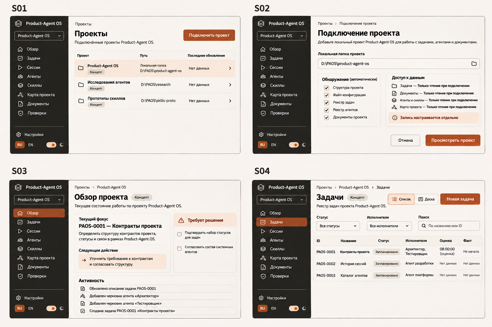
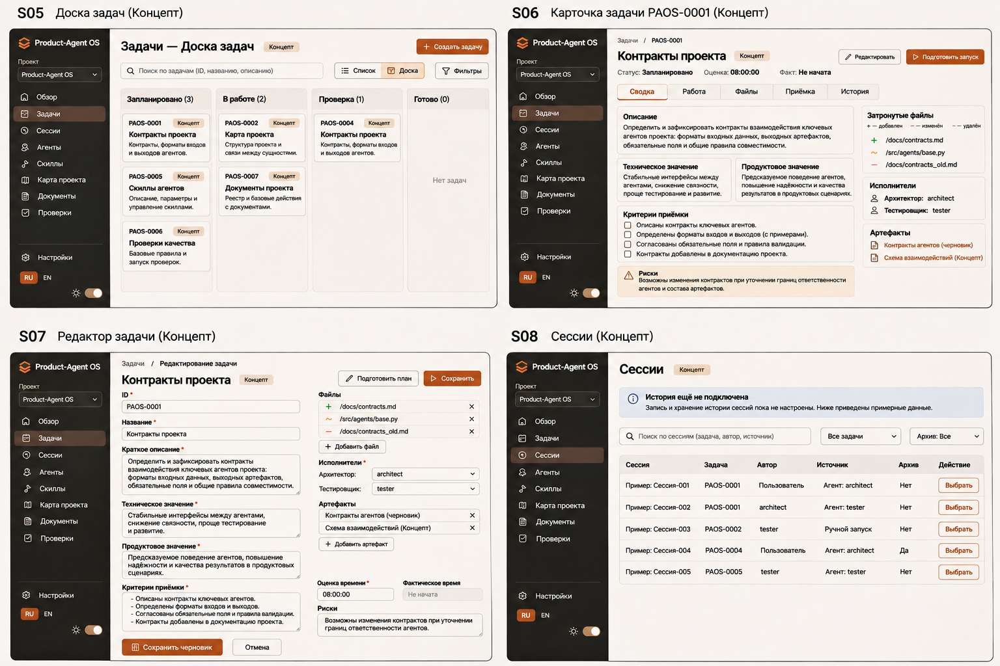
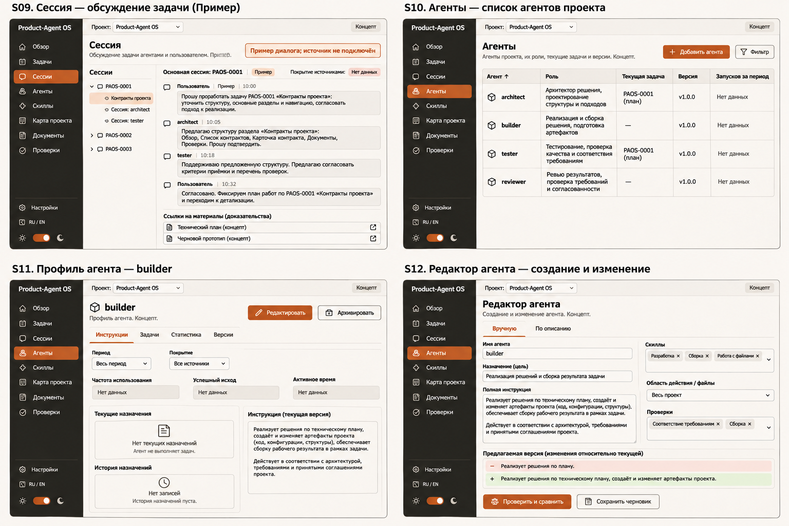
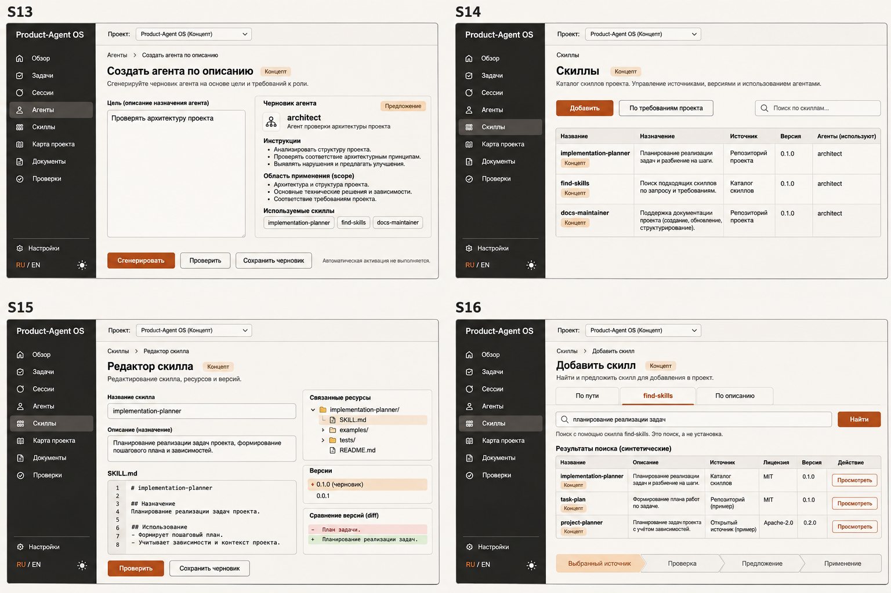
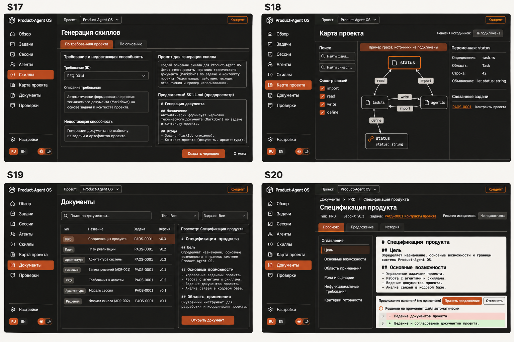
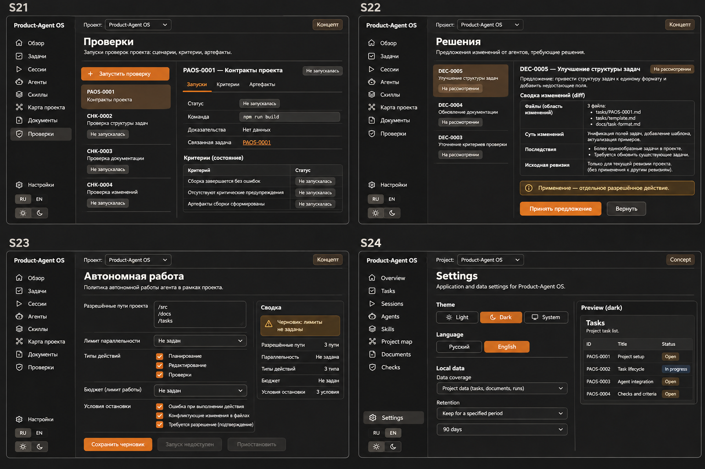

# Product-Agent OS Web — экраны полноценного Task Manager

## Актуальная структура UX v0.7 — единое окно

Source status: project-authored / proposed UX, 2026-11-09; draft_for_review. Продуктовое направление — PRD v0.7 §17. [Подробные wireframes WF-01–21](product-agent-os-web-m1-wireframes-2026-11-09.md) задают текущую компоновку и состояния; 24 изображения v0.2 ниже — исторические, не актуальный макет активного чата. Каталог содержит **31 маршрут**, восемь основных вкладок проекта.

Постоянная навигация: **Обзор, Задачи, Сессии, Агенты, Скиллы, Карта проекта, Документы, Проверки**. Переключатель проекта сверху; Настройки снизу. «Требует внимания» в заголовке ведёт в S22, «Автономная работа» доступна из Обзора и настроек проекта, Workflow — из Задач. Это вспомогательные маршруты, а не дополнительные основные вкладки. Нет отдельного чата вне проекта. Назад возвращает фильтры, выделение, черновик и позицию чтения.

В Сессиях: слева навигация и список сессий; в центре сообщения и composer; справа переключаемые **Задачи / Агенты / Файлы / Проверки**. Запросы разрешений находятся в потоке чата и очереди внимания; это один запрос с одним результатом. Поиск по сообщениям — локальный режим над transcript, не отдельный экран. Широкий diff временно занимает центр и inspector, оставляя возврат к чату. На узком экране работает одна область с доступными переходами; детали не исчезают.

| Семейство | Компоновка и главный переход | Граница первого M1 |
| --- | --- | --- |
| S01–S03 | Список проектов → read-only подключение → Обзор с активной сессией и следующим действием | Минимальные launch/selection/overview |
| S04–S07 | Таблица/доска → карточка → редактор; создать/связать/открыть сессию | Flat Task CRUD/Comments/History, fixed Kanban и manual closure M1; полная иерархия/редакторы позднее |
| S08–S09 | Каталог → рабочая сессия: чат, task/run context, diff, approvals | Основной сквозной путь M1 |
| S10–S13 | Список → профиль → редактор или генерация → preview | Read-only список/definitions/observed agents; полный CRUD позднее |
| S14–S17 | Каталог → инструкция/ресурсы → источник/поиск/генерация → preview | Read-only список/definitions/usage skills; полный CRUD позднее |
| S18 | Graph + поиск/легенда + inspector выбранного узла → source/diff/session | Полная карта позднее; статические связи не обозначают runtime truth |
| S19–S20 | Список артефактов → reader с provenance и связанными задачами/сессиями | Минимальные ссылки на evidence; полный каталог позднее |
| S21–S22 | Проверки и очередь решений → конкретное событие сессии | Минимальная приёмка/permissions M1, расширенные каталоги позднее |
| S23–S26 | Автономность, настройки, каталог и редактор workflow | Настройки темы/языка M1; полный workflow/autonomy позднее |
| S27–S28 | Подключение runtime/аккаунта → проверенное состояние; recovery → история действий | Обязательные состояния M1 |

Все подробные разделы S01–S28 ниже описывают целевой продукт, а не готовность функций первого M1. Приоритет текущей спецификации: UX v0.7 §15 и PRD §17; дополнения v0.3/v0.4 сохраняют историю решений. Критерии UX-AC-01–18 и проверки документа находятся в wireframes.

## Историческое дополнение v0.4: активные сессии в едином окне

Точная компоновка заменена UX v0.5 выше: approvals inline/attention, правая панель Задачи/Агенты/Файлы/Проверки; S24 содержит переход в S27 с подробными connection/account/payer/capabilities.

Source status: user-selected direction / proposed UX. Актуальны [PRD §15](product-agent-os-web-prd-2026-11-05.md#15-единое-окно-и-codex-app-server--v04) и [auth contract](product-agent-os-web-auth-commercial-2026-11-09.md). Всего 28 текстовых routes: к S01–S26 добавлены S27 /settings/connections и S28 /p/:project/recovery. Изображения v0.2 остаются историческими; в этой задаче новые PNG не создавались.

S08 теперь содержит создание собственных сессий PAOS, а S09 — composer, поток сообщений, Attach/Send/Stop, mode Discussion/Planning/Execution и правую панель task/diff/checks/approvals. Внешние Codex App/CLI sessions — отдельный import/coverage contract, не обязательный source первого M1. S06 открывает связанную рабочую сессию; S22 доставляет process-bound runtime approvals; S24 содержит connection/account/payer/capabilities без secrets.

S27: API baseline candidate, SIWC только при admission, pending/success/error/expired/quota states; login success отличается от проверенного inference. S28: unknown dispatch, interrupt pending, stale approval, история side effects, Inspect/Resume/Stop без автоматического повторения операции. Возврат в проект сохраняет его последнюю вкладку. RU/EN и light/dark относятся ко всем этим состояниям.

Основной путь: launcher → connection → проект → session/task → scoped run → approval → evidence → restart/resume. Никакого обязательного перехода в Codex App. Первый M1 имеет минимальную task card и одну recipe; full editors/graph следуют после проверки этого пути.

Source status: project-authored / proposed UX / generated visual concepts. Дата: 2026-11-09.

Статус: **draft_for_review / needs_user_acceptance**. 24 проектируемых экрана и шесть визуальных листов. Это дизайн будущего продукта, не screenshots работающего приложения. В макетах synthetic examples; названия задач/файлов, лица, статусы и счётчики не подтверждают работу текущего репозитория. Нормативные названия и поведение задаёт текст ниже; image generation может исказить мелкие подписи.

Связи: [PRD](product-agent-os-web-prd-2026-11-05.md), [архитектура](product-agent-os-web-architecture-2026-11-05.md), [38 задач и 10 групп](product-agent-os-web-task-manager-plan-2026-11-09.md).

## Дополнение v0.3: issue model и workflow

Source status: proposed UX, 2026-11-09. [PRD §14](product-agent-os-web-prd-2026-11-05.md) определяет новые поля, hierarchy, статусы и правила. Основной каталог S01–S24 и изображения ниже — v0.2; они не являются полным изображением расширенного scope. Новые изображения не создавались.

| Экран | Изменение v0.3 |
| --- | --- |
| S04 Список | Type/parent/Epic, creator, priority, components, Start/Due, Affects/Fix version; фильтры и hierarchy grouping |
| S05 Kanban | 7 колонок для 8 default statuses; mapping, WIP, rank, badges, keyboard transitions и settings |
| S06 Карточка | Type/parent и новые поля, ручные Завершить/Отменить/Reopen; Linked Issues, Attachments; отдельные tabs Комментарии и История изменений |
| S07 Редактор | Новый type, parent selector, дополнительные поля и validation; сохранённый Backlog отличается от Ready |
| S23 Автономность | Policy остаётся отдельной; ссылка на workflow/recipe, pinned version и migration notice |
| S24 Настройки | Project components и version registry; release policy; ссылки на workflows |
| S25 Workflow проекта | /p/:project/workflows: каталог, type mapping/default, active/draft/archived versions, create/copy/archive и migration entry |
| S26 Редактор workflow | /p/:project/workflows/:id/edit: graph/table, transitions/guards, agent recipes, validate, diff, publish, migration preview |

S25/S26 проектируются текстом; всего теперь 26 основных маршрутов, а визуальный пакет по-прежнему содержит 24 композиции. Для S25 нужны empty/draft/active/archived/conflict states; для S26 invalid graph, stale revision, running pinned version, migration mismatch и policy denial. Вкладки Comments/History/Attachments и version registry используют общие формы/панели без дополнительных верхнеуровневых вкладок проекта.

Основной путь v0.3: создать Epic → UserStory/Task/Bug → при необходимости Sub-Task; назначить компоненты/приоритет/даты/версии → выбрать workflow → вести вручную или через recipe → комментарии/links/evidence → принять результат и закрыть. Cancelled отделён от Done; при работающем агенте terminal transition ждёт подтверждённой остановки. Старые «четыре колонки» изображения не задают новый workflow.

## Направление Hallmark

Hallmark v2.0.0, app-screen scope, modern-minimal, адаптация по мотивам Rim (2 из 3 предложенных тем). Light mode и небольшие радиусы намеренно адаптируют исходную dark-only геометрию Rim к требованиям пользователя. Пользователь выбрал объединение утилитарного, технического и мягкого направлений: плотные таблицы, точные связи и source anchors, спокойные широкие формы. Это одна система с разной плотностью областей, а не три смешанных стиля.

Навигация: 8 постоянных проектных разделов — Обзор, Задачи, Сессии, Агенты, Скиллы, Карта проекта, Документы, Проверки. Решения открываются из Обзора и task attention; Автономная работа — из панели состояния/настроек проекта. Project switcher сверху, global settings и RU/EN/theme снизу. Search — overlay с keyboard shortcut и отдельными результатами по task/agent/skill/document/session; это состояние shell, не новый маршрут. Настройки проекта доступны из selector menu.

Signature: связная цепочка задача → агенты → сессия → файлы → проверки. Каждый переход сохраняет project/task context и даёт обратную ссылку. При переходе между проектами выбранная сущность не переносится молча.

| Токен | Светлая | Тёмная |
| --- | --- | --- |
| Main surface | #F6F4EF | #292826 |
| Navigation | #242321 | #1E1E1C |
| Main text | #252422 | #F3F0E8 |
| Action | #B74B20 | #E99155 |
| Dividers | #D9D5CC | #514D46 |

Цвета — proposal; контраст всех states проверяется при реализации. Humanist sans с поддержкой кириллицы, системный fallback Segoe UI; monospace только для code/ID/time. Не устанавливать шрифты ради концептов. Flat regions, малые радиусы, без gradients/glow и декоративных метрик. Формы просторнее таблиц, но сохраняют одну сетку. Размеры controls и focus states уточняются UI implementation и accessibility проверкой; raster не доказывает их.

Источник материалов: требования пользователя и локальные PRD/architecture. Реальные показатели и реальные сообщения не предоставлены; unknown показывается как «Нет данных». Данные изображений не являются seed data будущего приложения.

Hallmark применён к изображениям и спецификации. CSS scaffold, HTML build, sloplint --render, browser tests и подключение стороннего image provider не выполнялись: разработка не разрешена. Текстовая проверка и визуальный review не заменяют DOM/contrast/accessibility проверки.

## Каталог экранов

| ID | Экран | Маршрут | Главная задача |
| --- | --- | --- | --- |
| S01 | Проекты | `/projects` | Выбрать проект или подключить папку. |
| S02 | Подключение проекта | `/projects/new` | Проверить папку и состав доступных данных перед подключением. |
| S03 | Обзор | `/p/:project` | Понять состояние, активную работу и следующий шаг. |
| S04 | Задачи: список | `/p/:project/tasks?view=list` | Найти и сравнить задачи. |
| S05 | Задачи: доска | `/p/:project/tasks?view=board` | Видеть этапы работы. |
| S06 | Карточка задачи | `/p/:project/tasks/:id` | Понять ценность, scope и основания завершения. |
| S07 | Редактор задачи | `/p/:project/tasks/:id/edit` | Сформулировать полноценную задачу. |
| S08 | Сессии | `/p/:project/sessions` | Найти любую доступную сессию проекта. |
| S09 | Рабочая сессия | `/p/:project/sessions/:id` | Вести работу: чат, задачи, агенты, изменения, проверки и разрешения. |
| S10 | Агенты | `/p/:project/agents` | Управлять составом проектной команды. |
| S11 | Профиль агента | `/p/:project/agents/:id` | Понять инструкции и фактическую работу агента. |
| S12 | Редактор агента | `/p/:project/agents/:id/edit` | Создать или изменить профиль вручную. |
| S13 | Агент по описанию | `/p/:project/agents/generate` | Получить проверяемый черновик из описания роли. |
| S14 | Скиллы | `/p/:project/skills` | Найти и управлять навыками проекта. |
| S15 | Редактор скилла | `/p/:project/skills/:id` | Проверить и изменить инструкцию и ресурсы. |
| S16 | Добавление скилла | `/p/:project/skills/add` | Выбрать локальный источник или найти новый skill. |
| S17 | Генерация скиллов | `/p/:project/skills/generate` | Закрыть потребность проекта через новый draft. |
| S18 | Карта проекта | `/p/:project/map` | Найти зависимости файлов и переменных и оценить влияние. |
| S19 | Документы | `/p/:project/documents` | Найти планы, исследования, решения и внешние ресурсы. |
| S20 | Просмотр документа | `/p/:project/documents/:id` | Прочитать документ и проверить источник или предложение. |
| S21 | Проверки | `/p/:project/checks` | Понять результат проверки и связь с приёмкой. |
| S22 | Решения | `/p/:project/decisions` | Принять конкретное решение на основе последствий. |
| S23 | Автономная работа | `/p/:project/autonomy` | Настроить границы самостоятельного выполнения и наблюдать состояние. |
| S24 | Настройки | `/settings` | Язык, тема, хранение и переход к подключению. |
| S25 | Workflow проекта | `/p/:project/workflows` | Выбрать цепочки работы по типам задач. |
| S26 | Редактор workflow | `/p/:project/workflows/:id/edit` | Проверить переходы, guards и версии recipes. |
| S27 | Подключения | `/settings/connections` | Runtime, identity, payer и доступные возможности. |
| S28 | Восстановление | `/p/:project/recovery` | Установить исход прерванного взаимодействия. |

### S01. Проекты

**Назначение:** Выбрать проект или подключить папку.

**Структура:** Список проектов, источник, доступность данных, последний snapshot, поиск.

**Действия:** Открыть проект; подключить папку.

**Состояния:** Нет проектов; источник недоступен. Для каждого route также обязательны loading, empty, error, populated и unavailable; успешное пустое состояние отличается от отсутствующих данных.

### S02. Подключение проекта

**Назначение:** Проверить папку и состав доступных данных перед подключением.

**Структура:** Путь, результат read-only discovery, доступные источники, ошибки.

**Действия:** Просмотреть; подтвердить регистрацию.

**Состояния:** Нет доступа; неверный путь; проект уже подключён. Для каждого route также обязательны loading, empty, error, populated и unavailable; успешное пустое состояние отличается от отсутствующих данных.

### S03. Обзор

**Назначение:** Понять состояние, активную работу и следующий шаг.

**Структура:** Текущая задача, события, решения, ссылки на evidence.

**Действия:** Открыть задачу или требующее внимания решение.

**Состояния:** Нет задач; snapshot устарел; источник отключён. Для каждого route также обязательны loading, empty, error, populated и unavailable; успешное пустое состояние отличается от отсутствующих данных.

### S04. Задачи: список

**Назначение:** Найти и сравнить задачи.

**Структура:** ID, название, статус, агенты, оценка/факт, фильтры, сортировка.

**Действия:** Новая задача; открыть; сменить представление.

**Состояния:** Нет совпадений; загрузка; конфликт изменения. Для каждого route также обязательны loading, empty, error, populated и unavailable; успешное пустое состояние отличается от отсутствующих данных.

### S05. Задачи: доска

**Назначение:** Видеть этапы работы.

**Структура:** Колонки по статусам, карточки и исполнители.

**Действия:** Переместить с проверкой перехода; открыть задачу.

**Состояния:** Пустая колонка; недопустимый переход; клавиатурная альтернатива drag. Для каждого route также обязательны loading, empty, error, populated и unavailable; успешное пустое состояние отличается от отсутствующих данных.

### S06. Карточка задачи

**Назначение:** Понять ценность, scope и основания завершения.

**Структура:** Все поля PRD §13–14: ID/тип/parent/название/описание, техническая и продуктовая ценность, статус/создатель/приоритет/components, исполнители, planned/actual files, артефакты, критерии, estimate/actual, Start/Due Date, Affects version, attachments, риски и Linked Issues. Вкладки Сводка/Сессии/Файлы/Приёмка/Комментарии/История изменений; comments и history раздельны.

**Действия:** Редактировать; вручную создать/закрыть/reopen по workflow guards; открыть или создать связанную сессию, вернуться к точному сообщению. Остановка относится к выбранному run и не означает rollback; завершение задачи требует результата приёмки.

**Состояния:** Не начата; выполняется; needs decision; failed; reopened. Для каждого route также обязательны loading, empty, error, populated и unavailable; успешное пустое состояние отличается от отсутствующих данных.

### S07. Редактор задачи

**Назначение:** Сформулировать полноценную задачу.

**Структура:** Два смысловых столбца: цель/приёмка и scope/исполнители/время/риски.

**Действия:** Сохранить черновик; подготовить план.

**Состояния:** Ошибки полей; unsaved changes; stale revision. Для каждого route также обязательны loading, empty, error, populated и unavailable; успешное пустое состояние отличается от отсутствующих данных.

### S08. Сессии

**Назначение:** Найти, создать и продолжить сессию своего проекта в Product-Agent OS.

**Структура:** Поиск, фильтры по состоянию/task/agent/source, активные и архивные сессии, дата последнего события, заголовок, task links, источник и полнота истории. Новая сессия создаёт черновик без inference; импорт внешних сессий отдельно обозначает доступное покрытие.

**Действия:** Новая сессия; открыть; переименовать; архивировать с проверкой активной работы; поиск истории. Fork доступен только при подтверждённой capability, не притворяется копией полного runtime.

**Состояния:** Первый запуск; нет совпадений; partial history; отсутствующий источник; загрузка следующей страницы; активная работа в архивируемой сессии. [WF-02/03](product-agent-os-web-m1-wireframes-2026-11-09.md) задают детали.

### S09. Рабочая сессия

**Назначение:** Обсудить задачу, получить план, запустить разрешённую работу и проверить результат в одном окне.

**Структура:** Заголовок с project/session и состоянием соединения; список сессий слева; transcript и composer в центре; контекст справа. В transcript разделены пользователь, агент, этап работы, tool event, вопрос, предложение и типизированный permission request. У сообщения есть permalink, время, роль и связь с task/run. Длинные события свернуты с понятным итогом. Показываются наблюдаемые действия, а не скрытые рассуждения модели.

**Composer:** Видимая метка «Сообщение», явный режим Discussion/Planning/Execution, задача и context attachments, Send/Stop. Enter — новая строка, Ctrl/Cmd+Enter — отправка с защитой IME. Черновик не теряется при навигации, смене темы и connection error. Следующее сообщение во время run входит в видимую очередь; изменение режима/профиля действует для следующего run. Выполнение очереди повторно проверяет scope, не расширяет права молча.

**Контекст:** Несколько связанных задач, одна execution target на run; агенты с закреплёнными версиями инструкций/skills и фактическими событиями; файлы с planned/proposed/applied/external состояниями; проверки с командами, revision и evidence. Task/agent profile открывается с возвратом в тот же chat. Diff расширяет рабочую область, после возврата сохраняются scroll и draft.

**Разрешения:** Встроенный блок показывает запрашивающего агента, действие, конкретный scope и последствия. Allow/Deny подтверждаются runtime acknowledgement. Уточнение пользователя, продуктовое принятие и разрешение инструмента — разные сущности. Повторный ответ из другой вкладки не выполняет действие снова; просроченный запрос требует reconciliation.

**Состояния:** Draft, connecting, streaming, queued, needs input, permission pending, interrupt requested, stopped, completed, failed, unknown outcome. Статусы runtime не заменяют статусы Kanban. Потеря stream не доказывает остановку; повторная отправка не автоматическая. Завершённый turn не закрывает задачу.

**Wireframes:** [WF-03–12 и UX-AC-01–18](product-agent-os-web-m1-wireframes-2026-11-09.md): chat, task context, agents, diff, permissions, result, recovery, narrow layout. Эти состояния являются proposed поведением, не runtime proof.

### S10. Агенты

**Назначение:** Управлять составом проектной команды.

**Структура:** Роль, источник, версия, текущие задачи, число стартов за выбранный период.

**Действия:** Добавить вручную/по описанию; открыть профиль.

**Состояния:** Нет project agents; источник read-only; неизвестная статистика. Для каждого route также обязательны loading, empty, error, populated и unavailable; успешное пустое состояние отличается от отсутствующих данных.

### S11. Профиль агента

**Назначение:** Понять инструкции и фактическую работу агента.

**Структура:** Инструкции, текущие/прошлые задачи, частота, исходы, duration, skills, version.

**Действия:** Редактировать; сравнить; архивировать; перейти к run/session.

**Состояния:** No telemetry; disabled; running old pinned version; delete dependency. Для каждого route также обязательны loading, empty, error, populated и unavailable; успешное пустое состояние отличается от отсутствующих данных.

### S12. Редактор агента

**Назначение:** Создать или изменить профиль вручную.

**Структура:** Имя, цель, инструкции, skills, scope, checks, diff и validation.

**Действия:** Проверить; сохранить proposal; применить по действующей авторизации.

**Состояния:** Invalid instruction structure; stale version; active-run warning. Для каждого route также обязательны loading, empty, error, populated и unavailable; успешное пустое состояние отличается от отсутствующих данных.

### S13. Агент по описанию

**Назначение:** Получить проверяемый черновик создания, изменения или удаления агента из описания. Изображение S13 показывает create state; для update/delete добавляются выбор текущего агента, diff и последствия для зависимостей/истории.

**Структура:** Prompt, требования, generated instructions, scope, capabilities, rationale summary.

**Действия:** Сгенерировать; отредактировать; проверить; сохранить draft.

**Состояния:** Generation unavailable/error; ambiguous description; forbidden capability. Для каждого route также обязательны loading, empty, error, populated и unavailable; успешное пустое состояние отличается от отсутствующих данных.

### S14. Скиллы

**Назначение:** Найти и управлять навыками проекта.

**Структура:** Назначение, источник, версия/hash, зависимости, использующие агенты.

**Действия:** Открыть; добавить; предложить по требованиям.

**Состояния:** Нет skills; vendor read-only; несовместимая зависимость. Для каждого route также обязательны loading, empty, error, populated и unavailable; успешное пустое состояние отличается от отсутствующих данных.

### S15. Редактор скилла

**Назначение:** Проверить и изменить инструкцию и ресурсы.

**Структура:** SKILL.md, ресурсы, source/trust/license, version history, usages.

**Действия:** Редактировать local copy; проверить; diff; сохранить proposal; удалить с dependency check.

**Состояния:** Invalid metadata; missing resource; active consumer; conflict. Для каждого route также обязательны loading, empty, error, populated и unavailable; успешное пустое состояние отличается от отсутствующих данных.

### S16. Добавление скилла

**Назначение:** Выбрать локальный источник или найти новый skill.

**Структура:** Вкладки По пути/find-skills; metadata и preview найденного результата.

**Действия:** Проверить источник; staged import; применить отдельным действием.

**Состояния:** No result; search unavailable; unsafe path; unknown license. Для каждого route также обязательны loading, empty, error, populated и unavailable; успешное пустое состояние отличается от отсутствующих данных.

### S17. Генерация скиллов

**Назначение:** Закрыть потребность проекта через новый draft.

**Структура:** По требованиям/По описанию; requirement links, gaps, proposed SKILL.md.

**Действия:** Сгенерировать; сравнить с существующими; сохранить draft.

**Состояния:** Insufficient requirements; duplicate candidate; provider unavailable. Для каждого route также обязательны loading, empty, error, populated и unavailable; успешное пустое состояние отличается от отсутствующих данных.

### S18. Карта проекта

**Назначение:** Найти зависимости файлов и переменных и оценить влияние.

**Структура:** Graph + file/symbol index + inspector; import/call/define/read/write/reference; source anchors.

**Действия:** Поиск; фильтр; глубина; открыть код; связать с задачей.

**Состояния:** Unsupported language; unresolved edge; stale graph; oversized graph. Для каждого route также обязательны loading, empty, error, populated и unavailable; успешное пустое состояние отличается от отсутствующих данных.

### S19. Документы

**Назначение:** Найти планы, исследования, решения и внешние ресурсы.

**Структура:** Каталог с типом, source/version, task, freshness.

**Действия:** Открыть; фильтровать; связать с задачей.

**Состояния:** Missing/deleted file; inaccessible external URL. Для каждого route также обязательны loading, empty, error, populated и unavailable; успешное пустое состояние отличается от отсутствующих данных.

### S20. Просмотр документа

**Назначение:** Прочитать документ и проверить источник или предложение.

**Структура:** Outline, content, linked tasks, source anchors, revision, proposal diff.

**Действия:** Открыть source; сравнить; предложить изменение.

**Состояния:** Parse error; unsafe link; stale proposal; read-only source. Для каждого route также обязательны loading, empty, error, populated и unavailable; успешное пустое состояние отличается от отсутствующих данных.

### S21. Проверки

**Назначение:** Понять результат проверки и связь с приёмкой.

**Структура:** Master/detail: runs, command, environment, version, evidence, criteria.

**Действия:** Выбрать run; прочитать failure; открыть артефакт; authorized rerun.

**Состояния:** Не запускалась; failed; skipped; stale; unavailable. Для каждого route также обязательны loading, empty, error, populated и unavailable; успешное пустое состояние отличается от отсутствующих данных.

### S22. Решения

**Назначение:** Принять конкретное решение на основе последствий.

**Структура:** Очередь с фильтрами Уточнения/Продуктовые решения/Разрешения runtime; task/session/run, scope, diff, причина, risk, evidence, expiry. Runtime request — та же сущность, что inline в S09; не отдельное разрешение.

**Действия:** Ответить на вопрос; принять/вернуть proposal; Allow/Deny конкретное runtime действие. Ссылка открывает исходное событие S09. ACK, stale и already resolved показаны явно; кнопки определяются типом запроса.

**Состояния:** Already resolved; expired; revision changed; insufficient authority. Для каждого route также обязательны loading, empty, error, populated и unavailable; успешное пустое состояние отличается от отсутствующих данных.

### S23. Автономная работа

**Назначение:** Настроить границы самостоятельного выполнения и наблюдать состояние.

**Структура:** Allowed paths/actions, budgets, concurrency, stop rules, queue, current runs.

**Действия:** Сохранить policy proposal; start authorized queue; pause; cancel.

**Состояния:** Budget exhausted; conflict; adapter offline; permission boundary reached. Для каждого route также обязательны loading, empty, error, populated и unavailable; успешное пустое состояние отличается от отсутствующих данных.

### S24. Настройки

**Назначение:** Настроить язык, тему и локальное хранение.

**Структура:** RU/EN, Light/Dark/System, локальные retention/coverage; настройки компонентов/версий проекта и ссылки на workflows; переход в S27 для runtime/account/payer. Secrets не попадают в обычные формы настроек.

**Действия:** Сохранить настройки; открыть состояние подключения.

**Состояния:** Unavailable capability; unsaved changes; retention preview. Для каждого route также обязательны loading, empty, error, populated и unavailable; успешное пустое состояние отличается от отсутствующих данных.

### S25. Workflow проекта

Каталог версий и type mapping: active/draft/archived, default, какие задачи закреплены за версией. Действия: создать/копировать, открыть S26, preview миграции и архивировать. Empty, конфликт назначения, активные runs и unavailable policy показаны отдельно; изменение default не переносит текущий run.

### S26. Редактор workflow

Graph и доступная table-альтернатива, статусы/переходы/guards/agent recipes, проверка достижимости, diff, публикация версии и migration preview. Ошибки привязаны к узлу/переходу. Running pinned version и stale revision исключают молчаливую замену. Сохранить draft, validate и publish — разные действия. Редактор не запускает агентную цепочку сам по себе.

### S27. Подключения

Слева runtime profile и состояние; справа identity/account, payer, capabilities и последний подтверждённый результат подключения. API baseline и conditional SIWC следуют [auth contract](product-agent-os-web-auth-commercial-2026-11-09.md), без обещания коммерческого admission. Authentication success не равен проверенному inference; платная проверка обозначается до запуска. Empty/pending/connected/expired/quota/unsupported/offline, secure storage и return-to-session. При смене аккаунта история и draft остаются в правильном project/account scope, нет автоматической смены payer.

### S28. Восстановление

Последний подтверждённый event, состояние процесса/dispatch, список уже известных изменений и неразрешённых действий. Inspect history/files, reconcile state, interrupt request, затем допустимое Resume/новый run. Unknown outcome не преобразуется в failure или success без evidence; команда с side effects не отправляется повторно автоматически. Истёкший approval нельзя оживить кнопкой Retry. После разрешения ситуации возврат в S09 с прежним draft.

## Основной пользовательский путь

1. Открыть Product-Agent OS, выбрать проект S01 или зарегистрировать папку S02. S27 показывает готовность runtime и способ оплаты; при недоступности остаются локальные данные.
2. В S08 создать сессию, в S09 описать цель в Discussion/Planning. Само открытие сессии ничего не запускает; отправка модели имеет обычные ограничения и стоимость.
3. Из сообщения создать черновик задачи с preview полей либо связать существующую; определить acceptance, scope и estimate. Выбрать Execution для следующего run.
4. Отправить поручение в той же сессии. Наблюдать сообщения и реальные действия; справа открыть исполнителя, его закреплённые инструкции и задачу. Переходы не теряют draft.
5. При реальном runtime запросе прочитать действие/последствия и Allow/Deny в S09. Уточнение или принятие плана обрабатываются отдельно. Ожидать ACK, не считать нажатие выполнением.
6. Открыть список изменений и широкий diff, затем проверки. Проверить revision, actual files и evidence; остановка не отменяет уже записанные файлы.
7. Принять результат по критериям и вручную закрыть задачу через допустимый workflow переход. Turn completed сам по себе не означает Done.
8. При разрыве соединения открыть S28, установить фактический исход и вернуться в чат без повторного исполнения. Позднее найти историю через S08, S06 или S11.

## Общие interaction contracts

- Theme и language меняются независимо; сохраняются на пользователя. Идентификаторы, code, paths и оригинальные сообщения не переводятся. RU/EN применяются ко всем 28 экранам, ошибкам, empty states, датам и форматам чисел.
- Mobile: sidebar превращается в drawer, table — в горизонтально прокручиваемую таблицу с закреплёнными ID/title или список; inspector — отдельная панель с Back. Graph имеет list alternative. Не терять destructive actions и исходный context.
- Delete/archive использует подтверждение с перечнем зависимостей и последствиями; при активных runs предлагается завершить/отменить их или архивировать для новых назначений. Hard deletion не удаляет execution history.
- Изменение инструкций, skills и policy проходит draft → validate → diff → authorized apply → receipt. Если разрешение уже покрывает точное действие, отдельный вопрос не нужен. UI не ослабляет host controls.
- Session transcript показывает все доступные user-visible сообщения с явным coverage; внутренние chain-of-thought, secrets и недоступные host записи не извлекаются. Скрытый/усечённый фрагмент обозначается.
- Global search и confirmation dialogs являются shared states этих экранов; duplicate route ради каждого диалога не создаётся. Print/export и real-time collaboration вне текущего scope.

## Исторические визуальные листы v0.2

Каждый файл содержит четыре полных экранных композиции; расположение: слева сверху, справа сверху, слева снизу, справа снизу. Первые четыре листа показывают светлый main surface с графитовой навигацией, последние два — тёмный режим; S24 демонстрирует EN. Это не отдельные реализации тем.

### Лист 1: S01–S04

### Лист 2: S05–S08

### Лист 3: S09–S12

### Лист 4: S13–S16

### Лист 5: S17–S20

### Лист 6: S21–S24

## Проверка и ограничения

Актуальный каталог содержит S01–S31. Текущая детализация и receipts — в wireframes UX v0.5; прежние изображения покрывают только S01–S24 и не подтверждают новый UX. Малые labels изображения не являются source of truth. Для разработки потребуются component-level states, responsive layouts и browser verification. Статус принятия визуального направления — needs_user_acceptance.

Fresh-context Hallmark review и один пакет visual corrections записаны в [протоколе плана](product-agent-os-web-task-manager-plan-2026-11-09.md). В рисунке S18 возможны повторяющиеся labels одного примера; нормативная identity символа задаётся архитектурой. Второстепенные данные картинок не импортируются в приложение. [Manifest](assets/task-manager-2026-11-09/manifest.json) фиксирует финальные шесть PNG.

## Дополнение M1 v0.7 — данные и согласованные действия

Source status: project-authored / planned UI, 2026-11-10. Сохранены S01–S28; добавлены три маршрута, итого 31. Нормативный scope M1 — PRD §17 и wireframes §15. Статические images v0.2 не обновлялись.

### S29. Перенос данных проекта

Route: /p/:project/data/import. Вход из Обзора, Задач в legacy mode и «Данные проекта». WF-17–19: inventory → mapping/conflicts → freeze/backup/cutover → receipt. Source changed/unsupported/missing backup блокируют switch. В DB mode external MD conflict открывает тот же route, не меняет SQL автоматически. Owner 0050/0056.

### S30. Данные и резервные копии

Route: /settings/data. WF-20: usage, managed backups/pinning, create, restore preview/new directory/validation, purge consequences. Healthy SQL не требует provider. Credentials/runtime profiles/source repo исключены; message coverage видна. Owner 0051.

### S31. Поиск в проекте

Route: /p/:project/search. WF-21: FTS5 и exact ID/path, type filters, coverage/rebuild, пагинация, deep links/back. Scope только project, no semantic/global cross-project search M1. Owner 0049.

M1 S04–S07 включает flat Task CRUD, fixed Kanban, Comments/History, related/blocks и ручное закрытие с guards. S10–S17 — read-only списки/определения/observed usage, S18 — существующая read-only projection с coverage. Full hierarchy/editors/generation/workflows — M2–M3. S27 включает local pairing и отдельный BYOK; S09 смена mode создаёт новый runtime segment без наследования grants. S28 не блокирует локальный CRUD при здоровой SQL. Разрешение answered_or_cleared не изображается как success файла/команды.
