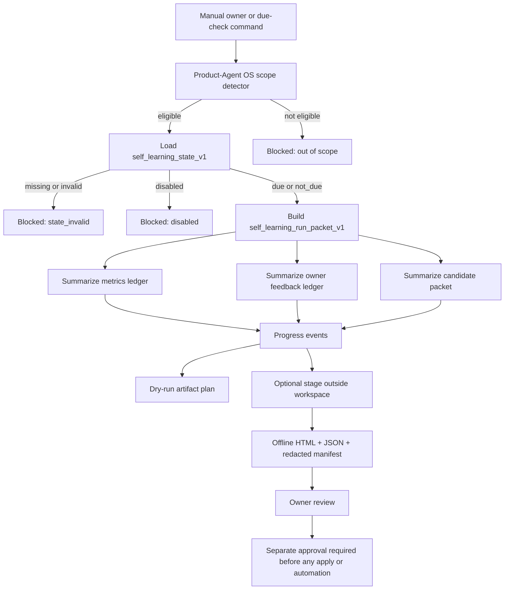
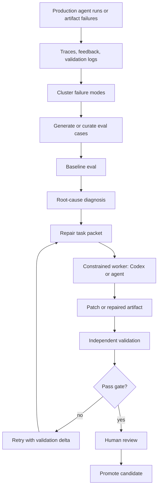
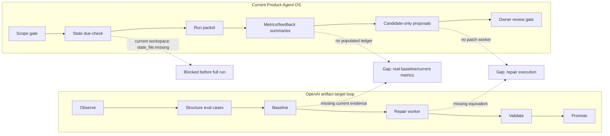
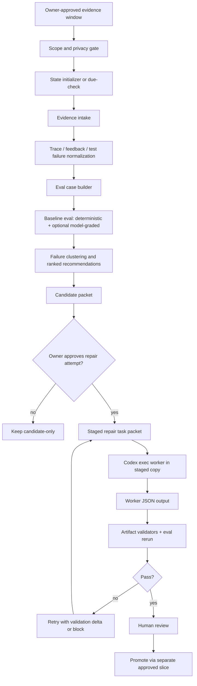

# Сравнение Self-Learning Loop Product-Agent OS с OpenAI agent improvement / Codex repair loops

Source status: `local_current_run_evidence + internal_research_artifact_comparison`

Дата анализа: 2026-06-30.

Сравниваемые источники:

- `research/openai-agent-repair-loops-technical-analysis.md` - артефакт по двум OpenAI Cookbook паттернам: Agents SDK agent improvement loop и Codex iterative repair loop.
- `plugins/product-agent-os/scripts/run_self_learning_loop.py` - текущий ручной runner Self-Learning Loop.
- `plugins/product-agent-os/scripts/product_agent_os/self_learning_state.py` - state, trigger и due-check контракт.
- `plugins/product-agent-os/scripts/product_agent_os/self_learning_progress.py` - run packet, progress events, staged HTML/JSON artifacts.
- `plugins/product-agent-os/scripts/product_agent_os/self_learning_feedback.py` - owner feedback, redacted session-summary import, satisfaction и preference memory.
- `plugins/product-agent-os/scripts/product_agent_os/self_learning_metrics.py` - append-only metrics ledger, eval report, taxonomy, paired skill utility, retrieval/composition и safety scorecard.
- `plugins/product-agent-os/scripts/product_agent_os/self_learning_candidates.py` - review-only candidate packet и forbidden-action safety report.
- `plugins/product-agent-os/scripts/product_agent_os/agent_skill_metrics.py` - более широкий read-only metrics/scorecard контур для agents/skills.
- `docs/product-agent-os/agent-skill-modernization-loop.md`, `docs/product-agent-os/behavioral-evals.md`, `docs/product-agent-os/artifact-contracts.md`.
- `docs/superpowers/plans/2026-06-20-track-11-documentation-architecture-refresh.md` и `docs/superpowers/specs/batch44-self-learning-loop-*.json`.

Текущие команды, выполненные в этом анализе:

- `python plugins\product-agent-os\scripts\check_self_learning_due.py . --dry-run` -> `status: state_invalid`, причина `state_file:missing`, без analysis execution и без state write.
- `python plugins\product-agent-os\scripts\run_self_learning_loop.py . --dry-run` -> `status: blocked`, scope eligible, блокер `self-learning state is invalid`, provider/live eval/target writes не выполнялись.
- `python -m unittest tests.product_agent_os.test_self_learning_state -v` -> 25 tests OK.
- `python -m unittest tests.product_agent_os.test_agent_skill_metrics tests.product_agent_os.test_agent_skill_metrics_cli tests.product_agent_os.test_agent_skill_metrics_report -v` -> 36 tests OK.

## Короткий вывод

Текущая реализация Product-Agent OS Self-Learning Loop сильнее OpenAI-артефакта в safety/control-plane дисциплине: scope detector, manual-only/staged-only режим, privacy/redaction, candidate-only policy, запрет hidden telemetry, provider calls, target mutation, automation и auto-apply. Это аккуратный, безопасный, source-backed фундамент.

Но как learning/improvement loop она пока слабее OpenAI-паттернов: у нее нет заведенного state в текущем workspace, нет end-to-end `B44-S7` пилота, нет populated metrics ledger, нет реального trace/user-feedback/eval корпуса, нет Promptfoo/HALO или эквивалентного model-graded optimization слоя, нет Codex repair worker, нет patch/rewrite execution path, и нет closed-loop проверки "candidate -> repair -> validation -> promotion".

Самая точная формула текущего статуса:

`Self-Learning Loop = safety-first staged evidence and candidate generation foundation, not yet an autonomous or semi-automatic improvement loop`.

## Архитектура OpenAI-артефакта как эталон сравнения

В артефакте выделены два родственных, но разных паттерна.

### Agents SDK improvement loop

Смысл:

1. production agent runs дают traces и user feedback;
2. failures кластеризуются;
3. генерируются representative eval cases;
4. запускается baseline eval;
5. определяется targeted change surface: instructions, tools, retrieval, handoff, guardrail;
6. Codex получает task packet и делает patch;
7. evals перезапускаются;
8. candidate продвигается только после review/promotion gate.

Ключевые свойства из артефакта:

- signal source: traces, user feedback, eval failures;
- eval layer: Promptfoo / HALO-style ideas, model-graded checks, deterministic checks;
- change worker: Codex как patch assistant;
- promotion: human-in-the-loop;
- риски: overfitting, trace privacy, weak evals, LLM-as-judge calibration, regression masking.

### Codex iterative repair loop

Смысл:

1. inventory notebooks/docs artifacts;
2. select broken candidate;
3. build repair prompt;
4. run `codex exec` with pinned version, sandbox, output schema;
5. validate repaired artifact deterministic validators;
6. retry with validation deltas;
7. record audit trail;
8. promote repaired artifact only after pass/review.

Ключевые свойства из артефакта:

- signal source: validation failures, stale APIs, setup gaps, runtime risks;
- worker: headless Codex CLI / `codex exec`;
- transport contract: structured output / JSON schema;
- artifact truth: deterministic validators, not model confidence;
- production requirements: pinned CLI version, sandbox boundaries, retry limit, status artifacts, review/repair separation.

## Текущая архитектура Self-Learning Loop

Текущий Product-Agent OS механизм разбит на безопасные компоненты.

| Слой | Файл / контракт | Что делает сейчас | Статус |
| --- | --- | --- | --- |
| Scope gate | `discovery.py`, `detect_product_agent_os_scope`, runner integration | Проверяет, что workspace относится к Product-Agent OS; не анализирует глобальные Codex sessions. | Реализовано, fail-closed. |
| State / due check | `self_learning_state_v1`, `check_self_learning_due.py --dry-run` | Читает `.codex/product-agent-os/self-learning-state.json`, возвращает `due`, `not_due`, `disabled`, `state_invalid`; не пишет state. | Реализовано, но state file в текущем workspace отсутствует. |
| Manual runner | `run_self_learning_loop.py --dry-run` / `--stage` | Строит `self_learning_run_packet_v1`, progress, metrics/feedback/candidate summaries; stage writes только во внешний stage root. | Реализовано; текущий dry-run blocked из-за missing state. |
| Progress artifacts | `self_learning_progress_v1`, offline HTML | Фазы: scope, due, evidence, metrics, feedback, candidates, reporting, owner review. | Реализовано как generated view only. |
| Feedback | `owner_feedback_ledger_v1`, `codex_session_feedback_import_v1`, `self_learning_satisfaction_report_v1`, `preference_memory_v1` | Принимает только redacted owner-provided summaries; raw chat/PII/absolute paths blocked; pseudo-labels low confidence. | Реализовано schema/fixture; реального import в текущем run нет. |
| Metrics/evals | `self_learning_metrics_ledger_v1`, `self_learning_eval_report_v1`, taxonomy, paired utility, retrieval/composition, process-control safety | Валидирует и суммаризирует ledger, считает fixture-level metrics; generated view never proof. | Реализовано schema/fixture; populated operational ledger отсутствует. |
| Candidate generation | `self_learning_candidate_packet_v1`, `self_learning_forbidden_action_report_v1` | Делает review-only candidates из metrics/feedback summaries; auto-apply disabled; forbidden actions blocked. | Реализовано; текущий run дал `no_candidates`. |
| Agent/skill metrics loop | `agent_skill_metrics.py` | Target registry, trace packet, evidence dataset, judge calibration, scorecards, cadence, modernization candidates. | Реализовано read-only; отдельный слой от manual runner. |
| Promotion | `self_learning_docs_contracts_closure_v1`, automation candidate gate | `candidate_only`; minimum 3 manual successful runs; owner approval; rollback/disable; false-positive audit; flake replay; cost check. | Реализовано как docs/contract gate; automation не активирована. |

## Диаграмма: текущий Product-Agent OS Self-Learning Loop



В текущем workspace путь идет до `Y`: state file отсутствует, поэтому runner корректно блокируется до сбора дальнейших phases.

## Диаграмма: OpenAI-паттерн из артефакта



OpenAI-паттерн уже подразумевает change execution. Наша реализация пока останавливается до `H`: она может подготовить candidates, но не запускает repair worker и не применяет patch.

## Детальное сравнение по архитектурным осям

| Ось | OpenAI artifact | Текущая Product-Agent OS реализация | Оценка |
| --- | --- | --- | --- |
| Observe | Traces, user feedback, eval failures, validation logs. | Scope packet, due packet, local control-plane evidence, optional owner feedback ledger, optional metrics ledger. | У нас безопаснее, но сигнал беднее и в текущем workspace ledger/state не populated. |
| Structure | Failure clusters, eval cases, repair finding taxonomy. | Schema contracts, progress phases, metrics taxonomy, candidate packet. | Сильный schema слой; не хватает failure taxonomy и persisted eval cases именно для Self-Learning Loop. |
| Baseline | Baseline eval before change. | `self_learning_eval_report_v1` поддерживает static/evolutionary split, но реального baseline/current run нет. | Концепт есть, evidence пока fixture-level. |
| Eval harness | Promptfoo/HALO/OpenAI eval workflow + deterministic checks. | `agent_skill_metrics.py`, fixture tests, transcript eval, schema tests; live/model judge disabled. | Локально надежно, но нет model-graded semantic layer и no optional Promptfoo export. |
| Repair worker | Codex patch assistant или `codex exec` worker. | Нет repair worker; candidates are review-only. | Главный функциональный разрыв. |
| Output contract | Worker JSON report + artifact validation schema. | `self_learning_candidate_packet_v1`, `self_learning_run_packet_v1`, safety report. | Хорошо для orchestration; нет schema для worker patch result и validation delta. |
| Validation | Deterministic validators + eval rerun + human review. | Unit/schema tests есть; current dry-run блокируется до execution; no real eval rerun. | Сильно по safety, слабее по improvement proof. |
| Promotion | Promote after pass gates. | `candidate_only`, 3 manual runs + owner approval + rollback/disable + flake/cost. | У нас сильнее governance; promotion еще не выполнен. |
| Privacy | Artifact предупреждает о trace privacy. | Реализованы redaction, hash-only refs, raw chat blocking, hidden telemetry forbidden. | У нас лучше и конкретнее. |
| Automation | OpenAI Codex loop может быть batch automation. | Automation explicitly not created; future activation separate approval. | У нас безопаснее, но менее полезно как continuous improvement loop. |
| Documentation | Artifact хорошо объясняет production blueprint. | Docs распределены по modernization loop, behavioral evals, artifact contracts, Track 11 plan. | Не хватает единой страницы Self-Learning Loop runbook. |

## Что в нашей реализации лучше

### 1. Safety и approval boundaries

Product-Agent OS явно запрещает:

- active scheduler;
- Codex App automation;
- hooks activation;
- provider/model/live eval calls;
- target workspace writes;
- raw transcript storage;
- hidden telemetry;
- global config mutation;
- git/release/deploy/publish/external writes;
- auto-apply.

OpenAI-артефакт эти риски называет, но не превращает их в настолько детальный локальный policy layer. У нас это уже зашито в state, runner, candidate validator, automation-promoter skill и docs/control-plane.

### 2. Privacy by design

В OpenAI-паттерне traces являются сильным сигналом, но одновременно privacy risk. У нас privacy превращена в системное ограничение:

- workspace ref через hash;
- raw path exclusion;
- owner-provided redacted summary consent;
- `raw_session_ingestion: not_performed`;
- raw chat/PII/absolute path rejection;
- generated HTML validation без external URLs/scripts;
- no hidden app log scraping.

Это более production-ready с точки зрения безопасности данных.

### 3. Evidence hierarchy

Product-Agent OS лучше отделяет:

- source truth;
- generated view;
- current command evidence;
- accepted gap;
- candidate-only proposal;
- activation proof.

OpenAI-артефакт тоже говорит про independent validation, но у нас эта дисциплина интегрирована в `AGENTS.md`, `PLAN.md`, `TEST.md`, `EVALS.md`, `RUNLOG.md`, docs registry и behavioral evals.

### 4. Deterministic regression coverage

Текущие focused tests подтверждают:

- due-check не пишет state;
- runner не пишет workspace в dry-run;
- stage пишет только под explicit stage root;
- disabled/missing state fail-closed;
- feedback ledger rejects raw chat, PII и absolute paths;
- candidate packet не применяет изменения;
- forbidden actions блокируются;
- agent/skill metrics блокируют uncalibrated judge, low dataset quality, unsafe redaction, single lucky run promotion.

Это сильнее, чем просто описанный loop.

## Что в нашей реализации хуже или неполно

### 1. Нет активированного state в текущем workspace

Фактический dry-run показал:

- `.codex/product-agent-os/self-learning-state.json` отсутствует;
- due-check возвращает `state_invalid`;
- runner блокируется до evidence collection.

Это правильный fail-closed behavior, но с точки зрения пользовательского опыта Self-Learning Loop сейчас не "готов к ручному использованию из коробки". Нужен approved initializer или staged state proposal.

### 2. Нет end-to-end `B44-S7` manual pilot

`B44-S0..S6` закрывают design, schemas, fixtures, docs и safety. Но OpenAI-паттерн требует полный цикл:

`evidence -> eval -> candidate -> repair/change -> validation -> promotion decision`.

У нас пока нет реального owner-approved manual run с:

- evidence window;
- redacted feedback;
- metrics ledger row;
- candidate review;
- owner decision;
- accepted gaps/residual risks;
- post-run validation.

### 3. Candidate generation не равно repair loop

`self_learning_candidates.py` создает review-only improvement candidates. Это полезно, но пока нет:

- `self_learning_repair_task_v1`;
- Codex worker task packet;
- `codex exec` controlled staged copy;
- worker JSON output schema;
- artifact validation schema;
- retry policy;
- modified files list;
- patch diff / rollback bundle;
- validation delta feedback.

То есть наша реализация доходит до "что можно улучшить", но не до "сделать ограниченный repair и проверить".

### 4. Нет Promptfoo/HALO-equivalent semantic eval layer

`agent_skill_metrics.py` покрывает target registry, trace normalization, dataset quality, judge calibration, scorecards и modernization candidates. Но это не то же самое, что Promptfoo/HALO:

- нет `promptfooconfig.yaml` или export adapter;
- нет набора persisted `eval_cases.jsonl` для Self-Learning Loop;
- нет model-graded rubric runs;
- нет HALO-style optimizer, который выдает top-k changes с supporting evidence;
- нет fresh model calls по approval-gated eval budget.

Текущий подход намеренно offline/local. Это хорошо для безопасности, но хуже для semantic quality feedback.

### 5. Нет populated operational metrics ledger

Контракт `self_learning_metrics_ledger_v1` есть. Но текущий dry-run показывает `status: no_metrics_ledger`, `ledger_rows: 0`. Значит:

- quality regression claims unsupported;
- real owner satisfaction unsupported;
- candidate ranking weak;
- promotion невозможен без accepted gap.

### 6. Документация разложена по нескольким страницам

Сейчас Self-Learning Loop описан кусками:

- `agent-skill-modernization-loop.md` - общий agent/skill metrics loop;
- `behavioral-evals.md` - eval boundaries;
- `artifact-contracts.md` - state/progress artifacts;
- Track 11 plan - B44 details;
- specs JSON - evidence packets.

Не хватает единой операторской страницы:

`docs/product-agent-os/self-learning-loop.md`

Содержимое такой страницы должно быть:

- what it is / what it is not;
- current closure level;
- command quickstart;
- state initialization boundary;
- dry-run vs stage;
- inputs/outputs;
- diagram;
- privacy policy;
- promotion gate;
- comparison to agent_skill_metrics_loop and learning-loop-maintainer;
- "как перейти к B44-S7".

## Диаграмма: где наша реализация останавливается относительно OpenAI loop



## Продуктовая ценность текущего механизма

Текущий Self-Learning Loop уже полезен как:

1. Проверка, что Product-Agent OS не будет сам себя менять без approval.
2. Единый safety envelope для будущей self-improvement инфраструктуры.
3. Место, куда можно подключить owner feedback без raw chat logs.
4. Метрики и scorecards без зависимости от live model calls.
5. Candidate-only pipeline для будущих improvements.
6. Документированная promotion policy с manual-success threshold.

Но пока продуктовая ценность ограничена:

- оператор не получает завершенный "weekly learning report" без state/ledger;
- нет реального "после ошибки стало лучше";
- нет автоматического построения regression evals из traces/feedback;
- нет repair artifact, который можно review и merge;
- нет UX "запусти и получи ranked improvements".

## Рекомендуемое целевое состояние



Это сохраняет наши сильные стороны safety/approval, но добавляет missing OpenAI-style loop.

## Что добавить в реализацию

### P0. State initializer без silent activation

Проблема: current workspace не имеет `.codex/product-agent-os/self-learning-state.json`; runner блокируется.

Решение:

- добавить `init_self_learning_state.py --dry-run` и `--stage <dir>`;
- не писать в workspace без approval;
- генерировать staged state proposal:
  - `schema_version: self_learning_state_v1`;
  - `cadence_level: manual_only`;
  - `approval_state: manual_only`;
  - `installed_at`;
  - `disable_reason: null`;
  - owner review note;
- добавить docs quickstart: "state отсутствует -> stage initializer -> owner approves write".

Почему это важно: сейчас механизм корректен, но пользовательский старт слишком "провалился в state_invalid".

### P0. `B44-S7` owner-approved manual pilot

Нужно провести первый полный ручной pilot:

- target project: явно approved Product-Agent OS scope;
- evidence window: даты/артефакты;
- redacted feedback: owner-provided only;
- stage/write surface: точный stage root;
- no provider calls unless separately approved;
- output: run packet, metrics row, feedback summary, candidate summary, owner questions, unsupported claims;
- closure: owner review decision.

Без этого нельзя сказать, что Self-Learning Loop дает real user value.

### P1. Self-Learning eval cases как durable artifact

Добавить:

- `.codex/evals/self-learning-loop-cases.jsonl` или template under plugin assets;
- поля:
  - `case_id`;
  - `input_signal`;
  - `expected_candidate_kind`;
  - `forbidden_action`;
  - `expected_metric`;
  - `source_evidence`;
  - `rubric`;
  - `split: baseline | regression | holdout`;
  - `privacy_status`;
  - `owner_review_status`.

Это приблизит систему к OpenAI-паттерну "eval set as regression suite".

### P1. Failure taxonomy для Self-Learning Loop

Сейчас есть generic metrics и forbidden-action catalog. Нужна domain taxonomy:

- `missing_evidence_before_completion`;
- `wrong_skill_not_invoked`;
- `unsafe_tool_or_approval_boundary`;
- `stale_docs_or_source_registry`;
- `weak_eval_or_no_baseline`;
- `raw_private_context_risk`;
- `generated_view_misread_as_truth`;
- `candidate_without_rollback`;
- `state_or_scope_blocker`;
- `repair_validation_failure`.

Эта taxonomy должна использоваться в:

- feedback summary;
- metrics ledger;
- candidate packet;
- eval cases;
- future repair prompt.

### P1. Repair task packet и Codex worker schema

Добавить proposal-only контракт:

```yaml
self_learning_repair_task_v1:
  task_id: ""
  candidate_id: ""
  source_evidence_refs: []
  allowed_files: []
  forbidden_files: []
  change_surface: "docs | skill | eval | prompt | route | test | config_candidate"
  expected_behavior: []
  forbidden_behavior: []
  validation_commands: []
  rollback_target: ""
  privacy_boundary: ""
  approval_state: "approved_for_staged_repair | not_requested"
```

И worker output:

```yaml
self_learning_repair_result_v1:
  task_id: ""
  status: "repaired | partial | blocked | no_change"
  files_changed: []
  changes_made: []
  validation_summary: []
  unresolved_items: []
  next_retry_prompt: ""
```

Важно: этот слой не должен автоматически появиться как active write. Сначала только staged copy и owner-approved repair attempt.

### P1. Worker output schema vs artifact validation schema

OpenAI-артефакт подчеркивает разделение:

- worker output schema: "Codex вернул parseable JSON";
- artifact validation schema: "измененный artifact реально соответствует rules".

У нас стоит явно добавить это в docs и tests:

- `validate_self_learning_repair_result.py`;
- `validate_self_learning_artifact_delta.py`;
- tests на parseable JSON but invalid artifact;
- tests на valid artifact but missing worker metadata.

### P1. Promptfoo export adapter как optional, approval-gated layer

Не надо встраивать Promptfoo как обязательную зависимость. Лучше:

- добавить exporter:
  - `self_learning_eval_cases_to_promptfoo.py --dry-run`;
  - создает staged `promptfooconfig.yaml`;
  - не запускает `npx`, не делает provider calls;
- docs: Promptfoo run требует explicit approval, Node/npx и API/budget boundary;
- map metrics:
  - deterministic assertions -> existing local tests;
  - `llm-rubric` -> approval-gated model judge;
  - cost/latency -> metrics ledger;
  - red-team -> future safety slice.

Так мы получим совместимость с OpenAI-артефактом без нарушения sandbox/approval policy.

### P1. HALO-style optimizer как internal recommendation packet

HALO можно не подключать напрямую. Но стоит повторить идею:

- input: traces/feedback/eval failures;
- output: top-k recommendations;
- каждую recommendation снабдить:
  - evidence refs;
  - target surface;
  - expected metric delta;
  - validation cases;
  - risk;
  - rollback;
  - owner decision.

Это почти совпадает с текущими candidates, но нужно добавить failure clustering и validation guidance.

### P2. Agents SDK / OpenTelemetry trace packet compatibility

`agent_skill_metrics.py` уже знает `agents_sdk`, `opentelemetry_genai`, `tool_report`, `accepted_gap` trace source types. Нужно:

- документировать minimal trace schema;
- добавить example redacted trace packet;
- добавить "allowed trace fields" policy;
- добавить conversion from Agents SDK traces to local packet, без raw messages.

Это приблизит наш Observe слой к OpenAI Agents SDK improvement loop.

### P2. Consolidated docs page

Добавить `docs/product-agent-os/self-learning-loop.md` и `.en.md`:

- Source status;
- architecture diagram;
- quickstart;
- current status and closure level;
- state file lifecycle;
- dry-run/stage examples;
- evidence inputs;
- outputs;
- relation to:
  - `learning-loop-maintainer`;
  - `agent_skill_metrics_loop`;
  - `completion-skeptic`;
  - `automation-promoter`;
- what is not performed;
- promotion gate;
- B44-S7 pilot instructions;
- comparison with OpenAI repair/improvement loops.

Если добавить в MkDocs nav, потребуется strict docs path: RU/EN parity, registry update, docs tests, maybe strict MkDocs.

### P2. Operator UX: "why blocked" remediation

Сейчас dry-run честно пишет `state_file:missing`, но оператору нужно actionable next step:

- `status: state_invalid`;
- `blocker: state_file:missing`;
- `recommended_next_action: run init_self_learning_state.py --stage <dir>`;
- `approval_required: target_workspace_write_to_create_state`;
- `safe_alternative: keep dry-run only`.

Это улучшит UX без изменения safety.

## Приоритетная дорожная карта

| Приоритет | Работа | Пользовательская ценность | Риск |
| --- | --- | --- | --- |
| P0 | Stage-only state initializer | Убирает "первый запуск сразу blocked" и дает понятный старт. | Нельзя silently write state. |
| P0 | B44-S7 manual pilot | Дает первый real loop evidence. | Нужны точные approval, scope, redaction. |
| P1 | Durable eval cases + failure taxonomy | Делает learning измеримым, а не описательным. | Overfitting и плохие evals. |
| P1 | Repair task/result schema | Подготавливает Codex repair loop без auto-apply. | Может быть ошибочно воспринято как разрешение писать файлы. |
| P1 | Promptfoo export adapter | Совместимость с внешним eval harness. | Node/provider/budget approvals. |
| P1 | HALO-style recommendation packet | Улучшает ranking candidates и root-cause clarity. | Нельзя выдавать LLM diagnosis за truth. |
| P2 | Trace compatibility docs | Подключает Agents SDK-style observability. | Privacy/redaction. |
| P2 | Unified docs page | Уменьшает cognitive load и расхождение docs. | Нужно поддерживать RU/EN/registry/nav. |

## Итог: что лучше, что хуже

Наша реализация лучше как governance foundation:

- безопаснее;
- privacy-aware;
- не self-mutating;
- хорошо тестируется;
- хорошо отделяет generated view от source truth;
- имеет ясный promotion gate.

OpenAI-артефакт лучше как actual improvement engine:

- строит evals из traces/feedback;
- запускает baseline/current сравнение;
- использует Codex worker для repair;
- валидирует и повторяет repair;
- ближе к closed-loop automation.

Идеальное развитие Product-Agent OS: не заменить текущую safety-first архитектуру OpenAI-паттерном, а достроить поверх нее missing execution layers:

`state initializer -> owner-approved manual pilot -> eval cases -> failure taxonomy -> candidate ranking -> staged Codex repair worker -> deterministic + semantic validation -> owner promotion`.

Тогда текущая реализация сохранит свои сильные boundaries и получит настоящую self-learning ценность.
