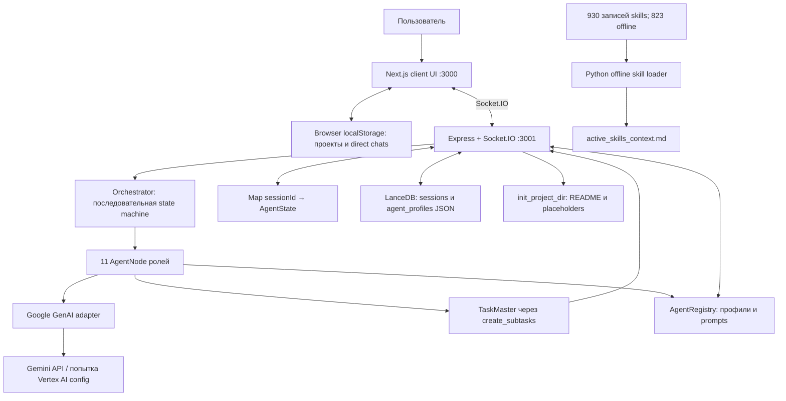
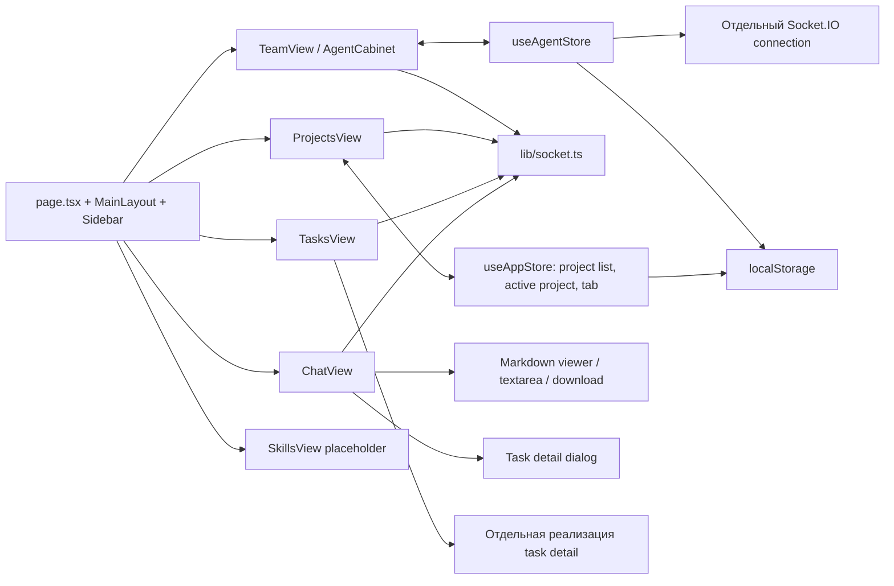
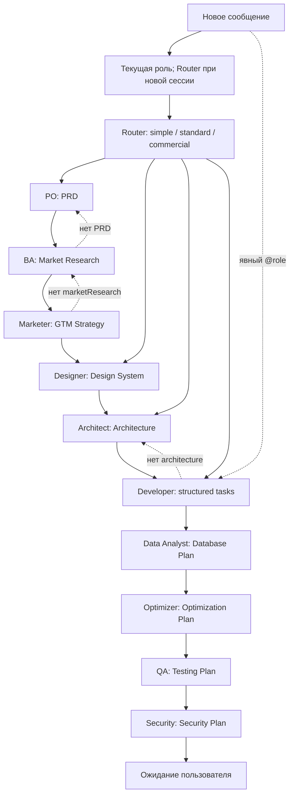
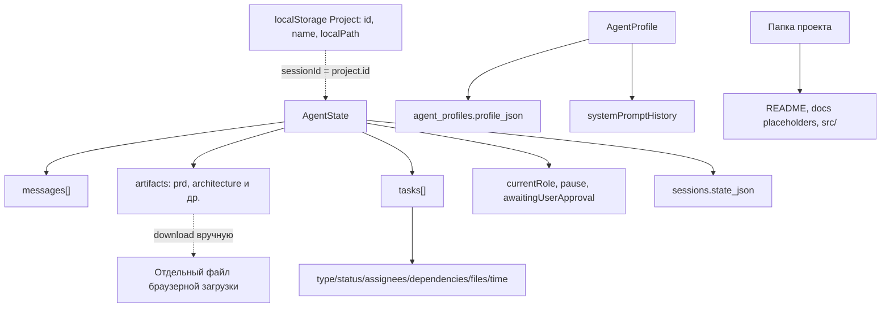
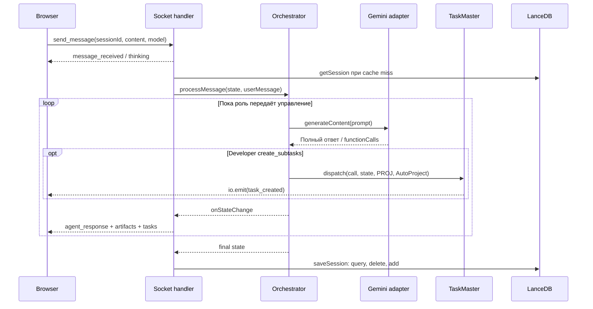
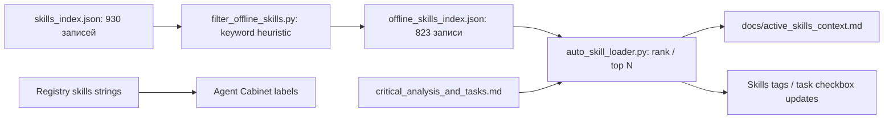
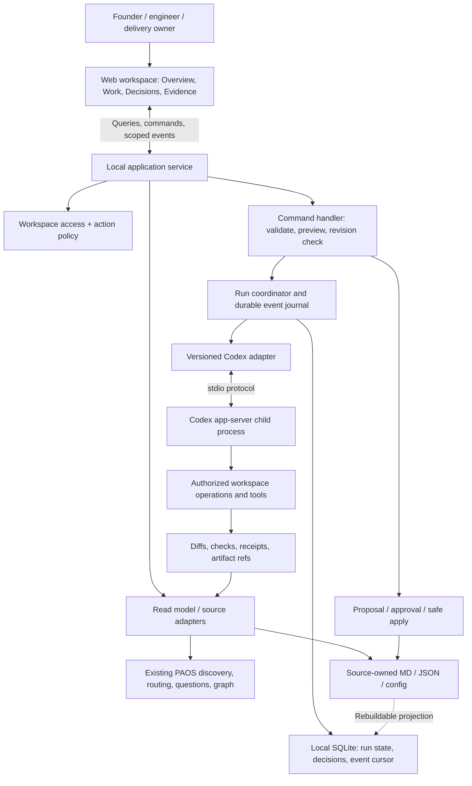
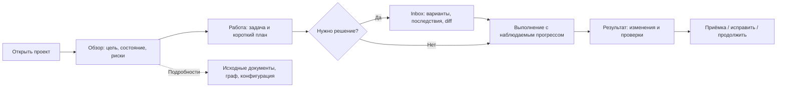

# SOL 0.6: технический, архитектурный и продуктовый анализ

Source status: локальное исследование исходников SOL 0.6 и Product-Agent OS; выводы о runtime ограничены статическим анализом. Дата: 2026-11-05.

Статус: исследовательский проход завершён; файл сохраняет промежуточные контрольные точки и итоговый анализ. `research_complete / runtime_not_verified`. 8 редактируемых Mermaid-диаграмм; 18 технических findings; гипотеза ICP и предлагаемый roadmap.

## Границы и журнал исследования

- Scope: read-only аудит `C:/Users/user/Desktop/project/myAI Labs/SOL 0.6`; запись результатов только в этот исследовательский файл. Реализация web-интерфейса не входит в текущую задачу.
- Evidence: исходники, manifests/lockfiles, проектные планы, существующие проверки и текущие модули Product-Agent OS. Секреты, `.env`, пользовательские чаты и содержимое пользовательских БД не копируются.
- Limits: приложение, серверы и провайдеры не запускаются; готовность и безопасность эксплуатации не подтверждаются. ICP — гипотеза до интервью и пилотов.
- Начальное состояние: в `codex_docs` есть изменения другой задачи; её lifecycle marker и файлы сохраняются без изменений. Исследование не возобновляет PAOS-GAP.
- Контрольная точка 1: найдены отдельные `frontend/`, `backend/`, `docs/`, Python scripts и каталог внешних skills. Далее — проверка фактических связей и отличий от планов.

## Результаты

Контрольная точка 2: прочитаны manifests, backend entrypoint, orchestrator, AI adapter, DB, TaskMaster, dispatcher, основные планы и часть UI. Ниже промежуточные выводы; подробная матрица и диаграммы добавляются после проверки связей.

- Фактический стек: Next.js 16.1.6 / React 19.2.3 / TypeScript / Tailwind 4 / Zustand 5; Express 5 / Socket.IO 4; Google GenAI SDK / Gemini 2.5 Pro и Flash; embedded LanceDB. Это отличается от нескольких вариантов стека, перечисленных в PRD.
- Архитектура: два приложения, один backend-процесс, in-memory sessions, последовательная state machine с 11 зарегистрированными ролями. Это не распределённый swarm и не LangGraph.
- Основная реализованная цепочка генерирует документы и структурированные задачи. Developer декомпозирует архитектуру; исполнитель редактирования кода и запуска тестов в dispatcher отсутствует.
- SkillsView — placeholder. Профильные skills/MCP/integrations в registry сами по себе не подключают инструменты. Python skill loader — отдельная утилита подготовки Markdown-контекста.
- Критичные ограничения переноса: нет авторизации socket-команд; некоторые события broadcast без project/session ID; `init_project_dir` принимает путь и перезаписывает файлы; задачи Developer используют `PROJ`/`AutoProject`; DB save использует delete+add и подавляет ошибки.
- В `sol-ide.json` обнаружен приватный ключ service account; содержимое случайно попало в вывод чтения при проверке предполагаемой конфигурации. Значение не сохраняется в этом отчёте и не используется. Нужны отзыв/ротация у владельца; актуальность ключа не проверялась.
- Предварительная рекомендация: перенести UX-паттерны (проект → задача → артефакт → решение), но опереть новый web-интерфейс на текущие источники и governance Product-Agent OS. Не переносить SOL orchestrator как новое ядро без переработки.

Контрольная точка 3: `node node_modules/typescript/bin/tsc --noEmit --incremental false` выполнен отдельно в frontend и backend: оба exit 0. `node node_modules/eslint/bin/eslint.js src` во frontend: exit 1, 18 errors / 25 warnings. Изолированная Node/vm-проверка фактического TaskMaster с подменённым `io.emit`: после `DEM-1, DEM-2, DEM-3`, удаления `DEM-2` и добавления новой задачи получено `DEM-1, DEM-3, DEM-3`; `unique=false`. Код, БД и приложение SOL не изменялись и не запускались как сервис.

Контрольная точка 4: прочитаны актуальные `status_snapshot.py`, `project_cockpit_model.py`, `codex_runtime_runner/cli.py` и staging-контракты Product-Agent OS; проверена официальная страница Codex App Server. Существующий PAOS contract runner строит routing/evidence packet, но сам по себе не является новым web execution service. Проекция task matrix в status snapshot явно отложена — её придётся проектировать отдельно.

## 1. Главный вывод

**SOL 0.6 полезен как источник пользовательских сценариев и отдельных UI-компонентов для Product-Agent OS. Переносить приложение целиком как новое ядро не рекомендую.**

У SOL уже есть понятная предметная оболочка: проекты, общий чат, документы рядом с обсуждением, задачи, карточки AI-команды. Но фактический результат его основного сценария — комплект сгенерированных документов и backlog. В inspected backend нет executor, который читает/правит код проекта, запускает тесты, проверяет diff и завершает engineering task по evidence. Обещание AI-Native IDE шире реализованного продукта.

Product-Agent OS полезно развить в **локальное рабочее пространство управления AI-разработкой**: пользователь формулирует результат, видит план и состояние, принимает конкретные решения, получает проверяемые изменения. Markdown/JSON остаются переносимыми источниками; интерфейс даёт понятные проекции и управляемые действия поверх них.

Три решения, которые следуют из аудита:

1. Заимствовать из SOL представление проекта и рабочего процесса; использовать существующие PAOS routing, evidence, questions, staging и preservation contracts.
2. Отделить web presentation, локальный backend и execution adapter. Не дублировать Codex собственной обязательной цепочкой из десяти AI-персон.
3. Начать с технически самостоятельного пользователя или маленькой команды. Обещание полностью автономной разработки для нетехнического массового пользователя пока не обеспечено ни SOL, ни доказанным уровнем PAOS.

Уверенность: высокая в структуре кода и обнаруженных статических разрывах; средняя в оценке стоимости переработки; гипотеза в ICP и готовности платить. UI не просмотрен в браузере, поэтому визуальное качество, доступность и адаптивность не оценены как проверенные.

## 2. Объём и метод

Проверены собственные `backend/src`, `frontend/src`, manifests и lockfiles, scripts, PRD, актуальный checklist, отдельный TaskMaster plan, исходные архитектурные схемы, фазовые summaries. Каталог внешних skills проверен на структуру/численность, без аудита каждого навыка. Чатовые транскрипты и пользовательские БД не использовались как доказательство готовности.

Инвентаризация собственных TS/TSX/Python-файлов:

| Область | Файлы | Строки | Наблюдение |
| --- | ---: | ---: | --- |
| `backend/src` | 19 | 2 854 | Entry point 489 строк; registry 381; orchestrator 183 |
| `frontend/src` | 26 | 4 561 | Chat 1 052 строки; Tasks 1 024; Team 621; Projects 311 |
| `scripts` | 2 | 596 | Подготовка offline skills и подбор контекста |

Это размер анализируемого собственного кода, а не всей папки с зависимостями/skills. В корне SOL нет `.git`; история изменений и происхождение snapshot не установлены. Метка `0.6` присутствует в UI/названии папки, тогда как package versions — frontend `0.1.0`, backend `1.0.0`. Это не единый release manifest.

Обозначения ниже: **код** — путь реализован в исходниках; **проверено локально** — выполнена указанная проверка; **частично** — есть существенный разрыв; **план** — намерение в документах; **предложение** — результат этого исследования. Ни одна из этих меток автоматически не означает production readiness.

## 3. Фактический стек

Версии ниже взяты из локальных manifests/lockfiles; не являются рекомендацией использовать эти версии сегодня.

| Слой | Найдено | Роль и ограничение |
| --- | --- | --- |
| Web framework | Next.js `16.1.6`, App Router | Главная страница — client component; вкладки переключаются через Zustand, не через отдельные URL |
| UI runtime | React / React DOM `19.2.3` | Разделы Projects, Chat, Tasks, Team; Skills placeholder |
| Язык | TypeScript; lockfiles `5.9.3` | `strict: true`, но много `any`; типы не валидируют входящие socket payloads |
| Стили | Tailwind CSS `4.2.1` в lockfile; shadcn, Radix UI | Локальные UI primitives, CSS variables; React Compiler включён в Next config |
| UI utilities | Framer Motion `12.34.3` manifest range, Lucide, react-resizable-panels | Анимации, иконки, split pane |
| Markdown | react-markdown `10.1.0`, remark-gfm `4.0.1` manifest ranges | Просмотр документов; это не полноценный редактор связанной структуры проекта |
| State | Zustand `5.0.11` | LocalStorage для проектов и direct chats; обычный project chat хранится backend-side |
| Voice | react-speech-recognition `4.0.1` manifest range | Browser speech recognition, язык ввода в коде `ru-RU`; поддержка/приватность конкретного браузера не проверены |
| Backend | Node.js + Express `5.2.1` | Один процесс; production Node version не закреплена `engines` |
| Realtime | Socket.IO server `4.8.3`, client `^4.8.3` | Локальные адреса 3000/3001; ответы после выполнения узла, не token streaming |
| AI | `@google/genai 1.42.0` | `gemini-2.5-pro`, `gemini-2.5-flash`; 429 retry и Pro→Flash fallback |
| Persistence | `@lancedb/lancedb 0.26.2`, Apache Arrow | `.sol_data`, JSON snapshots сессий/профилей; embeddings/vector search не обнаружены |
| Dev | ts-node-dev, tsc, ESLint 9 | backend dev использует `--transpile-only`; test script — заглушка с exit 1 |
| Offline tooling | Python standard library | Keyword-based подбор skills; независим от web backend |

**Что не подтверждается кодом:** Python/FastAPI backend, LangGraph/AutoGen orchestration, PostgreSQL, Pinecone/Milvus/Qdrant, Docker sandbox, Vercel/AWS deployment и MCP executor. Они фигурируют в идеях/PRD/диаграммах, но не составляют runtime найденного snapshot. Frontend не является установленным Electron/Tauri desktop-приложением.

## 4. Общая архитектура SOL — as-is

Источник: S01–S08, S15. Схема показывает вызовы и хранилища; графическое расположение узлов не означает независимые процессы. FS-стрелка относится к созданию заготовок, а не к исполнению кода агентами. Связь `active_skills_context.md → AgentNode runtime` не нарисована: соответствующее чтение в backend не найдено.

### 4.1. Frontend по модулям

Практическая ценность: пользователь остаётся в контексте проекта, видит результат рядом с диалогом и может открыть задачу из артефактов. Стоимость переноса: логика подписок, локального состояния, формы, domain types и большой JSX смешаны в монолитных компонентах. Task detail продублирован между Chat и Tasks. Два socket instances и привязка direct reply к имени агента усложняют корреляцию; имена Ben у BA/Data Analyst совпадают.

Deep links, browser history и серверная авторитетность списка проектов отсутствуют в найденной схеме. UI удаляет проект из localStorage; отдельный каскад удаления backend session/files не реализован. Это следует учитывать до превращения UI в командный продукт.

### 4.2. Реальная цепочка агентов

Источник S03, S06, S07. Пунктир `@role → Developer` — пример: код допускает любую зарегистрированную роль. В type union есть `context_manager`, но такая реализация не зарегистрирована. Цепочка останавливается также на вопросе, ошибке или pause. Любой новый запрос не обязательно проходит Router: сохраняется `currentRole`; после Security следующий текст снова попадёт Security, если не изменить маршрут.

Это handoff одного общего mutable state, без очереди jobs, DAG scheduler, workers, изоляции агентов и durable checkpoints на каждом шаге. `tier` используется для выбора первого обработчика и логирования; он не является budget/capability policy. Даже simple→Developer при отсутствии architecture уходит к Architect и далее по хвосту цепочки. Полный happy path может включать Router плюс десять специалистов, но стоимость/latency не измерялись.

### 4.3. Данные и владение состоянием

Три самостоятельных места хранения — browser, LanceDB и файлы — не образуют согласованную модель. Таблица `projects` создаётся с демонстрационной записью, но UI project CRUD с ней не связан. Артефакт после редактирования сохраняется в JSON session; обратной синхронизации с `docs/prd.md`/`docs/architecture.md` нет. Список `dependencies` не образует валидируемый граф; поля `parentId`/проверки иерархии и циклов нет. Статус `Done` можно установить через обычный patch без evidence gate.

### 4.4. Один запрос и его побочные эффекты

Следствия: UI видит обновление раньше durable save; ошибка сохранения подавляется; tool result логируется, но `functionResponse` назад модели не отправляется. Данные `model` в запросе не управляют выбором модели в orchestrator. Слово streaming в старом плане относится здесь к последовательным полным ответам ролей, а не к token deltas.

### 4.5. Skills subsystem

Подбор по словам, ограничение количества, dry-run, append и попытка дедупликации — полезные утилитарные идеи. Но offline-классификация по blacklist не доказывает отсутствие сети/побочных эффектов, а список skills в профиле не является runtime capability registry. Обёртка с требованием следовать всем загруженным инструкциям не заменяет проверку доверия и разрешений. В PAOS стоит переносить каталог с provenance и review status, а не массово подключать весь bundle. Найден MIT-текст bundle; права на весь SOL и отдельные вложенные материалы при переносе/публикации требуют отдельной проверки владельцем, это не юридическое заключение.

## 5. Что реализовано и где заканчивается реализация

| Возможность | Фактический статус | Граница |
| --- | --- | --- |
| Projects CRUD, выбор активного проекта | Код | Хранится в браузере, не серверный каталог рабочих пространств |
| Создание папки проекта | Код, риск перезаписи | Создаёт placeholders; не подключает существующий repository |
| Unified Chat, имена/роли, typing | Код | Нет корреляции run/project в ответах; browser acceptance не выполнен |
| Markdown artifacts: просмотр, edit, download | Код | Изменения в session JSON; нет безопасного round-trip в source files |
| PO/BA/GTM/Design/Architecture generation | Код | LLM-генерация без проверки рыночных данных, источников и качества |
| 11 зарегистрированных ролей | Код | Последовательные вызовы одного provider adapter |
| Task generation через function call | Код, частично | Единственный tool `create_subtasks`; проект пока placeholder |
| Kanban, фильтр проекта, task detail, ручной CRUD | Код | Нет подтверждённой иерархии, dependency scheduling и completion gates |
| Project session persistence | Код, частично | JSON snapshot, delete+add, silent failure; восстановление не протестировано |
| Pause | Код, частично | Между узлами; нет отмены текущего provider request; первый run может не находиться в sessions Map |
| Agent Cabinet / редактирование prompt | Код | Без eval/promotion gate; prompt history требует проверки сохранения при DB rehydration |
| Direct Chat | Код, частично | Backend получает один message без истории проекта; всегда Flash |
| Agent metrics | Структура/отображение | Default counters, pipeline обновления не найден |
| MCP / integrations / knowledgeBase | Структуры профиля | Подключения и retrieval не обнаружены |
| Vector memory / RAG | Не реализовано в inspected runtime | Наличие LanceDB не создаёт embeddings/search |
| Skills Marketplace | Placeholder | Offline development tools существуют отдельно |
| QA / Security | Генерация planning artifacts | Не исполнение unit/E2E/SAST и не независимая проверка результата |
| Budget / cost cap / summarizer | План | Нет ledger, threshold enforcement или token accounting |
| Approvals перед опасным действием | План | `awaitingUserApproval` — stop flag, без action binding и policy enforcement |
| Code edits, tests, sandbox, Git, deploy | План / отсутствует executor | Не входят в доступный dispatcher |

**Продуктовая зрелость:** прототип discovery/planning workspace с развитой оболочкой. Проверенная сегодня часть — компилируемость типов и один воспроизведённый дефект TaskMaster; полноценный продуктовый happy path не проверен.

## 6. Технические риски и дефекты

Приоритеты отражают риск при превращении SOL в рабочую основу PAOS; это не утверждение о доступности текущего приложения из интернета. Exploit/production checks не выполнялись.

| ID / приоритет | Наблюдение и основание | Последствие / необходимое изменение |
| --- | --- | --- |
| F01 / критично | `sol-ide.json` содержит private key service account | Отозвать/заменить ключ; исключить credential files из переносимого материала. Действительность не проверять вызовом API |
| F02 / высокий | S02: socket handlers без authentication/ownership; `httpServer.listen(PORT)` без loopback host; `/api/llm/test` вызывает provider через GET | Доступность порта создаёт путь к чтению/изменению сессий, файловым writes и затратам. Нужны bind, local session auth, origin policy, authorization каждого project/action |
| F03 / высокий | S02:350–365 `localPath` от клиента + `writeFileSync`; нет allowed-root, existing-file check и preview | Перезапись README/документов в доступной серверу папке. Нужны resolved-path allowlist, symlink/junction policy, stage→diff→approval→atomic apply |
| F04 / высокий | S02:225 broadcast артефакта без sessionId; S08:116 delete без projectId; S10 listeners без проверки session/run | Обновления могут смешиваться между проектами/вкладками. Нужны server-authorized rooms/каналы, полный event envelope и filtering |
| F05 / высокий | S07:61–62 `PROJ` / `AutoProject`; S11:94 фильтрует реальный activeProjectId | AI-created tasks не проходят live filter; последующая загрузка snapshot может их показать, маскируя разрыв. Передавать реальный workspace/task context |
| F06 / высокий | S04:72–83,115–124: query→delete→add, catch только логирует | Нет transaction/CAS; lost updates и ложное впечатление сохранения. Нужны durable commit, revision, error propagation, explicit acknowledgement |
| F07 / высокий | S03:140–171: один mutable state, нет per-session lock/runId; API сохраняет новый state после цепочки | Параллельные сообщения и edits могут конфликтовать; restart теряет промежуточные результаты. Нужны run queue, checkpoints, idempotency, cancellation semantics |
| F08 / средний | S08:23–26 ID = число оставшихся задач + 1; воспроизведён duplicate `DEM-3` | Ошибочные update/delete по ID. Stable UUID/ULID и отдельный монотонный display number |
| F09 / высокий для delivery | S03 Task без parentId; S08 update принимает произвольный Partial; Done не требует evidence | Нельзя считать доску графом исполнения или доказательством завершения. Нужны schema, transition rules, dependency validation, verification refs |
| F10 / средний | S02:101 pause ищет sessions Map, новый state помещается туда после processMessage; S03 проверяет pause после await | Первый run не гарантированно останавливается; текущий запрос продолжает расход. Abort/interrupt + корректная регистрация run до старта |
| F11 / средний | S05:10 Vertex config object вместо `vertexai: boolean`, project/location вложены внутрь | Несоответствие установленным SDK declarations; `any` скрывает ошибку от tsc. API-key и Vertex пути следует отдельно конфигурировать/проверять |
| F12 / средний | S10:332 отправляет model; S02/S05 не используют выбор UI. Direct Chat всегда Flash | Пользователь видит настройку, которая не управляет runtime. Нужны capability resolution и запись requested/effective model/fallback |
| F13 / средний | S12:174–175 передаёт `dirHandle.name` как localPath | Это имя каталога, не абсолютный путь. Browser picker нельзя напрямую использовать как backend workspace root |
| F14 / средний | S13 ответ direct chat мапится по имени; две роли Ben; error response не имеет agentId | Ответ/typing могут попасть не в тот кабинет или остаться незавершёнными. Нужны agentId, requestId, runId, status в каждом событии |
| F15 / средний | S03/S06: пользовательский initialPrompt и артефакты интерполируются в общий prompt; JSON.parse без строгой schema | Prompt injection, ошибочные роли/структуры, смешение trusted instructions и untrusted content; schema enforcement и явные границы данных |
| F16 / средний | Нет общего лимита шагов/стоимости; цикл останавливает только повтор той же роли, а не разные роли по кругу | Multi-role loop не ограничен; full history многократно передаётся ролям. Нужны max steps/time/cost, scoped context и budget policy |
| F17 / средний | ToolDispatcher проверяет лишь `Array.isArray`; текстовый XML fallback создаёт fakeCall | Ошибочные/недоверенные tasks проходят в state; функция не возвращает functionResponse модели. Нужна единая schema и запрещённые по умолчанию side effects |
| F18 / средний | 18 ESLint errors, 25 warnings; нет configured application test suite | Типы зелёные, но regressions не защищены. Выделить domain/store/transport и проверить межпроектные, persistence, cancellation сценарии |

F11 подтверждён сверкой `backend/node_modules/@google/genai/dist/genai.d.ts`: `vertexai?: boolean`, `project?: string`, `location?: string`. Это статический mismatch, не наблюдение о реальном account setup или работоспособности key-based path.

Для F04 Socket.IO предоставляет server-side rooms и выборочную рассылку; комнаты сами по себе не проверяют право подписки. [Официальная документация Socket.IO Rooms](https://socket.io/docs/v4/rooms/).

Для F13 `FileSystemHandle.name` возвращает имя entry. Сохранение только этого поля теряет смысл выбранного location для backend. [MDN: FileSystemHandle.name](https://developer.mozilla.org/en-US/docs/Web/API/FileSystemHandle/name).

Дополнительные UX gaps: английская обёртка initialPrompt при создании проекта конфликтует с определением языка по первому сообщению; selectedTask closure в Tasks listener может устареть; Chat cleanup не удаляет `session_paused`; UI optimistic save не показывает durable acknowledgement. Их необходимо включить в UI regression checklist, но они не воспроизводились браузером в этом исследовании.

## 7. Что планировалось дальше

Основной более поздний checklist — `docs/critical_analysis_and_tasks.md`: **62 `[x]` и 9 `[ ]`**, но это строки, не уникальные завершённые требования. Task 3.9 продублирован, Task 4.5.8 используется и для done bugfix, и для pending logs. Процент готовности из такого счётчика выводить нельзя.

| План | Оставшееся намерение | Что подтверждает snapshot |
| --- | --- | --- |
| 4.5.8 pending | System logs / tool progress | Нет полноценной timeline операций; есть console logs и thinking UI |
| 4.5.9 | `scan_mcp`, `recommend_mcp` | Нет реализации tools; только profile metadata |
| 5.1 | Skills Marketplace | Placeholder |
| 5.2 | File create/edit в виртуальной среде | Нет filesystem executor в dispatcher |
| 5.3 | Web search для PO/Architect | Нет соответствующего tool/provider integration |
| 5.4 | Approval Gates для дорогих/опасных действий | Stop flag есть; action-level authority отсутствует |
| 6.1 | E2E от создания проекта до закрытия задачи | Автоматизированного E2E suite не найдено |
| 6.2 | Микроанимации | Motion используется; completion criteria пункта не определены |
| 6.3 | API/socket recovery и graceful degradation | Retry 429 и catch есть; reconnect/replay/ack lifecycle не завершён |

Дополнительные будущие направления из PRD/critical analysis/phase summaries: полноценное Desktop IDE, budgets, conflict escalation после N итераций, memory summarization, sandbox/VFS/Docker, навыки выполнения и ссылка на deployed demo. Это планы разных горизонтов, не approved backlog обновлённого PAOS.

Источники расходятся:

- `taskmaster_plan.md` оставляет фазу 4 unchecked, в то время как общий checklist отмечает её сделанной. Код подтверждает CRUD и tool dispatch, но не строгую иерархию и полный functionResponse round-trip.
- Общая архитектурная схема рисует vector memory, Bash/Git, Figma и deploy как действующие связи; в runtime этих связей нет.
- MAS-схема описывает TaskMaster MCP и другие маршруты; фактический TaskMaster — внутренний TypeScript class, цепочка уточнена в разделе 4.2.
- Фазовые summaries утверждают успешное подключение и восстановление; это исторические claims без свежих receipts. Они не заменяют текущий запуск.
- `idea_analysis.md` объявляет Product-Market Fit и массовый спрос, но customer evidence не приложено. Эти заявления исключены из основания ICP.

## 8. Что переносить в Product-Agent OS

| Элемент SOL | Решение | Конкретное применение | Условия |
| --- | --- | --- | --- |
| Project dashboard | Переиспользовать UX и часть presentational components | Portfolio: проект, текущее состояние, blocker, следующее решение | Источник проектов — workspace registry backend, не localStorage |
| Chat + artifacts split pane | Приоритетный перенос паттерна | Обсуждение слева, текущая спецификация/diff/evidence справа | Source path, revision, свежесть, draft/applied status |
| Kanban / Task details | Переиспользовать дизайн; domain переписать | Просмотр scope, owner, dependencies, acceptance, checks | Status projection из owning task source; Done через verification/acceptance policy |
| Human-readable progress | Переиспользовать идею | «Проверяем тесты», «Ждём решения», «Проверка завершилась ошибкой» | Только события runtime; процент — лишь при известном denominator |
| Agent Cabinet | Отложить в advanced mode | Роль, разрешённый scope, последние actions, доступные skills | Effective configuration отдельно от proposed; prompt edits проходят version/eval flow |
| Prompt history | Использовать как UX-референс | Draft→diff→evaluation→promotion, rollback | Не менять active prompt немедленно по Save |
| Skills discovery scripts | Использовать алгоритмические идеи | Каталог с поиском, provenance, совместимостью, permissions | Не переносить keyword blacklist как security boundary |
| `create_subtasks` | Переработать contract | Предложение backlog, которое валидирует PAOS | Stable IDs, hierarchy, dependency checks, source binding |
| LanceDB session storage | Не переносить как основную БД | Возможен отдельный retrieval index позднее | Index должен пересоздаваться; tasks/runs требуют надёжной transactional модели |
| SOL agent prompts / chain | Не переносить как default orchestration | Только отдельные product questions при явной необходимости | PAOS already has role/routing assets; не дублировать authority |
| Direct Chat | Низкий приоритет | Обсуждение ограниченного role scope | Общий task/run context; без bypass approvals |
| Файловые/socket handlers | Перепроектировать | Typed command API и scope-aware event transport | Auth, validation, idempotency, optimistic concurrency, safe write pipeline |
| Voice | Отложить | Дополнительный input mode после core flow | Browser/privacy checks, полноценная text alternative |

Это **не оценка в процентах переиспользования**: компонентные границы и regression tests ещё не выделены. Большие JSX-файлы дают материал для извлечения небольших компонентов, но перенос целиком сохранит coupling и дефекты.

### 8.1. Уже имеющиеся опоры Product-Agent OS

| Текущий source | Что использовать для UI | Что ещё нужно |
| --- | --- | --- |
| `product_agent_os/status_snapshot.py` | lifecycle, questions, readiness/evidence, next_safe_action, approval summary | HTTP query adapter, freshness/version contract |
| `project_cockpit_model.py` | Overview, Project Map, Docs & Sources, Code Intelligence, Contracts, Quality & Metrics, Operations & Risk, Proposal Ledger | Guided first screen; advanced sections по запросу |
| `question_protocol.py`, `question_ledger.py` | Очередь вопросов и решения с источниками | UI inbox, submission validation, decision history |
| `task_routing.py`, `codex_runtime_runner/cli.py` | ordinary/full routing, state provenance, gaps | API DTO; route_ready не превращать в execution succeeded |
| `infrastructure.py`, `merge_infrastructure.py` | dry-run/stage, approval binding, safe merge и rollback | Адаптер только к поддерживаемым операциям; не считать это универсальным editor для всех MD |
| graph modules | Карта проекта и evidence navigation | Index/projection refresh и явные ограничения статического анализа |
| Existing requirements/plans/tests/evals | Источники scope, acceptance и проверки | Сопоставление с UI entities; migrations/parser boundaries |

Особенно важно: `TASK_MATRIX_PROJECTION_DECISION` в `status_snapshot.py` явно содержит `state_projection: not_projected`. Рабочую Kanban-доску нельзя получить простым подключением текущего dashboard JSON. Нужен собственный source-aware task projection adapter с тестами неоднозначности и устаревания.

## 9. Предлагаемая архитектура обновлённого продукта

**Это целевое предложение, не текущая реализация.** Первый deployment model — приложение в локальном браузере и локальный backend. Hosted SaaS, удалённое управление, multi-tenancy и mobile доступ — отдельные стадии.

Браузер не получает ключи, произвольный shell API или возможность задать абсолютный путь на запись. Backend владеет разрешёнными workspace roots и lifecycle команд. При выводе source Markdown запрещаются raw HTML execution, unsafe URLs и раскрытие исключённых файлов. Local-only режим также требует authentication/origin protections: наличие localhost не является полномочием на изменение проекта.

### 9.1. Сравнение вариантов

| Вариант | Преимущества | Цена/риск | Решение |
| --- | --- | --- | --- |
| Улучшить текущий static cockpit | Минимум новых runtime surfaces; быстрый read-only обзор | Нет guided edits и активной работы | Подходит для первого validation slice |
| Local web workspace + PAOS + Codex adapter | Понятный UX, сохраняется governance, можно постепенно добавлять команды | Нужны local service, events, версии и packaging | Рекомендуемое направление |
| Взять SOL целиком и заменить Gemini | Быстрый первый визуальный прототип | Сохраняются state/identity/security defects и дублирование orchestration | Только как выбрасываемый UX prototype, не основной путь |
| Сразу hosted multi-user SaaS | Командная работа и удалённый доступ | Tenant isolation, identity, remote execution, billing, operations | Отложить до доказательства потребности |
| Desktop wrapper сразу | Удобный folder picker, lifecycle локального процесса | Packaging/update/signing и ещё один слой | Решать после локального web pilot |

### 9.2. Стек для первой версии — рекомендация

- **Frontend:** сохранить React/TypeScript, Tailwind и знакомые shadcn/Radix primitives. Если переиспользуется SOL shell, Next.js допустим; SSR не является необходимостью для local app. Решение Next.js vs Vite принять по packaging spike, не ради переписывания работающего UI.
- **Application service:** один локальный TypeScript/Node service — естественная опора для существующего UI/transport и integration adapter. Python PAOS оставить source-owned engine и вызывать через узкий JSON subprocess interface либо изолированный adapter. Не добавлять одновременно второй Python HTTP server без необходимости.
- **Data:** SQLite как предлагаемое хранилище runs, decisions, mappings и event cursor. Canonical source files остаются отдельно; graph/vector indexes — rebuildable. Не хранить всю логику проекта в непрозрачном JSON blob.
- **Transport:** типизированные HTTP commands/queries плюс SSE для одностороннего прогресса; Socket.IO можно сохранить, если выбран и проверен reconnect/replay contract. Transport не должен определять domain architecture.
- **Runtime:** Codex adapter, а не независимый Gemini swarm. Официальный Codex App Server предназначен для rich-client integration, включает history, approvals и agent events. Для локального bridge предпочтителен `stdio`; описанный WebSocket transport помечен experimental/unsupported. Это документационная возможность, доступность/совместимость установленной версии и account не проверялись. [Codex App Server](https://learn.chatgpt.com/docs/app-server).

Для конкретной реализации нужно закрепить версию CLI и сгенерировать matching protocol schema. Server adapter должен использовать узкий allowlist методов и сохранять approvals. Нельзя публиковать весь app-server API как proxy: документация описывает и методы вне sandbox. Локальная аутентификация браузера — отдельная задача от provider account authentication. Запуск/интеграция app-server в этом исследовании не выполнялись.

### 9.3. Владение данными и безопасное редактирование

| Entity | Authority | Проекция/хранение UI |
| --- | --- | --- |
| Workspace | Явно выбранный и разрешённый локальный root | Registry metadata + display name |
| Требования/план/acceptance | Owning source file/section | Parsed projection + hash + source ref |
| Task | Owning task-group JSON или конкретный task matrix по проектному контракту | Indexed fields; при противоречии показывать conflict |
| Run / step | Runtime events + durable receipts | SQLite journal с sequence/cursor |
| Approval / decision | Действие, scope, baseline revision и подтверждение владельца | Immutable audit record; expiry/invalidation |
| Evidence | Команда/результат/source revision/environment | Summary + ref; без секретов/raw private logs |
| Graph | Источники кода/контрактов | Rebuildable index, не source truth |

Запись из UI: прочитать revision → подготовить patch → показать diff и эффект → получить необходимое решение → повторно проверить revision → применить атомарно в разрешённом scope → перечитать → записать receipt. При изменении файла в IDE между preview и apply — conflict и новый preview, без silent overwrite.

Не следует вводить две независимые истины «Markdown для Codex» и «SQL для пользователя». Для каждой сущности должен быть один authority. Гибрид MD/JSON удобен для portability, но требует parser contracts, preservation незнакомых секций, source hashes и явных ошибок. Поздняя миграция к DB-authoritative project model возможна только как отдельное решение с экспортом и rollback.

Event envelope должен включать минимум `workspaceId`, `taskId` при наличии, `runId`, `eventId`, `sequence`, `timestamp`, `schemaVersion`, `sourceRevision`. Command envelope — `commandId`, actor/session, target, expectedRevision и allowlisted action. Повторная доставка command не должна повторять side effect. Approval конкретного plan не означает разрешение deployment или нового scope.

### 9.4. Что пользователь увидит вместо файлов

Предлагаемые основные экраны: **Обзор**, **Работа**, **Решения**, **Результаты и проверки**. Проекты — глобальное переключение; Team/Skills/Architecture/Raw sources — advanced navigation. Основная карточка отвечает: цель; что сейчас происходит; что блокирует; что требуется от меня; что подтверждено.

`REQUIREMENTS.md` отображается как «Что делаем»; `PLAN.md` — «План работы»; `TEST.md`/`EVALS.md` — «Как проверяем»; `RUNLOG.md` — «История результатов». Это человекочитаемые представления, а не механическое переименование файлов. Для обычной маленькой задачи интерфейс не должен навязывать заполнение всего пакета.

Прогресс показывает операции, решения и результаты. `agentThoughts` лучше заменить на `activitySummary`, `decisionRationale`, `evidenceRefs`; приватные внутренние рассуждения не нужны для управления продуктом. QA-pass, owner acceptance и release authorization должны быть различимыми состояниями.

## 10. Предлагаемая последовательность развития

Это гипотеза roadmap для последующего PRD, а не начатая реализация. Оценка сроков и бюджета не дана: нет согласованного scope, packaging решения и pilot evidence.

| Шаг | Результат | Критерий выхода |
| --- | --- | --- |
| A. UX/source-contract spike | 3–5 реальных workspace patterns, mappings MD/JSON→UI; интерактивный сценарий без execution | Пользователь находит состояние, blocker и следующий шаг без ручного поиска MD; conflicts видны |
| B. Read-only local cockpit | Workspace selection, overview, tasks projection, artifacts, evidence, freshness | Два проекта изолированы; restart/reload восстанавливает выбор; source changes отражаются; unsupported formats честно показаны |
| C. Guided work + decisions | Task intake, scope questions, plan preview, bounded proposal editing | Внешнее изменение документа блокирует stale apply; потеря данных отсутствует; approval соответствует действию |
| D. Runtime integration | Один тип engineering task через Codex adapter с событиями и interrupt | Наблюдаемы start/resume/error/interruption; нельзя продолжить без required approval; receipt связан с diff/checks |
| E. Quality and adoption pilot | Повторяемая работа на реальных задачах и интервью | Evidence-based completion, снижение времени ориентации, повторное использование без поддержки автора |
| F. Командные/remote возможности | Общие проекты, роли, доступ, review workflow | Только после подтверждённой потребности и отдельных security/operations gates |

Минимальный первый product slice: **открыть существующий проект → понять его состояние → выбрать следующую задачу → увидеть документы и проверки**. Не включать marketplace, voice, собственный редактор кода, billing и обязательные десять ролей. Это уменьшает неопределённость именно по пользовательской боли, названной в запросе.

Проверки нового UI: duplicate/out-of-order events; session switching во время run; disconnection/replay; double-submit; stale plan; file changed externally; unsupported Markdown; denied path/symlink; approval expiry; provider failure; interrupt/restart; Done без receipts; source fixture с секретом; keyboard/focus/screen reader; два workspace одновременно. Это будущие acceptance cases, а не пройденные тесты.

## 11. ICP обновлённого продукта

### 11.1. Основная гипотеза

**Технический founder, самостоятельный product engineer или AI Engineer, который уже использует AI coding agents для реального проекта и начинает терять управляемость между чатами, задачами, документами и проверками.**

Начальный диапазон для отбора пилотов: один ответственный пользователь или команда примерно 2–10 человек, один или несколько активных репозиториев. Это предложенные screening criteria, не рыночная статистика. Отраслевой фокус — небольшие SaaS, internal tools, automation products и прикладные AI-продукты, где регулярно меняются требования и нужен проверяемый результат.

| Аспект | Гипотеза ICP |
| --- | --- |
| Пользователь | Technical founder, product engineer, AI Engineer, ведущий разработчик |
| Покупатель | Тот же founder либо руководитель маленькой delivery-команды |
| Триггер | После нескольких AI-итераций непонятно, что завершено, где решение, какие проверки актуальны; работа передаётся другому человеку/чату |
| Технический уровень | Может открыть repo, запустить локальный инструмент, понять diff и принять границы доступа; не хочет изучать внутренние MD-конвенции |
| Частота | Повторяющаяся продуктовая разработка; желательно несколько рабочих сессий в неделю для пилота |
| Основной JTBD | «Когда AI работает над проектом, помоги мне направлять работу, видеть доказательства результата и безопасно продолжать после перерыва» |
| Функциональная ценность | Согласованные scope/план/задачи/проверки; меньше потерянного контекста и повторной работы |
| Эмоциональная ценность | Понимание и контроль: не нужно угадывать, что агент сделал и чему можно доверять |
| Командная ценность | Объяснить результат коллегам/заказчику по source/evidence, передать проект без пересказа всей переписки |
| Текущий обходной путь | AI chat + IDE + Markdown + ручная доска задач + повторные status prompts |
| Барьеры покупки | Сложный install, ещё один tool, страх конфликтов с IDE, недоверие к данным, скрытые API costs, vendor lock-in |
| Условие доверия | Local-first, прозрачные источники, reversible writes, честные gaps, совместимость с текущим Codex workflow |

Главные боли: потеря текущего состояния; путаница «сделано» и «проверено»; сложное продолжение работы; документы расходятся с реализацией; лишние уточнения и повторные prompts; трудно понять, что именно нужно решить; сложно передать результат другому человеку.

### 11.2. Сегменты и приоритет

| Сегмент | Fit для первого продукта | Почему / ограничения |
| --- | --- | --- |
| Technical solo founder / product engineer | Высокий, первичный | Прямой owner проблемы, быстро пробует, сам способен принять diff |
| AI-enabled студия/маленькое агентство | Высокий вторичный | Много проектов, важны handoffs и repeatability; появятся demands на доступы и client reporting |
| AI Engineer в продуктовой команде | Средний/высокий | Сильная потребность в eval/evidence; требует integration и policy compatibility |
| PM с доступным техническим reviewer | Вторичный | Guided UI полезен; engineering acceptance должен оставаться у ответственного специалиста |
| Полностью нетехнический основатель без reviewer | Низкий на старте | Хочет работающий/развёрнутый продукт; локальная governance-платформа сама не закрывает acceptance и operations |
| Enterprise regulated delivery | Отложенный | SSO/RBAC/audit/изоляция и support увеличивают scope до доказательства базовой ценности |
| Одноразовый генератор landing page | Низкий | Управление жизненным циклом может стоить больше, чем решаемая задача |

Идеальный первый design partner: уже ведёт реальный repo через Codex, лично испытывал потерю контекста и спорный статус завершения, может дать 2–3 настоящие задачи и возвращаться к ним в течение пилота. География, пол, возраст, образование и выручка не определяют fit на текущих данных.

### 11.3. Позиционирование и границы обещания

Рабочая формулировка: **«Product-Agent OS превращает работу AI над вашим репозиторием в понятные задачи, решения и проверяемые результаты».**

SOL даёт метафору виртуальной команды. PAOS добавляет отличительный слой — источник состояния, управляемые действия, доказательства и продолжение работы. Пользователь покупает меньший риск потеряться и переделывать, а не количество агентов или документов.

Не обещать «замену команды», гарантированный production deploy или доказанный PMF. Не утверждать измеренную экономию времени/денег до пилота. Оплата за одного ответственного пользователя или небольшую команду — возможная гипотеза; цены и willingness-to-pay не установлены. Provider usage должен быть отделён от цены интерфейса и явно показан, когда он доступен runtime.

### 11.4. Как проверить ICP

Предлагаемый, ещё не выполненный research plan:

1. 8–12 problem interviews: primary users, небольшие студии, несколько нетехнических founders для сравнения. Просить показать последний реальный сбой/передачу/возобновление задачи, а не оценивать абстрактный интерес к AI.
2. 5 design partners: открыть свой проект, найти blocker, определить следующее действие, проверить завершённую задачу, вернуться после перерыва. Сначала baseline текущего workflow, затем тот же класс задач с UI.
3. Фиксировать time-to-understanding, completion rate без подсказки, число неверных выводов о готовности, потерянные изменения, необходимость raw MD, частоту возврата и готовность платить после использования.
4. Предлагаемые gates для обсуждения: 4/5 пользователей находят blocker/next step за 3 минуты; ни один не принимает unverified за verified; ноль потерь данных в сценариях conflict/restart; минимум 3/5 самостоятельно возвращаются с новой задачей. Это проектируемые критерии, не результаты и не статистически подтверждённый PMF.

Самая важная неизвестная: пользователю нужен новый самостоятельный workspace или компактная панель поверх привычного Codex/IDE. Её стоит проверить до создания полноценной альтернативы IDE.

## 12. Источники и воспроизводимость

SOL root: `C:/Users/user/Desktop/project/myAI Labs/SOL 0.6`. PAOS root: текущий `codex_docs`. Диапазоны в таблице — ориентиры для inspected snapshot; файл может измениться после исследования.

| ID | Source | Основание |
| --- | --- | --- |
| S01 | `frontend/package.json`, `backend/package.json`, оба `package-lock.json` | Стек, scripts, resolved versions |
| S02 | [backend/src/index.ts](<C:/Users/user/Desktop/project/myAI Labs/SOL 0.6/backend/src/index.ts:29>) | Регистрация, socket API, filesystem, persistence, direct chat |
| S03 | [orchestrator.ts](<C:/Users/user/Desktop/project/myAI Labs/SOL 0.6/backend/src/services/orchestrator.ts:1>) | Domain types, state, control loop |
| S04 | [db.ts](<C:/Users/user/Desktop/project/myAI Labs/SOL 0.6/backend/src/services/db.ts:6>) | LanceDB, JSON snapshots, query/delete/add |
| S05 | [ai.ts](<C:/Users/user/Desktop/project/myAI Labs/SOL 0.6/backend/src/services/ai.ts:5>) | Provider config, model selection, retry/fallback |
| S06 | [router-agent.ts](<C:/Users/user/Desktop/project/myAI Labs/SOL 0.6/backend/src/services/agents/router-agent.ts:9>) и остальные `agents/*.ts` | Реальная routing chain и document generation |
| S07 | [developer-agent.ts](<C:/Users/user/Desktop/project/myAI Labs/SOL 0.6/backend/src/services/agents/developer-agent.ts:57>) | Placeholder identity, decomposition, tools и fallback |
| S08 | [taskMaster.ts](<C:/Users/user/Desktop/project/myAI Labs/SOL 0.6/backend/src/services/taskMaster.ts:23>), `tools/dispatcher.ts`, `createSubtasksTool.ts` | CRUD, IDs, broadcasts, schema |
| S09 | [agent-registry.ts](<C:/Users/user/Desktop/project/myAI Labs/SOL 0.6/backend/src/services/agent-registry.ts:31>) | Profiles, prompts, default capabilities и counters |
| S10 | [chat-view.tsx](<C:/Users/user/Desktop/project/myAI Labs/SOL 0.6/frontend/src/components/views/chat-view.tsx:214>) | Session handlers, artifacts, task details, voice |
| S11 | [tasks-view.tsx](<C:/Users/user/Desktop/project/myAI Labs/SOL 0.6/frontend/src/components/views/tasks-view.tsx:82>) | Kanban filters, updates и dialogs |
| S12 | [projects-view.tsx](<C:/Users/user/Desktop/project/myAI Labs/SOL 0.6/frontend/src/components/views/projects-view.tsx:29>) | Creation, path picker, local metadata |
| S13 | `frontend/src/store/useAppStore.ts`, `useAgentStore.ts`, `lib/socket.ts` | State persistence и connections |
| S14 | `frontend/src/app/page.tsx`, `components/views/team-view.tsx` | Вкладки, placeholder, Cabinet |
| S15 | `scripts/*.py`, `antigravity-awesome-skills-main/*skills_index.json` | Offline catalog и keyword loader |
| S16 | `docs/prd.md`, `idea_analysis.md`, `critical_analysis_and_tasks.md`, `taskmaster_plan.md` | Product vision, status contradictions и roadmap |
| S17 | `docs/architecture_diagram.md`, `mas_architecture_diagram.md`, `docs/Tasks/*summary.md` | Исторические схемы и заявления, сверенные с кодом |
| P01 | [status_snapshot.py](../plugins/product-agent-os/scripts/product_agent_os/status_snapshot.py) | Read-only projection, evidence, task matrix deferral |
| P02 | [project_cockpit_model.py](../plugins/product-agent-os/scripts/product_agent_os/project_cockpit_model.py) | Восемь страниц и ограничения generated views |
| P03 | [cli.py](../plugins/product-agent-os/scripts/codex_runtime_runner/cli.py), [task_routing.py](../plugins/product-agent-os/scripts/product_agent_os/task_routing.py) | Contract runner и task routing |
| P04 | [infrastructure.py](../plugins/product-agent-os/scripts/product_agent_os/infrastructure.py), [merge_infrastructure.py](../plugins/product-agent-os/scripts/product_agent_os/merge_infrastructure.py) | Staging, approval и preservation |
| P05 | [question_protocol.py](../plugins/product-agent-os/scripts/product_agent_os/question_protocol.py), [question_ledger.py](../plugins/product-agent-os/scripts/product_agent_os/question_ledger.py) | Вопросы/решения |
| E01 | [Codex App Server](https://learn.chatgpt.com/docs/app-server) | Официальная документация, прочитана 2026-11-05; integration proposal, не activation proof |
| E02 | [Socket.IO Rooms](https://socket.io/docs/v4/rooms/) | Механизм scoped broadcasting |
| E03 | [MDN FileSystemHandle.name](https://developer.mozilla.org/en-US/docs/Web/API/FileSystemHandle/name) | Семантика directory handle name |

Проверка source text: UTF-8/UTF-8-SIG чтение выбранных исходников и планов; обнаруженные опечатки в планах не трактовались как отдельные требования. Старые `file:///.../Cursor/Projects/...` ссылки из SOL docs не использованы для навигации: соответствующие файлы сопоставлены с текущим root. Отсутствующие runtime capabilities проверялись по импорту, dispatcher и usages в собственном source, а не по наличию слова в dependency bundle.

### Текущие проверки

| Проверка | Результат | Что доказывает |
| --- | --- | --- |
| Backend: `node node_modules/typescript/bin/tsc --noEmit --incremental false` | exit 0 | Типовая компилируемость текущего source с установленными declarations |
| Frontend: та же команда | exit 0 | Типовая компилируемость; не Next production build |
| Frontend: `node node_modules/eslint/bin/eslint.js src` | exit 1; 18 errors, 25 warnings | Линтер не проходит; в том числе `no-explicit-any`, `react-hooks/set-state-in-effect` |
| Node stdin + TypeScript transpileModule + vm, TaskMaster с mock `io.emit` | exit 0; `unique=false` после middle deletion | Воспроизведён defect ID; успешный exit скрипта не означает passing product test |
| Manifests/lockfile/source inventory Python read-only | exit 0 | Версии, размеры, 11 agent modules, 930/823 catalog entries, 62/9 checklist marks |
| PAOS: `python -m unittest tests.product_agent_os.test_product_agent_os_docs -v` | exit 0; 100 tests, 2.955s, OK | Existing documentation contracts проходят; это не функциональная проверка SOL |
| PAOS: `python tools/check_docs.py` | exit 0; documentation structure checks passed | Структура canonical docs; research отдельно проверен ссылками/UTF-8 |
| PAOS: `git diff --check` | exit 0; только CRLF→LF warnings | Tracked diff без whitespace errors; новый untracked report проверен отдельно |
| Inline Python: UTF-8, Markdown fences, local links, whitespace и credential-marker check отчёта | exit 0; 19 local links существуют, 8 Mermaid blocks, нет replacement characters/secret markers/trailing whitespace | Статическая целостность исследовательского артефакта; Mermaid не рендерился |
| Runtime, Gemini/Vertex credentials, server/browser, E2E, deployment | Не запускались | Соответствующие claims остаются unverified |

Inline probe: загрузить только `taskMaster.ts` как текст, transpile в памяти; `require('../index')` заменить на mock `{io.emit}`; вызвать `addTask` трижды, `deleteTask('DEM-2')`, `addTask` ещё раз. Полный backend index не импортировался. Результат: `['DEM-1','DEM-3','DEM-3']`.

Исторический `frontend/build_output.log` не принимался за свежий build. Backend `npm test` не запускался, поскольку manifest явно задаёт заглушку. Ничего не устанавливалось; SOL source, credentials, DB и generated artifacts не изменялись намеренными writes.

Source fingerprint SOL: `6c340c4bba538e7d85601a102503eaa7adf00df8774f16bc2aa8c84380839157`. Покрытие: 56 файлов — все TS в `backend/src`, TS/TSX в `frontend/src`, Python в `scripts`, оба manifests/lockfiles, `prd.md`, `critical_analysis_and_tasks.md`, `taskmaster_plan.md`, две исходные architecture diagram страницы. Алгоритм: SHA-256 от UTF-8 строк `relative/path + space + file SHA-256`, отсортированных по POSIX relative path, соединённых LF без завершающего LF. Секретные файлы и БД исключены. Это fingerprint проверяемого snapshot, не доказательство отсутствия любых изменений за всю историю.

Self-review: сверены as-is и proposed диаграммы, роли с реальными переходами, checklist с source, capability claims с dispatcher, источники и границы проверок. Независимый reviewer не привлекался. Внешний SOL остаётся объектом read-only исследования; только этот report записан данной задачей. Рабочее дерево PAOS изменялось другой работой во время исследования: итоговый `git status` шире начального; эти изменения не редактировались, не откатывались и не присваиваются этому исследованию. Проверки PAOS относятся к состоянию на момент команды, а не к будущим правкам.

### Control-plane sync и дальнейший статус

Исследование — отдельный source-owned artifact, не утверждённая программа разработки. `REQUIREMENTS.md`, `PLAN.md`, `TEST.md`, `EVALS.md`, `prod_test.md`: `not_applicable` для изменения действующих контрактов/очередей — текущая работа не меняет их acceptance или политики. `RUNLOG.md`: `handoff_required` при принятии нового направления, так как текущая запись результатов ограничена этим файлом и уже идёт другая задача. Lifecycle marker другой задачи сохранён.

Реестры источников RU/EN и diagram atlas: `handoff_required` при переносе этих исследовательских выводов в canonical docs/новый approved plan. Сейчас claims и ссылки принадлежат этому исследованию; MkDocs nav, atlas, site и опубликованные guides не меняются. Перенос потребует синхронного обновления registry пары и, при добавлении workflow в atlas, nav/checks. Mermaid source здесь редактируемый; browser rendering не проверялся.

Результат исследования допускает выбор направления и подготовку следующего PRD. Он не разрешает автоматически implementation, SOL fixes, credential rotation, target writes, app-server launch или deployment. Следующее продуктовое решение — подтвердить primary ICP и выбрать первый read-only local workspace slice.
